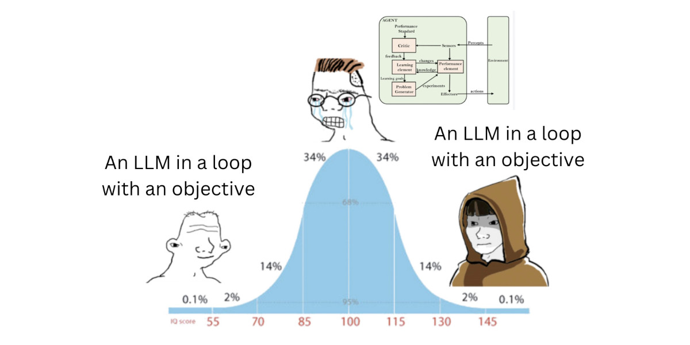
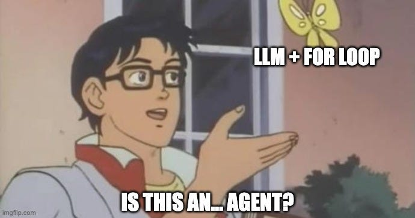
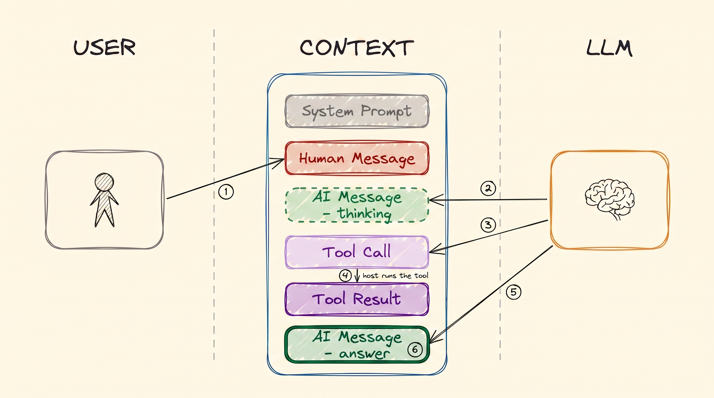
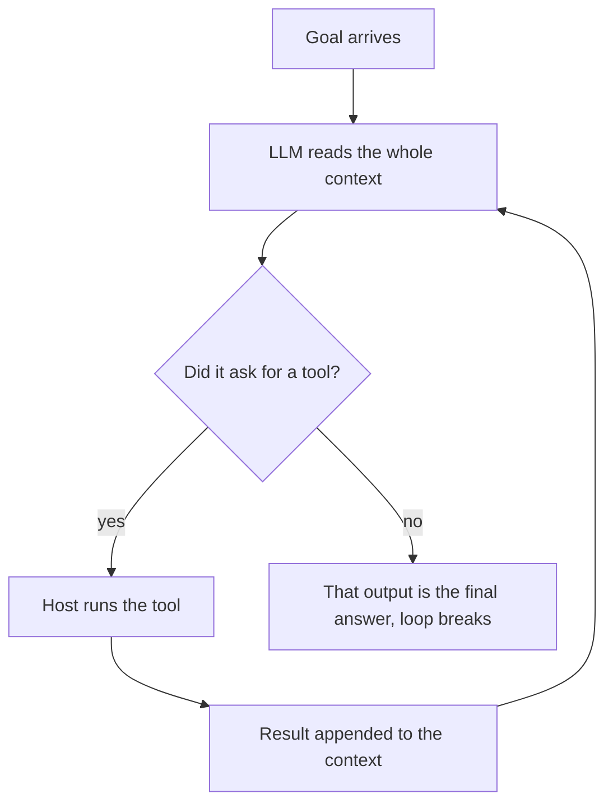
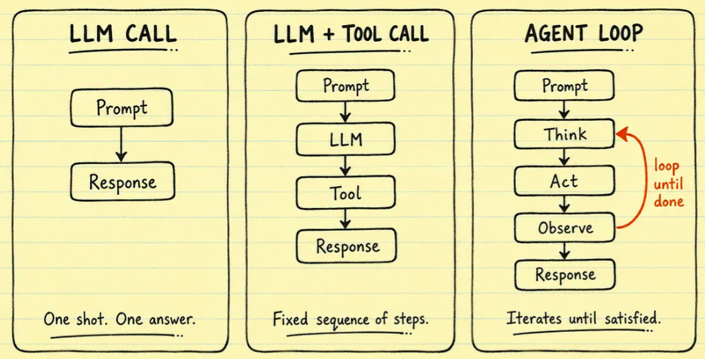
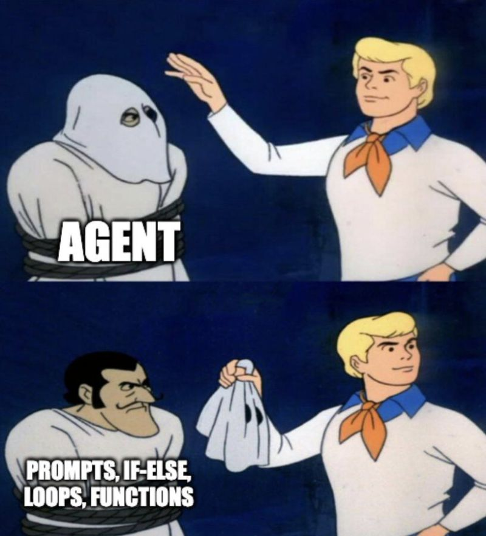
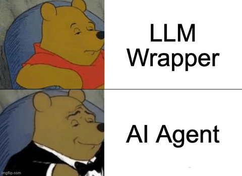
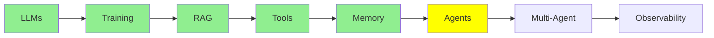

# AI Agents

Everything so far has been building to this. The definition is smaller than you would expect.

> **An AI agent is just a loop in which an LLM calls tools until it reaches its goal. When the LLM
> calls no tools, it generates a final answer, and the loop breaks.**

That is the whole thing. Read it twice. Most of the confusion about agents comes from expecting
something bigger.

  
*Both ends of the curve arrive at the same answer. The people in the middle go looking for an architecture instead.*

## Single Turn, and Multi Turn

Here is the difference that matters.

A **plain LLM is single-turn.** You give it input, and it gives you output. Done. That is what
[LLM Fundamentals](llms.md) covered. It is all a model does.

An **agent is multi-turn.** You call the same model again and again. Each time, it can ask for a
tool. It keeps going until it has what it needs. It writes a final answer only after that.

It is the same model in both cases. Nothing was added to it. The whole difference is in how many
times you call it, and in what you send it each time.

  
*Yes. That really is the definition. The joke is that people expect it to be more.*

## One Pass Through the Loop

[Tool Calling](tools.md) showed a single tool call. An agent turn is exactly that, repeated:

  
*One pass: you ask, and the model thinks. The model asks for a tool. The host runs the tool and writes the result back. Then the model answers. On the next pass, the whole message stack goes to the model again, and it is now two messages longer.*



**Look at what ends it.** There is no counter. There is no supervisor that decides the agent is
finished. The loop breaks because the model stopped asking for tools. The absence of a tool call
*is* the termination condition. The text that the model wrote instead of a tool call is the answer.

### How Much of the Deciding You Hand Over

"Agent" is not a yes-or-no thing. The real question is how much of the deciding you hand over to
the model.

At one end is a plain LLM call. You decide everything, and the model only writes text. In the
middle are **fixed workflows**, which people sometimes call state machines. In a fixed workflow,
*you* wrote the steps and their order, and the model only fills in each step. At the other end is a
real agent. There, the model chooses the steps, the tools, and when to stop.

  
*The same model sits in all three panels. Two things change: how many times it is called, and who picks the next step. You pick it in the first two panels. The model itself picks it in the third.*

Most production systems are not at the far end, and that is usually the right choice. Less
autonomy means fewer ways for things to go wrong. LangChain's
[what is an agent](https://www.langchain.com/blog/what-is-an-agent) explains that spectrum well.
It is worth reading before you decide how much freedom to give the model.

## Where Does the Agent Loop Run?

It is worth being precise about this part. This is where people imagine that the model does
things it cannot do.

None of the loop happens inside the LLM. **All of it happens on the host machine**, which means
your laptop or your server:

- running the loop, and deciding when it has ended
- keeping the message stack that is the agent's [memory](memory.md)
- building the system prompt before every call
- running the tools, because they are your Python functions ([Tool Calling](tools.md))
- sending the whole context, which is now longer, back to the model for the next pass

  
*Under the costume: prompts, if-else, loops and functions. There is nothing else in there.*

That list is why agents use a **framework**. The concept is not hard. The problem is that doing all
of it by hand means a lot of boilerplate code:

- parsing tool calls out of a response
- matching results to call ids
- growing and trimming the message stack
- rebuilding the prompt
- deciding when to stop

[smolagents](https://github.com/huggingface/smolagents) and
[LangChain](https://github.com/langchain-ai/langchain) exist to write that code once.

**And now think back to [LLM Fundamentals](llms.md)**. There, we ran an LLM straight from the
terminal with no framework at all. Why did we not need a framework there? Because that was one
call. You sent one input, you got one output back, and then it was finished. There was no loop, no
tool parsing, and no message stack to maintain. A single-turn LLM needs no scaffolding, which means
no extra code around the model. An agent is almost entirely scaffolding.

This brings the series to its main point. **The LLM really is just a brain. Text goes in and text
comes out, and the LLM stores nothing and does nothing else.** Every capability we have covered is an environment built
around that brain, so that it can:

- work across turns (this module)
- reach outside itself ([Tool Calling](tools.md))
- remember ([Memory](memory.md))
- read data it was never trained on ([RAG & Embeddings](rag.md))

We were not oversimplifying in [LLM Fundamentals](llms.md). The model is that simple. Everything
else is engineering around it.

An older way to describe the same loop is **observe, decide, act**. The model observes the context
and decides on an action. The host acts. The result becomes part of the next observation. It is the
same mechanism, with older vocabulary.

## How the LLM Knows Which Tools it Has

Underneath, an agent is still just an LLM that you call again and again. So how does it know which
tools it is allowed to call?

The answer is the **system prompt**. The host rebuilds it and sends it before every call in the
loop. It carries the agent's role and the list of available tools, with their names and
descriptions. It also says how to format a tool call, so that the host can parse it.

You do not write that list by hand. As [Tool Calling](tools.md) covered, the `@tool` decorator does
it. The framework reads your function's name, docstring and type hints. Then it puts the schema into
what the model sees. That is why that code was so short. The decorator does more than register the
function. It is how the framework tells the model that the function exists.

## An Example

"Fix the bug in my code" is not one question. So the loop runs several times:

| Pass | What the agent does | Why the LLM is called |
|---|---|---|
| 0 | Goal arrives | not yet |
| 1 | Read the relevant files (`read_file`) | to decide which files to open |
| 2 | Write a failing test | to generate code |
| 3 | Write the fix | to generate code |
| 4 | Run the tests (`run_shell`) | to decide the command |
| 5 | Report that the tests pass | to write the answer. It calls no tool, so the loop ends |

So this one goal took six passes and five model calls. A plain LLM would get only one call for all of that. That is
why it would guess.

## Building an Agent

```python
from smolagents import CodeAgent, tool, InferenceClientModel

@tool
def read_file(filename: str) -> str:
    """Read a file and return its contents."""
    with open(filename, 'r') as f:
        return f.read()

agent = CodeAgent(tools=[read_file], model=InferenceClientModel())
result = agent.run("Read main.py and summarise it")
```

That is a complete agent. Notice what is *not* there:

- no loop
- no tool-call parsing
- no message stack
- no system prompt

`CodeAgent` does all of it, and `agent.run` is the loop.

Other frameworks solve the same problem in different ways:
[LangChain](https://github.com/langchain-ai/langchain),
[crewAI](https://github.com/crewAIInc/crewAI) and [AutoGen](https://github.com/microsoft/autogen).
[Agent Frameworks](../4_ecosystem/agent_frameworks.md) compares them.

  
*The LLM is the brain, the agent is the body around it, and the tools are its hands.*

## Where this fits in the series



## Summary

An agent is a loop in which an LLM calls tools until it reaches its goal. The loop ends when the
model stops calling tools and writes an answer instead.

The model is unchanged. These parts all run on your machine:

- the loop
- the memory
- the system prompt
- the tool execution

Handling them is what a framework is for. That is also why a single-turn LLM needed no framework back
in [LLM Fundamentals](llms.md).

Next: what happens when one agent becomes several.

**Quick Check**: what ends the agent loop, and which parts of an agent run outside the model?

## References

- [LLM agents](https://www.promptingguide.ai/research/llm-agents): a fuller survey of the same idea
- [Agent components](https://www.promptingguide.ai/agents/components): the parts of an agent, one by one
- [What is an agent?](https://www.langchain.com/blog/what-is-an-agent): places agents, workflows and state machines on one autonomy spectrum
- [smolagents](https://github.com/huggingface/smolagents): the framework used above
- [Tool Calling](tools.md): where the tool schema comes from
- [Memory](memory.md): the message stack that the loop keeps growing
