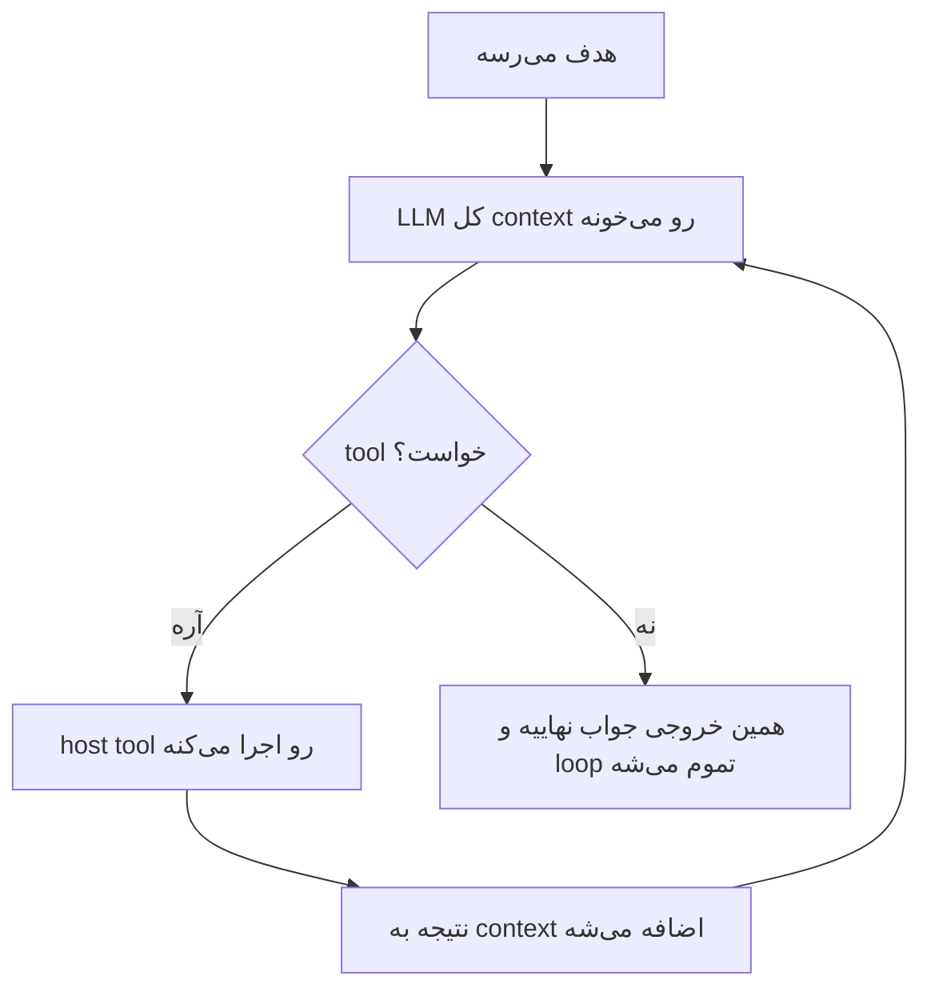
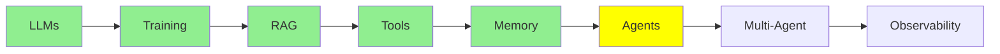

# AI Agents

هر چیزی که تا این‌جا دیدیم، مقدمه‌ی همین درس بود. تعریف agent هم از اون چیزی که فکرش رو می‌کنی خیلی جمع‌وجورتره.

> **AI agent فقط یه loop‌ه که توش یه LLM اون‌قدر tool صدا می‌زنه تا به هدفش برسه.**
> **هر وقت LLM دیگه هیچ tool‌ای صدا نزد، یه جواب نهایی می‌نویسه و loop تموم می‌شه.**

همه‌ش همینه. یه بار دیگه بخونش؛ بیشتر سردرگمی‌ها درباره‌ی agent‌ها از این‌جا میاد که آدم انتظار یه چیز گنده‌تر رو داره.

  
*دو سر منحنی به یه جواب می‌رسن؛ ولی اونایی که وسط منحنی‌ان، به‌جاش دنبال یه معماری می‌گردن.*

## تفاوت single-turn و multi-turn

فرق اصلی این‌جاست.

**یه LLM معمولی single-turn‌ه:** ورودی رو بهش می‌دی، خروجی رو تحویلت می‌ده و تمام. همون چیزی که توی [مبانی LLM](llms_fa.md) دیدیم، و کل کاری که یه مدل بلده همینه.

**ولی agent، multi-turn‌ه:** همون مدل رو بارها و بارها صدا می‌زنی و هر بار ممکنه یه tool بخواد، و این‌قدر ادامه می‌ده تا هر چی لازم داره دستش بیاد؛ تازه بعد از اون جواب نهایی رو می‌نویسه.

توی هر دو حالت مدل همونه و هیچ چیزی بهش اضافه نشده؛ همه‌ی فرق توی اینه که چند بار صداش می‌زنی و هر بار چی براش می‌فرستی.

  
*آره، تعریفش واقعاً همینه. شوخیش هم همین‌جاست که آدم‌ها انتظار دارن یه چیز بیشتر باشه.*

## یه دور از loop

توی [Tool Calling](tools_fa.md) یه tool call تکی رو دیدیم. یه نوبت agent دقیقاً همونه، فقط چند بار پشت هم:

  
*یه دور: تو می‌پرسی و مدل فکر می‌کنه، بعد یه tool درخواست می‌ده. host اون tool رو اجرا می‌کنه و نتیجه رو برمی‌گردونه، و بعد مدل جواب می‌ده. توی دور بعد، کل message stack دوباره برای مدل فرستاده می‌شه، که حالا دو تا پیام بلندتر شده.*



**ببین چی loop رو تموم می‌کنه.** نه counter‌ای در کاره، نه supervisor‌ای که تشخیص بده کار agent تموم شده؛ loop فقط به این خاطر تموم می‌شه که مدل دیگه tool نخواسته. یعنی شرط پایان، *نبودن* tool call‌ه، و متنی که مدل به‌جای tool call نوشته، همون جوابه.

### چقدر از تصمیم‌گیری رو می‌سپاری به مدل

agent بودن صفر و یکی نیست؛ سوال اصلی اینه که چقدر از تصمیم‌گیری رو می‌سپاری دست مدل.

یه سر این طیف، صدا زدن ساده‌ی LLM‌ه: همه‌ی تصمیم‌ها با توئه و مدل فقط متن می‌نویسه. وسط طیف **fixed workflow‌ها** هستن که گاهی بهشون state machine هم می‌گن؛ توی یه fixed workflow، مرحله‌ها و ترتیبشون رو *تو* نوشتی و مدل فقط هر مرحله رو پر می‌کنه. سر دیگه‌ی طیف یه agent واقعیه که خود مدل مرحله‌ها، tool‌ها و زمان تموم کردن رو انتخاب می‌کنه.

  
*توی هر سه پنل همون مدل نشسته و فقط دو چیز فرق می‌کنه: این‌که چند بار صدا زده می‌شه، و این‌که قدم بعدی رو کی انتخاب می‌کنه. توی دو پنل اول تو انتخاب می‌کنی و توی سومی خود مدل.*

بیشتر سیستم‌هایی که توی production هستن اون سر طیف نیستن، و معمولاً هم کار درستی می‌کنن، چون هرچی اختیار مدل کمتر باشه، راه‌های کمتری برای خراب شدن کار هست. مطلب [what is an agent](https://www.langchain.com/blog/what-is-an-agent) از LangChain این طیف رو خوب توضیح داده و قبل از این‌که تصمیم بگیری چقدر به مدل آزادی بدی، ارزش خوندن داره.

## loop یه agent کجا اجرا می‌شه؟

این قسمت رو باید دقیق بفهمی، چون دقیقاً همین‌جاست که خیلی‌ها خیال می‌کنن مدل کارهایی می‌کنه که از دستش برنمیاد.

هیچ تیکه‌ای از loop داخل LLM اجرا نمی‌شه؛ **همه‌ش روی host machine اجرا می‌شه**، یعنی لپ‌تاپ یا سرور خودت:

- اجرای loop و تشخیص این‌که کی تموم شده
- نگه داشتن message stack، یعنی همون حافظه‌ی agent ([memory](memory_fa.md))
- ساختن system prompt قبل از هر call
- اجرای tool‌ها، چون tool‌ها همون تابع‌های Python خودتن ([Tool Calling](tools_fa.md))
- فرستادن دوباره‌ی کل context، که حالا بلندتر شده، به مدل برای دور بعد

  
*زیر این لباس فقط prompt، if-else، loop و تابع هست و دیگه هیچی.*

به خاطر همین فهرسته که agent‌ها از یه **framework** استفاده می‌کنن. مفهومش سخت نیست؛ مشکل اینه که انجام دادن همه‌ی این‌ها با دست، یعنی کلی کد boilerplate:

- parse کردن tool call‌ها از توی جواب مدل
- جفت کردن نتیجه‌ها با call id‌ها
- بزرگ کردن و کوتاه کردن message stack
- ساختن دوباره‌ی prompt
- تصمیم گرفتن درباره‌ی این‌که کی باید تموم کرد

[smolagents](https://github.com/huggingface/smolagents) و [LangChain](https://github.com/langchain-ai/langchain) اومدن که این کد رو یه بار برای همیشه بنویسن.

**حالا برگرد به [مبانی LLM](llms_fa.md).** اون‌جا یه LLM رو مستقیم از terminal و بدون هیچ framework‌ای اجرا کردیم. چرا اون‌جا framework لازم نداشتیم؟ چون فقط یه call بود: یه ورودی فرستادی، یه خروجی گرفتی و کار همون‌جا تموم شد. نه loop‌ی بود، نه tool call‌ی که parse بشه، نه message stack‌ای که نگهش داریم. یه LLM single-turn به هیچ scaffolding‌ای، یعنی کد اضافه‌ای که دور مدل نوشته می‌شه، احتیاج نداره، ولی agent تقریباً سر تا پاش همین scaffolding‌ه.

این ما رو می‌رسونه به حرف اصلی کل این مجموعه: **LLM واقعاً فقط یه مغزه؛ متن می‌گیره، متن پس می‌ده، هیچی ذخیره نمی‌کنه و هیچ کار دیگه‌ای هم نمی‌کنه.** هر قابلیتی که تا الان دیدیم، محیطیه که دور همین مغز ساخته شده تا بتونه:

- توی چند نوبت کار کنه (همین درس)
- دستش به بیرون از خودش برسه ([Tool Calling](tools_fa.md))
- چیزی رو یادش بمونه ([Memory](memory_fa.md))
- داده‌هایی رو بخونه که هیچ‌وقت روشون train نشده ([RAG و Embedding‌ها](rag_fa.md))

توی [مبانی LLM](llms_fa.md) قضیه رو ساده‌تر از اون چیزی که هست نشون ندادیم؛ مدل واقعاً همون‌قدر ساده‌ست و بقیه‌ش مهندسیه که دورش انجام شده.

یه اسم قدیمی‌تر هم برای همین loop هست: **observe, decide, act**، یعنی ببین، تصمیم بگیر، عمل کن. مدل context رو می‌بینه و تصمیم می‌گیره چه کاری انجام بشه، host اون کار رو انجام می‌ده، و نتیجه‌ش می‌شه بخشی از چیزی که مدل دفعه‌ی بعد می‌بینه. همون سازوکاره، فقط با اسم‌های قدیمی‌تر.

## LLM از کجا می‌دونه چه tool‌هایی در اختیارشه؟

agent در اصل هنوز همون LLM‌ه که بارها و بارها صداش می‌زنی. پس از کجا می‌فهمه اجازه داره کدوم tool‌ها رو صدا بزنه؟

از **system prompt**. host قبل از هر call توی loop از نو می‌سازدش و می‌فرسته. نقش agent و فهرست tool‌های در دسترس، با اسم و توضیح هر کدوم، توی همین system prompt‌ه، و این‌که tool call باید چه فرمتی داشته باشه تا host بتونه parse‌ش کنه هم همون‌جا گفته شده.

این فهرست رو هم دستی نمی‌نویسی؛ همون‌طور که توی [Tool Calling](tools_fa.md) دیدیم، این کار رو decorator `@tool` انجام می‌ده. framework اسم تابع، docstring و type hint‌هاش رو می‌خونه و schema رو می‌ذاره توی چیزی که مدل می‌بینه. واسه همین بود که اون کد این‌قدر کوتاه بود: decorator فقط تابع رو register نمی‌کنه، بلکه راهیه که framework باهاش به مدل خبر می‌ده همچین تابعی وجود داره.

## یه مثال

«باگ کدم رو درست کن» یه سوال تک نیست، واسه همین loop چند دور می‌چرخه:

| دور | agent چی کار می‌کنه | LLM برای چی صدا زده می‌شه |
|---|---|---|
| 0 | هدف می‌رسه | هنوز صدا زده نشده |
| 1 | فایل‌های مربوط رو می‌خونه (`read_file`) | تا تصمیم بگیره کدوم فایل‌ها رو باز کنه |
| 2 | یه تست می‌نویسه که فعلاً fail می‌شه | تا کد بنویسه |
| 3 | کد اصلاحی رو می‌نویسه | تا کد بنویسه |
| 4 | تست‌ها رو اجرا می‌کنه (`run_shell`) | تا دستور اجرا رو انتخاب کنه |
| 5 | گزارش می‌ده که تست‌ها پاس شدن | تا جواب رو بنویسه؛ هیچ tool‌ای صدا نمی‌زنه، پس loop تموم می‌شه |

یعنی برای همین یه هدف، loop شش دور چرخید و مدل پنج بار صدا زده شد. یه LLM معمولی برای همه‌ی این کارها فقط یه call داشت، و واسه همین مجبور بود حدس بزنه.

## ساختن یه agent

```python
from smolagents import CodeAgent, tool, InferenceClientModel

@tool
def read_file(filename: str) -> str:
    """Read a file and return its contents."""
    with open(filename, 'r') as f:
        return f.read()

agent = CodeAgent(tools=[read_file], model=InferenceClientModel())
result = agent.run("Read main.py and summarise it")
```

این یه agent کامله. دقت کن چی *توش نیست*:

- خبری از loop نیست
- خبری از parse کردن tool call نیست
- خبری از message stack نیست
- خبری از system prompt نیست

همه‌ی این کارها رو `CodeAgent` انجام می‌ده و loop همون `agent.run` هست.

framework‌های دیگه هم همین مشکل رو هر کدوم به یه روش حل می‌کنن: [LangChain](https://github.com/langchain-ai/langchain)، [crewAI](https://github.com/crewAIInc/crewAI) و [AutoGen](https://github.com/microsoft/autogen). توی [Agent Framework‌ها](../4_ecosystem/agent_frameworks_fa.md) این‌ها رو کنار هم مقایسه کردیم.

  
*LLM مغزه، agent بدنیه که دورش ساخته شده، و tool‌ها دست‌هاش.*

## کجای این مجموعه هستیم



## خلاصه

agent یه loop‌ه که توش LLM اون‌قدر tool صدا می‌زنه تا به هدفش برسه، و loop وقتی تموم می‌شه که مدل دیگه tool صدا نزنه و به‌جاش جواب بنویسه.

خود مدل هیچ تغییری نمی‌کنه و همه‌ی این بخش‌ها روی ماشین خودت اجرا می‌شن:

- خود loop
- memory
- system prompt
- اجرای tool‌ها

framework برای همینه که این‌ها رو مدیریت کنه، و به همین دلیل هم بود که LLM single-turn توی [مبانی LLM](llms_fa.md) به framework احتیاج نداشت.

بعدی: وقتی به‌جای یه agent چند تا agent داشته باشیم، چی می‌شه.

**بررسی سریع**: loop یه agent رو چی تموم می‌کنه، و کدوم بخش‌های agent بیرون از مدل اجرا می‌شن؟

## منابع

- [LLM agents](https://www.promptingguide.ai/research/llm-agents): مرور کامل‌تری از همین ایده
- [Agent components](https://www.promptingguide.ai/agents/components): اجزای یه agent، یکی‌یکی
- [What is an agent?](https://www.langchain.com/blog/what-is-an-agent): agent، workflow و state machine رو روی یه طیف خودمختاری کنار هم نشون می‌ده
- [smolagents](https://github.com/huggingface/smolagents): framework‌ای که بالا ازش استفاده کردیم
- [Tool Calling](tools_fa.md): این‌که tool schema از کجا میاد
- [Memory](memory_fa.md): message stack‌ای که loop مدام بزرگ‌ترش می‌کنه
