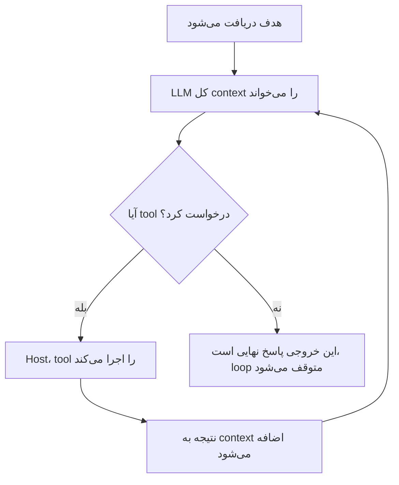
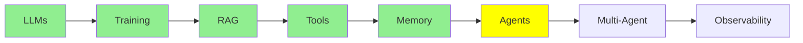

# AI Agents

همه‌چیزی که تا اینجا گفتیم به این موضوع ختم می‌شود. تعریف آن کوچک‌تر از چیزی است که فکر می‌کنید.

> **یک AI agent فقط یک loop است که در آن یک LLM تا رسیدن به هدفش tool‌ها را صدا می‌زند. وقتی LLM هیچ tool‌ای صدا نمی‌زند،
> یک پاسخ نهایی تولید می‌کند و loop متوقف می‌شود.**

همین کل ماجراست. آن را دو بار بخوانید. بیشتر سردرگمی‌ها درباره‌ی agent‌ها از این می‌آید که انتظار چیزی بزرگ‌تر را دارید.

  
*هر دو سر این منحنی به یک پاسخ می‌رسند. کسانی که وسط منحنی‌اند، به‌جایش دنبال یک architecture می‌گردند.*

## Single Turn و Multi Turn

این تفاوتی است که اهمیت دارد.

یک **LLM ساده single-turn است.** شما به آن input می‌دهید و آن output می‌دهد. تمام. این همان کاری است که [مبانی LLM](llms_fa.md) پوشش داد. یک مدل فقط همین کار را می‌کند.

یک **agent چندمرحله‌ای (multi-turn) است.** شما همان مدل را بارها و بارها صدا می‌زنید. هر بار، مدل می‌تواند یک tool بخواهد. تا وقتی آنچه لازم دارد را به دست نیاورده، ادامه می‌دهد. فقط بعد از آن یک پاسخ نهایی می‌نویسد.

در هر دو حالت مدل یکسان است. چیزی به آن اضافه نشده است. کل تفاوت در این است که شما چند بار آن را صدا می‌زنید، و هر بار چه چیزی برایش می‌فرستید.

  
*بله. تعریف واقعاً همین است. شوخی این است که مردم انتظار دارند بیشتر از این باشد.*

## یک pass در loop

[Tool Calling](tools_fa.md) یک tool call تکی را نشان داد. یک نوبت agent دقیقاً همان است، که تکرار می‌شود:

  
*یک pass: شما سؤال می‌پرسید و مدل فکر می‌کند. مدل یک tool می‌خواهد. host آن tool را اجرا می‌کند و نتیجه را دوباره در message stack می‌نویسد. بعد مدل پاسخ می‌دهد. در pass بعدی، کل message stack دوباره به مدل فرستاده می‌شود، و حالا دو message بلندتر شده است.*



**به چیزی که آن را تمام می‌کند نگاه کنید.** هیچ counter وجود ندارد. هیچ supervisor‌ای نیست که تصمیم بگیرد agent کارش تمام شده است. loop متوقف می‌شود چون مدل دیگر tool نمی‌خواهد. نبودن یک tool call *همان* شرط پایان است. متنی که مدل به‌جای tool call نوشته، همان پاسخ است.

### چقدر از تصمیم‌گیری را به مدل واگذار می‌کنید

«Agent» فقط بله یا خیر نیست. سؤال واقعی این است که چقدر از تصمیم‌گیری را به مدل واگذار می‌کنید.

در یک سر این طیف، یک فراخوانی ساده‌ی LLM است. شما همه‌چیز را تصمیم می‌گیرید و مدل فقط متن می‌نویسد. در میانه، **workflow‌های ثابت** هستند که گاهی آن‌ها را state machine می‌نامند. در یک workflow ثابت، *شما* مراحل و ترتیب آن‌ها را نوشته‌اید و مدل فقط هر مرحله را پر می‌کند. در سر دیگر، یک agent واقعی است. آنجا مدل مراحل، tool‌ها و زمان توقف را انتخاب می‌کند.

  
*همان مدل در هر سه پنل حضور دارد. دو چیز تغییر می‌کند: اینکه مدل چند بار صدا زده می‌شود، و اینکه قدم بعدی را چه کسی انتخاب می‌کند. در دو پنل اول، شما قدم بعدی را انتخاب می‌کنید. در پنل سوم، خود مدل آن را انتخاب می‌کند.*

بیشتر سیستم‌های production در سر دور این طیف نیستند، و معمولاً همین انتخاب درست است. خودمختاری کمتر یعنی راه‌های کمتری برای خراب شدن کارها. [what is an agent](https://www.langchain.com/blog/what-is-an-agent) از LangChain آن طیف را خوب توضیح می‌دهد. پیش از آنکه تصمیم بگیرید چقدر آزادی به مدل بدهید، ارزش دارد آن را بخوانید.

## Agent loop کجا اجرا می‌شود؟

ارزش دارد در این بخش دقیق باشیم. اینجاست که مردم تصور می‌کنند مدل کارهایی انجام می‌دهد که توانایی‌اش را ندارد.

هیچ‌کدام از loop داخل LLM اتفاق نمی‌افتد. **همه‌ی آن روی host machine اتفاق می‌افتد**، یعنی لپ‌تاپ یا سرور شما:

- اجرای loop، و تصمیم‌گیری درباره‌ی زمان پایان آن
- نگه داشتن message stack، که همان [Memory](memory_fa.md) agent است
- ساختن system prompt قبل از هر فراخوانی
- اجرای tool‌ها، چون آن‌ها تابع‌های Python شما هستند ([Tool Calling](tools_fa.md))
- فرستادن کل context، که حالا بلندتر شده، دوباره به مدل برای pass بعدی

  
*زیر این لباس: prompt، if-else، loop و تابع. چیز دیگری در آن نیست.*

همین فهرست دلیل آن است که agent‌ها از یک **framework** استفاده می‌کنند. مفهوم سختی نیست. مشکل این است که انجام همه‌ی این کارها با دست، یعنی حجم زیادی **boilerplate code**:

- parse کردن tool call‌ها از یک پاسخ
- تطبیق نتیجه‌ها با call id‌ها
- افزودن و کوتاه کردن message stack
- ساختن دوباره‌ی prompt
- تصمیم گرفتن درباره‌ی زمان توقف

[smolagents](https://github.com/huggingface/smolagents) و [LangChain](https://github.com/langchain-ai/langchain) وجود دارند تا آن کد را یک بار بنویسند.

**حالا به [مبانی LLM](llms_fa.md) فکر کنید.** آنجا یک LLM را مستقیم از terminal و بدون هیچ framework اجرا کردیم. چرا آنجا به framework نیاز نداشتیم؟ چون آن یک فراخوانی بود. input، output، تمام. نه loop داشت، نه parse کردن tool، و نه message stack‌ای که نیاز به نگه‌داری داشته باشد. یک LLM single-turn به هیچ scaffolding نیاز ندارد. یک agent تقریباً کاملاً scaffolding است.

این ما را به نکته‌ی اصلی این مجموعه می‌رساند. **LLM واقعاً فقط یک مغز است: متن ورودی، متن خروجی، بدون ذخیره‌ی چیزی و بدون هیچ کار دیگری.** هر توانایی‌ای که تا اینجا پوشش داده‌ایم، محیطی است که دور آن مغز ساخته شده، تا بتواند:

- در طول چند turn کار کند (همین ماژول)
- به بیرون از خودش دسترسی پیدا کند ([Tool Calling](tools_fa.md))
- به خاطر بسپارد ([Memory](memory_fa.md))
- داده‌ای را بخواند که هرگز روی آن training نشده است ([RAG و Embedding‌ها](rag_fa.md))

در [مبانی LLM](llms_fa.md) ساده‌سازی نمی‌کردیم. مدل همین‌قدر ساده است. هر چیز دیگر، مهندسی‌ای است که دور آن ساخته می‌شود.

یک روش قدیمی‌تر برای توصیف همان loop، **observe, decide, act** است. مدل context را observe می‌کند و درباره‌ی یک action تصمیم می‌گیرد. host آن action را انجام می‌دهد. نتیجه بخشی از observation بعدی می‌شود. این همان مکانیزم است، فقط با واژگان قدیمی‌تر.

## LLM چطور می‌داند کدام tool‌ها را دارد؟

در اصل، یک agent هنوز فقط یک LLM است که شما بارها و بارها صدایش می‌زنید. پس چطور می‌داند کدام tool‌ها اجازه‌ی صدا زده شدن دارند؟

پاسخ **system prompt** است. host آن را دوباره می‌سازد و قبل از هر فراخوانی در loop می‌فرستد. این prompt نقش agent و فهرست tool‌های موجود را، همراه با نام و توضیح هر کدام، در خود دارد. همچنین می‌گوید tool call باید چه شکلی داشته باشد تا host بتواند آن را parse کند.

شما آن فهرست را با دست نمی‌نویسید. همان‌طور که [Tool Calling](tools_fa.md) پوشش داد، دکوریتور (decorator) `@tool` این کار را انجام می‌دهد. framework نام تابع، docstring و type hint‌های آن را می‌خواند. سپس schema را در چیزی قرار می‌دهد که مدل می‌بیند. به همین دلیل آن کد آن‌قدر کوتاه بود. دکوریتور بیشتر از ثبت کردن تابع کار می‌کند. این روشی است که framework با آن به مدل می‌گوید تابع وجود دارد.

## یک مثال

«باگ را در کدم رفع کن» فقط یک سؤال نیست. پس loop چند بار اجرا می‌شود:

| Pass | کاری که agent انجام می‌دهد | چرا LLM صدا زده می‌شود |
|---|---|---|
| 0 | هدف دریافت می‌شود | هنوز نه |
| 1 | خواندن فایل‌های مرتبط (`read_file`) | برای تصمیم‌گیری درباره‌ی اینکه کدام فایل‌ها باز شوند |
| 2 | نوشتن یک تست شکست‌خورده | برای تولید کد |
| 3 | نوشتن رفع مشکل | برای تولید کد |
| 4 | اجرای تست‌ها (`run_shell`) | برای تصمیم‌گیری درباره‌ی دستور |
| 5 | گزارش اینکه تست‌ها pass شدند | برای نوشتن پاسخ. tool‌ای صدا نمی‌زند، پس loop تمام می‌شود |

شش pass، پنج فراخوانی مدل و یک هدف. یک LLM ساده برای همه‌ی این کارها فقط یک فراخوانی می‌گرفت. به همین دلیل مجبور می‌شد حدس بزند.

## ساختن یک Agent

```python
from smolagents import CodeAgent, tool, InferenceClientModel

@tool
def read_file(filename: str) -> str:
    """Read a file and return its contents."""
    with open(filename, 'r') as f:
        return f.read()

agent = CodeAgent(tools=[read_file], model=InferenceClientModel())
result = agent.run("Read main.py and summarise it")
```

این یک agent کامل است. به چیزهایی توجه کنید که *نیستند*:

- بدون loop
- بدون parse کردن tool call
- بدون message stack
- بدون system prompt

`CodeAgent` همه‌ی این کارها را انجام می‌دهد، و `agent.run` همان loop است.

framework‌های دیگر همین مسئله را به روش‌های متفاوتی حل می‌کنند: [LangChain](https://github.com/langchain-ai/langchain)،
[crewAI](https://github.com/crewAIInc/crewAI) و [AutoGen](https://github.com/microsoft/autogen). [Agent Framework‌ها](../4_ecosystem/agent_frameworks_fa.md) آن‌ها را مقایسه می‌کند.

  
*LLM مغز است، agent بدنی است که دور آن را گرفته، و tool‌ها دست‌های آن‌اند.*

## کجای این مجموعه هستیم



## خلاصه

یک agent یک loop است که در آن یک LLM تا رسیدن به هدفش tool‌ها را صدا می‌زند. loop وقتی تمام می‌شود که مدل دیگر tool‌ای صدا نزند و به‌جایش یک پاسخ بنویسد.

مدل تغییری نمی‌کند. این بخش‌ها همه روی ماشین شما اجرا می‌شوند:

- loop
- memory
- system prompt
- اجرای tool‌ها

مدیریت این بخش‌ها همان کاری است که framework برایش ساخته شده است. به همین دلیل بود که یک LLM single-turn در [مبانی LLM](llms_fa.md) به framework نیاز نداشت.

در ادامه: چه اتفاقی می‌افتد وقتی یک agent به چند agent تبدیل می‌شود.

**بررسی سریع**: چه چیزی loop یک agent را تمام می‌کند، و کدام بخش‌های یک agent بیرون از مدل اجرا می‌شوند؟

## منابع

- [LLM agents](https://www.promptingguide.ai/research/llm-agents): یک بررسی کامل‌تر از همین ایده
- [Agent components](https://www.promptingguide.ai/agents/components): بخش‌های یک agent، یکی یکی
- [What is an agent?](https://www.langchain.com/blog/what-is-an-agent): agent‌ها، workflow‌ها و state machine‌ها را روی یک طیف خودمختاری قرار می‌دهد
- [smolagents](https://github.com/huggingface/smolagents): framework‌ای که در بالا استفاده شد
- [Tool Calling](tools_fa.md): اینکه schema مربوط به tool از کجا می‌آید
- [Memory](memory_fa.md): message stack‌ای که loop پیوسته بزرگ‌تر می‌کند
