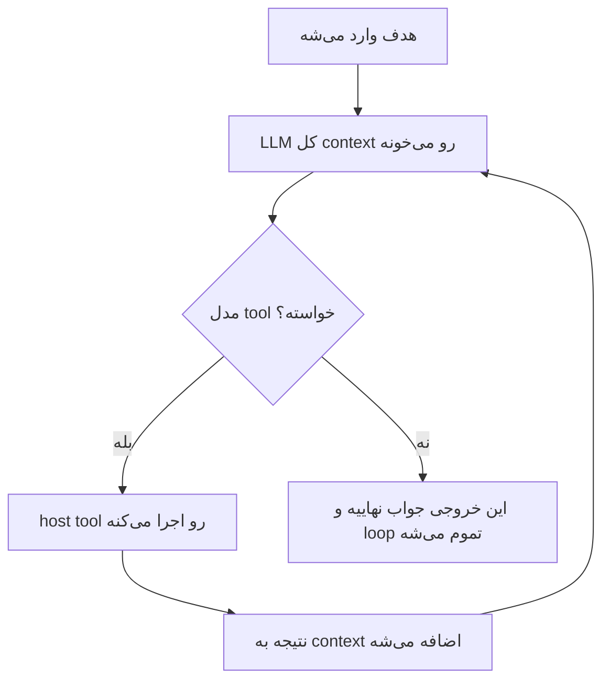
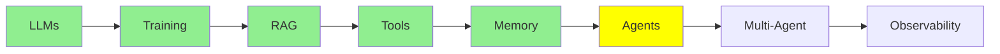

# AI Agents

همه‌ی چیزهایی که تا اینجا یاد گرفتیم، در واقع داشتن ما رو به همین مبحث می‌رسوندن. و تعریف agent از چیزی که فکر می‌کنی خیلی کوچیک‌تره.

> **یه AI agent در واقع فقط یه loop هست که توش یه LLM تا وقتی به هدفش برسه tool صدا می‌زنه.**
> **وقتی LLM دیگه هیچ tool‌ای صدا نمی‌زنه، یه جواب نهایی تولید می‌کنه و loop تموم می‌شه.**

همین! تمام ماجرا همین بود، پس بد نیست یه بار دیگه دقیق بخونیش. بیشتر سردرگمی‌هایی که درباره‌ی agent‌ها وجود داره، از این میاد که آدم انتظار داره یه چیز بزرگ‌تر از این باشه.

  
*هر دو طرف این منحنی به یه جواب می‌رسن. ولی آدم‌های وسط منحنی به جای این، دنبال یه معماری می‌گردن.*

## تفاوت single-turn و multi-turn

اینجا یه تفاوت مهم هست که باید بدونی.

یه **LLM ساده single-turn هست.** ورودی رو بهش می‌دی، خروجی رو می‌گیری و تمام. این همون کاریه که توی [مبانی LLM](llms_fa.md) دیدیم، و در واقع همه‌ی کاری که یه مدل انجام می‌ده همینه.

ولی **agent** از نوع **multi-turn** هست: تو مدل رو بارها و بارها دوباره صدا می‌زنی، و هر بار ممکنه مدل یه tool بخواد. این ادامه پیدا می‌کنه تا وقتی که مدل چیزی که لازم داره رو داشته باشه، و جواب نهایی رو هم فقط بعد از اون می‌نویسه.

توی هر دو حالت مدل همونه و هیچ چیزی بهش اضافه نشده. کل تفاوت توی اینه که مدل رو چند بار صدا می‌زنی و هر بار چی براش می‌فرستی.

  
*آره، دقیقاً همون تعریفه. جوک ماجرا اینجاست که آدم‌ها انتظار دارن agent یه چیز بیشتر از این باشه.*

## یک دور توی loop

توی [Tool Calling](tools_fa.md) یه tool call تکی رو دیدیم. هر دور کار یه agent دقیقاً همون کاره، فقط بارها تکرار می‌شه:

  
*یه دور این‌جوری پیش می‌ره: تو سؤال می‌پرسی و مدل فکر می‌کنه، بعد یه tool می‌خواد. host اون tool رو اجرا می‌کنه و نتیجه رو به message stack برمی‌گردونه، بعد مدل جواب می‌ده. توی دور بعد، کل message stack دوباره برای مدل فرستاده می‌شه و این بار دو تا پیام بلندتره.*



**به چیزی که loop رو تمام می‌کنه دقت کن.** هیچ counter‌ای در کار نیست و هیچ supervisor‌ای هم وجود نداره که تشخیص بده agent کارش تموم شده. loop به این خاطر می‌شکنه که مدل دیگه tool نمی‌خواد. پس نبودن tool call خودش شرط پایان کاره، و متنی که مدل به جای tool call می‌نویسه، همون جواب نهاییه.

### چقدر تصمیم‌گیری رو دست مدل می‌ذاری

«agent» یه چیز بله یا خیر نیست، و سؤال واقعی اینه که چقدر از تصمیم‌گیری رو به مدل واگذار می‌کنی.

یه سر این طیف، یه فراخوانی ساده‌ی LLM قرار داره. همه‌ی تصمیم‌ها دست خودته و مدل فقط متن می‌نویسه. وسط طیف **fixed workflow‌ها** هستن که گاهی بهشون state machine هم می‌گن. توی fixed workflow، *تو* مرحله‌ها و ترتیبشون رو نوشتی و مدل فقط داخل هر مرحله رو پر می‌کنه. اون سر دیگه‌ی طیف هم یه agent واقعیه، که توش مدل خودش مرحله‌ها، tool‌ها و لحظه‌ی توقف رو انتخاب می‌کنه.

  
*همون مدل توی هر سه پنل هست و فقط دو چیز عوض می‌شه: این‌که مدل چند بار صدا زده می‌شه، و این‌که قدم بعدی رو کی انتخاب می‌کنه. توی دو پنل اول این تو هستی که انتخاب می‌کنی، ولی توی پنل سوم خود مدله که انتخاب می‌کنه.*

بیشتر سیستم‌های production به اون سر طیف نزدیک نیستن، و معمولاً انتخاب درستی هم هست. هرچی خودمختاری کمتر باشه، راه‌های کمتری برای خراب شدن کارها وجود داره. مقاله‌ی [what is an agent](https://www.langchain.com/blog/what-is-an-agent) از LangChain این طیف رو خوب توضیح می‌ده. قبل از این‌که تصمیم بگیری مدل چقدر آزادی داشته باشه، ارزش خوندنش رو داره.

## loop یک agent کجا اجرا می‌شه؟

این قسمت رو باید دقیق بدونی، چون درست همین‌جاست که آدم‌ها تصور می‌کنن مدل کارهایی می‌کنه که از توانش خارجه.

هیچ‌کدوم از loop داخل LLM اتفاق نمی‌افته، بلکه **همه‌ش روی host machine اجرا می‌شه**، یعنی روی لپ‌تاپ یا سرور خودت:

- اجرای loop و تصمیم گرفتن درباره‌ی این‌که کی تموم شده
- نگه داشتن message stack که حافظه‌ی agent هست ([memory](memory_fa.md))
- ساختن system prompt قبل از هر فراخوانی
- اجرای tool‌ها، چون tool‌ها همون تابع‌های Python خودتن ([Tool Calling](tools_fa.md))
- فرستادن کل context، که حالا بلندتره، دوباره به مدل برای دور بعد

  
*زیر لباسش فقط prompt، if-else، loop و تابع هست. هیچ چیز دیگه‌ای توش نیست.*

به خاطر همین فهرست کارهاست که agent‌ها از یه **framework** استفاده می‌کنن، و مفهومش هم سخت نیست. مشکل اینه که اگه همه‌ی این کارها رو دستی انجام بدی، کلی کد boilerplate لازم داری:

- parse کردن tool call‌ها از داخل پاسخ
- تطبیق دادن نتیجه‌ها با call id‌ها
- بزرگ و کوچیک کردن message stack
- ساختن دوباره‌ی prompt
- تصمیم گرفتن درباره‌ی این‌که کی باید متوقف بشه

[smolagents](https://github.com/huggingface/smolagents) و [LangChain](https://github.com/langchain-ai/langchain) برای همین هستن که این کد رو یه بار بنویسن.

**حالا یه نگاه به [مبانی LLM](llms_fa.md) بنداز.** اونجا یه LLM رو مستقیم از terminal اجرا کردیم، بدون هیچ framework‌ای. دلیلش این بود که framework لازم نداشتیم، چون اون فقط یه فراخوانی بود، با یه ورودی و یه خروجی که همون‌جا تموم می‌شد. نه loop‌ای در کار بود، نه parse کردن tool‌ای، و نه message stack‌ای که بخوایم نگهش داریم. یه LLM single-turn به هیچ scaffolding‌ای نیاز نداره، ولی یه agent تقریباً تمامش scaffolding هست.

این بحث ما رو به نکته‌ی اصلی کل این مجموعه می‌رسونه. **LLM واقعاً فقط یه مغزه: متن می‌گیره، متن برمی‌گردونه، چیزی رو ذخیره نمی‌کنه و کار دیگه‌ای هم نمی‌کنه.** هر قابلیتی که تا الان دیدیم، یه محیطه که دور همین مغز ساخته شده تا بتونه این کارها رو بکنه:

- بین چند نوبت کار کنه (همین ماژول)
- به دنیای بیرون از خودش دسترسی پیدا کنه ([Tool Calling](tools_fa.md))
- چیزی رو به خاطر بسپاره ([Memory](memory_fa.md))
- داده‌هایی رو بخونه که توی آموزشش ندیده ([RAG و Embedding‌ها](rag_fa.md))

وقتی توی [مبانی LLM](llms_fa.md) گفتیم LLM ساده‌ست، ساده‌سازی نمی‌کردیم. مدل واقعاً همین‌قدر ساده‌ست، و بقیه‌ی ماجرا همون مهندسی دورِ مدله.

یه روش قدیمی‌تر برای توصیف همین loop هم هست: **observe, decide, act**، یعنی مشاهده، تصمیم و عمل. مدل context رو مشاهده می‌کنه و درباره‌ی یه عمل تصمیم می‌گیره. بعد host اون عمل رو انجام می‌ده و نتیجه‌اش می‌شه بخشی از مشاهده‌ی بعدی، پس در کل همون مکانیزمه، فقط با واژگان قدیمی‌تر.

## LLM از کجا می‌دونه چه tool‌هایی در اختیارشه؟

ته ماجرا، agent هنوز هم فقط یه LLM هست که تو بارها و بارها صداش می‌زنی. پس از کجا بفهمه کدوم tool‌ها رو اجازه داره صدا بزنه؟

جوابش توی **system prompt** قرار داره، که host اون رو قبل از هر فراخوانی توی loop دوباره می‌سازه و می‌فرسته. نقشِ agent و فهرست tool‌های موجود، همراه با نام و توضیح هر کدوم، توی همین prompt قرار داره. همچنین مشخص می‌کنه که tool call باید چه فرمتی داشته باشه تا host بتونه اون رو parse کنه.

این فهرست رو خودت دستی نمی‌نویسی، چون همون‌طور که توی [Tool Calling](tools_fa.md) دیدیم، دکوریتور `@tool` این کار رو انجام می‌ده. framework نام تابع، docstring و type hint‌های اون رو می‌خونه و بعد schema رو توی چیزی که مدل می‌بینه قرار می‌ده. به همین خاطره که اون کد این‌قدر کوتاه بود. دکوریتور فقط تابع رو ثبت نمی‌کنه؛ با همین کار، framework به مدل می‌گه که این تابع وجود داره.

## یک مثال

«این باگ کدم رو درست کن» فقط یه سؤال نیست، برای همین loop چند بار اجرا می‌شه:

| دور | agent چی کار می‌کنه | چرا LLM صدا زده می‌شه |
|---|---|---|
| 0 | هدف وارد می‌شه | هنوز نه |
| 1 | فایل‌های مربوط رو می‌خونه (`read_file`) | تا تصمیم بگیره کدوم فایل‌ها رو باز کنه |
| 2 | یه تست می‌نویسه که الان fail می‌شه | تا کد تولید کنه |
| 3 | فیکس رو می‌نویسه | تا کد تولید کنه |
| 4 | تست‌ها رو اجرا می‌کنه (`run_shell`) | تا دستور رو انتخاب کنه |
| 5 | گزارش می‌ده که تست‌ها پاس شدن | تا جواب رو بنویسه. چون هیچ tool صدا نمی‌زنه، loop تموم می‌شه |

شش دور، پنج فراخوانی مدل و یه هدف. یه LLM ساده برای همه‌ی این کارها فقط یه فراخوانی داشت، و همین باعث می‌شد که حدس بزنه.

## ساختن یک agent

```python
from smolagents import CodeAgent, tool, InferenceClientModel

@tool
def read_file(filename: str) -> str:
    """Read a file and return its contents."""
    with open(filename, 'r') as f:
        return f.read()

agent = CodeAgent(tools=[read_file], model=InferenceClientModel())
result = agent.run("Read main.py and summarise it")
```

این یه agent کامله، و به چیزهایی که *توش نیست* دقت کن:

- خبری از loop نیست
- خبری از parse کردن tool call نیست
- خبری از message stack نیست
- خبری از system prompt نیست

`CodeAgent` همه‌ی این کارها رو انجام می‌ده، و `agent.run` همون loop هست.

framework‌های دیگه هم همین مشکل رو با روش‌های متفاوتی حل می‌کنن: [LangChain](https://github.com/langchain-ai/langchain)، [crewAI](https://github.com/crewAIInc/crewAI) و [AutoGen](https://github.com/microsoft/autogen). [Agent Framework‌ها](../4_ecosystem/agent_frameworks_fa.md) این‌ها رو با هم مقایسه کرده.

  
*LLM مغزه، agent بدنی هست که دور اون رو گرفته، و tool‌ها دست‌های این بدن هستن.*

## کجای این مجموعه هستیم



## خلاصه

agent یه loop هست که توش یه LLM تا رسیدن به هدفش tool صدا می‌زنه. loop وقتی تموم می‌شه که مدل دیگه tool صدا نزنه و به جاش یه جواب بنویسه.

مدل تغییری نمی‌کنه، و این بخش‌ها همه روی ماشین خودت اجرا می‌شن:

- خود loop
- memory
- system prompt
- اجرای tool‌ها

کار framework همین مدیریت کردن این بخش‌هاست، و به همین دلیله که یه LLM single-turn توی [مبانی LLM](llms_fa.md) به framework نیاز نداشت.

ادامه‌ی بحث: این‌که وقتی یه agent تبدیل به چندتا می‌شه، چه اتفاقی می‌افته.

**بررسی سریع**: چه چیزی loop یک agent رو تموم می‌کنه، و کدوم بخش‌های agent بیرون از مدل اجرا می‌شن؟

## منابع

- [LLM agents](https://www.promptingguide.ai/research/llm-agents): یه مرور کامل‌تر از همین ایده
- [Agent components](https://www.promptingguide.ai/agents/components): بخش‌های یه agent، یکی یکی
- [What is an agent?](https://www.langchain.com/blog/what-is-an-agent): agent، workflow و state machine رو روی یه طیف خودمختاری کنار هم می‌ذاره
- [smolagents](https://github.com/huggingface/smolagents): framework‌ای که بالاتر ازش استفاده کردیم
- [Tool Calling](tools_fa.md): این‌که schema مربوط به tool از کجا میاد
- [Memory](memory_fa.md): message stack‌ای که loop مدام بزرگ‌ترش می‌کنه
