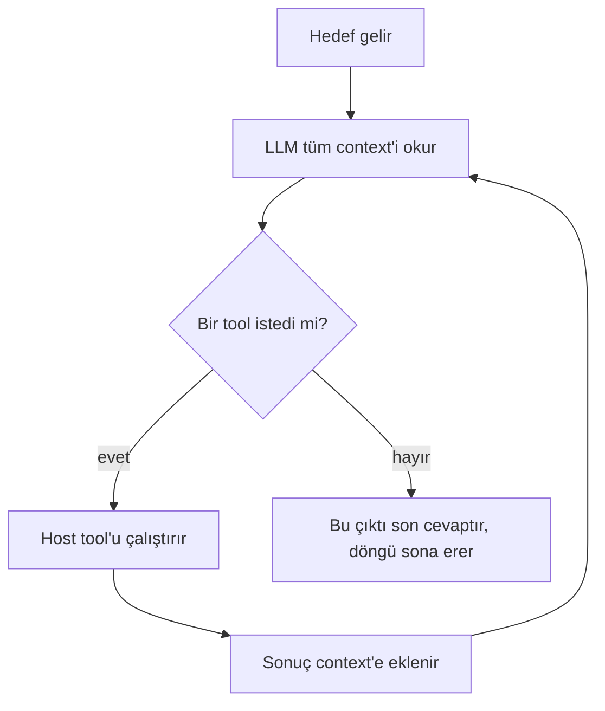
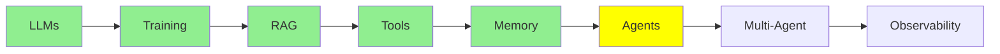

# AI Agents

Şimdiye kadar anlattığımız her şey bu tanıma doğru ilerliyordu, ama tanım beklediğinden çok daha küçük.

> **Bir AI agent, aslında LLM'in hedefine ulaşana kadar tool çağırdığı bir döngüdür. LLM tool çağırmadığında ise son cevabını üretir ve döngü sona erer.**

Tanım bu kadar, yine de bunu iki kez okumakta fayda var. Agent'lar hakkındaki karışıklığın çoğu, insanın bundan daha büyük bir şey beklemesinden doğuyor.

  
*Eğrinin iki ucu da aynı cevaba varıyor. Ortadakiler ise bunun yerine bir mimari aramaya koyuluyor.*

## Tek turlu ve çok turlu

Asıl önemli fark şu: düz bir LLM tek turludur. Ona bir girdi verirsin, o da bir çıktı döndürür ve iş biter. [LLM Temelleri](llms_tr.md) modülünde anlattığımız şey tam olarak budur, yani bir modelin yapabildiği tek şey.

Bir **agent ise çok turludur.** Aynı modeli tekrar tekrar çağırırsın ve her seferinde model bir tool isteyebilir. İhtiyacı olan her şeyi topladığında son cevabını yazar, ama bundan önce değil.

İki durumda da model aynıdır ve modele hiçbir şey eklenmedi. Aradaki fark, onu kaç kez çağırdığında ve her seferinde ona ne gönderdiğinde yatıyor.

  
*Evet, tanım tam olarak bu. Espri şurada: insanlar bunun daha büyük bir şey olmasını bekliyor.*

## Döngünün tek bir geçişi

[LLM Tool Calling](tools_tr.md) modülünde tek bir tool çağrısını görmüştük. Bir agent turu ise tam olarak bu çağrının tekrar tekrar yapılmasından ibarettir:

  
*Tek bir geçiş şöyle işliyor: sen soruyorsun, model düşünüyor ve bir tool istiyor. Host tool'u çalıştırıp sonucu geri yazar, ardından model cevap verir. Bir sonraki geçişte bütün mesaj yığını (message stack) modele yeniden gönderilir ve artık iki mesaj daha uzundur.*



**Döngüyü neyin bitirdiğine bak.** Ortada bir sayaç yok ve agent'ın işinin bittiğine karar veren bir denetleyici de yok. Döngü, model tool istemeyi bıraktığı için sona erer. Yani tool çağrısının yokluğu, *tam da* bitiş koşulunun kendisidir. Model tool çağrısı yerine yazdığı metin ise cevaptır.

### Kararın ne kadarını modele bıraktığın

"Agent" her şeyi ya da hiçbir şeyi ifade eden ikili bir kavram değil. Asıl soru, kararların ne kadarını modele devrettiğindir.

Bir ucunda düz bir LLM çağrısı var. Her kararı sen verirsin ve model yalnızca metin yazar. Ortada ise **sabit iş akışları** (fixed workflows) var, bunlara bazen durum makinesi (state machine) de denir. Sabit bir iş akışında adımları ve sırasını *sen* yazarsın, model de her adımı yalnızca doldurur. Diğer ucunda gerçek bir agent var ve orada adımları, tool'ları ve ne zaman duracağını model seçer.

  
*Üç panelde de aynı model var. Değişen iki şey var: modelin kaç kez çağrıldığı ve bir sonraki adımı kimin seçtiği. İlk iki panelde adımı sen seçiyorsun. Üçüncüde ise adımı model seçiyor.*

Üretimdeki sistemlerin çoğu spektrumun en uç noktasında durmaz ve bu genellikle doğru bir tercihtir. Daha az özerklik, işlerin ters gidebileceği daha az yol demek. LangChain'in [what is an agent](https://www.langchain.com/blog/what-is-an-agent) yazısı bu spektrumu iyi özetliyor ve modele ne kadar özgürlük vereceğine karar vermeden önce okumaya değer.

## Agent döngüsü nerede çalışır?

Bu kısmı net bilmekte fayda var, çünkü insanların modelin yapamayacağı şeyleri yaptığını hayal ettiği yer tam burasıdır.

Döngünün hiçbir parçası LLM'in içinde gerçekleşmez. **Hepsi host makinede çalışır**, yani senin laptop'unda ya da sunucunda:

- döngüyü çalıştırmak ve ne zaman bittiğine karar vermek
- agent'ın [hafızası](memory_tr.md) olan mesaj yığınını tutmak
- her çağrıdan önce system prompt'u oluşturmak
- tool'ları çalıştırmak, çünkü bunlar senin Python fonksiyonların ([LLM Tool Calling](tools_tr.md))
- bir sonraki geçiş için, artık daha uzun olan tüm context'i modele geri göndermek

  
*Kostümün altında prompt'lar, if-else, döngüler ve fonksiyonlardan başka bir şey yok.*

Yukarıdaki liste, agent'ların neden bir **framework** kullandığını açıklıyor. Kavramın kendisi zor değildir, asıl sorun ise bunların hepsini elle yazmanın çok fazla boilerplate kod gerektirmesidir:

- tool çağrılarını bir yanıttan ayıklamak
- sonuçları çağrı id'leriyle eşleştirmek
- mesaj yığınını büyütmek ve kısaltmak
- prompt'u yeniden oluşturmak
- ne zaman duracağına karar vermek

[smolagents](https://github.com/huggingface/smolagents) ve [LangChain](https://github.com/langchain-ai/langchain), bu kodu bir kez yazıp herkesin kullanabilmesi için var.

**Şimdi de [LLM Temelleri](llms_tr.md) modülüne dön.** Orada bir LLM'i hiçbir framework olmadan doğrudan terminalden çalıştırmıştık. Neden bir framework'e ihtiyacımız olmadı? Çünkü ortada tek bir çağrı vardı: girdi, çıktı, bitti. Döngü yoktu, tool ayrıştırması yoktu ve tutulacak bir mesaj yığını da yoktu. Tek turlu bir LLM böyle bir iskele kod (scaffolding) ihtiyacı duymaz, bir agent ise neredeyse tamamen bu iskele koddan oluşur.

Serinin ana noktasına bu noktada varıyoruz: **LLM gerçekten sadece bir beyin. Metin girer, metin çıkar, hiçbir şey saklamaz ve başka hiçbir şey yapmaz.** Şimdiye kadar anlattığımız her yetenek, bu beynin etrafına kurulmuş bir ortamdır. Bu ortam sayesinde model şunları yapabiliyor:

- birden fazla tur boyunca çalışabilir (bu modül)
- kendi dışındaki dünyaya uzanabilir ([LLM Tool Calling](tools_tr.md))
- hatırlayabilir ([Memory](memory_tr.md))
- hiç eğitilmediği verileri okuyabilir ([Retrieval-Augmented Generation (RAG)](rag_tr.md))

[LLM Temelleri](llms_tr.md) modülünde işi basitleştirmiş değildik. Model gerçekten bu kadar basit ve geri kalan her şey, onun etrafındaki mühendislik.

Aynı döngü, eskiden **observe, decide, act** (gözlemle, karar ver, eyleme geç) diye tarif edilirdi. Model context'i gözlemler ve bir eylem seçer, host bu eylemi gerçekleştirir ve sonuç bir sonraki gözlemin parçası olur. Mekanizma aynıdır, yalnızca kelimeler daha eskidir.

## LLM hangi tool'lara sahip olduğunu nasıl biliyor?

Altta yatan şey yine de tekrar tekrar çağırdığın bir LLM. Peki hangi tool'ları çağırmasına izin verildiğini nereden biliyor?

Cevap **system prompt**'tur. Host, döngüdeki her çağrıdan önce bunu yeniden oluşturup modele gönderir. System prompt; agent'ın rolünü, kullanılabilir tool'ların adlarını ve açıklamalarını taşır ve bir tool çağrısının nasıl biçimlendirileceğini anlatır. Böylece host çağrıyı ayrıştırabilir.

Bu listeyi elle yazman gerekmez, çünkü [LLM Tool Calling](tools_tr.md) modülünde anlattığımız gibi bunu `@tool` dekoratörü yapar. Framework, fonksiyonunun adını, docstring'ini ve type hint'lerini okur ve ardından şemayı modelin göreceği içeriğe yerleştirir. O kodun bu kadar kısa olmasının sebebi de bu. Dekoratör yalnızca fonksiyonu kaydetmekle kalmaz; framework bu sayede modele fonksiyonun var olduğunu da bildirir.

## Bir örnek

"Kodumdaki hatayı düzelt" tek bir soru olmadığı için döngü birkaç kez çalışıyor:

| Geçiş | Agent ne yapar | LLM neden çağrılır |
|---|---|---|
| 0 | Hedef gelir | henüz değil |
| 1 | İlgili dosyaları okur (`read_file`) | hangi dosyaları açacağına karar vermek için |
| 2 | Başarısız bir test yazar | kod üretmek için |
| 3 | Düzeltmeyi yazar | kod üretmek için |
| 4 | Testleri çalıştırır (`run_shell`) | komutu belirlemek için |
| 5 | Testlerin geçtiğini raporlar | cevabı yazmak için. Hiçbir tool çağırmadığı için döngü sona erer |

Altı geçiş, beş model çağrısı ve tek bir hedef var. Düz bir LLM ise bütün bunlar için yalnızca bir çağrı alırdı ve bu yüzden tahmin yürütmek zorunda kalırdı.

## Bir agent kurmak

```python
from smolagents import CodeAgent, tool, InferenceClientModel

@tool
def read_file(filename: str) -> str:
    """Read a file and return its contents."""
    with open(filename, 'r') as f:
        return f.read()

agent = CodeAgent(tools=[read_file], model=InferenceClientModel())
result = agent.run("Read main.py and summarise it")
```

İşte tam bir agent, ama şunların *yok* olduğuna dikkat et:

- döngü yok
- tool çağrılarını ayrıştıran kod yok
- mesaj yığını yok
- system prompt yok

Bunların hepsini `CodeAgent` yapıyor, döngünün kendisi ise `agent.run`.

Aynı sorunu farklı yollarla çözen başka framework'ler de var: [LangChain](https://github.com/langchain-ai/langchain), [crewAI](https://github.com/crewAIInc/crewAI) ve [AutoGen](https://github.com/microsoft/autogen). [Agent Framework'leri](../4_ecosystem/agent_frameworks_tr.md) bunları karşılaştırıyor.

  
*LLM beyin, agent onu çevreleyen gövde, tool'lar ise ellerdir.*

## Bu serinin neresindeyiz



## Özet

Bir agent, LLM'in hedefine ulaşana kadar tool çağırdığı bir döngüdür. Döngü, model tool çağırmayı bırakıp bunun yerine bir cevap yazdığında sona erer.

Model aynı kalır, ama şu parçaların hepsi senin makinende çalışır:

- döngü
- hafıza
- system prompt
- tool'ların çalıştırılması

Bunları yönetmek de framework'lerin asıl işidir ve tek turlu bir LLM'in [LLM Temelleri](llms_tr.md) modülünde bir framework'e ihtiyaç duymamasının sebebi de budur.

Sırada ise bir agent birden fazlaya dönüştüğünde neler olduğu var.

**Hızlı Kontrol**: Agent döngüsünü ne bitirir ve bir agent'ın hangi parçaları model dışında çalışır?

## Kaynaklar

- [LLM agents](https://www.promptingguide.ai/research/llm-agents): aynı fikri daha geniş ele alan bir derleme
- [Agent components](https://www.promptingguide.ai/agents/components): bir agent'ın parçaları tek tek
- [What is an agent?](https://www.langchain.com/blog/what-is-an-agent): agent'ları, iş akışlarını ve durum makinelerini tek bir özerklik spektrumunda yerleştiriyor
- [smolagents](https://github.com/huggingface/smolagents): yukarıda kullanılan framework
- [LLM Tool Calling](tools_tr.md): tool şemasının nereden geldiği
- [Memory](memory_tr.md): döngünün büyüttüğü mesaj yığını
