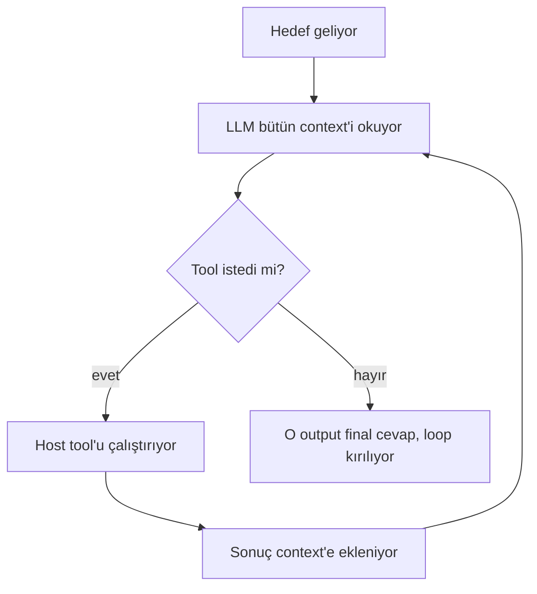
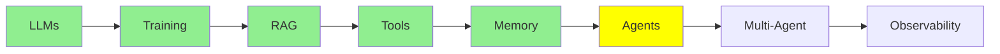

# AI Agents

Buraya kadar her şey bunun için kuruluyordu. Tanım ise beklediğinden küçük.

> **Bir AI agent, bir LLM'in hedefine ulaşana kadar tool çağırdığı bir loop'tan başka bir şey
> değil. LLM hiç tool çağırmadığında, bir final cevap üretiyor ve loop kırılıyor.**

Bütün olay bu. İki kez oku. Agent'lar hakkındaki kafa karışıklığının çoğu, daha büyük bir şey
beklemekten geliyor.

  
*Eğrinin iki ucu da aynı cevaba varıyor. Ortadakiler ise bunun yerine bir mimari aramaya gidiyor.*

## Single Turn ve Multi Turn

Önemli olan fark şu.

**Düz bir LLM single-turn.** Ona input veriyorsun, o da sana output veriyor. Bitti.
[LLM Fundamentals](llms_tr.md) modülü bunu anlatmıştı. Bir modelin yaptığı şey bundan fazlası
değil.

**Bir agent multi-turn.** Aynı modeli tekrar tekrar çağırıyorsun. Model her seferinde bir tool
isteyebiliyor. İhtiyacı olanı elde edene kadar devam ediyor. Final cevabı ancak ondan sonra
yazıyor.

İki durumda da model aynı. Ona hiçbir şey eklenmedi. Bütün fark, onu kaç kez çağırdığında ve her
seferinde ona ne gönderdiğinde.

  
*Evet. Tanım gerçekten bu. Şaka da insanların bundan fazlasını beklemesi.*

## Loop'un Bir Turu

[Tool Calling](tools_tr.md) tek bir tool call göstermişti. Bir agent turu da tam olarak onun
tekrarlanmış hâli:

  
*Bir tur: sen soruyorsun ve model düşünüyor. Model bir tool istiyor. Host tool'u çalıştırıp sonucu geri yazıyor. Sonra model cevaplıyor. Sonraki turda mesaj yığınının tamamı yine modele gidiyor ve artık iki mesaj daha uzun.*



**Loop'u neyin bitirdiğine bak.** Bir sayaç yok. Agent'ın bittiğine karar veren bir denetleyici de
yok. Loop, model tool istemeyi bıraktığı için kırılıyor. Bir tool call'ın olmaması, sonlanma
koşulunun (termination condition) *kendisi*. Modelin tool call yerine yazdığı metin de cevap.

### Karar Vermenin Ne Kadarını Devrediyorsun

"Agent" evet ya da hayır diye cevaplanan bir şey değil. Asıl soru, karar vermenin ne kadarını
modele devrettiğin.

Bir uçta düz bir LLM çağrısı var. Her şeye sen karar veriyorsun, model sadece metin yazıyor.
Ortada **sabit workflow'lar** var. Bunlara bazen state machine de deniyor. Sabit bir workflow'da
adımları ve sıralarını *sen* yazdın, model sadece her adımı dolduruyor. Diğer uçta gerçek bir agent
var. Orada adımları, tool'ları ve ne zaman duracağını model seçiyor.

  
*Üç panelde de aynı model var. Değişen iki şey var: modelin kaç kez çağrıldığı ve sonraki adımı kimin seçtiği. İlk iki panelde sen seçiyorsun. Üçüncüsünde modelin kendisi seçiyor.*

Production sistemlerinin çoğu en uçta değil. Bu da genelde doğru bir seçim. Daha az autonomy,
işlerin ters gidebileceği daha az yol demek. LangChain'in
[what is an agent](https://www.langchain.com/blog/what-is-an-agent) yazısı bu spektrumu iyi
anlatıyor. Modele ne kadar serbestlik vereceğine karar vermeden önce okumaya değer.

## Agent Loop Nerede Çalışır?

Bu kısımda net olmaya değer. İnsanların, modelin yapamayacağı şeyleri yaptığını hayal ettiği yer
burası.

Loop'un hiçbir parçası LLM'in içinde olmuyor. **Hepsi host makinede oluyor**, yani laptop'unda ya da
sunucunda:

- loop'u çalıştırmak ve ne zaman bittiğine karar vermek
- agent'ın [memory](memory_tr.md)'si olan mesaj yığınını tutmak
- her çağrıdan önce system prompt'u kurmak
- tool'ları çalıştırmak, çünkü onlar senin Python fonksiyonların ([Tool Calling](tools_tr.md))
- artık daha uzun olan context'in tamamını sonraki tur için modele geri göndermek

  
*Kostümün altında: prompt'lar, if-else'ler, loop'lar ve fonksiyonlar. İçinde başka bir şey yok.*

Bu liste, agent'ların neden bir **framework** kullandığının cevabı. Kavram zor değil. Sorun,
bunların hepsini elle yapmanın çok fazla boilerplate kod gerektirmesi:

- bir cevabın içinden tool call'ları parse etmek
- sonuçları çağrı id'leriyle eşleştirmek
- mesaj yığınını büyütüp budamak
- prompt'u yeniden kurmak
- ne zaman duracağına karar vermek

[smolagents](https://github.com/huggingface/smolagents) ve
[LangChain](https://github.com/langchain-ai/langchain) bu kodu bir kez yazmak için var.

**Şimdi [LLM Fundamentals](llms_tr.md) modülünü hatırla**. Orada bir LLM'i hiç framework olmadan,
doğrudan terminalden çalıştırmıştık. Orada neden framework'e ihtiyaç yoktu? Çünkü o tek bir
çağrıydı. Input, output, bitti. Loop yoktu, tool parse etme yoktu, sürdürülecek bir mesaj yığını
yoktu. Single-turn bir LLM hiçbir iskeleye (scaffolding) ihtiyaç duymuyor. Bir agent ise neredeyse
tamamen iskele.

Bu da seriyi asıl noktasına getiriyor. **LLM gerçekten sadece bir beyin: metin girer, metin
çıkar, hiçbir şey saklamaz, başka hiçbir şey yapmaz.** Buraya kadar anlattığımız her yetenek, o
beynin etrafına kurulmuş bir çevre. Bu çevre sayesinde beyin şunları yapabiliyor:

- turlar boyunca çalışmak (bu modül)
- kendi dışına uzanmak ([Tool Calling](tools_tr.md))
- hatırlamak ([Memory](memory_tr.md))
- hiç eğitilmediği veriyi okumak ([RAG & Embeddings](rag_tr.md))

[LLM Fundamentals](llms_tr.md) modülünde fazla basitleştirmiyorduk. Model gerçekten o kadar basit.
Geri kalan her şey onun etrafındaki mühendislik.

Aynı loop'u anlatmanın daha eski bir yolu **observe, decide, act**. Model context'i gözlemliyor ve
bir aksiyona karar veriyor. Host aksiyonu uyguluyor. Sonuç da sonraki gözlemin parçası oluyor. Aynı
mekanizma, daha eski kelimelerle.

## LLM Hangi Tool'lara Sahip Olduğunu Nasıl Biliyor

Özünde bir agent hâlâ tekrar tekrar çağırdığın bir LLM'den başka bir şey değil. O zaman hangi
tool'ları çağırmasına izin verildiğini nasıl biliyor?

Cevap **system prompt**. Host onu loop'taki her çağrıdan önce yeniden kurup gönderiyor. System
prompt, agent'ın rolünü ve kullanılabilir tool'ların listesini, adları ve açıklamalarıyla birlikte
taşıyor. Ayrıca bir tool call'ın nasıl formatlanacağını da söylüyor. Böylece host onu parse
edebiliyor.

O listeyi elle yazmıyorsun. [Tool Calling](tools_tr.md) modülünde anlattığımız gibi, bunu `@tool`
decorator'ı yapıyor. Framework fonksiyonunun adını, docstring'ini ve type hint'lerini okuyor. Sonra
schema'yı modelin gördüğü içeriğe ekliyor. O kodun bu kadar kısa olmasının sebebi bu. Decorator,
fonksiyonu kaydetmekten fazlasını yapıyor. Framework, o fonksiyonun var olduğunu modele decorator
sayesinde söylüyor.

## Bir Örnek

"Kodumdaki bug'ı düzelt" tek bir soru değil. O yüzden loop birkaç kez çalışıyor:

| Tur | Agent ne yapıyor | LLM neden çağrılıyor |
|---|---|---|
| 0 | Hedef geliyor | henüz değil |
| 1 | İlgili dosyaları oku (`read_file`) | hangi dosyaların açılacağına karar vermek için |
| 2 | Başarısız olan bir test yaz | kod üretmek için |
| 3 | Düzeltmeyi yaz | kod üretmek için |
| 4 | Testleri çalıştır (`run_shell`) | komuta karar vermek için |
| 5 | Testlerin geçtiğini bildir | cevabı yazmak için. Hiç tool çağırmadığı için loop bitiyor |

Altı tur, beş model çağrısı, bir hedef. Düz bir LLM'in bunların hepsi için sadece tek bir çağrısı
olurdu. Bu yüzden tahmin ederdi.

## Bir Agent Kurmak

```python
from smolagents import CodeAgent, tool, InferenceClientModel

@tool
def read_file(filename: str) -> str:
    """Read a file and return its contents."""
    with open(filename, 'r') as f:
        return f.read()

agent = CodeAgent(tools=[read_file], model=InferenceClientModel())
result = agent.run("Read main.py and summarise it")
```

Bu tam bir agent. Orada *olmayan* şeylere dikkat et:

- loop yok
- tool call parse etme yok
- mesaj yığını yok
- system prompt yok

Hepsini `CodeAgent` yapıyor. `agent.run` de loop'un kendisi.

Başka framework'ler aynı problemi farklı şekillerde çözüyor:
[LangChain](https://github.com/langchain-ai/langchain),
[crewAI](https://github.com/crewAIInc/crewAI) ve [AutoGen](https://github.com/microsoft/autogen).
[Agent Framework'leri](../4_ecosystem/agent_frameworks_tr.md) onları karşılaştırıyor.

  
*LLM beyin, agent etrafındaki beden, tool'lar da onun elleri.*

## Bu serinin neresindeyiz



## Özet

Bir agent, bir LLM'in hedefine ulaşana kadar tool çağırdığı bir loop. Loop, model tool çağırmayı
bırakıp onun yerine bir cevap yazdığında bitiyor.

Model değişmiyor. Şu parçaların hepsi senin makinende çalışıyor:

- loop
- memory
- system prompt
- tool çalıştırma

Framework de bunları yönetmek için var. [LLM Fundamentals](llms_tr.md) modülünde single-turn bir
LLM'in neden framework'e ihtiyaç duymadığının cevabı da bu.

Sırada bir agent'ın birden fazlaya dönüşmesi var.

**Hızlı Kontrol**: agent loop'unu ne bitiriyor ve bir agent'ın hangi parçaları modelin dışında
çalışıyor?

## Kaynaklar

- [LLM agents](https://www.promptingguide.ai/research/llm-agents): aynı fikrin daha geniş bir incelemesi
- [Agent components](https://www.promptingguide.ai/agents/components): bir agent'ın parçaları, tek tek
- [What is an agent?](https://www.langchain.com/blog/what-is-an-agent): agent'ları, workflow'ları ve state machine'leri tek bir autonomy spektrumuna yerleştiriyor
- [smolagents](https://github.com/huggingface/smolagents): yukarıda kullanılan framework
- [Tool Calling](tools_tr.md): tool schema'sının nereden geldiği
- [Memory](memory_tr.md): loop'un büyütmeye devam ettiği mesaj yığını
