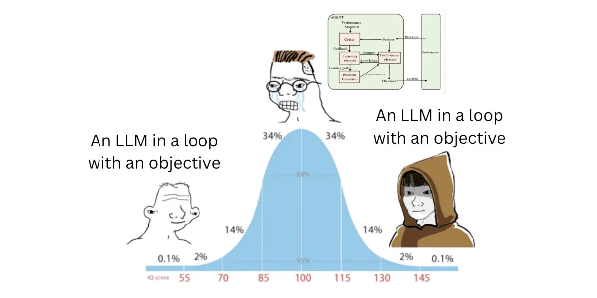
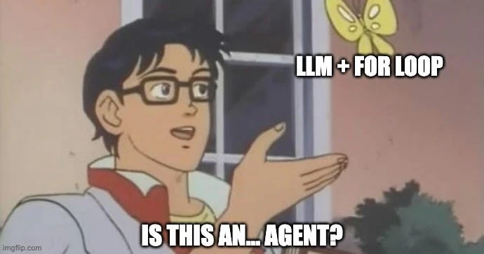
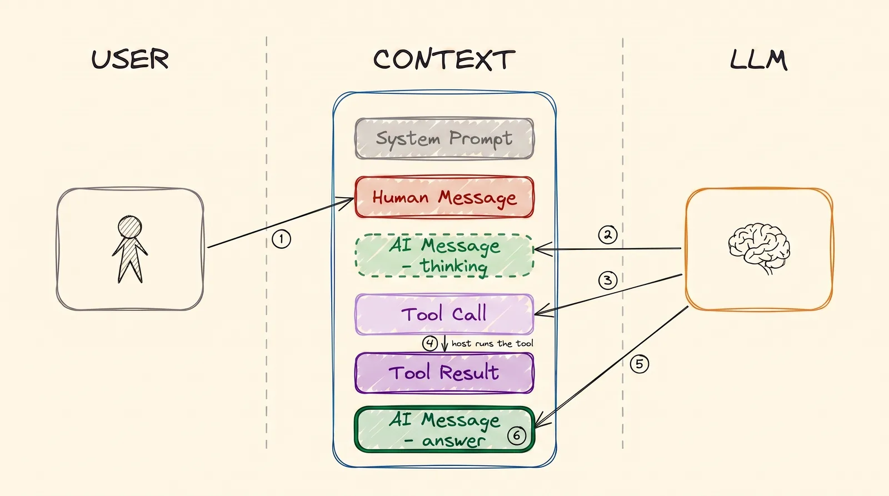
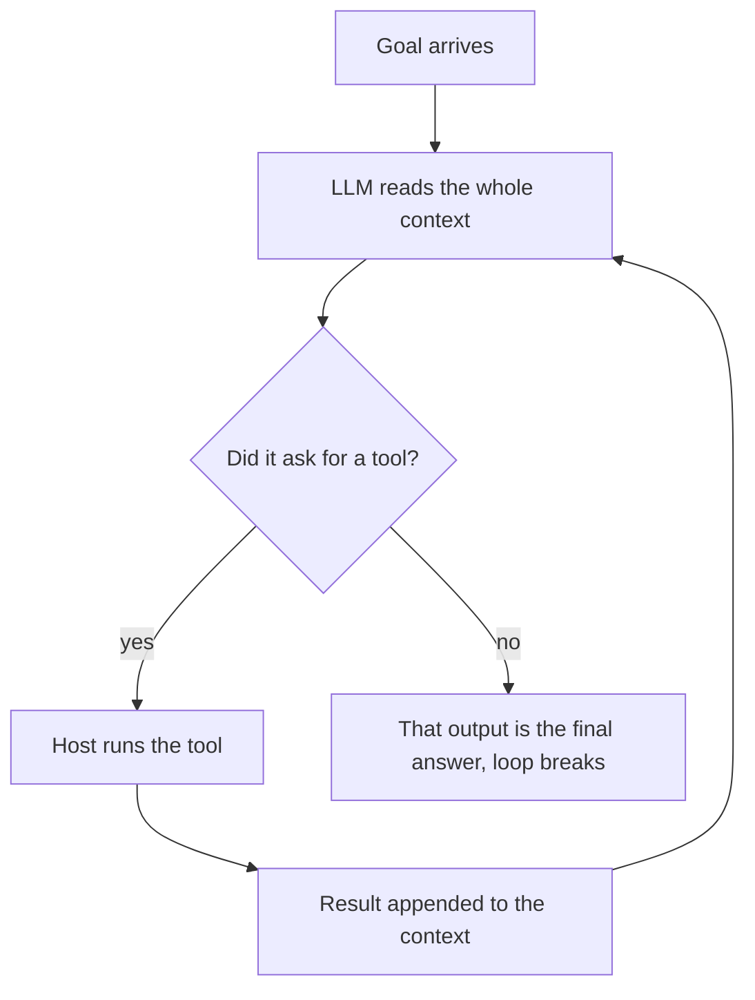
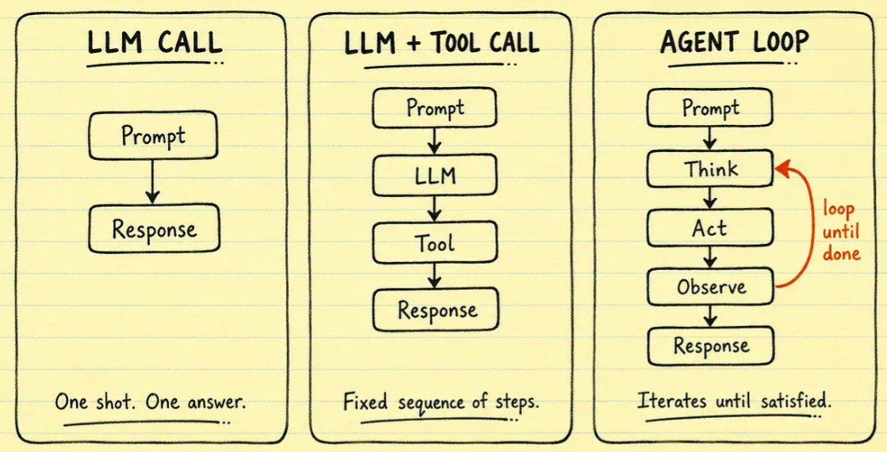
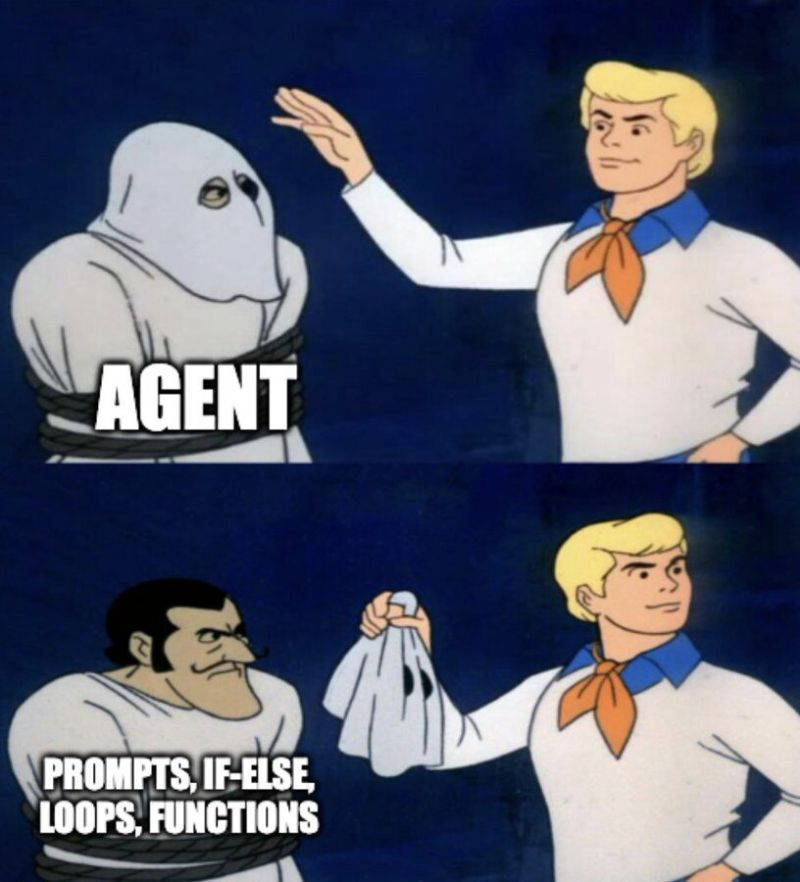
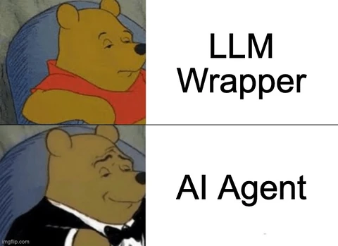

# AI Agents

Everything so far has been building to this. The definition is smaller than you would expect.

> **An AI agent is an LLM in a loop that uses tools until it reaches its goal. When the LLM stops
> asking for tools, it writes the final answer, and the loop ends.**

That is the whole thing. Most of the confusion about agents comes from expecting
something bigger.

  
*Both ends of the IQ curve say the same simple thing. The person in the middle draws a complicated diagram.*

## Why This Matters to You

"Agent" is the most used word in AI right now. Many vendors sell one. Once you know that an
agent is a model in a loop with tools, you can ask the right questions about any of them: which
tools does it have, what can those tools change, and what makes it stop?

## Single Turn, and Multi Turn

Here is the difference that matters.

A **plain LLM answers once.** You ask, it replies, and it is finished. That is what
[LLM Fundamentals](llms.md) covered.

An **agent keeps working.** The same model is called again and again. Each time, it can ask for
a tool, read the result, and decide what to do next. It keeps going until it has what it needs,
and only then writes the answer.

It is the same model in both cases. Nothing was added to the model. The only difference is how
many times it is called, and what it is shown each time.

  
*Yes. That really is the definition. The joke is that people expect it to be more.*

## One Pass Through the Loop

[Tool Calling](tools.md) showed a single tool call. An agent is that, repeated:

  
*One round: you ask, and the AI thinks. It asks for a tool. The computer runs the tool and writes the result back. Then the AI answers. In the next round, the whole chat goes to the AI again, and it is now longer.*

**Look at what ends it.** There is no counter, and no boss who says "stop". The loop ends because
the AI stopped asking for tools. When it writes text instead of a tool call, that text is the
answer.

### How Much of the Deciding You Hand Over

"Agent" is not a yes-or-no thing. The real question is how much of the deciding you give to the
AI. Think of it as a scale:

- **Plain chat:** you decide everything. The AI only writes text.
- **Workflow:** *you* wrote the steps and their order, like a company procedure. The AI only fills
  in each step.
- **Agent:** the AI chooses the steps, the tools, and when to stop.

  
*The same model sits in all three panels. Two things change: how many times it is called, and who picks the next step. You pick it in the first two panels. The AI picks it in the third.*

Most real products do not go to the far end, and that is usually the right choice. Less freedom means
fewer ways for things to go wrong. When you choose an AI product, it is fair to ask where on this
scale it sits.

## Where Does the Agent Loop Run?

None of the loop happens inside the AI. **All of it happens in a normal program on a normal
computer.** That program:

- runs the loop and decides when it has ended
- keeps the chat, which is the agent's [memory](memory.md)
- puts the system prompt at the top before every call
- runs the tools ([Tool Calling](tools.md))
- sends the whole, now longer, chat back to the AI for the next round

  
*Under the costume: instructions, simple rules, loops and small programs. There is nothing else in there.*

That program is a lot of routine work to write, so ready-made ones exist, called **frameworks**.
[LangChain](https://github.com/langchain-ai/langchain) and [smolagents](https://github.com/huggingface/smolagents) are two names you will hear.

This brings the course to its main point. **The LLM is only a brain. Text goes in, and text
comes out. It stores nothing and does nothing else.** Everything we have covered is built around
that brain, so that it can:

- work over many rounds (this module)
- reach outside itself ([Tool Calling](tools.md))
- remember ([Memory](memory.md))
- read documents it was never trained on ([RAG & Embeddings](rag.md))

The model really is that simple. Everything else is engineering around it.

## How the LLM Knows Which Tools it Has

The system prompt tells it. Before every call in the loop, the program puts the system prompt at
the top of the chat. It holds the agent's role and the menu card of every tool, as
[Tool Calling](tools.md) described.

## An Example

"Find me a flight to Ankara next Friday and put the best one in my calendar" is not one question.
So the loop runs several times:

| Round | What the agent does | Why the AI is called |
|---|---|---|
| 0 | The goal arrives | not yet |
| 1 | Searches for flights (`search_flights`) | to decide what to search for |
| 2 | Compares the results | to choose the best flight |
| 3 | Checks your calendar (`read_calendar`) | to make sure you are free |
| 4 | Adds the flight to your calendar (`create_event`) | to fill in the event details |
| 5 | Tells you what it booked in your calendar | to write the answer. It calls no tool, so the loop ends |

One goal took six rounds and five calls to the AI. A plain LLM would get one call for all of
that, so it could only guess.

  
*The LLM is the brain, the agent is the body around it, and the tools are its hands.*

## Words You Now Know

- **Agent**: an LLM in a loop that uses tools until the job is done.
- **Loop**: the repeated rounds of thinking, using a tool, and reading the result.
- **Workflow**: fixed steps that a person wrote; the AI fills in each step.
- **Autonomy**: how much of the deciding the AI does.
- **Framework**: ready-made software that runs the loop, such as LangChain.

## Summary

An agent is a model in a loop. It asks for a tool, reads the result, and repeats, until it stops
asking for tools and writes the answer. The model itself does not change. A normal program runs
the loop, keeps the chat and runs the tools. And how much you let the AI decide is a choice, on a
scale from plain chat to workflow to agent.

Next: what happens when one agent is not enough.

**Quick check**: What ends an agent's loop? And what is the difference between a workflow and an
agent?

## References

### 📄 Articles

- [What is an agent?](https://www.langchain.com/blog/what-is-an-agent): places chat, workflows and agents on one scale
- [LLM agents](https://www.promptingguide.ai/research/llm-agents): a fuller overview of the same idea

### 🗃️ Repositories

- [smolagents](https://github.com/huggingface/smolagents): a small agent framework from Hugging Face
