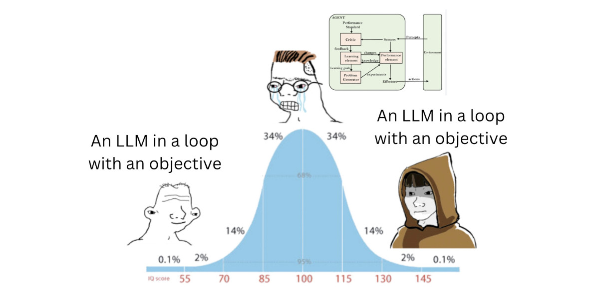
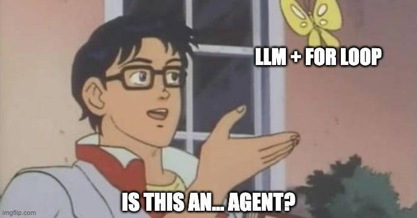
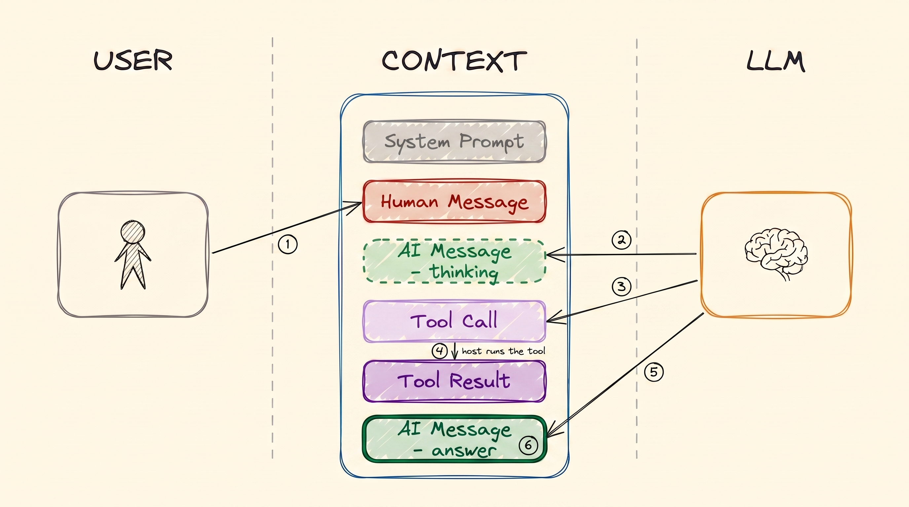
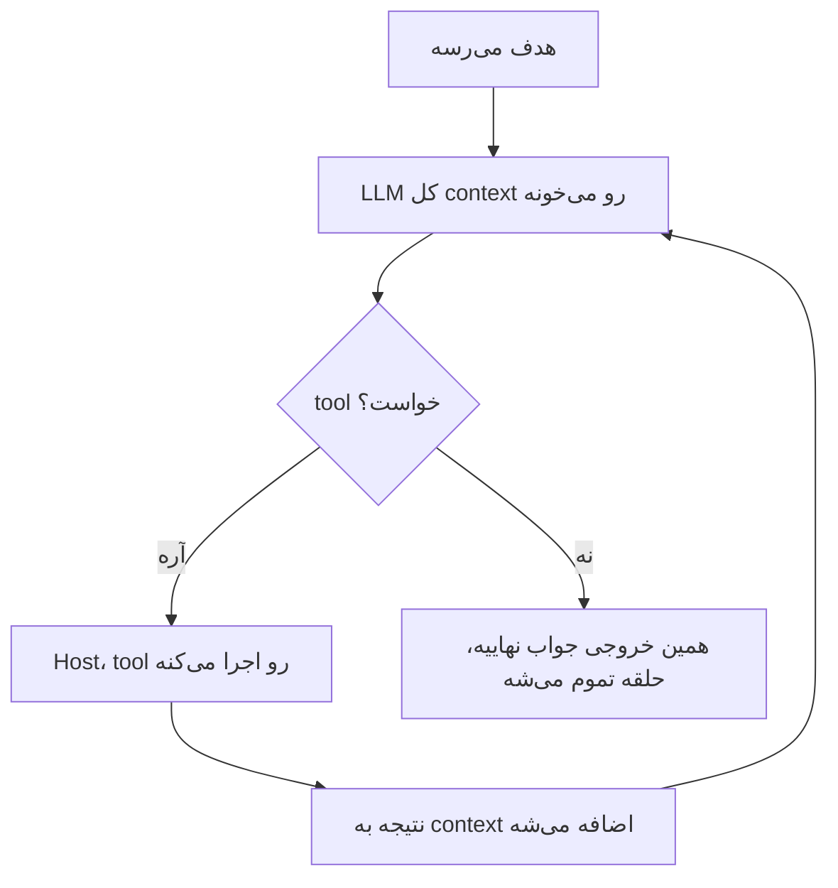
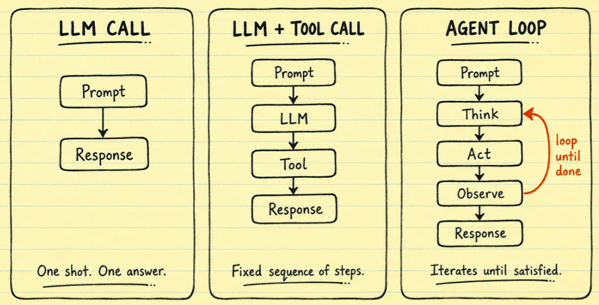
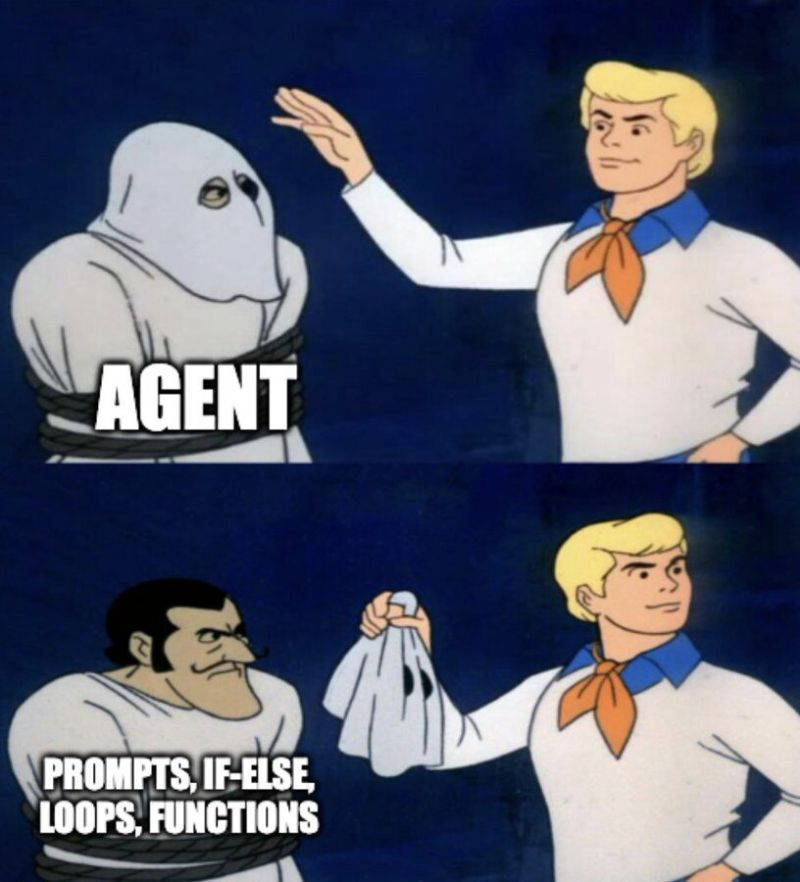
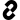
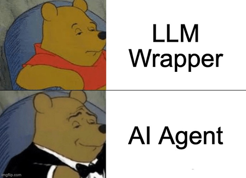

# AI Agents

همه‌ی چیزهای قبلی داشتن به همین‌جا می‌رسیدن. تعریفش کوچیک‌تر از چیزیه که انتظار داری.

> **یه AI agent یه LLM توی یه حلقه (loop) هست که تا وقتی به هدفش برسه از tool‌ها استفاده می‌کنه. وقتی LLM دیگه tool نمی‌خواد، جواب نهایی رو می‌نویسه و حلقه تموم می‌شه.**

همه‌ی ماجرا همینه. بیشتر سردرگمی‌ها درباره‌ی agent‌ها از اینه که آدم یه چیز بزرگ‌تر انتظار داره.

  
*دو سر منحنی IQ همون حرف ساده رو می‌زنن. آدمِ وسط یه نمودار پیچیده می‌کشه.*

## چرا این برای تو مهمه

«Agent» الان پرکاربردترین کلمه توی هوش مصنوعیه. خیلی از فروشنده‌ها یکی می‌فروشن. وقتی بدونی یه agent یه مدل توی یه حلقه‌ست با چند تا tool، می‌تونی درباره‌ی هر کدوم‌شون سؤال‌های درست بپرسی: چه tool‌هایی داره، اون tool‌ها چی رو می‌تونن عوض کنن، و چی باعث می‌شه متوقف بشه؟

## تفاوت single-turn و multi-turn

فرقی که مهمه این‌جاست.

یه **LLM معمولی یه بار جواب می‌ده.** می‌پرسی، جواب می‌ده، و تمومه. این همون چیزیه که [مبانی LLM](llms_fa.md) گفت.

یه **agent کار رو ادامه می‌ده.** همون مدل بارها و بارها صدا زده می‌شه. هر بار می‌تونه یه tool بخواد، نتیجه رو بخونه و تصمیم بگیره بعدش چی کار کنه. ادامه می‌ده تا چیزی رو که لازم داره بگیره، و فقط اون‌وقته که جواب رو می‌نویسه.

در هر دو حالت مدل همونه. چیزی به مدل اضافه نشده. تنها فرق اینه که چند بار صدا زده می‌شه، و هر بار چی بهش نشون داده می‌شه.

  
*آره. تعریفش واقعاً همینه. نکته‌ی شوخی اینه که آدم‌ها انتظار دارن بیشتر از این باشه.*

## یه دور از loop

[Tool Calling](tools_fa.md) یه tool call تکی رو نشون داد. یه agent همون رو تکرار می‌کنه:

  
*یه دور: تو می‌پرسی و هوش مصنوعی فکر می‌کنه. یه tool می‌خواد. کامپیوتر tool رو اجرا می‌کنه و نتیجه رو برمی‌گردونه توی چت. بعد هوش مصنوعی جواب می‌ده. توی دور بعدی کل چت دوباره به هوش مصنوعی می‌رسه، و حالا بلندتره.*

**ببین چی تمومش می‌کنه.** نه شمارنده‌ای هست، نه رئیسی که بگه «بسه». حلقه تموم می‌شه چون هوش مصنوعی دیگه tool نخواسته. وقتی به‌جای tool call متن می‌نویسه، همون متن جواب می‌شه.

### چقدر از تصمیم‌گیری رو می‌سپاری به مدل

«Agent» یه چیز آره-یا-نه نیست. سؤال واقعی اینه که چقدر از تصمیم‌گیری رو به هوش مصنوعی می‌دی. مثل یه مقیاس بهش فکر کن:

- **چت معمولی:** تو همه‌چیز رو تصمیم می‌گیری. هوش مصنوعی فقط متن می‌نویسه.
- **Workflow:** *تو* قدم‌ها و ترتیبشون رو نوشتی، مثل یه رویه‌ی شرکتی. هوش مصنوعی فقط هر قدم رو پر می‌کنه.
- **Agent:** هوش مصنوعی قدم‌ها، tool‌ها و زمان متوقف شدن رو انتخاب می‌کنه.

  
*همون مدل توی هر سه قاب هست. دو چیز عوض می‌شه: چند بار صدا زده می‌شه، و کی قدم بعدی رو انتخاب می‌کنه. توی دو قاب اول تو انتخابش می‌کنی. توی قاب سوم هوش مصنوعی انتخاب می‌کنه.*

بیشتر محصول‌های واقعی تا انتهای این مقیاس نمی‌رن، و معمولاً این انتخاب درستیه. آزادی کمتر یعنی راه‌های کمتری برای خراب شدن کار. وقتی یه محصول هوش مصنوعی انتخاب می‌کنی، بجاست بپرسی کجای این مقیاس نشسته.

## loop یه agent کجا اجرا می‌شه؟

هیچ بخشی از حلقه توی خودِ هوش مصنوعی اتفاق نمی‌افته. **همه‌ش توی یه برنامه‌ی معمولی روی یه کامپیوتر معمولی اتفاق می‌افته.** اون برنامه:

- حلقه رو اجرا می‌کنه و تصمیم می‌گیره کی تموم شده
- چت رو نگه می‌داره، که [memory](memory_fa.md)‌ی agent‌ه
- قبل از هر بار صدا زدن، system prompt رو بالای چت می‌ذاره
- tool‌ها رو اجرا می‌کنه ([Tool Calling](tools_fa.md))
- کل چت، که حالا بلندتر شده، رو برای دور بعدی به هوش مصنوعی برمی‌گردونه

  
*زیر لباس مبدل: دستورها، قاعده‌های ساده، حلقه‌ها و برنامه‌های کوچیک. چیز دیگه‌ای اون تو نیست.*

نوشتن اون برنامه کلی کار روتینه، برای همین نسخه‌های آماده‌ش وجود دارن، به اسم **framework**. [LangChain](https://github.com/langchain-ai/langchain) و [smolagents](https://github.com/huggingface/smolagents) دو تا اسمی‌ان که می‌شنوی.

این ما رو به نکته‌ی اصلی این مجموعه می‌رسونه. **LLM فقط یه مغزه. متن میره تو و متن میاد بیرون. هیچ‌چیز ذخیره نمی‌کنه و هیچ کار دیگه‌ای نمی‌کنه.** هر چیزی که گفتیم دور همین مغز ساخته شده، که بتونه:

- توی چند دور کار کنه (همین درس)
- به بیرون از خودش دست دراز کنه ([Tool Calling](tools_fa.md))
- یادش بمونه ([Memory](memory_fa.md))
- سندهایی رو بخونه که هیچ‌وقت روشون train نشده ([RAG و Embedding‌ها](rag_fa.md))

مدل واقعاً همین‌قدر ساده‌ست. هر چیز دیگه مهندسیِ دور اونه.

## LLM از کجا می‌دونه چه tool‌هایی در اختیارشه؟

system prompt بهش می‌گه. قبل از هر بار صدا زدن توی حلقه، برنامه system prompt رو بالای چت می‌ذاره. نقش agent و کارت منوی هر tool توشه، همون‌طور که [Tool Calling](tools_fa.md) گفت.

## یه مثال

«یه پرواز به آنکارا برای جمعه‌ی آینده پیدا کن و بهترینش رو بذار توی تقویمم» یه سؤال تکی نیست. پس حلقه چند بار اجرا می‌شه:

| دور | agent چی کار می‌کنه | چرا هوش مصنوعی صدا زده می‌شه |
|---|---|---|
| 0 | هدف می‌رسه | هنوز نه |
| 1 | دنبال پرواز می‌گرده (`search_flights`) | که تصمیم بگیره دنبال چی بگرده |
| 2 | نتیجه‌ها رو مقایسه می‌کنه | که بهترین پرواز رو انتخاب کنه |
| 3 | تقویمت رو چک می‌کنه (`read_calendar`) | که مطمئن بشه وقت داری |
| 4 | پرواز رو به تقویمت اضافه می‌کنه (`create_event`) | که جزئیات رویداد رو پر کنه |
| 5 | بهت می‌گه چی توی تقویمت رزرو کرده | که جواب رو بنویسه. هیچ tool‌ای صدا نمی‌زنه، پس حلقه تموم می‌شه |

یه هدف شش دور و پنج بار صدا زدن هوش مصنوعی طول کشید. یه LLM معمولی برای همه‌ی این‌ها فقط یه بار صدا زده می‌شد، پس فقط می‌تونست حدس بزنه.

  
*LLM مغزه، agent بدنیه که دور اونه، و tool‌ها دست‌هاشن.*

## کلمه‌هایی که الان بلدی

- **Agent**: یه LLM توی یه حلقه که تا تموم شدن کار از tool‌ها استفاده می‌کنه.
- **Loop (حلقه)**: دورهای تکراریِ فکر کردن، استفاده از یه tool، و خوندن نتیجه.
- **Workflow**: قدم‌های ثابتی که یه آدم نوشته؛ هوش مصنوعی هر قدم رو پر می‌کنه.
- **Autonomy (استقلال)**: چقدر از تصمیم‌گیری رو هوش مصنوعی انجام می‌ده.
- **Framework**: نرم‌افزار آماده‌ای که حلقه رو اجرا می‌کنه، مثل LangChain.

## خلاصه

یه agent یه مدله توی یه حلقه. یه tool می‌خواد، نتیجه رو می‌خونه و تکرار می‌کنه، تا وقتی که دیگه tool نخواد و جواب رو بنویسه. خودِ مدل عوض نمی‌شه. یه برنامه‌ی معمولی حلقه رو اجرا می‌کنه، چت رو نگه می‌داره و tool‌ها رو اجرا می‌کنه. و این‌که چقدر به هوش مصنوعی اجازه‌ی تصمیم‌گیری بدی یه انتخابه، روی یه مقیاس از چت معمولی تا workflow تا agent.

بعدش: وقتی یه agent کافی نیست چه اتفاقی می‌افته.

**بررسی سریع**: چی حلقه‌ی یه agent رو تموم می‌کنه؟ و فرق workflow با agent چیه؟

## منابع

### 📄 مقاله‌ها

- [What is an agent?](https://www.langchain.com/blog/what-is-an-agent): چت، workflow و agent رو روی یه مقیاس می‌ذاره
- [LLM agents](https://www.promptingguide.ai/research/llm-agents): یه مرور کامل‌تر از همین ایده

### 🗃️ Repository‌ها

- [smolagents](https://github.com/huggingface/smolagents): یه framework کوچیک برای agent‌ها، از Hugging Face
