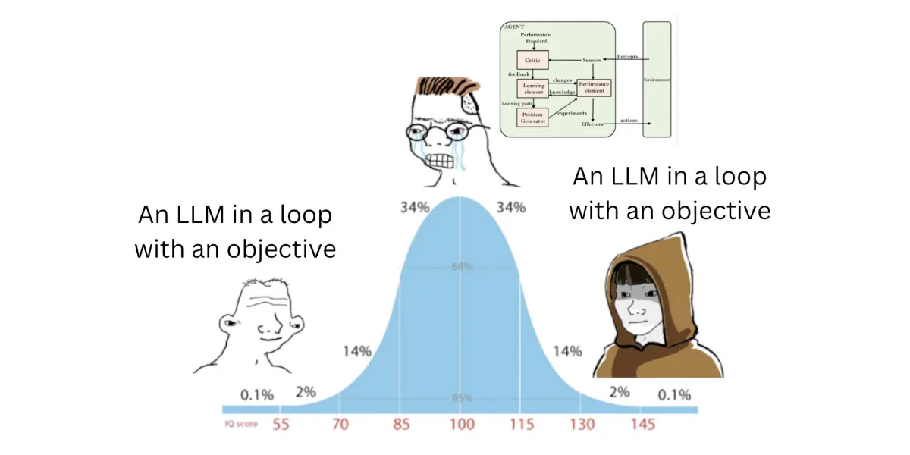
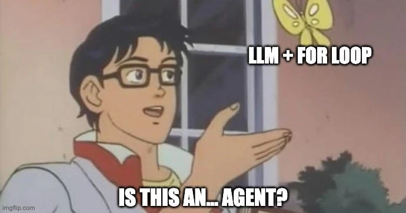
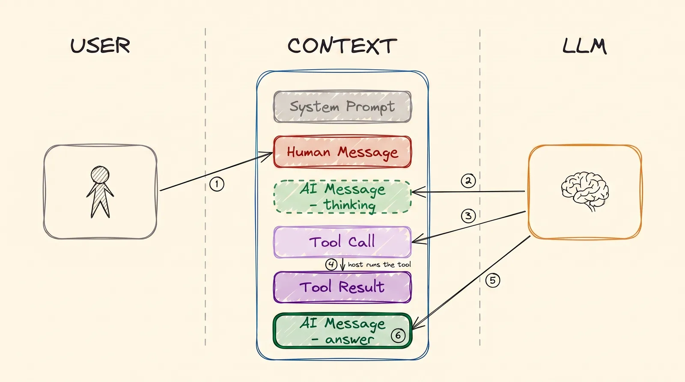
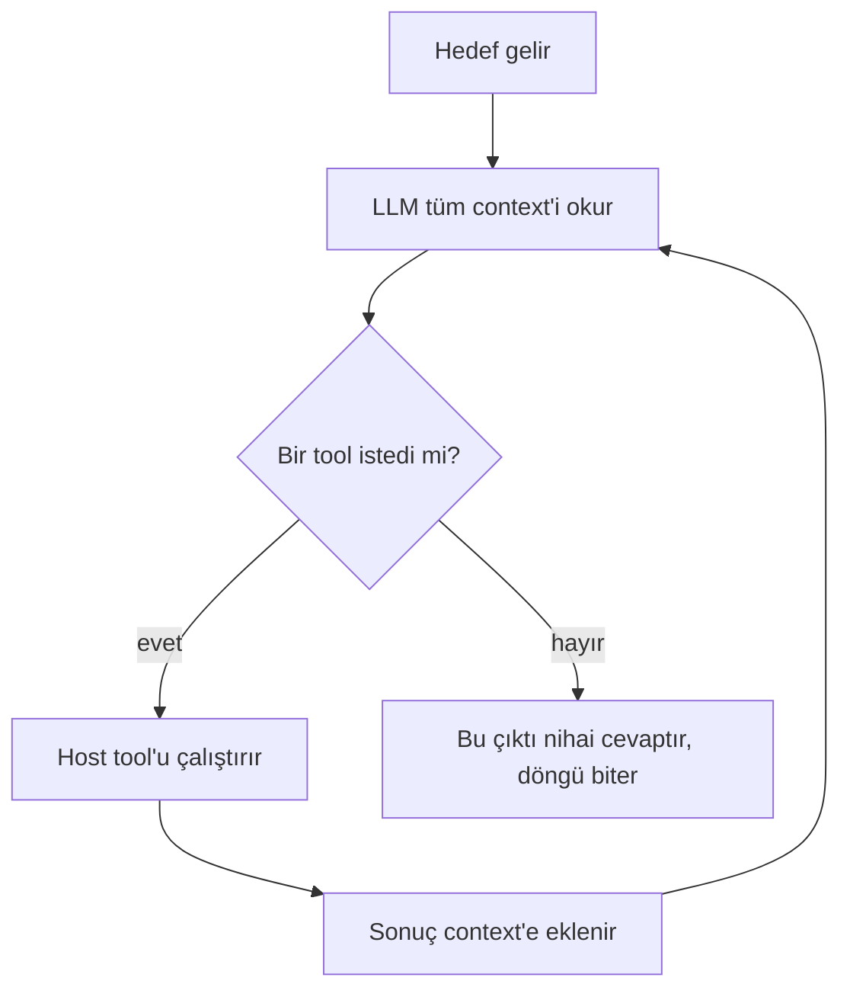
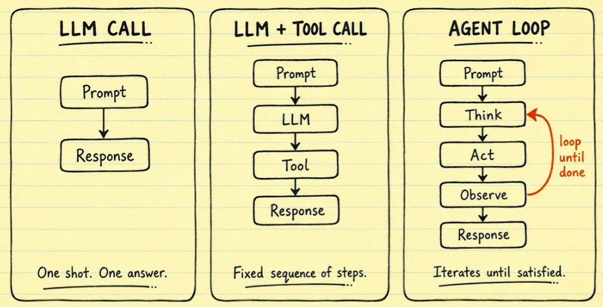
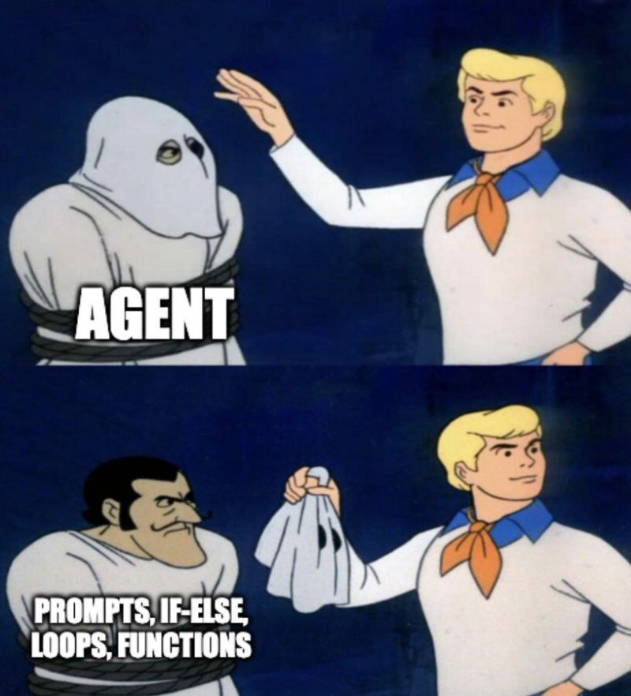
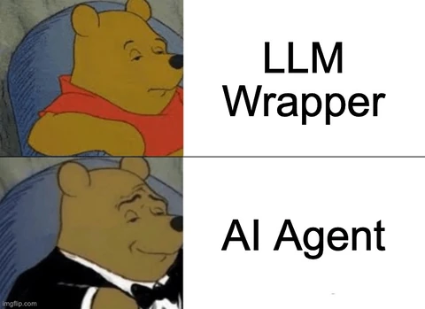

---
objectives:
  - "Bir kez cevap veren bir LLM ile çalışmaya devam eden bir agent arasındaki farkı açıkla"
  - "Bir agent'ın döngüsünü neyin bitirdiğini söyle"
  - "Bir ürünü düz sohbet, workflow ve agent arasındaki ölçekte doğru yere yerleştir"
---

# AI Agents

Şimdiye kadar anlattığımız her şey buraya varmak içindi. Tanım, beklediğinden daha küçük.

> **Bir AI agent, hedefine ulaşana kadar tool kullanan, bir döngünün içindeki LLM'dir. LLM tool istemeyi bıraktığında nihai cevabı yazar ve döngü biter.**

Her şey bundan ibaret. Agent'lar hakkındaki kafa karışıklığının çoğu, daha büyük bir şey beklemekten geliyor.

  
*IQ eğrisinin iki ucu da aynı basit şeyi söylüyor. Ortadaki kişi karmaşık bir diyagram çiziyor.*

## Bu Senin İçin Neden Önemli

"Agent", şu anda yapay zekâda en çok kullanılan kelime. Birçok satıcı bir tane satıyor. Bir agent'ın tool'larla birlikte bir döngü içindeki model olduğunu bildiğinde, hangisi hakkında olursa olsun doğru soruları sorabilirsin: hangi tool'ları var, o tool'lar neyi değiştirebiliyor ve onu ne durduruyor?

## Single Turn ve Multi Turn

Önemli olan fark şu.

**Düz bir LLM bir kez cevap verir.** Sen sorarsın, o cevaplar ve iş biter. [LLM Temelleri](llms_tr.md) modülünde anlatılan buydu.

**Bir agent çalışmaya devam eder.** Aynı model tekrar tekrar çağrılır. Her seferinde bir tool isteyebilir, sonucu okuyabilir ve sonra ne yapacağına karar verebilir. İhtiyacı olan şeye ulaşana kadar devam eder ve cevabı ancak o zaman yazar.

İki durumda da model aynı. Modele hiçbir şey eklenmedi. Tek fark, modelin kaç kez çağrıldığı ve her seferinde ona neyin gösterildiği.

  
*Evet. Tanım gerçekten bu. Şaka şu ki insanlar bundan daha fazlasını bekliyor.*

## Döngünün tek bir geçişi

[Tool Calling](tools_tr.md) modülü tek bir tool çağrısını gösterdi. Bir agent, bunun tekrarlanmasıdır:

  
*Tek bir tur: sen soruyorsun ve yapay zekâ düşünüyor. Bir tool istiyor. Bilgisayar tool'u çalıştırıp sonucu geri yazıyor. Sonra yapay zekâ cevap veriyor. Sonraki turda sohbetin tamamı yapay zekâya yeniden gidiyor ve artık daha uzun.*

**Onu neyin bitirdiğine bak.** Ortada bir sayaç yok, "dur" diyen bir patron da yok. Döngü, yapay zekâ tool istemeyi bıraktığı için biter. Tool çağrısı yerine metin yazdığında, o metin cevaptır.

### Kararın ne kadarını modele bıraktığın

"Agent", evet ya da hayır diye cevaplanacak bir şey değil. Asıl soru, karar vermenin ne kadarını yapay zekâya verdiğin. Bunu bir ölçek olarak düşün:

- **Düz sohbet:** her şeye sen karar verirsin. Yapay zekâ yalnızca metin yazar.
- **Workflow:** adımları ve sırasını *sen* yazdın, tıpkı bir şirket prosedürü gibi. Yapay zekâ yalnızca her adımı doldurur.
- **Agent:** adımları, tool'ları ve ne zaman duracağını yapay zekâ seçer.

  
*Üç panelde de aynı model duruyor. İki şey değişiyor: modelin kaç kez çağrıldığı ve bir sonraki adımı kimin seçtiği. İlk iki panelde onu sen seçiyorsun. Üçüncüde yapay zekâ seçiyor.*

Gerçek ürünlerin çoğu uç noktaya kadar gitmez ve bu çoğu zaman doğru seçimdir. Daha az serbestlik, işlerin ters gitmesi için daha az yol demektir. Bir yapay zekâ ürünü seçerken, onun bu ölçeğin neresinde durduğunu sormak haklı bir sorudur.

## Agent döngüsü nerede çalışır?

Döngünün hiçbir parçası yapay zekânın içinde olmaz. **Hepsi, normal bir bilgisayardaki normal bir programda olur.** O program:

- döngüyü çalıştırır ve ne zaman bittiğine karar verir
- sohbeti tutar; bu, agent'ın [belleğidir](memory_tr.md)
- her çağrıdan önce system prompt'u en üste koyar
- tool'ları çalıştırır ([Tool Calling](tools_tr.md))
- sohbetin tamamını, artık daha uzun hâliyle, sonraki tur için yapay zekâya geri gönderir

  
*Kostümün altında: talimatlar, basit kurallar, döngüler ve küçük programlar. Orada başka hiçbir şey yok.*

Bu programı yazmak epey sıradan bir iş, bu yüzden **framework** denen hazır olanları var. [LangChain](https://github.com/langchain-ai/langchain) ve [smolagents](https://github.com/huggingface/smolagents) duyacağın iki isim.

Bu da kursu ana noktasına getiriyor. **LLM yalnızca bir beyindir. İçeri metin girer, dışarı metin çıkar. Hiçbir şey saklamaz ve başka hiçbir şey yapmaz.** Şimdiye kadar anlattığımız her şey bu beynin etrafına kuruldu; böylece beyin şunları yapabiliyor:

- birçok tur boyunca çalışmak (bu modül)
- kendi dışına uzanmak ([Tool Calling](tools_tr.md))
- hatırlamak ([Memory](memory_tr.md))
- hiç eğitilmediği dokümanları okumak ([RAG & Embeddings](rag_tr.md))

Model gerçekten bu kadar basit. Geri kalan her şey, onun etrafındaki mühendislik.

## LLM hangi tool'lara sahip olduğunu nasıl biliyor?

System prompt ona söylüyor. Döngüdeki her çağrıdan önce program, system prompt'u sohbetin en üstüne koyar. Orada agent'ın rolü ve her tool'un menü kartı bulunur; [Tool Calling](tools_tr.md) modülünde anlatıldığı gibi.

## Bir örnek

"Gelecek cuma için bana Ankara'ya bir uçuş bul ve en iyisini takvimime ekle" tek bir soru değil. Bu yüzden döngü birkaç kez çalışır:

| Tur | Agent ne yapar | Yapay zekâ neden çağrılır |
|---|---|---|
| 0 | Hedef gelir | henüz çağrılmaz |
| 1 | Uçuşları arar (`search_flights`) | ne arayacağına karar vermek için |
| 2 | Sonuçları karşılaştırır | en iyi uçuşu seçmek için |
| 3 | Takvimine bakar (`read_calendar`) | müsait olduğundan emin olmak için |
| 4 | Uçuşu takvimine ekler (`create_event`) | etkinliğin ayrıntılarını doldurmak için |
| 5 | Takvimine ne rezerve ettiğini sana söyler | cevabı yazmak için. Hiçbir tool çağırmaz, bu yüzden döngü biter |

Tek bir hedef altı tur ve yapay zekâya beş çağrı sürdü. Düz bir LLM'e bunların hepsi için tek bir çağrı yapılırdı, bu yüzden yalnızca tahmin edebilirdi.

  
*LLM beyin, agent onun etrafındaki beden, tool'lar da elleridir.*

## Artık Bildiğin Terimler

- **Agent**: iş bitene kadar tool kullanan, bir döngünün içindeki LLM.
- **Döngü (loop)**: düşünmenin, bir tool kullanmanın ve sonucu okumanın tekrarlanan turları.
- **Workflow**: bir insanın yazdığı sabit adımlar; yapay zekâ her adımı doldurur.
- **Özerklik (autonomy)**: kararın ne kadarını yapay zekânın verdiği.
- **Framework**: döngüyü çalıştıran hazır yazılım, örneğin LangChain.

## Özet

Bir agent, döngü içindeki bir modeldir. Bir tool ister, sonucu okur ve bunu, tool istemeyi bırakıp cevabı yazana kadar tekrarlar. Modelin kendisi değişmez. Döngüyü, sohbeti tutmayı ve tool'ları çalıştırmayı normal bir program yapar. Yapay zekânın ne kadarına karar vereceğini ise sen seçersin; ölçek, düz sohbetten workflow'a ve agent'a doğru gider.

Sırada: bir agent yetmediğinde ne oluyor.

**Hızlı Kontrol**: Bir agent'ın döngüsünü ne bitirir? Workflow ile agent arasındaki fark ne?

## Kaynaklar

### 📄 Makaleler

- [What is an agent?](https://www.langchain.com/blog/what-is-an-agent): sohbeti, workflow'ları ve agent'ları tek bir ölçeğe yerleştiriyor
- [LLM agents](https://www.promptingguide.ai/research/llm-agents): aynı fikre daha kapsamlı bir genel bakış

### 🗃️ Repolar

- [smolagents](https://github.com/huggingface/smolagents): Hugging Face'ten küçük bir agent framework'ü
