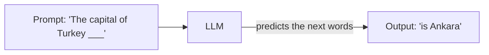
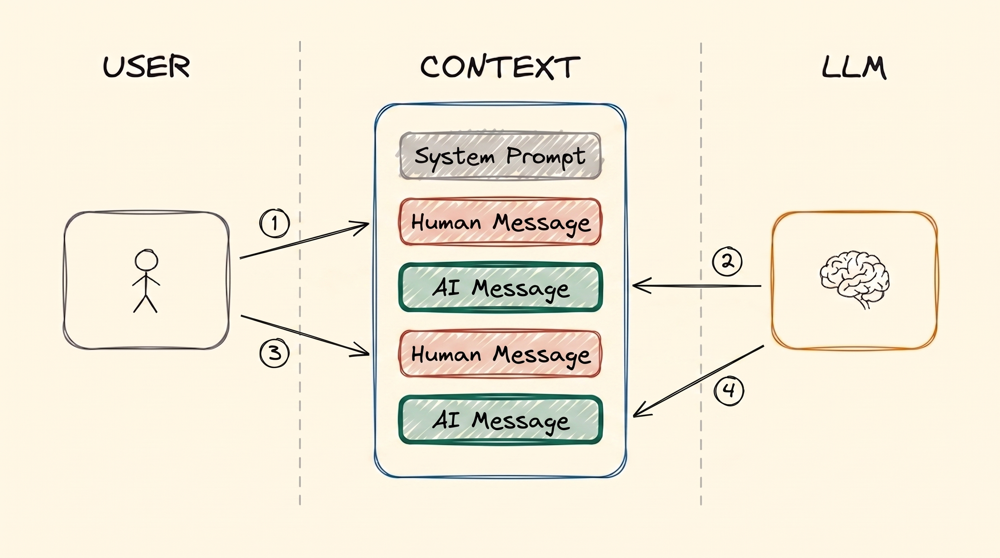
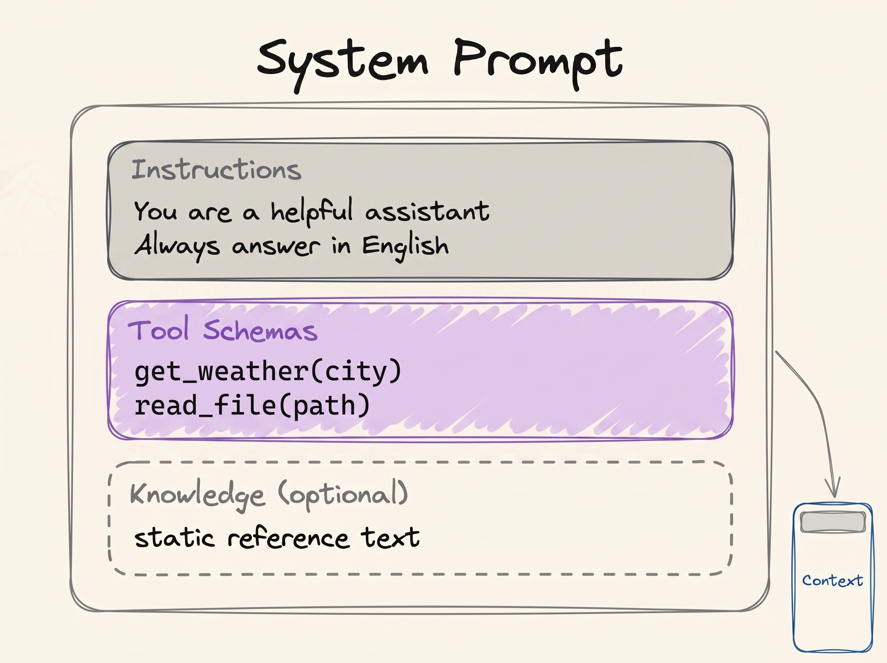

# LLM Fundamentals

ChatGPT, Claude and Gemini all have the same thing inside them. It is called an LLM, a Large
Language Model. Every other module in this course is built on this one idea, and on one limit
that comes with it. So this is the place to start.

## Why This Matters to You

This is a course in AI *engineering*, and it is written for everyone, not only for engineers.
That is on purpose.

To use today's AI, you do not write mathematics, you do not need special tools, and you do not
need a degree. You talk to it in normal language, the same language you use with a colleague.
Because the interface is normal language, anyone who can explain a problem clearly can now
solve problems with AI. An HR specialist, an accountant, an architect or a volleyball player
can build a small website or an internal tool by describing it.

But to describe it well, you need to know how the AI works: what it sees, what it remembers,
and where it goes wrong. That is what AI engineering is. You do not have to become an engineer.
You only need the concepts, and this course is a cheatsheet of the concepts that matter.

## What is an LLM?

An LLM is a program that takes text in and gives text back. You send it some words (the
**prompt**), and it sends back more words (the **generation**).

Think of the word suggestions on your phone keyboard. You type "See you", and the phone offers
"tomorrow". An LLM does the same thing, but it learned from a huge part of the internet: books,
websites, articles and code. From all of that text, it learned one skill: guessing the most
likely next word.



That is really all it does. It guesses one word, adds it to the text, and guesses the next
word, again and again, until the answer is complete. Everything clever that an LLM seems to do
comes from repeating that one guess.

## How Big is an LLM?

Inside, an LLM is a network of numbers called **parameters**. You can think of parameters as
the connections in a brain. More parameters usually give a smarter model, but a smarter model
needs a bigger computer to run.

Small models can run on a good laptop. Medium models need a company server. The largest ones,
the models behind ChatGPT and Claude, have hundreds of billions or even trillions of
parameters, and they only run in large data centres.

Researchers measured this in 2020: when you make a model bigger and train it on more data, it
gets better in a smooth and predictable way. That is why AI companies spent the following years
building bigger and bigger models.

## The Context Window

Here is the limit that shapes everything else in this course.

Think of a WhatsApp chat. Messages stack from top to bottom: one from you, then one from the
other person, then one from you again. An AI chat is exactly the same. Every time you send a
message, the AI reads **the whole chat from the top**, and then it writes its reply at the
bottom.

That whole chat, everything the AI can see right now, is called the **context**. And there is
a maximum size for it, called the **context window**. It counts your messages and the AI's
replies together. When a chat goes past that size, the request fails. A later module,
[Context Engineering](../2_intermediate/context_engineering.md), explains why a long chat can also
get worse before it is full.

Some names you will hear for this same chat: **context**, **working memory**, **message
history** and **short-term memory**. They all mean the stack of messages that the AI reads.
The [Memory](memory.md) module comes back to this.

### What Goes into the Context

A normal chat has three kinds of message:

- **Your message**: what you type. People call this "the prompt".
- **The AI's message**: its reply.
- **The system prompt**: hidden instructions at the very top of the chat. The company that
  built the product writes them (OpenAI, Anthropic, or a developer). You do not see them, but
  the AI reads them first, every time. They tell the AI how to behave and which tools it may
  use.

  
*Two turns of a plain chat: two of your messages and two AI replies. Nothing is removed. So in the second turn, the AI also reads everything from the first turn.*

One message from you, plus the AI's reply to it, is called a **turn**. The picture above shows
two turns.

The system prompt is not one short sentence. It is often long, and it holds the behaviour
rules and a list of the **tools** the AI is allowed to use:

  
*Inside a system prompt: the behaviour rules, the list of tools, and sometimes some fixed reference text. All of it sits at the very top of the chat, before you say anything.*

If you are curious, people have collected the real, leaked system prompts of many AI products
in [system_prompts_leaks](https://github.com/asgeirtj/system_prompts_leaks).

One more idea, and we come back to it in [Tool Calling](tools.md). An AI on its own cannot check
the weather, because it has no internet and no hands. It can only write text. So it writes a
message that says "please check the weather in Istanbul". A normal computer program reads that
message, checks the weather, and adds the answer to the chat. Then the AI reads the answer and
replies to you. **The AI asks; something else does the work.** That split is the basis of every
AI agent.

## Temperature and Length

You can change how the AI answers with a few settings:

- **Temperature**: the creativity dial, usually from 0 to 1. Low (0.1) gives steady,
  predictable answers. High (0.9) gives more creative answers, but they are less reliable.
- **Max output tokens**: a limit on how long the answer can be. A **token** is a piece of a
  word, so this is roughly a word limit.

These settings are called **hyperparameters**. They are different from the parameters above:
parameters are the numbers inside the model, and hyperparameters are the dials you set when
you use it.

## Running an LLM

Running a model to get an answer is called **inference**. There are two ways to do it.

**1. In the cloud.** You use the model on a company's computers over the internet. This is what
happens when you use ChatGPT or Claude.

- **Good:** you get the biggest and smartest models, and you buy no hardware.
- **Not so good:** it costs money, it needs internet, and your text goes to that company.

**2. On your own computer (local).** The model runs on your machine.

- **Good:** after setup it is free, it works offline, and your text never leaves your computer.
  For private company data, that last point can matter a lot.
- **Not so good:** you need a strong computer, and you can only run the smaller models.

To make a model fit on a normal computer, people shrink it. This is called **quantization**. It
makes the model need about four times less memory, and the model itself stays the same. You do not have
to do this yourself: shrunk versions of popular models are ready to download.

**Try it yourself:** **[LM Studio](https://lmstudio.ai/)** is an app that lets you download a small
model and chat with it on your own laptop, with no internet. It takes a few minutes, and it
helps you see everything in this module for real.

For the cloud, companies rent models through an **inference provider**. Some services, like
[OpenRouter](https://openrouter.ai/), are one door to many models from many companies, with one account.

## Writing a Good Prompt

**Prompt engineering** means writing your input so that you get the output you want. It is like
giving instructions to students. Clear instructions get the homework done properly. Vague
instructions get you whatever each student felt like doing.

Remember what the model does: it calculates the most likely next word, given everything in the
chat. Written as a formula:

```
P(next token | context)
```

Read it as "the probability of the next word, given the context". Your prompt *is* that context.
So your job is to write the input that makes the answer you want the most likely one:

```
best prompt = the prompt that maximises P(the output you want | prompt)
```

If the formula does not mean much to you, that is fine. The idea is the sentence above it. The
[Prompt Engineering](../2_intermediate/prompt_engineering.md) module covers this in detail.

## Words You Now Know

- **LLM**: a model that reads text and writes the most likely next words.
- **Prompt**: the text you give it. **Generation**: the text it gives back.
- **Parameters**: the numbers inside the model. More usually means smarter and bigger.
- **Context**: the whole chat the AI reads, from the top, every time.
- **Context window**: the maximum size of that chat.
- **System prompt**: hidden instructions at the top of the chat, written by the company.
- **Turn**: one of your messages plus the AI's reply.
- **Temperature**: the creativity dial.
- **Hyperparameters**: the dials you set when you use a model, such as temperature.
- **Token**: a piece of a word.
- **Inference**: running a model to get an answer, in the cloud or on your own computer.
- **Quantization**: shrinking a model so it fits on a normal computer.
- **Inference provider**: a company that runs models and rents them to you.
- **Prompt engineering**: writing your input so you get the answer you want.

## Summary

An LLM guesses the next word, again and again. It reads the whole chat every time it answers,
and that chat has a maximum size: the context window. At the top of the chat sit hidden
instructions, the system prompt. You can use a model in the cloud or run a small one on your
own computer.

Keep the chat picture in mind. Almost every later module answers one question: *what do we put
into that limited chat?*

**Quick check**: Why does the AI read the whole chat again every time you send a message? And
what is the difference between your message and the system prompt?

## References

### 📄 Articles

- [Scaling Laws for Neural Language Models](https://arxiv.org/abs/2001.08361): the 2020 measurement behind
  "bigger models are better"

### 🎬 Videos

- [Large Language Models explained briefly](https://youtu.be/LPZh9BOjkQs?si=8kH-lzHbfHRL1_8h): a short video
  that covers the same ideas, if you prefer to watch

### 🛠️ Tools

- [LM Studio](https://lmstudio.ai/): download a small model and chat with it on your laptop
- [Artificial Analysis](https://artificialanalysis.ai/): compare models and their scores
- [OpenRouter](https://openrouter.ai/): one account for models from many companies

### 🗃️ Repositories

- [System prompt leaks](https://github.com/asgeirtj/system_prompts_leaks): real system prompts from many AI products
