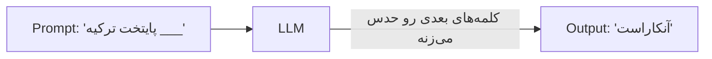
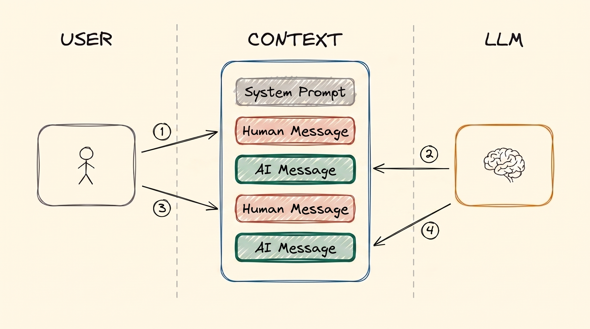
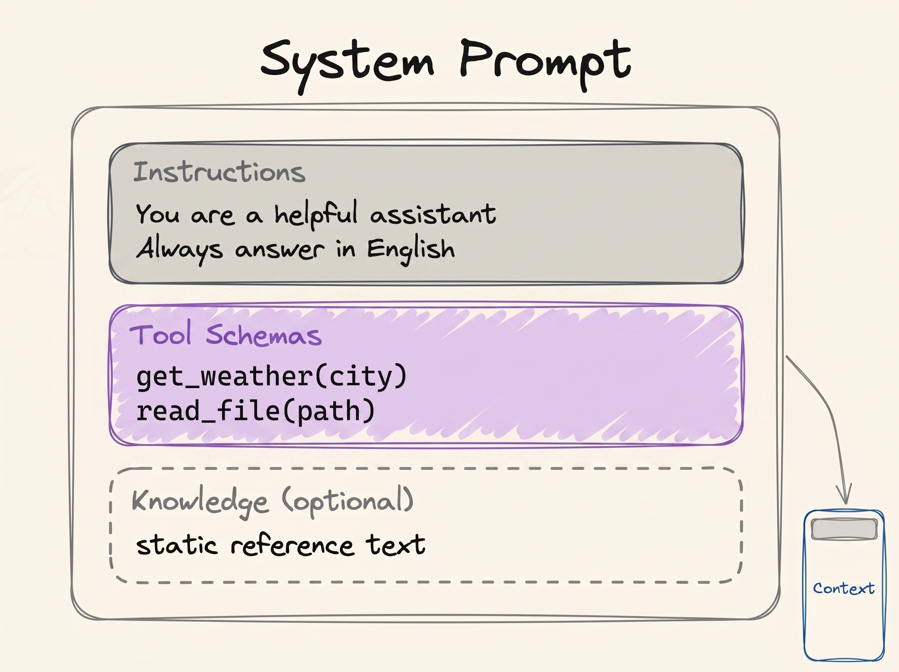

# مبانی LLM

ChatGPT و Claude و Gemini همه‌شون یه چیز مشترک تو دلشون دارن. اسمش LLM‌ه، یعنی Large Language Model یا «مدل زبانی بزرگ». تقریباً هر درس دیگه‌ی این مجموعه روی همین یه ایده بنا شده، و روی یه محدودیتی که همراهشه. برای همین شروع کار از همین‌جاست.

## چرا این برای تو مهمه

این مجموعه درباره‌ی «مهندسی هوش مصنوعی»ـه، ولی برای همه نوشته شده، نه فقط برای مهندس‌ها. این رو عمداً این‌طوری گذاشتیم.

برای استفاده از هوش مصنوعی امروزی لازم نیست ریاضی بنویسی، ابزار خاصی بلد باشی یا مدرک بگیری. باهاش به زبون عادی حرف می‌زنی، همون زبونی که با یه همکار حرف می‌زنی. چون رابط کار همین زبون عادیه، هر کسی که بتونه یه مشکل رو خوب توضیح بده، حالا می‌تونه با هوش مصنوعی حلش کنه. یه کارشناس منابع انسانی، یه حسابدار، یه معمار یا یه والیبالیست می‌تونه فقط با توضیح دادن، یه وب‌سایت کوچیک یا یه ابزار داخلی بسازه.

ولی برای این‌که خوب توضیح بدی، باید بدونی هوش مصنوعی چطور کار می‌کنه: چی می‌بینه، چی یادش می‌مونه، و کجا اشتباه می‌کنه. مهندسی هوش مصنوعی یعنی همین. لازم نیست مهندس بشی. فقط باید مفهوم‌ها رو بدونی، و این مجموعه یه برگه‌ی تقلبه از مفهوم‌هایی که واقعاً مهمن.

## LLM چیه؟

LLM یه برنامه‌ست که متن می‌گیره و متن تحویل می‌ده. تو چند تا کلمه براش می‌فرستی که بهش می‌گن **prompt**، و اون در جواب چند تا کلمه‌ی دیگه برمی‌گردونه که اسمش **generation** (تولید) هست.

پیشنهاد کلمه‌ی کیبورد گوشیت رو در نظر بگیر. «می‌بینمت» رو می‌نویسی و گوشی «فردا» رو پیشنهاد می‌ده. LLM هم همین کار رو می‌کنه، ولی از یه بخش خیلی بزرگ اینترنت یاد گرفته: کتاب، وب‌سایت، مقاله و کد. از این همه متن فقط یه مهارت یاد گرفته: حدس زدن محتمل‌ترین کلمه‌ی بعدی.



واقعاً کارش همینه. یه کلمه حدس می‌زنه، به متن اضافه‌ش می‌کنه، کلمه‌ی بعدی رو حدس می‌زنه، و همین‌طور ادامه می‌ده تا جواب کامل بشه. هر کار باهوشی که از یه LLM می‌بینی، از تکرار همین یه حدسه.

## LLM چقدر بزرگه؟

از داخل، یه LLM یه شبکه‌ست از عددها که بهشون می‌گن **parameter**. parameter‌ها رو می‌تونی مثل اتصال‌های داخل مغز در نظر بگیری. معمولاً parameter بیشتر یعنی مدل باهوش‌تر، ولی مدل باهوش‌تر برای اجرا شدن یه کامپیوتر بزرگ‌تر لازم داره.

مدل‌های کوچیک روی یه لپ‌تاپ خوب اجرا می‌شن. مدل‌های متوسط یه سرور شرکتی می‌خوان. بزرگ‌ترین‌ها، یعنی مدل‌های پشت ChatGPT و Claude، صدها میلیارد یا حتی چند تریلیون parameter دارن و فقط توی data center‌های بزرگ اجرا می‌شن.

پژوهشگرها سال 2020 این رو اندازه گرفتن: وقتی مدل رو بزرگ‌تر می‌کنی و با داده‌ی بیشتری آموزشش می‌دی، آروم و قابل‌پیش‌بینی بهتر می‌شه. برای همین شرکت‌های هوش مصنوعی سال‌های بعدش رو گذروندن به ساختن مدل‌های بزرگ‌تر و بزرگ‌تر.

## Context Window

این همون محدودیتیه که همه‌ی چیزهای دیگه‌ی این مجموعه رو شکل می‌ده.

یه چت واتس‌اپ رو در نظر بگیر. پیام‌ها از بالا به پایین روی هم میان: یکی از تو، بعد یکی از طرف مقابل، بعد دوباره یکی از تو. چت با هوش مصنوعی هم دقیقاً همینه. هر بار که یه پیام می‌فرستی، هوش مصنوعی **کل چت رو از بالا** می‌خونه، و بعد جوابش رو پایین چت می‌نویسه.

کل اون چت، یعنی هر چیزی که هوش مصنوعی همین الان می‌تونه ببینه، اسمش **context**ـه. و برای اندازه‌ش یه سقف هست که بهش می‌گن **context window**. پیام‌های تو و جواب‌های هوش مصنوعی هر دو توش حساب می‌شن. اگه چت از این اندازه رد بشه، درخواست fail می‌شه. یکی از دلایلی که یه چت خیلی طولانی گاهی خوب کار نمی‌کنه و با باز کردن یه چت جدید درست می‌شه همینه.

چند تا اسم دیگه هم برای همین چت می‌شنوی: **context**، **working memory**، **message history** و **short-term memory**. همه‌شون یعنی همون پشته‌ی پیام‌هایی که هوش مصنوعی می‌خونه. درس [Memory](memory_fa.md) دوباره برمی‌گرده سراغش.

### چی وارد context می‌شه

یه چت معمولی سه جور پیام داره:

- **پیام تو**: چیزی که تایپ می‌کنی. بهش می‌گن «prompt».
- **پیام هوش مصنوعی**: جوابش.
- **system prompt**: دستورهای پنهانی که اول چت، بالای همه‌چیز نشسته. شرکتی که محصول رو ساخته (OpenAI، Anthropic یا یه developer) می‌نویسه‌شون. تو نمی‌بینی‌شون، ولی هوش مصنوعی هر بار اول اون‌ها رو می‌خونه. بهش می‌گن چطور رفتار کنه و از کدوم tool‌ها می‌تونه استفاده کنه.

  
*دو دور از یه چت ساده: دو پیام از تو و دو جواب از هوش مصنوعی. هیچ‌چیز پاک نمی‌شه. برای همین توی دور دوم، هوش مصنوعی هر چیزی که تو دور اول بوده رو هم دوباره می‌خونه.*

یه پیام از تو به‌علاوه‌ی جوابی که هوش مصنوعی بهش می‌ده، می‌شه یه **turn** (نوبت). شکل بالا دو تا نوبت رو نشون می‌ده.

system prompt یه جمله‌ی کوتاه نیست. معمولاً بلنده و قاعده‌های رفتار توشه، به‌علاوه‌ی فهرست **tool**‌هایی که هوش مصنوعی اجازه داره ازشون استفاده کنه:

  
*داخل یه system prompt: قاعده‌های رفتار، فهرست tool‌ها، و گاهی یه متن مرجع ثابت. همه‌ی این‌ها بالای بالای چت می‌شینن، قبل از این‌که تو حرفی بزنی.*

اگه کنجکاوی، آدم‌ها system prompt‌های واقعی و لو رفته‌ی خیلی از محصولات هوش مصنوعی رو توی [system_prompts_leaks](https://github.com/asgeirtj/system_prompts_leaks) جمع کردن. خیلی‌هاشون هزاران کلمه‌ن.

یه ایده‌ی دیگه هم هست که توی [Tool Calling](tools_fa.md) بهش برمی‌گردیم. هوش مصنوعی به‌تنهایی نمی‌تونه هوا رو چک کنه، چون نه اینترنت داره و نه دست. فقط می‌تونه متن بنویسه. پس یه پیام می‌نویسه که می‌گه «لطفاً هوای استانبول رو چک کن». یه برنامه‌ی معمولی روی کامپیوتر اون پیام رو می‌خونه، هوا رو چک می‌کنه و جوابش رو به چت اضافه می‌کنه. بعد هوش مصنوعی جواب رو می‌خونه و به تو جواب می‌ده. **هوش مصنوعی درخواست می‌ده؛ یکی دیگه کار رو انجام می‌ده.** پایه‌ی هر AI agent همین تقسیم کاره.

## Temperature و طول جواب

با چند تا تنظیم می‌تونی نحوه‌ی جواب دادن هوش مصنوعی رو عوض کنی:

- **Temperature**: دکمه‌ی خلاقیت، معمولاً از 0 تا 1. مقدار پایین (0.1) هر بار همون جواب دقیق و محتاط رو می‌ده. مقدار بالا (0.9) جواب‌های خلاقانه‌تری می‌ده، ولی کمتر می‌شه بهشون تکیه کرد.
- **Max output tokens**: سقف طول جواب. **token** یه تیکه از یه کلمه‌ست، پس این تقریباً یه سقف تعداد کلمه‌ست.

به این تنظیم‌ها می‌گن **hyperparameter**. با parameter‌هایی که بالا گفتیم فرق دارن: parameter‌ها عددهای داخل مدل‌ان، ولی hyperparameter‌ها دکمه‌هایی‌ان که موقع استفاده تنظیم می‌کنی.

## اجرای LLM

اجرا کردن مدل برای گرفتن جواب اسمش **inference**ـه. دو تا راه برای انجامش هست.

**1. توی cloud.** از مدل روی کامپیوترهای یه شرکت، از راه اینترنت استفاده می‌کنی. وقتی ChatGPT یا Claude رو باز می‌کنی همین اتفاق می‌افته.

- **خوبیش:** به بزرگ‌ترین و باهوش‌ترین مدل‌ها دسترسی داری و هیچ سخت‌افزاری نمی‌خری.
- **بدیش:** پول می‌خواد، اینترنت لازمه، و متنت به اون شرکت می‌رسه.

**2. روی کامپیوتر خودت (local).** مدل روی دستگاه خودت اجرا می‌شه.

- **خوبیش:** بعد از راه‌اندازی رایگانه، بدون اینترنت هم کار می‌کنه، و متنت هیچ‌وقت از کامپیوترت بیرون نمی‌ره. برای داده‌های خصوصی شرکت، همین آخری می‌تونه خیلی مهم باشه.
- **بدیش:** یه کامپیوتر قوی لازم داری و فقط می‌تونی مدل‌های کوچیک‌تر رو اجرا کنی.

برای این‌که یه مدل روی یه کامپیوتر معمولی جا بشه، آدم‌ها کوچیکش می‌کنن. اسم این کار **quantization**ـه. مدل رو تقریباً چهار برابر کوچیک‌تر می‌کنه و کیفیتش فقط یه کم میاد پایین. لازم نیست خودت این کار رو بکنی: نسخه‌های کوچیک‌شده‌ی مدل‌های معروف آماده‌ن و می‌تونی دانلودشون کنی.

**خودت امتحان کن:** **[LM Studio](https://lmstudio.ai/)** یه اپه که بهت اجازه می‌ده یه مدل کوچیک دانلود کنی و روی لپ‌تاپ خودت، بدون اینترنت، باهاش چت کنی. چند دقیقه بیشتر وقت نمی‌گیره و کمک می‌کنه همه‌ی چیزهای این درس رو واقعی ببینی.

برای cloud، شرکت‌ها مدل‌ها رو از طریق یه **inference provider** اجاره می‌کنن. بعضی سرویس‌ها، مثل [OpenRouter](https://openrouter.ai/)، یه در واحدن به مدل‌های خیلی از شرکت‌ها، با یه حساب.

## نوشتن یه prompt خوب

**Prompt engineering** یعنی ورودیت رو جوری بنویسی که خروجی دلخواهت رو بگیری. مثل دستور دادن به دانش‌آموزهاست. دستور واضح باعث می‌شه تکلیف درست انجام بشه. دستور مبهم هر چیزی رو می‌ده که هر کدوم از بچه‌ها دلش خواسته.

یادت باشه مدل چی کار می‌کنه: با توجه به هر چیزی که تو چته، محتمل‌ترین کلمه‌ی بعدی رو حساب می‌کنه. به شکل فرمول:

```
P(next token | context)
```

این رو این‌طوری بخون: «احتمال کلمه‌ی بعدی، با توجه به context». prompt تو همون context *هست*. پس کار تو اینه که ورودی‌ای بنویسی که جواب دلخواهت محتمل‌ترین جواب بشه:

```
best prompt = the prompt that maximises P(the output you want | prompt)
```

اگه فرمول چیز زیادی بهت نمی‌گه، اشکالی نداره. ایده‌ی اصلی همون جمله‌ی بالاشه. درس [Prompt Engineering](../2_intermediate/prompt_engineering_fa.md) این رو با جزئیات می‌گه.

## کلمه‌هایی که الان بلدی

- **LLM**: مدلی که متن می‌خونه و محتمل‌ترین کلمه‌های بعدی رو می‌نویسه.
- **Prompt**: متنی که بهش می‌دی. **Generation**: متنی که پس می‌ده.
- **Parameter**: عددهای داخل مدل. بیشتر بودنشون معمولاً یعنی مدل باهوش‌تر و بزرگ‌تر.
- **Context**: کل چتی که هوش مصنوعی هر بار از بالا می‌خونه.
- **Context window**: بیشترین اندازه‌ی اون چت.
- **System prompt**: دستورهای پنهان بالای چت، که شرکت نوشته.
- **Turn**: یه پیام از تو به‌علاوه‌ی جواب هوش مصنوعی.
- **Temperature**: دکمه‌ی خلاقیت.
- **Token**: یه تیکه از یه کلمه.
- **Inference**: اجرا کردن مدل برای گرفتن جواب، توی cloud یا روی کامپیوتر خودت.
- **Quantization**: کوچیک کردن مدل که روی یه کامپیوتر معمولی جا بشه.

## خلاصه

LLM یه کلمه رو حدس می‌زنه، بعد دوباره و دوباره. هر بار که جواب می‌ده کل چت رو می‌خونه، و اون چت یه اندازه‌ی بیشینه داره: context window. بالای چت دستورهای پنهانی نشسته، یعنی system prompt. می‌تونی از مدل توی cloud استفاده کنی یا یه مدل کوچیک رو روی کامپیوتر خودت اجرا کنی.

تصویر اون چت رو توی ذهنت نگه دار. تقریباً هر درس بعدی یه سؤال رو جواب می‌ده: *توی اون چت محدود چی بذاریم؟*

**بررسی سریع**: چرا هوش مصنوعی هر بار که پیام می‌فرستی کل چت رو دوباره می‌خونه؟ و فرق پیام تو با system prompt چیه؟

## منابع

### 📄 مقاله‌ها

- [Scaling Laws for Neural Language Models](https://arxiv.org/abs/2001.08361): اندازه‌گیری سال 2020 که حرف «مدل بزرگ‌تر، بهتر» ازش میاد

### 🎬 ویدیوها

- [Large Language Models explained briefly](https://youtu.be/LPZh9BOjkQs?si=8kH-lzHbfHRL1_8h): یه ویدیوی کوتاه درباره‌ی همین ایده‌ها، اگه دیدن رو به خوندن ترجیح می‌دی

### 🛠️ ابزارها

- [LM Studio](https://lmstudio.ai/): یه مدل کوچیک دانلود کن و روی لپ‌تاپت باهاش چت کن
- [Artificial Analysis](https://artificialanalysis.ai/): مقایسه‌ی مدل‌ها و امتیازهاشون
- [OpenRouter](https://openrouter.ai/): یه حساب برای مدل‌های خیلی از شرکت‌ها

### 🗃️ Repository‌ها

- [System prompt leaks](https://github.com/asgeirtj/system_prompts_leaks): system prompt‌های واقعی از خیلی محصول‌های هوش مصنوعی
