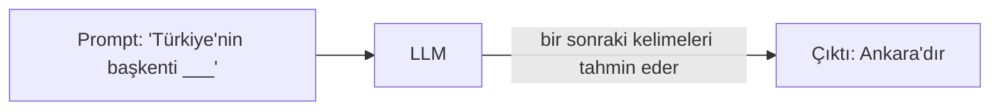
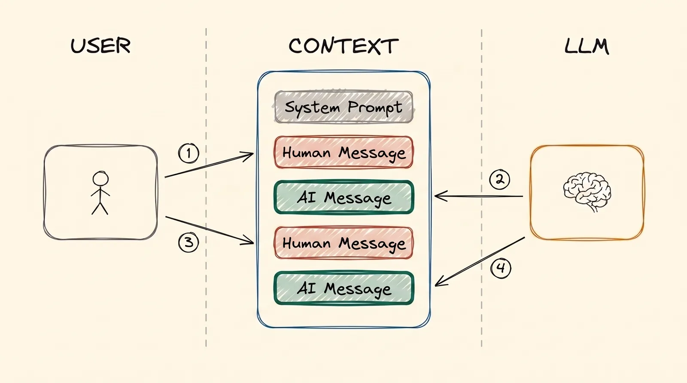
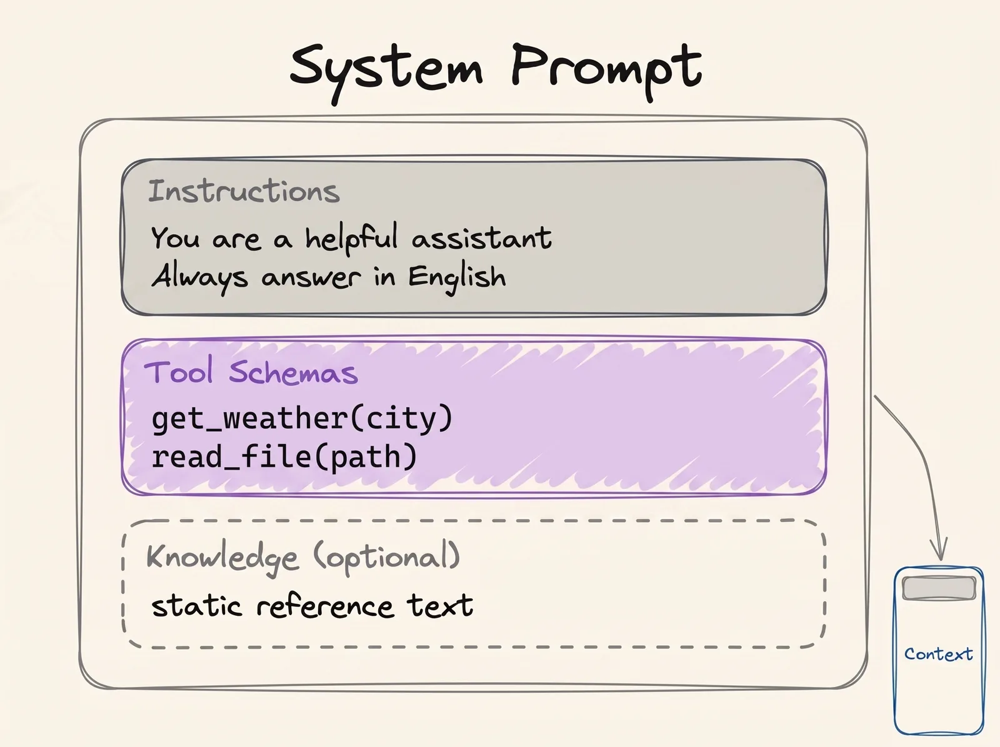

---
objectives:
  - "LLM'in sana verdiğin metinle ne yaptığını sade bir dille anlat."
  - "Context window'u, telefondaki bir sohbeti örnek alarak açıkla."
  - "Bir sohbetteki üç tür mesajı say ve her birini kimin yazdığını söyle."
  - "Bir modeli bulutta çalıştırmakla kendi bilgisayarında çalıştırmayı birbirinden ayırt et."
---

# LLM Temelleri

ChatGPT'nin, Claude'un ve Gemini'nin içinde aynı şey var: LLM, yani Large Language Model (Büyük Dil Modeli). Bu kurstaki her modül bu tek fikrin ve onunla gelen bir sınırın üzerine kurulu. O yüzden başlangıç noktamız burası.

## Bu Senin İçin Neden Önemli

Bu kurs bir AI *mühendisliği* kursu, ama yalnızca mühendisler için değil, herkes için yazıldı. Bunu bilerek böyle yaptık.

Bugünün yapay zekâsını kullanmak için matematik yazman, özel araçlar kurman ya da bir diploma sahibi olman gerekmiyor. Onunla bir iş arkadaşınla konuştuğun gibi, normal bir dille konuşuyorsun. Arayüz normal dil olduğu için, bir sorunu net anlatabilen herkes artık yapay zekâyla sorun çözebilir. Bir İK uzmanı, bir muhasebeci, bir mimar ya da bir voleybolcu, ne istediğini anlatarak küçük bir web sitesi ya da şirket içi bir araç yaptırabilir.

Ama bunu iyi anlatabilmek için yapay zekânın nasıl çalıştığını bilmen gerekiyor: neyi görüyor, neyi hatırlıyor ve nerede yanılıyor. AI mühendisliği tam olarak bu. Mühendis olmak zorunda değilsin. Sadece kavramları bilmen yeter; bu kurs, gerçekten önemli olanların kısa bir özeti.

## LLM Nedir?

LLM, içeri metin alıp dışarı metin veren bir programdır. Ona birkaç kelime gönderirsin (**prompt**), o da sana daha fazla kelimeyle cevap verir (**generation**).

Telefonunun klavyesindeki kelime önerilerini düşün. "Yarın görüşürüz" yazarken telefon sana bir sonraki kelimeyi önerir. LLM de aynı şeyi yapar, ama internetin çok büyük bir kısmından öğrenmiştir: kitaplardan, web sitelerinden, makalelerden ve koddan. Bütün bu metinden tek bir yetenek öğrenmiştir: bir sonraki kelimeyi en olası şekilde tahmin etmek.



Yaptığı iş gerçekten bundan ibaret. Bir kelime tahmin eder, onu metne ekler, sonra bir sonraki kelimeyi tahmin eder; cevap tamamlanana kadar bunu tekrar tekrar yapar. LLM'in yaptığı her akıllıca şey, bu tek tahminin tekrarından çıkar.

## Bir LLM Ne Kadar Büyük?

LLM'in içi, **parametre (parameter)** denen sayılardan oluşan bir ağdır. Parametreleri bir beyindeki bağlantılara benzetebilirsin. Parametre sayısı arttıkça model genellikle daha akıllı olur, ama daha akıllı bir model çalışmak için daha büyük bir bilgisayara ihtiyaç duyar.

Küçük modeller iyi bir dizüstü bilgisayarda çalışabilir. Orta boy modeller için bir şirket sunucusu gerekir. ChatGPT ve Claude'un arkasındaki en büyük modellerin yüz milyarlarca, hatta trilyonlarca parametresi var ve bunlar yalnızca büyük veri merkezlerinde çalışır.

Araştırmacılar bunu 2020'de ölçtü: bir modeli büyütüp daha fazla veriyle eğittiğinde, model düzgün ve öngörülebilir biçimde daha iyi oluyor. Yapay zekâ şirketlerinin sonraki yıllarda giderek daha büyük modeller yapmasının nedeni bu.

## Context Window

Bu kurstaki her şeyi şekillendiren sınır burada.

Bir WhatsApp sohbetini düşün. Mesajlar yukarıdan aşağı dizilir: biri senden, sonraki karşındaki kişiden, bir sonraki yine senden. Bir yapay zekâ sohbeti de tamamen aynıdır. Her mesaj gönderdiğinde yapay zekâ **sohbetin tamamını baştan** okur ve cevabını en alta yazar.

Yapay zekânın o an görebildiği bu sohbetin tamamına **context** denir. Bunun da ulaşabileceği bir en büyük boyut vardır; buna **context window** diyoruz. Senin mesajların ve yapay zekânın cevapları birlikte sayılır. Bir sohbet bu boyutu aştığında istek başarısız olur. Daha sonraki bir modül olan [Context Engineering](../2_intermediate/context_engineering_tr.md), uzun bir sohbetin henüz dolmadan da neden kötüleşebildiğini anlatıyor.

Aynı sohbet için başka isimler de duyacaksın: **context**, **working memory**, **message history** (mesaj geçmişi) ve **short-term memory**. Hepsi, yapay zekânın okuduğu mesaj yığını demek. [Memory](memory_tr.md) modülü buraya geri dönecek.

### Context'e Ne Girer?

Normal bir sohbette üç tür mesaj vardır:

- **Senin mesajın**: yazdığın şey. İnsanlar buna "prompt" der.
- **Yapay zekânın mesajı**: onun cevabı.
- **System prompt**: sohbetin en üstündeki gizli talimatlar. Bunları ürünü yapan şirket (OpenAI, Anthropic ya da bir geliştirici) yazar. Sen görmezsin, ama yapay zekâ her seferinde önce bunları okur. Yapay zekâya nasıl davranacağını ve hangi araçları (tool) kullanabileceğini söylerler.

  
*Düz bir sohbetin iki turu: senin iki mesajın ve yapay zekânın iki cevabı. Hiçbir şey silinmez. Bu yüzden ikinci turda yapay zekâ, birinci turdaki her şeyi de okur.*

Senden bir mesaj ve yapay zekânın ona verdiği cevaba birlikte bir **tur (turn)** denir. Yukarıdaki şekilde iki tur var.

System prompt kısa bir cümle değildir. Çoğu zaman uzundur ve içinde davranış kurallarının yanı sıra yapay zekânın kullanmasına izin verilen **tool**'ların bir listesi de bulunur:

  
*Bir system prompt'un içi: davranış kuralları, tool listesi ve bazen sabit bir referans metin. Hepsi sohbetin en üstünde durur ve sen daha bir şey söylemeden önce orada olur.*

Merak edersen, insanlar birçok yapay zekâ ürününün gerçek ve sızdırılmış system prompt'larını [system_prompts_leaks](https://github.com/asgeirtj/system_prompts_leaks) adresinde toplamış.

Bir fikir daha var ve ona [Tool Calling](tools_tr.md) modülünde döneceğiz. Yapay zekâ tek başına hava durumuna bakamaz, çünkü internete bağlı değildir ve elleri yoktur; yalnızca metin yazabilir. Bu yüzden "lütfen İstanbul'un hava durumuna bak" diyen bir mesaj yazar. Normal bir bilgisayar programı bu mesajı okur, hava durumuna bakar ve cevabı sohbete ekler. Sonra yapay zekâ cevabı okur ve sana yanıt verir. **Yapay zekâ ister; işi başka bir şey yapar.** Her AI agent'ının temeli bu ayrımdır.

## LLM Hyperparameter'ları

Yapay zekânın nasıl cevap vereceğini birkaç ayarla değiştirebilirsin:

- **Temperature**: yaratıcılık düğmesi, genellikle 0 ile 1 arasında. Düşük bir değer (0.1) istikrarlı, öngörülebilir cevaplar verir. Yüksek bir değer (0.9) daha yaratıcı cevaplar verir, ama bunlar daha az güvenilirdir.
- **Max output tokens**: cevabın ne kadar uzun olabileceğine koyulan sınır. **Token**, bir kelimenin bir parçasıdır; yani bu ayar kabaca bir kelime sınırı gibidir.

Bu ayarlara **hiperparametre (hyperparameter)** denir. Yukarıda anlattığımız parametrelerden farklıdırlar: parametreler modelin içindeki sayılardır, hiperparametreler ise modeli kullanırken senin ayarladığın düğmelerdir.

## Bir LLM'i Çalıştırmak (Inference)

Bir modeli cevap alacak şekilde çalıştırmaya **inference** denir. Bunu yapmanın iki yolu var.

**1. Bulutta.** Modeli, internet üzerinden bir şirketin bilgisayarlarında kullanırsın. ChatGPT ya da Claude kullandığında olan şey budur.

- **Artısı:** en büyük ve en akıllı modellere erişirsin ve hiç donanım satın almazsın.
- **Eksisi:** para gerektirir, internet ister ve yazdığın metin o şirkete gider.

**2. Kendi bilgisayarında (local).** Model senin makinende çalışır.

- **Artısı:** kurulumdan sonra ücretsizdir, internet olmadan çalışır ve yazdığın metin bilgisayarından hiç çıkmaz. Şirkete ait gizli veriler söz konusu olduğunda bu son madde çok önemli olabilir.
- **Eksisi:** güçlü bir bilgisayar gerekir ve yalnızca daha küçük modelleri çalıştırabilirsin.

Bir modeli normal bir bilgisayara sığdırmak için insanlar onu küçültür. Buna **quantization** denir. Model yaklaşık dört kat daha az bellek kullanır; modelin kendisi aynı kalır. Bunu kendin yapmak zorunda değilsin: popüler modellerin küçültülmüş sürümleri indirmeye hazır bekliyor.

**Kendin dene:** **[LM Studio](https://lmstudio.ai/)**, küçük bir modeli indirip kendi dizüstü bilgisayarında, internet olmadan onunla sohbet etmeni sağlayan bir uygulama. Birkaç dakika sürüyor ve bu modüldeki her şeyi gerçekten görmene yardım ediyor.

Bulut tarafında şirketler modelleri bir **inference provider** (çıkarım sağlayıcısı) üzerinden kiralar. [OpenRouter](https://openrouter.ai/) gibi bazı servisler, tek bir hesapla birçok şirketin birçok modeline açılan tek bir kapıdır.

## LLM'lere Prompt Yazmak

**Prompt engineering**, istediğin çıktıyı alabilmek için girdini iyi yazmaktır. Öğrencilere talimat vermeye benzer. Net talimatlar ödevin düzgün yapılmasını sağlar. Belirsiz talimatlarda ise her öğrenci canı ne istediyse onu yapar.

Modelin ne yaptığını hatırla: sohbetteki her şeye bakarak en olası bir sonraki kelimeyi hesaplar. Bir formül olarak yazarsak:

```
P(next token | context)
```

Bunu "context verildiğinde bir sonraki kelimenin olasılığı" diye oku. Senin prompt'un tam olarak o context'tir. Yani senin işin, istediğin cevabı en olası cevap yapacak girdiyi yazmaktır:

```
best prompt = the prompt that maximises P(the output you want | prompt)
```

Formül sana pek bir şey ifade etmiyorsa sorun değil. Önemli olan, formülün üstündeki cümledeki fikir. [Prompt Engineering](../2_intermediate/prompt_engineering_tr.md) modülü bunu ayrıntılı anlatıyor.

## Artık Bildiğin Terimler

- **LLM**: metni okuyan ve en olası bir sonraki kelimeleri yazan model.
- **Prompt**: ona verdiğin metin. **Generation**: onun sana geri verdiği metin.
- **Parametreler**: modelin içindeki sayılar. Daha fazlası genellikle daha akıllı ve daha büyük model demek.
- **Context**: yapay zekânın her seferinde baştan okuduğu sohbetin tamamı.
- **Context window**: o sohbetin en büyük boyutu.
- **System prompt**: sohbetin en üstündeki, şirketin yazdığı gizli talimatlar.
- **Tur (turn)**: senin bir mesajın ve yapay zekânın ona verdiği cevap.
- **Temperature**: yaratıcılık düğmesi.
- **Hiperparametre (hyperparameter)**: bir modeli kullanırken ayarladığın düğmeler, örneğin temperature.
- **Token**: bir kelimenin bir parçası.
- **Inference**: bir modeli cevap almak için çalıştırmak; bulutta ya da kendi bilgisayarında.
- **Quantization**: bir modeli normal bir bilgisayara sığması için küçültmek.
- **Inference provider**: modelleri çalıştıran ve sana kiralayan bir şirket.
- **Prompt engineering**: istediğin cevabı alacak şekilde girdini yazmak.

## Özet

LLM, bir sonraki kelimeyi tekrar tekrar tahmin eder. Her cevap verişinde sohbetin tamamını okur ve bu sohbetin bir en büyük boyutu vardır: context window. Sohbetin en üstünde gizli talimatlar durur: system prompt. Bir modeli bulutta kullanabilir ya da küçük bir modeli kendi bilgisayarında çalıştırabilirsin.

Sohbet resmini aklında tut. Sonraki modüllerin neredeyse hepsi tek bir soruya cevap veriyor: *bu sınırlı sohbetin içine ne koyacağız?*

**Hızlı Kontrol**: Yapay zekâ, her mesaj gönderdiğinde neden sohbetin tamamını yeniden okuyor? Senin mesajınla system prompt arasındaki fark ne?

## Kaynaklar

### 📄 Makaleler

- [Scaling Laws for Neural Language Models](https://arxiv.org/abs/2001.08361): "daha büyük modeller daha iyidir" fikrinin arkasındaki 2020 ölçümü

### 🎬 Videolar

- [Large Language Models explained briefly](https://youtu.be/LPZh9BOjkQs?si=8kH-lzHbfHRL1_8h): izlemeyi tercih edersen, aynı fikirleri anlatan kısa bir video

### 🛠️ Araçlar

- [LM Studio](https://lmstudio.ai/): küçük bir modeli indirip dizüstü bilgisayarında onunla sohbet et
- [Artificial Analysis](https://artificialanalysis.ai/): modelleri ve skorlarını karşılaştır
- [OpenRouter](https://openrouter.ai/): birçok şirketin modelleri için tek bir hesap

### 🗃️ Repolar

- [System prompt leaks](https://github.com/asgeirtj/system_prompts_leaks): birçok yapay zekâ ürününün gerçek system prompt'ları
