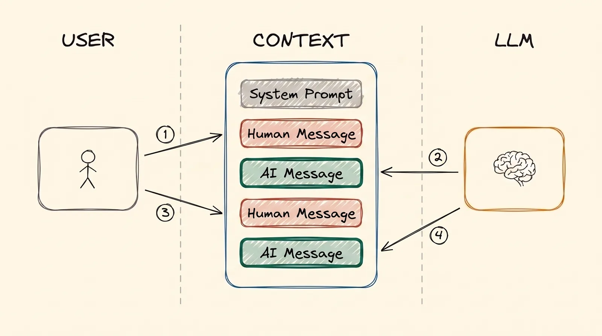
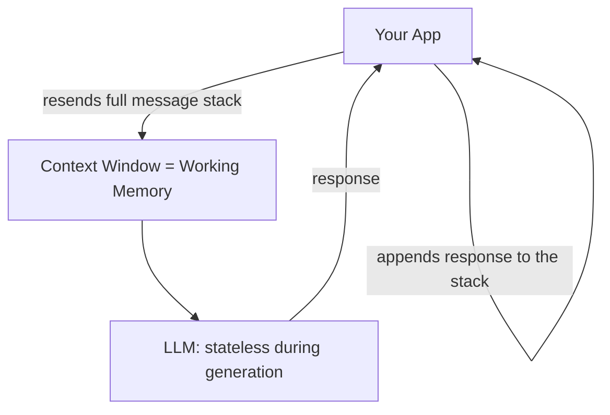
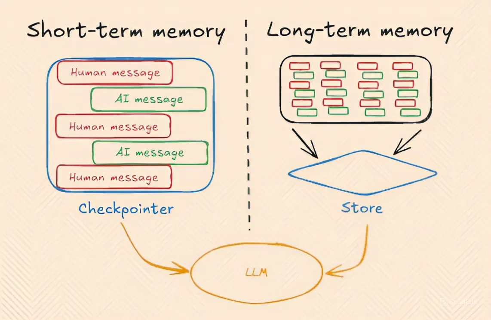

# Memory

Before we get to agents, here is one idea that sits under everything so far: an AI does not
remember anything on its own. And "memory" is not one thing. There are three kinds. They live in
different places, and they behave in completely different ways.

## Why This Matters to You

People often say "the AI remembers me" or "it forgot what I told it". Both are a little wrong.
Once you know where each kind of memory lives, you understand why a long chat goes wrong, why a
new chat forgets everything, and why some AI answers can show their sources while others cannot.

## Three Types of Memory

- **Parametric memory** (permanent): what training put inside the model's numbers.
- **Working memory**, also called **short-term memory** (temporary): the chat that the AI can see
  right now.
- **Long-term memory** (saved outside): notes and documents kept outside the model, and brought
  back into the chat when they are needed.

Let's go through each one.

## Parametric Memory

Remember [Training LLMs](training.md). Whatever a model learned in training is stored inside its
numbers, its parameters. That is why it is called parametric memory.

- **It is permanent.** It does not disappear when a chat ends, and you do not need to send it
  again.
- **It is not exact.** The model learned from billions of documents. Any one document is mixed in
  with all the others, so the model cannot recall it word for word.

Think of a person who has read 1,000 books. They know roughly what the books were about. But ask
them to quote page 214 of book number 537, and they will struggle. The information is in there
somewhere, but they cannot find it exactly.

## Working Memory

**Working memory** is the text the AI is working with right now: the chat it can see.

Go back to the person with 1,000 books. Working memory is the same person with *one book open in
front of them*. They do not need to remember anything. They can read it. That is why an AI
answers so much better from text that is in the chat than from what it learned in training.

**The problem:** working memory has a maximum size (the context window from
[LLM Fundamentals](llms.md)), and it is gone when you start a new chat. Every new chat starts
completely empty.

### An LLM is Stateless During Generation

Here is the most important idea in this module. The AI remembers nothing even *between two
messages in the same chat*. Each message you send is a new, separate request, as if the AI had
never met you. In technical words, the model is **stateless**.

So why does a chat feel like one continuous conversation? Because the app fakes it.

Imagine talking to someone who forgets everything the moment they reply. To keep the
conversation going, you hand them **the printout of the whole chat** with every new message.
They read it all from the top, and then they answer. That is exactly what an AI app does. It
keeps every message in a growing stack, and it sends the whole stack again, every single time.

  
*This stack is working memory. You write a message, and the AI writes one back. Nothing is removed. In the second round, the AI reads everything from the first round again, because the app sends the whole stack every time.*

This is also why a very long chat costs more: every new message makes the app
send everything again.

  
*Working (short-term) memory is the growing stack of your messages and the AI's replies. Long-term memory is a separate store: parts of the chat are saved there and brought back later, even in a new chat. The labels "Checkpointer" and "Store" come from one software framework. Others use different names for the same idea.*

## Long-term Memory

Sometimes the app does not let working memory disappear when a chat ends. It saves notes or a
summary somewhere outside the model, like notes in a notebook. Later, even in a completely new
chat, it can look in the notebook and bring the right notes back into the chat. It often uses
the search from [RAG & Embeddings](rag.md) to find them.

**Example:** you upload 5 PDFs to ChatGPT in one chat. Later, in a new chat, you ask about
them, and ChatGPT may still answer. This is not because the model learned them in training, and
it is not because they are in the new chat, which started empty. It is because ChatGPT saved and
indexed them earlier, and now it found them again and brought the right parts back into the chat.

## Side-by-side Comparison

| | Parametric | Working (Short-Term) | Long-Term |
|---|---|---|---|
| Stored in | The model's numbers | The chat (context window) | A database or files outside the model |
| How long it lasts | Permanent | Until the chat ends or fills up | Across chats |
| How exact it is | Fuzzy | Very exact: the AI reads it directly | Exact, once brought back into the chat |
| Created by | Training or fine-tuning | The growing stack of messages | Saving, then finding again, often with RAG |
| Picture | Someone who has read 1,000 books | The same person with one book open | That person's own notes, looked up later |

The main point: **the AI itself has no memory of its own.** Parametric memory is what training
stored. Working memory is what the app shows it right now. Long-term memory is what the app saves
and brings back later.

## Pros and Cons

Working memory and long-term memory have one thing in common: the information is text that the
AI reads, outside its numbers. So together they are called **non-parametric memory**.

| | Parametric (in the model) | Non-parametric (in the chat, or brought into it) |
|---|---|---|
| Changing it | Train again: hours or days, and real money | Edit a file or a database row; the next message sees it |
| How fresh it is | Frozen on the day training ended | As current as the data you keep |
| Where an answer came from | Unknown | Known: you can point at the exact document |
| Good for | How the model behaves: a style, a format, a skill | What the model should know: facts and documents that change |

The row that matters most is the source. When an AI answers from what it learned in training,
you usually cannot tell which document the answer came from. Go back to the person with 1,000 books: they
can tell you a fact, but not which book it came from. Give them their own notes, and they can
point at the page.

An answer from non-parametric memory can be **cited**: the app can show you the document the AI
had in front of it. For HR, finance and legal work, where you must be able to check an answer,
this is one of the main reasons why RAG usually beats fine-tuning.

## Words You Now Know

- **Parametric memory**: what training stored inside the model. Permanent, but fuzzy.
- **Working memory** (short-term memory): the chat the AI can see right now.
- **Long-term memory**: notes saved outside the model and brought back when needed.
- **Stateless**: the AI remembers nothing between two messages; the app resends the whole chat.
- **Non-parametric memory**: any knowledge kept as text outside the model.
- **Cited answer**: an answer that shows the document it came from.

## Summary

There are three kinds of memory. Parametric memory is permanent but fuzzy. Working memory is
exact but temporary, and the AI only "remembers" a chat because the app sends the whole chat
again with every message. Long-term memory is saved outside the model and brought back when it is
needed, often with RAG. Only memory outside the model can show where an answer came from.

Next come agents. They depend on this same working memory to plan and act over many steps.

**Quick check**: Why does a new chat forget everything? How does a chat feel continuous if the AI
remembers nothing between messages? And why can a RAG answer show its source when a trained-in
answer cannot?

## References

### 📄 Articles

- [The three memory types every LLM developer must know](https://medium.com/@sahilnanga4/the-three-memory-types-every-llm-developer-must-know-3358c26fdff3): the same three kinds, from a different angle
- [Retrieval-Augmented Generation for Knowledge-Intensive NLP Tasks](https://arxiv.org/abs/2005.11401): the original research paper that named parametric and non-parametric memory
