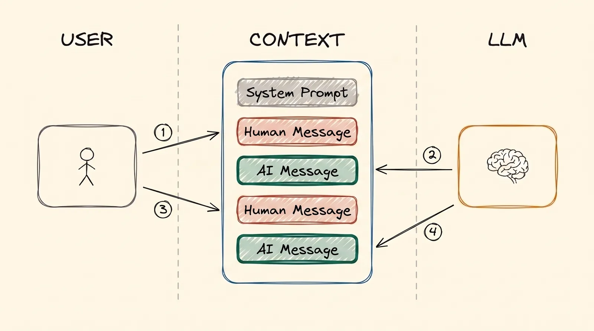
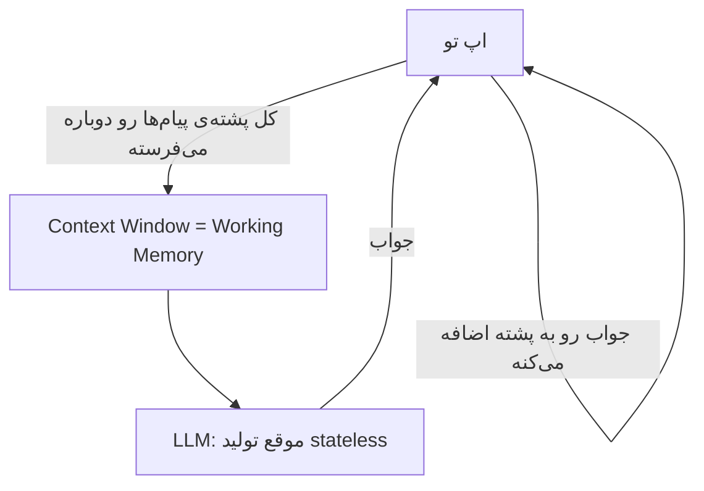
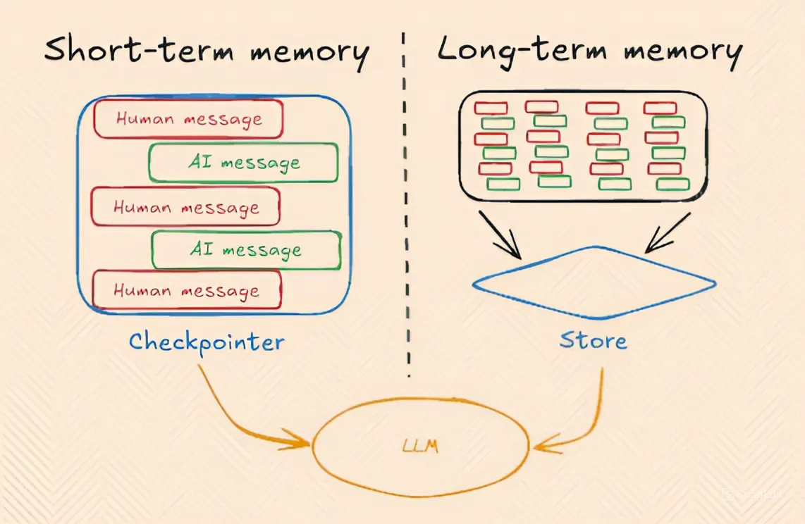

# Memory

قبل از این‌که برسیم به agent‌ها، یه ایده هست که زیر همه‌ی چیزهای قبلی قرار داره: هوش مصنوعی خودش هیچ‌چیز یادش نمی‌مونه. و «memory» هم یه چیز واحد نیست. سه جور داره. هر کدوم یه جای جدا زندگی می‌کنن و کاملاً متفاوت رفتار می‌کنن.

## چرا این برای تو مهمه

آدم‌ها اغلب می‌گن «هوش مصنوعی من رو یادشه» یا «یادش رفت بهش چی گفتم». هر دو یه کم غلطه. وقتی بدونی هر نوع memory کجا زندگی می‌کنه، می‌فهمی چرا یه چت طولانی خراب می‌شه، چرا یه چت جدید همه‌چیز رو فراموش می‌کنه، و چرا بعضی از جواب‌های هوش مصنوعی می‌تونن منبعشون رو نشون بدن و بعضی نه.

## سه نوع memory

- **Parametric memory** (دائمی): چیزی که training توی عددهای مدل گذاشته.
- **Working memory**، که بهش **short-term memory** هم می‌گن (موقت): چتی که هوش مصنوعی همین الان می‌تونه ببینه.
- **Long-term memory** (ذخیره‌شده بیرون): یادداشت‌ها و سندهایی که بیرون از مدل نگه‌داری می‌شن، و وقتی لازم باشن به چت برمی‌گردن.

بریم سراغ هر کدوم.

## Parametric Memory

[Training LLMs](training_fa.md) رو یادت بیار. هر چیزی که یه مدل توی training یاد گرفته، توی عددهاش، یعنی parameter‌هاش ذخیره شده. برای همین بهش می‌گن parametric memory.

- **دائمیه.** وقتی چت تموم می‌شه از بین نمی‌ره، و لازم نیست دوباره بفرستیش.
- **دقیق نیست.** مدل از میلیاردها سند یاد گرفته. هر سند با بقیه قاطی شده، پس مدل نمی‌تونه کلمه به کلمه به یاد بیارتش.

یه آدم رو در نظر بگیر که 1,000 تا کتاب خونده. تقریباً می‌دونه کتاب‌ها درباره‌ی چی بودن. ولی ازش بخواه صفحه‌ی 214 کتاب شماره‌ی 537 رو نقل کنه، دستش بند می‌شه. اطلاعات یه جایی اون تو هست، ولی نمی‌تونه دقیق پیداش کنه.

## Working Memory

**Working memory** متنیه که هوش مصنوعی همین الان باهاش کار می‌کنه: چتی که می‌تونه ببینه.

برگرد سراغ اون آدمی که 1,000 تا کتاب خونده. working memory همون آدمه، ولی *با یه کتاب باز جلوش*. لازم نیست چیزی رو یادش بیاره. می‌تونه بخونه. برای همین هوش مصنوعی از روی متنی که تو چته خیلی بهتر جواب می‌ده تا از روی چیزی که توی training یاد گرفته.

**مشکل:** working memory یه اندازه‌ی بیشینه داره (همون context window از [مبانی LLM](llms_fa.md))، و وقتی یه چت جدید شروع می‌کنی از بین می‌ره. هر چت جدید کاملاً خالی شروع می‌شه.

### LLM موقع Generation، Stateless‌ه

این مهم‌ترین ایده‌ی این درسه. هوش مصنوعی حتی *بین دو تا پیام توی یه چت* هم چیزی یادش نمی‌مونه. هر پیامی که می‌فرستی یه درخواست جدید و جداست، انگار هوش مصنوعی هیچ‌وقت تو رو ندیده. به زبون فنی، مدل **stateless**‌ه.

پس چرا یه چت مثل یه گفت‌وگوی پیوسته حس می‌شه؟ چون اپ این حس رو درست می‌کنه.

فرض کن داری با کسی حرف می‌زنی که به محض جواب دادن همه‌چیز رو فراموش می‌کنه. برای این‌که گفت‌وگو ادامه پیدا کنه، با هر پیام جدید **پرینت کل چت** رو بهش می‌دی. اون همه‌ش رو از بالا می‌خونه، و بعد جواب می‌ده. یه اپ هوش مصنوعی دقیقاً همین کار رو می‌کنه. هر پیام رو توی یه پشته‌ی در حال رشد نگه می‌داره، و هر بار کل پشته رو دوباره می‌فرسته.

  
*این پشته همون working memory‌ه. تو یه پیام می‌نویسی و هوش مصنوعی یکی برمی‌گردونه. هیچ‌چیز پاک نمی‌شه. توی دور دوم، هوش مصنوعی هر چیزی که تو دور اول بوده رو دوباره می‌خونه، چون اپ هر بار کل پشته رو می‌فرسته.*

برای همین هم یه چت خیلی طولانی گرون‌تر تموم می‌شه: هر پیام جدید باعث می‌شه اپ همه‌چیز رو دوباره بفرسته.

  
*Working memory (یا short-term) همون پشته‌ی در حال رشد پیام‌های تو و جواب‌های هوش مصنوعیه. Long-term memory یه جای ذخیره‌ی جداست: بخش‌هایی از چت اون‌جا ذخیره می‌شن و بعداً، حتی توی یه چت جدید، برمی‌گردن. برچسب‌های «Checkpointer» و «Store» از یه framework نرم‌افزاری خاص میان. بقیه برای همین ایده اسم‌های دیگه‌ای دارن.*

## Long-term Memory

گاهی اپ نمی‌ذاره working memory با تموم شدن چت از بین بره. یادداشت‌ها یا یه خلاصه رو یه جایی بیرون از مدل ذخیره می‌کنه، مثل یادداشت‌های توی یه دفترچه. بعداً، حتی توی یه چت کاملاً جدید، می‌تونه یه نگاه به دفترچه بندازه و یادداشت‌های درست رو به چت برگردونه. برای پیدا کردن‌شون اغلب از جست‌وجوی [RAG و Embedding‌ها](rag_fa.md) استفاده می‌کنه.

**مثال:** توی یه چت 5 تا PDF به ChatGPT می‌دی. بعداً، توی یه چت جدید، درباره‌شون می‌پرسی و ChatGPT شاید هنوز جواب بده. این به این دلیل نیست که مدل اون‌ها رو توی training یاد گرفته، و به این دلیل هم نیست که توی چت جدید هستن، چون اون خالی شروع شده بود. دلیلش اینه که ChatGPT اون‌ها رو قبلاً ذخیره و index کرده بود، و حالا دوباره پیداشون کرد و بخش‌های درست رو به چت برگردوند.

## مقایسه‌ی کنار هم

| | Parametric | Working (Short-Term) | Long-Term |
|---|---|---|---|
| کجا ذخیره می‌شه | عددهای مدل | چت (context window) | یه دیتابیس یا فایل‌ها، بیرون از مدل |
| چقدر می‌مونه | دائمی | تا وقتی چت تموم بشه یا پر بشه | بین چت‌ها |
| چقدر دقیقه | مبهم | خیلی دقیق: هوش مصنوعی مستقیم می‌خونتش | دقیق، بعد از این‌که به چت برگشت |
| چطور ساخته می‌شه | Training یا fine-tuning | پشته‌ی در حال رشد پیام‌ها | ذخیره کردن، بعد دوباره پیدا کردن، اغلب با RAG |
| تصویرش | کسی که 1,000 تا کتاب خونده | همون آدم با یه کتاب باز | یادداشت‌های خودِ اون آدم، که بعداً دنبالشون می‌گرده |

نکته‌ی اصلی: **خودِ هوش مصنوعی memory‌ای از خودش نداره.** Parametric memory چیزیه که training ذخیره کرده. Working memory چیزیه که اپ همین الان نشونش می‌ده. Long-term memory چیزیه که اپ ذخیره می‌کنه و بعداً برمی‌گردونه.

## مزایا و معایب

Working memory و long-term memory یه چیز مشترک دارن: اطلاعاتشون متنیه که هوش مصنوعی بیرون از عددهاش می‌خونه. برای همین روی هم بهشون می‌گن **non-parametric memory**.

| | Parametric (توی مدل) | Non-parametric (توی چت، یا آورده‌شده به چت) |
|---|---|---|
| عوض کردنش | دوباره train کن: ساعت‌ها یا روزها، و پول واقعی | یه فایل یا یه ردیف دیتابیس رو ویرایش کن؛ پیام بعدی می‌بینتش |
| چقدر تازه‌ست | منجمد توی روزی که training تموم شد | به‌روز به اندازه‌ی داده‌ای که نگه می‌داری |
| جواب از کجا اومده | نامعلوم | معلوم: می‌تونی به همون سند اشاره کنی |
| به چی می‌خوره | رفتار مدل: یه سبک، یه قالب، یه مهارت | چیزی که مدل باید بدونه: واقعیت‌ها و سندهایی که عوض می‌شن |

ردیفی که از همه مهم‌تره منبعه. وقتی یه هوش مصنوعی از روی چیزی که توی training یاد گرفته جواب می‌ده، معمولاً نمی‌تونی بفهمی جواب از کدوم سند اومده. برگرد سراغ آدم 1,000 کتابی: یه واقعیت رو می‌تونه بهت بگه، ولی نمی‌تونه بگه از کدوم کتاب اومده. یادداشت‌های خودش رو بهش بدی، می‌تونه صفحه رو نشون بده.

جواب یه non-parametric memory رو می‌شه **cite** کرد: اپ می‌تونه سندی رو که هوش مصنوعی جلوی چشمش داشته نشونت بده. توی کار منابع انسانی، مالی و حقوقی، که باید بتونی یه جواب رو چک کنی، این یکی از دلیل‌های اصلیه که RAG معمولاً از fine-tuning بهتره.

## کلمه‌هایی که الان بلدی

- **Parametric memory**: چیزی که training توی مدل ذخیره کرده. دائمی، ولی مبهم.
- **Working memory** (short-term memory): چتی که هوش مصنوعی همین الان می‌تونه ببینه.
- **Long-term memory**: یادداشت‌هایی که بیرون از مدل ذخیره می‌شن و وقتی لازم باشن برمی‌گردن.
- **Stateless**: هوش مصنوعی بین دو پیام چیزی یادش نمی‌مونه؛ اپ کل چت رو دوباره می‌فرسته.
- **Non-parametric memory**: هر دانشی که به شکل متن بیرون از مدل نگه‌داری می‌شه.
- **جواب cite‌شده**: جوابی که سندی رو که ازش اومده نشون می‌ده.

## خلاصه

سه نوع memory هست. Parametric memory دائمیه ولی مبهم. Working memory دقیقه ولی موقته، و هوش مصنوعی فقط به این دلیل یه چت رو «یادشه» که اپ با هر پیام کل چت رو دوباره می‌فرسته. Long-term memory بیرون از مدل ذخیره می‌شه و وقتی لازم باشه برمی‌گرده، اغلب با RAG. فقط memory‌ای که بیرون از مدله می‌تونه نشون بده یه جواب از کجا اومده.

درس بعدی agent‌هاست. اون‌ها برای برنامه‌ریزی و عمل کردن توی چند قدم، به همین working memory تکیه می‌کنن.

**بررسی سریع**: چرا یه چت جدید همه‌چیز رو فراموش می‌کنه؟ اگه هوش مصنوعی بین پیام‌ها چیزی یادش نمی‌مونه، چطور یه چت پیوسته حس می‌شه؟ و چرا جواب RAG می‌تونه منبعش رو نشون بده ولی جوابی که از training میاد نه؟

## منابع

### 📄 مقاله‌ها

- [The three memory types every LLM developer must know](https://medium.com/@sahilnanga4/the-three-memory-types-every-llm-developer-must-know-3358c26fdff3): همین سه نوع، از یه زاویه‌ی دیگه
- [Retrieval-Augmented Generation for Knowledge-Intensive NLP Tasks](https://arxiv.org/abs/2005.11401): مقاله‌ی پژوهشی اصلی که اسم parametric و non-parametric memory رو گذاشت
