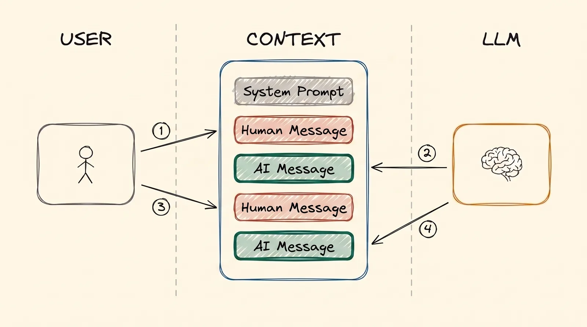
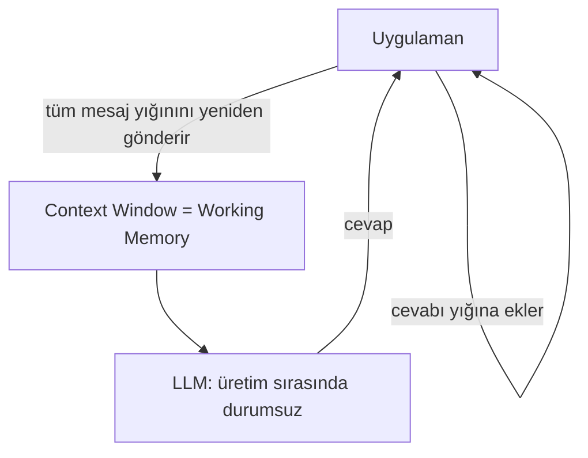
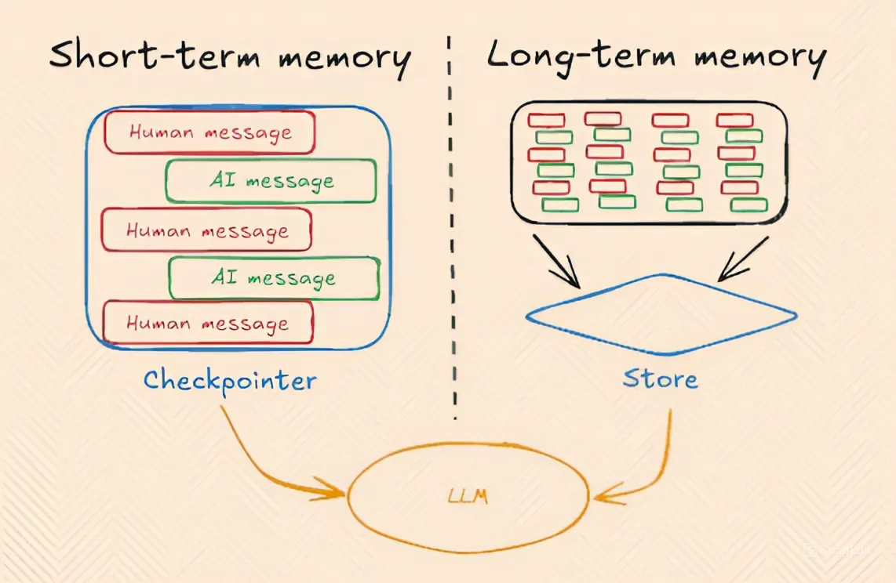

# Memory

Agent'lara geçmeden önce, şimdiye kadar anlattığımız her şeyin altında yatan bir fikir var: bir yapay zekâ kendi başına hiçbir şeyi hatırlamaz. Üstelik "hafıza" tek bir şey değil. Üç türü var. Farklı yerlerde duruyorlar ve birbirinden tamamen farklı davranıyorlar.

## Bu Senin İçin Neden Önemli

İnsanlar sık sık "yapay zekâ beni hatırlıyor" ya da "ona söylediğimi unuttu" der. İkisi de biraz yanlış. Her hafıza türünün nerede durduğunu bilirsen, uzun bir sohbetin neden bozulduğunu, yeni bir sohbetin neden her şeyi unuttuğunu ve bazı yapay zekâ cevaplarının neden kaynaklarını gösterebildiğini, bazılarının neden gösteremediğini anlarsın.

## Üç Memory Türü

- **Parametric memory** (kalıcı): eğitimin modelin sayılarının içine koyduğu şey.
- **Working memory**, yani **short-term memory** (geçici): yapay zekânın şu an görebildiği sohbet.
- **Long-term memory** (dışarıda saklanan): modelin dışında tutulan, gerektiğinde sohbete geri getirilen notlar ve dokümanlar.

Sırayla hepsine bakalım.

## Parametric Memory

[Training LLMs](training_tr.md) modülünü hatırla. Bir modelin eğitimde öğrendiği her şey, sayılarının, yani parametrelerinin içinde saklanır. Buna parametric memory denmesinin nedeni bu.

- **Kalıcıdır.** Sohbet bittiğinde kaybolmaz ve onu yeniden göndermen gerekmez.
- **Kesin değildir.** Model milyarlarca dokümandan öğrendi. Her doküman diğerlerinin arasına karışmıştır, bu yüzden model herhangi birini kelimesi kelimesine hatırlayamaz.

1.000 kitap okumuş bir insanı düşün. Kitapların kabaca ne anlattığını bilir. Ama ondan 537 numaralı kitabın 214. sayfasını alıntılamasını iste, zorlanır. Bilgi içeride bir yerde duruyor, ama onu tam olarak bulamaz.

## Working Memory

**Working memory**, yapay zekânın şu an üzerinde çalıştığı metindir: görebildiği sohbet.

1.000 kitap okumuş kişiye geri dön. Working memory, aynı kişinin *önünde tek bir kitap açıkken* hâlidir. Hiçbir şeyi hatırlaması gerekmez. Okuyabilir. Bir yapay zekânın, sohbette bulunan metinden cevap vermesinin eğitimde öğrendiklerinden cevap vermesine göre çok daha iyi olmasının nedeni bu.

**Sorun:** working memory'nin bir en büyük boyutu var ([LLM Temelleri](llms_tr.md) modülündeki context window) ve yeni bir sohbet açtığında yok olur. Her yeni sohbet tamamen boş başlar.

### Bir LLM Generation Sırasında Stateless'tır

Bu modüldeki en önemli fikir bu. Yapay zekâ, aynı sohbetteki *iki mesaj arasında bile* hiçbir şey hatırlamaz. Gönderdiğin her mesaj yeni ve ayrı bir istektir; sanki yapay zekâ seni hiç tanımıyormuş gibi. Teknik bir ifadeyle model **stateless**'tır, yani durumsuzdur.

Peki bir sohbet neden kesintisiz bir konuşma gibi geliyor? Çünkü bunu uygulama yapıyor.

Cevap verdiği anda her şeyi unutan biriyle konuştuğunu düşün. Konuşmayı sürdürmek için her yeni mesajda ona **sohbetin tamamının çıktısını** verirsin. O da hepsini baştan okur ve sonra cevap verir. Bir yapay zekâ uygulamasının yaptığı tam olarak bu. Her mesajı büyüyen bir yığında tutar ve yığının tamamını her seferinde yeniden gönderir.

  
*Bu yığın, working memory'dir. Sen bir mesaj yazarsın, yapay zekâ da sana bir mesaj yazar. Hiçbir şey silinmez. İkinci turda yapay zekâ birinci turdaki her şeyi yeniden okur, çünkü uygulama yığının tamamını her seferinde gönderir.*

Çok uzun bir sohbetin daha pahalıya gelmesinin nedeni de bu: her yeni mesajda uygulama her şeyi yeniden gönderiyor.

  
*Working (short-term) memory, senin mesajlarından ve yapay zekânın cevaplarından oluşan büyüyen yığındır. Long-term memory ayrı bir depodur: sohbetin parçaları oraya kaydedilir ve daha sonra, yeni bir sohbette bile geri getirilir. "Checkpointer" ve "Store" etiketleri tek bir yazılım framework'ünden geliyor. Başkaları aynı fikir için farklı isimler kullanıyor.*

## Long-term Memory

Bazen uygulama, sohbet bittiğinde working memory'nin yok olmasına izin vermez. Modelin dışında bir yere notlar ya da bir özet kaydeder; tıpkı bir defterdeki notlar gibi. Daha sonra, tamamen yeni bir sohbette bile defterine bakıp doğru notları sohbete geri getirebilir. Onları bulmak için çoğu zaman [RAG & Embeddings](rag_tr.md) modülündeki aramayı kullanır.

**Örnek:** bir sohbette ChatGPT'ye 5 PDF yüklüyorsun. Daha sonra, yeni bir sohbette bunları soruyorsun ve ChatGPT yine de cevap verebiliyor. Bunun nedeni modelin onları eğitimde öğrenmiş olması değil; ayrıca boş başlayan yeni sohbette de bulunmuyorlar. Nedeni, ChatGPT'nin onları daha önce kaydedip indekslemiş olması ve şimdi yeniden bulup doğru parçaları sohbete geri getirmesi.

## Yan Yana Karşılaştırma

| | Parametrik | Çalışma (Kısa Süreli) | Uzun Süreli |
|---|---|---|---|
| Nerede saklanır | Modelin sayılarında | Sohbette (context window) | Modelin dışındaki bir veritabanında ya da dosyalarda |
| Ne kadar sürer | Kalıcı | Sohbet bitene ya da dolana kadar | Sohbetler boyunca |
| Ne kadar kesin | Bulanık | Çok kesin: yapay zekâ onu doğrudan okur | Sohbete geri getirildikten sonra kesin |
| Nasıl oluşur | Eğitim ya da fine-tuning | Büyüyen mesaj yığını | Kaydetmek, sonra yeniden bulmak; çoğu zaman RAG ile |
| Resim | 1.000 kitap okumuş biri | Aynı kişi, önünde tek bir kitap açık | O kişinin kendi notları, sonradan bakılan |

Ana fikir şu: **yapay zekânın kendisinin kendine ait bir belleği yoktur.** Parametric memory, eğitimin sakladığı şeydir. Working memory, uygulamanın ona şu an gösterdiği şeydir. Long-term memory ise uygulamanın kaydedip daha sonra geri getirdiği şeydir.

## Artıları ve Eksileri

Working memory ile long-term memory'nin ortak bir noktası var: bilgi, yapay zekânın okuduğu ve sayılarının dışında duran bir metindir. Bu yüzden ikisine birlikte **non-parametric bellek** (non-parametric memory) denir.

| | Parametrik (modelin içinde) | Parametrik olmayan (sohbette ya da sohbete getirilmiş) |
|---|---|---|
| Değiştirmek | Yeniden eğit: saatler ya da günler ve gerçek para | Bir dosyayı ya da bir veritabanı satırını düzenle; bir sonraki mesaj görür |
| Ne kadar güncel | Eğitimin bittiği günde donmuş | Tuttuğun veri kadar güncel |
| Cevap nereden geldi | Bilinmiyor | Biliniyor: tam doküman gösterilebilir |
| Ne için iyi | Modelin nasıl davranacağı: bir üslup, bir biçim, bir beceri | Modelin ne bilmesi gerektiği: değişen bilgiler ve dokümanlar |

En önemli satır kaynak. Bir yapay zekâ eğitimde öğrendiği şeyden cevap verdiğinde, cevabın hangi dokümandan geldiğini çoğu zaman anlayamazsın. 1.000 kitap okumuş kişiye geri dön: sana bir bilgiyi söyleyebilir, ama hangi kitaptan geldiğini söyleyemez. Ona kendi notlarını ver, sayfayı gösterebilir.

Non-parametric memory'den gelen bir cevap **kaynak gösterebilir (cited)**: uygulama, yapay zekânın önünde duran dokümanı sana gösterebilir. Bir cevabı kontrol edebilmen gereken İK, finans ve hukuk işlerinde RAG'in çoğu zaman fine-tuning'den üstün olmasının başlıca nedenlerinden biri bu.

## Artık Bildiğin Terimler

- **Parametric memory**: eğitimin modelin içine koyduğu şey. Kalıcıdır, ama bulanıktır.
- **Working memory** (short-term memory): yapay zekânın şu an görebildiği sohbet.
- **Long-term memory**: modelin dışına kaydedilen ve gerektiğinde geri getirilen notlar.
- **Stateless**: yapay zekâ iki mesaj arasında hiçbir şey hatırlamaz; uygulama sohbetin tamamını yeniden gönderir.
- **Non-parametric memory**: modelin dışında metin olarak tutulan her bilgi.
- **Kaynak gösteren cevap (cited answer)**: geldiği dokümanı gösteren cevap.

## Özet

Üç tür memory var. Parametric memory kalıcıdır ama bulanıktır. Working memory kesindir ama geçicidir ve yapay zekâ bir sohbeti yalnızca uygulama her mesajda sohbetin tamamını yeniden gönderdiği için "hatırlar". Long-term memory modelin dışına kaydedilir ve gerektiğinde, çoğu zaman RAG ile, geri getirilir. Bir cevabın nereden geldiğini yalnızca modelin dışındaki bellek gösterebilir.

Sırada agent'lar var. Onlar, birçok adım boyunca plan yapıp harekete geçmek için bu aynı working memory'ye dayanıyor.

**Hızlı Kontrol**: Yeni bir sohbet neden her şeyi unutur? Yapay zekâ mesajlar arasında hiçbir şey hatırlamıyorsa bir sohbet nasıl kesintisiz hissettiriyor? Eğitimde öğrenilmiş bir cevap kaynağını gösteremezken bir RAG cevabı neden gösterebiliyor?

## Kaynaklar

### 📄 Makaleler

- [The three memory types every LLM developer must know](https://medium.com/@sahilnanga4/the-three-memory-types-every-llm-developer-must-know-3358c26fdff3): aynı üç tür, farklı bir açıdan
- [Retrieval-Augmented Generation for Knowledge-Intensive NLP Tasks](https://arxiv.org/abs/2005.11401): parametrik ve non-parametric memory'yi adlandıran özgün araştırma makalesi
