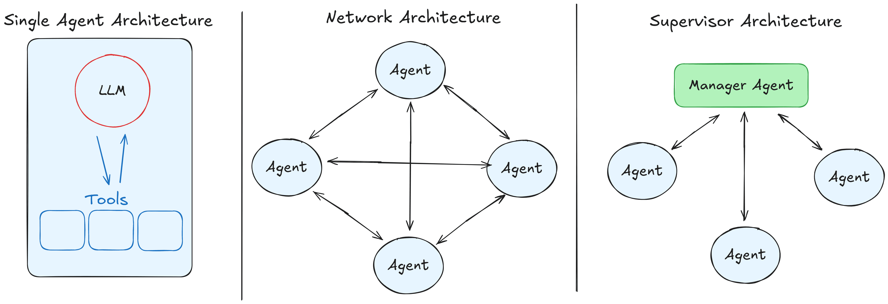
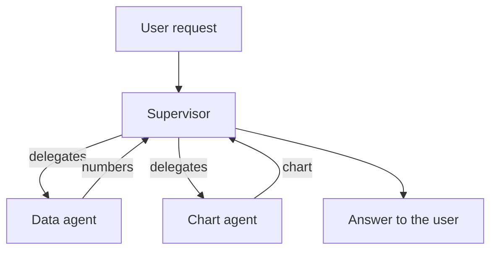

# Multi-Agent Systems

[AI Agents](agents.md) ended with one agent: one loop, one set of instructions, one set of tools.
This module is about using several agents together. It works very much like people working
together, and it brings the same problems.

## Why This Matters to You

You already know how teams work. A müdür hands out tasks. A hoca teaches several students, and
each one works on their own part. Colleagues hand work to each other, and sometimes something is
lost on the way. A team of AI agents behaves the same way. So you already understand most of this
module. It only needs new names.

## Why Use Several Agents?

Imagine asking one person to be both the company's accountant and its graphic designer. They can
do both. But their head is full of two jobs, and they make more mistakes in each.

A single agent has the same problem. Take this request: *"How many sales did we make in each
region? Show them in a bar chart."* That is two different jobs: first get the numbers from the
database, then draw a chart. One agent can do both. But its instructions must explain databases
*and* charts, and its tool list gets longer. So it has more ways to pick the wrong tool, and more
room to mix up the two jobs.

If you split the work, each agent gets short instructions, a few tools and one job, like two
specialists:

- a **data agent** that gets the numbers from the database
- a **chart agent** that turns the numbers into a chart

Each one is an ordinary agent from [AI Agents](agents.md). Nothing new was invented. You went
from one loop to several.

## Two Ways to Organise the Team

  
*Left: one agent with its tools. Middle: a network, where every agent can talk to every other agent. Right: a supervisor, who receives the request and hands work to the others. The others talk only to the supervisor.*

**Supervisor: a müdür and the team.** One agent receives the request, like a manager. It decides
who should do each part, hands the work over, collects the results and answers the user. The
team members talk to the manager and to no one else. It is like a hoca who gives each öğrenci a
part of the project and then puts the parts together.

In our example, the supervisor sends the question to the data agent and gets the numbers back.
Then it hands the numbers to the chart agent and returns the chart.

You will also hear this called **manager-worker** or **orchestrator-worker**. It is the same shape.

**Network: an open office.** There is no manager. Every agent can pass work to any other agent,
and they decide among themselves who does what next. It is flexible, like a small team that
organises itself. But it is much harder to follow, because no one place shows what was decided.

**Start with a supervisor.** It is easier to check, because every decision passes through one
place, the same way a manager knows the status of every task.

## The Problems of a Team

Both problems come *from* splitting the work. A single agent has neither. And both will sound
familiar from any office.

**Coordination.** Who does what, and in what order? How does anyone know a task is finished? Two
agents can do the same work twice. One agent can wait forever for something that never arrives.
A manager can keep handing out tasks and never stop. These are the same mistakes a badly run team
makes.

**Handover.** Each agent has its own chat, its own working memory. So when the data agent
finishes, what exactly does the chart agent get? Only the numbers? The original question too? If
you pass too little, the next agent works without information it needs, like a colleague who took
over a project with no notes. If you pass everything, it costs a lot, and it brings back the
confusion you split the work to avoid.

Getting the handover wrong is the usual reason a team of agents does *worse* than the one agent
it replaced.

### Shared Desk, or Separate Desks

This leads to one choice under every team of agents:

- **Shared context:** everyone works at one shared desk and sees everything. Nothing is lost in
  the handover, but the desk fills up fast.
- **Isolated context:** each agent has its own desk and sees only what it was handed. This is
  cheap and focused, but whatever nobody passed along is gone.

## Other Team Shapes

These names will come up later in the course:

- **Hierarchical:** managers of managers, like a company with departments.
- **Agent-as-a-tool:** one agent is given to another as if it were an ordinary tool.
- **Subagents:** an agent sends short-lived helpers to do one task each, like sending an intern to
  find something out. The helper comes back with only the result.

## When One Agent is Better

More agents is not an upgrade. It is a trade. You get shorter instructions and clearer jobs. You
pay with coordination and handover. Stay with one agent while one set of instructions still fits
well. Split when one agent is trying to learn two unrelated jobs, and split where the least
information has to pass from one agent to the next.

## Words You Now Know

- **Multi-agent system**: several agents working together on one request.
- **Supervisor** (manager-worker, orchestrator-worker): one agent hands out work and collects it.
- **Network** (swarm): agents pass work to each other with no manager.
- **Coordination**: deciding who does what, and when it is finished.
- **Handover** (context transfer): deciding what each agent is given.
- **Shared and isolated context**: one desk for everyone, or a desk for each.
- **Subagent**: a short-lived helper that returns only its result.

## Summary

Several agents let each one keep short instructions and a single job, like specialists in a team.
The supervisor shape, a manager who hands out and collects work, is the one to start with. You get
the same two problems any team has: coordination and handover.

That is the core of Fundamentals. You now have the whole picture: a model that only predicts
text, a chat that is its desk, search to fill that desk, tools to act, memory, a loop that makes
it an agent, and a team when one agent is not enough.

**Quick check**: What are the two problems a team of agents has? And what is the difference
between a supervisor and a network?

## References

### 📄 Articles

- [Multi-agent systems](https://docs.langchain.com/oss/python/langchain/multi-agent): the team shapes, in more depth
- [What is an agent?](https://www.langchain.com/blog/what-is-an-agent): worth reading again, because a supervisor is a decision about how much the AI decides
