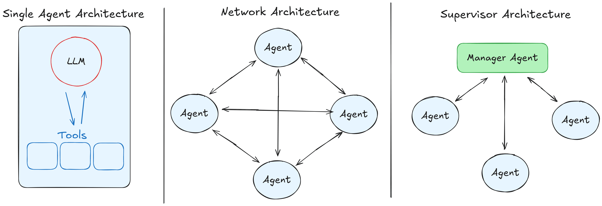
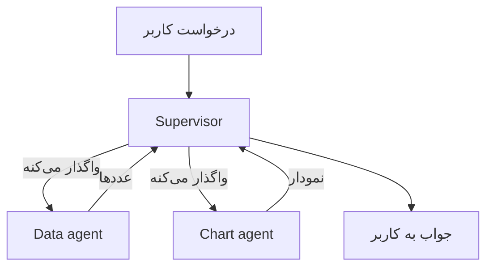

# Multi-Agent Systems

درس [AI Agents](agents_fa.md) با یه agent تموم شد: یه حلقه، یه دسته دستور، یه دسته tool. این درس درباره‌ی استفاده از چند تا agent با همه. خیلی شبیه کار کردن آدم‌ها با همه، و همون مشکل‌ها رو هم میاره.

## چرا این برای تو مهمه

تو از قبل می‌دونی تیم‌ها چطور کار می‌کنن. یه مدیر کارها رو بین آدم‌ها پخش می‌کنه. یه استاد چند تا دانشجو رو راهنمایی می‌کنه و هر کدوم روی بخش خودشون کار می‌کنن. همکارها کار رو به هم تحویل می‌دن، و گاهی یه چیزی تو راه گم می‌شه. یه تیم از agent‌های هوش مصنوعی هم همین‌طور رفتار می‌کنه. پس بیشتر این درس رو از قبل می‌فهمی. فقط اسم‌های جدید می‌خواد.

## چرا اصلاً به چند تا agent نیاز داریم

تصور کن از یه نفر بخوای هم حسابدار شرکت باشه هم طراح گرافیک. هر دو کار رو می‌تونه انجام بده. ولی سرش پر از دو تا شغله و توی هر کدوم بیشتر اشتباه می‌کنه.

یه agent تنها هم همین مشکل رو داره. این درخواست رو ببین: *«توی هر منطقه چند تا فروش داشتیم؟ توی یه نمودار میله‌ای نشونم بده.»* این دو تا کار متفاوته: اول باید عددها رو از دیتابیس دربیاری، بعد یه نمودار بکشی. یه agent می‌تونه هر دو رو انجام بده. ولی دستورهاش باید هم دیتابیس رو توضیح بدن *و* هم نمودار رو، و فهرست tool‌هاش بلندتر می‌شه. پس راه‌های بیشتری برای انتخاب tool اشتباه داره، و جای بیشتری برای قاطی کردن دو کار.

اگه کار رو تقسیم کنی، هر agent دستورهای کوتاه، چند تا tool و یه کار داره، مثل دو تا متخصص:

- یه **data agent** که عددها رو از دیتابیس درمیاره
- یه **chart agent** که عددها رو به یه نمودار تبدیل می‌کنه

هر کدوم یه agent معمولی از درس [AI Agents](agents_fa.md)‌ه. چیز جدیدی اختراع نشده. از یه حلقه رسیدی به چند تا حلقه.

## معماری‌های پایه‌ی Multi-agent

  
*چپ: یه agent با tool‌هاش. وسط: یه network، که هر agent می‌تونه با هر agent دیگه‌ای حرف بزنه. راست: یه supervisor، که درخواست رو می‌گیره و کار رو بین بقیه پخش می‌کنه. بقیه فقط با supervisor حرف می‌زنن.*

**Supervisor: یه مدیر و تیمش.** یه agent درخواست رو می‌گیره، مثل یه مدیر. تصمیم می‌گیره هر بخش رو کی انجام بده، کار رو تحویل می‌ده، نتیجه‌ها رو جمع می‌کنه و به کاربر جواب می‌ده. اعضای تیم با مدیر حرف می‌زنن و با هیچ‌کس دیگه. مثل یه استاده که به هر دانشجو یه بخش از پروژه می‌ده و بعد بخش‌ها رو کنار هم می‌ذاره.

توی مثال ما، supervisor سؤال رو برای data agent می‌فرسته و عددها رو پس می‌گیره. بعد عددها رو به chart agent می‌ده و نمودار رو برمی‌گردونه.

اسم‌های **manager-worker** یا **orchestrator-worker** رو هم برای همین می‌شنوی. همه‌شون همین شکلن.

**Network: یه دفتر کار بدون مدیر.** مدیری وجود نداره. هر agent می‌تونه کار رو به هر agent دیگه‌ای بده، و خودشون بینشون تصمیم می‌گیرن بعدش کی چی کار کنه. انعطاف‌پذیره، مثل یه تیم کوچیکی که خودش رو سازمان می‌ده. ولی دنبال کردنش خیلی سخت‌تره، چون هیچ جایی نیست که نشون بده چی تصمیم گرفته شده.

**با یه supervisor شروع کن.** چک کردنش راحت‌تره، چون هر تصمیمی از یه جا رد می‌شه، همون‌طور که یه مدیر از وضعیت هر کار خبر داره.

## دردسرهای Multi-agent

هر دو مشکل از *خودِ* تقسیم کار میان. یه agent تنها هیچ‌کدومشون رو نداره. و هر دو رو از هر دفتر کاری می‌شناسی.

**Coordination (هماهنگی).** کی چی کار می‌کنه، و به چه ترتیبی؟ از کجا بفهمیم یه کار تموم شده؟ دو تا agent می‌تونن یه کار رو دو بار انجام بدن. یه agent می‌تونه تا ابد منتظر چیزی بمونه که هیچ‌وقت نمیاد. یه مدیر می‌تونه مدام کار پخش کنه و هیچ‌وقت نگه «تموم شد». اشتباه‌ها همونیه که یه تیم بد مدیریت‌شده می‌کنه.

**Handover (تحویل کار).** هر agent چت خودش رو داره، working memory خودش. پس وقتی data agent کارش تموم می‌شه، chart agent دقیقاً چی تحویل می‌گیره؟ فقط عددها؟ سؤال اصلی هم؟ اگه خیلی کم بدی، agent بعدی بدون اطلاعاتی که لازم داره کار می‌کنه، مثل همکاری که پروژه رو بدون هیچ یادداشتی تحویل گرفته. اگه همه‌چیز رو بدی، هزینه‌ش زیاد می‌شه، و همون سردرگمی‌ای برمی‌گرده که برای فرار ازش کار رو تقسیم کرده بودی.

غلط انجام دادن handover دلیل معمولیه که یه تیم از agent‌ها از *همون agent تنها* که جاش اومدن بدتر عمل می‌کنه.

### Shared Context یا Isolated Context

این ما رو می‌رسونه به انتخابی که زیر هر تیم از agent‌ها هست:

- **Shared context:** همه سر یه میز مشترک کار می‌کنن و همه‌چیز رو می‌بینن. توی handover هیچ‌چیز گم نمی‌شه، ولی میز خیلی زود پر می‌شه.
- **Isolated context:** هر agent میز خودش رو داره و فقط چیزی رو می‌بینه که بهش تحویل داده شده. ارزونه و متمرکزه، ولی هر چیزی که هیچ‌کس رد نکرده باشه، گم می‌شه.

## معماری‌های پیشرفته‌تر Multi-agent

این اسم‌ها بعداً توی مجموعه می‌رسن:

- **Hierarchical:** مدیرهایی که مدیر دارن، مثل یه شرکت با چند تا دپارتمان.
- **Agent-as-a-tool:** یه agent رو به یه agent دیگه می‌دن، انگار یه tool معمولیه.
- **Subagent‌ها:** یه agent چند تا کمک‌کننده‌ی کوتاه‌مدت می‌فرسته که هر کدوم یه کار انجام بدن، مثل فرستادن یه کارآموز که یه چیزی رو پیدا کنه. کمک‌کننده فقط با نتیجه برمی‌گرده.

## کی یه agent تنها بهتره

agent بیشتر یعنی ارتقا نیست. یه معامله‌ست. دستورهای کوتاه‌تر و کارهای روشن‌تر می‌گیری. هزینه‌ش رو با coordination و handover می‌دی. تا وقتی یه دسته دستور هنوز خوب جواب می‌ده، با یه agent بمون. وقتی یه دسته دستور باید دو کار بی‌ربط رو با هم پوشش بده، وقتشه کار رو تقسیم کنی، و تقسیمش رو جایی بذار که کمترین اطلاعات لازمه از یه agent به بعدی برسه.

## کلمه‌هایی که الان بلدی

- **Multi-agent system**: چند تا agent که با هم روی یه درخواست کار می‌کنن.
- **Supervisor** (manager-worker، orchestrator-worker): یه agent کار رو پخش می‌کنه و جمعش می‌کنه.
- **Network** (swarm): agent‌ها کار رو بدون مدیر به هم می‌دن.
- **Coordination**: تصمیم گرفتن کی چی کار می‌کنه، و کی تموم شده.
- **Handover** (context transfer): تصمیم گرفتن هر agent چی تحویل بگیره.
- **Shared و isolated context**: یه میز برای همه، یا یه میز برای هر کدوم.
- **Subagent**: یه کمک‌کننده‌ی کوتاه‌مدت که فقط نتیجه‌ش رو برمی‌گردونه.

## خلاصه

چند تا agent اجازه می‌دن هر کدوم دستورهای کوتاه و یه کار داشته باشه، مثل متخصص‌های یه تیم. شکل supervisor، یعنی یه مدیر که کار رو پخش و جمع می‌کنه، اونیه که باید باهاش شروع کنی. همون دو تا مشکلی رو داری که هر تیمی داره: coordination و handover.

این هسته‌ی Fundamentals بود. حالا تصویر کامل رو داری:

- یه مدل که فقط متن پیش‌بینی می‌کنه
- یه چت که میز کارشه
- جست‌وجو برای پر کردن اون میز
- tool‌ها برای عمل کردن
- memory
- یه حلقه که یه agent از مدل درمیاره
- یه تیم وقتی یه agent کافی نیست

**بررسی سریع**: دو تا مشکل یه تیم از agent‌ها چیه؟ و فرق supervisor با network چیه؟

## منابع

### 📄 مقاله‌ها

- [Multi-agent systems](https://docs.langchain.com/oss/python/langchain/multi-agent): شکل‌های تیم، با عمق بیشتر
- [What is an agent?](https://www.langchain.com/blog/what-is-an-agent): ارزش دوباره خوندن داره، چون انتخاب supervisor یه تصمیمه درباره‌ی این‌که هوش مصنوعی چقدر تصمیم بگیره
