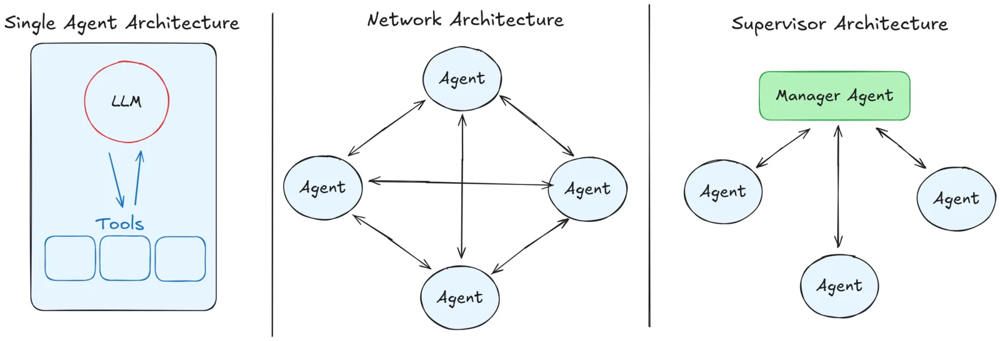
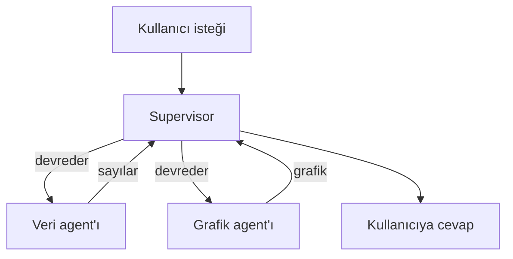
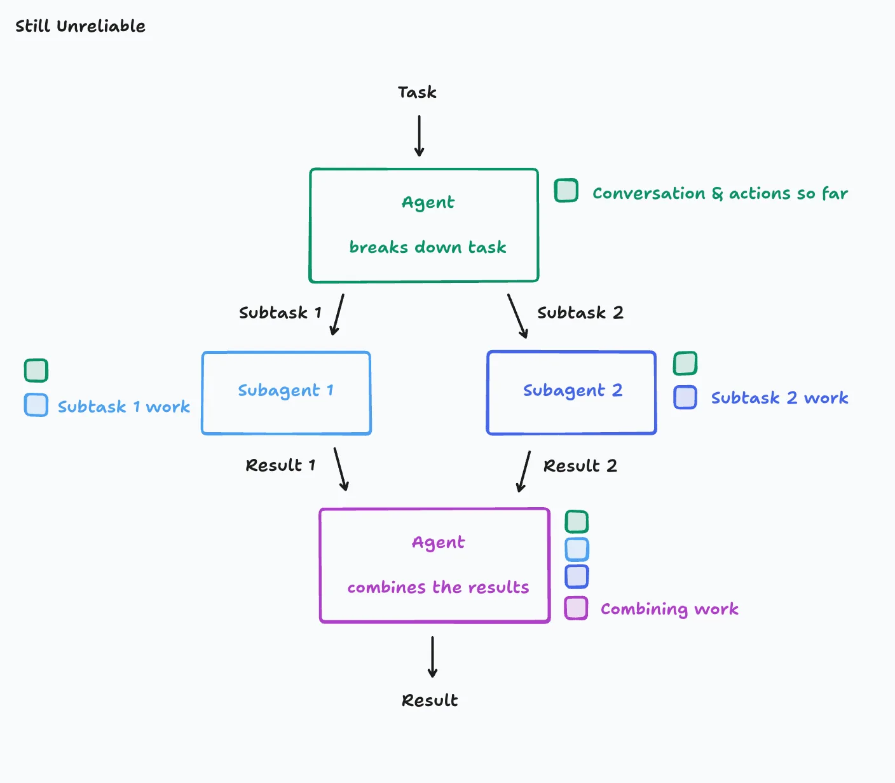
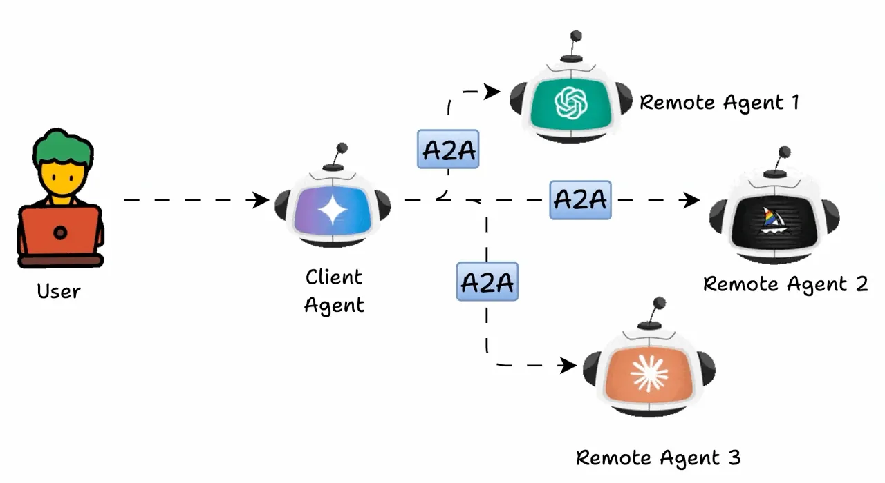
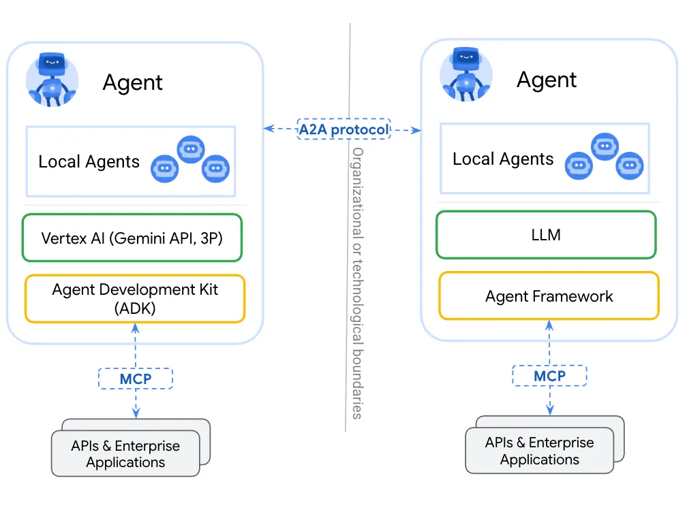

# Multi-Agent Systems

[AI Agents](agents_tr.md) modülü tek bir agent ile bitti: tek bir döngü, tek bir talimat seti, tek bir tool seti. Bu modül, birden fazla agent'ı birlikte kullanmakla ilgili. İnsanların birlikte çalışmasına çok benziyor ve aynı sorunları da getiriyor.

## Bu Senin İçin Neden Önemli

Takımların nasıl çalıştığını zaten biliyorsun. Bir müdür görev dağıtır. Bir hoca birkaç öğrenciye ders verir ve her biri kendi bölümü üzerinde çalışır. İş arkadaşları işi birbirine devreder ve bazen yolda bir şey kaybolur. Bir AI agent takımı da aynı şekilde davranır. Yani bu modülün çoğunu zaten anlıyorsun. Yalnızca yeni isimlere ihtiyacı var.

## Neden Birden Fazla Agent'a İhtiyaç Duyabiliriz

Birinden hem şirketin muhasebecisi hem de grafik tasarımcısı olmasını istediğini düşün. İkisini de yapabilir. Ama kafası iki işle dolar ve ikisinde de daha çok hata yapar.

Tek bir agent de aynı sorunu yaşar. Şu isteği ele alalım: *"Her bölgede kaç satış yaptık? Bunları bir çubuk grafikte göster."* Bu iki farklı iş: önce sayıları veritabanından almak, sonra bir grafik çizmek. Tek bir agent ikisini de yapabilir. Ama talimatlarının hem veritabanlarını *hem de* grafikleri anlatması gerekir ve tool listesi uzar. Bu yüzden yanlış tool'u seçmesi için daha çok yol, iki işi birbirine karıştırması için de daha çok alan olur.

İşi bölersen, her agent kısa talimatlar, birkaç tool ve tek bir iş alır; tıpkı iki uzman gibi:

- sayıları veritabanından alan bir **veri agent'ı**
- sayıları bir grafiğe çeviren bir **grafik agent'ı**

Her biri, [AI Agents](agents_tr.md) modülündeki sıradan bir agent. Yeni bir şey icat edilmedi. Tek bir döngüden birkaç döngüye geçtin.

## Temel Multi-agent Mimarileri

  
*Solda: tool'larıyla tek bir agent. Ortada: her agent'ın diğer her agent'la konuşabildiği bir network. Sağda: isteği alıp işi diğerlerine dağıtan bir supervisor. Diğerleri yalnızca supervisor'la konuşur.*

**Supervisor: bir müdür ve takımı.** Tek bir agent, bir müdür gibi isteği alır. Her parçayı kimin yapması gerektiğine karar verir, işi devreder, sonuçları toplar ve kullanıcıya cevap verir. Takım üyeleri müdürle konuşur, başka kimseyle konuşmaz. Her öğrenciye projenin bir parçasını verip sonra parçaları bir araya getiren bir hocaya benzer.

Örneğimizde supervisor soruyu veri agent'ına gönderir ve sayıları geri alır. Sonra sayıları grafik agent'ına verir ve grafiği geri döndürür.

Buna **manager-worker** ya da **orchestrator-worker** dendiğini de duyacaksın. Şekil aynı.

**Network: bir açık ofis.** Müdür yok. Her agent işi başka herhangi bir agent'a aktarabilir ve sıradaki işi kimin yapacağına kendi aralarında karar verirler. Esnektir; kendi kendini organize eden küçük bir takım gibi. Ama takip etmesi çok daha zordur, çünkü neyin kararlaştırıldığını gösteren tek bir yer yoktur.

**Bir supervisor ile başla.** Kontrol etmesi daha kolaydır, çünkü her karar tek bir yerden geçer; tıpkı bir müdürün her görevin durumunu bilmesi gibi.

## Multi-agent'ın Dezavantajları

İki sorun da işi bölmenin *kendisinden* gelir. Tek bir agent'ın ikisi de yoktur. İkisi de herhangi bir ofisten tanıdık gelecek.

**Koordinasyon.** Kim neyi, hangi sırayla yapıyor? Bir işin bittiğini kimse nereden biliyor? İki agent aynı işi iki kez yapabilir. Bir agent hiç gelmeyecek bir şeyi sonsuza kadar bekleyebilir. Bir müdür sürekli görev dağıtıp hiç durmayabilir. Bunlar, kötü yönetilen bir takımın yaptığı hataların aynısı.

Bu ileri seviye bir konu ve Expert seviyesinde ele alınıyor. Ama sorunu basit bir örnek zaten gösteriyor:

  
*Ana agent bir işi iki parçaya böler ve her parçayı bir yardımcıya verir. Her yardımcı o ana kadarki işi ve kendi parçasını bilir, ama diğer yardımcının ne yaptığını bilmez. Bu yüzden aynı işi iki kez yapabilirler ya da çelişen seçimler yapabilirler. Sonuçlar bir araya getirilene kadar da kimse bunu fark etmez.*

Bu, bir raporun iki yarısını iki iş arkadaşına, birbirleriyle konuşmalarına izin vermeden vermeye benziyor. İkisi de iyi bir yarım yazar, ama yarımlar birbirini tekrar edebilir ya da birbiriyle çelişebilir. Bir agent takımının kırılgan, bazen de güvenilmez olmasının sebeplerinden biri de bu.

**Devir (handover).** Her agent'ın kendi sohbeti, kendi working memory'si var. Peki veri agent'ı işini bitirdiğinde, grafik agent'ı tam olarak ne alıyor? Yalnızca sayıları mı? İlk soruyu da mı? Çok az verirsen sonraki agent, ihtiyaç duyduğu bilgi olmadan çalışır; hiç not almadan bir projeyi devralan bir iş arkadaşı gibi. Her şeyi verirsen maliyeti çok olur ve işi bölerek kaçınmaya çalıştığın karışıklık geri gelir.

Devri yanlış yapmak, bir agent takımının yerini aldığı tek agent'tan *daha kötü* çalışmasının olağan nedenidir.

### Shared Context mi, Isolated Context mi

Bu da her agent takımının altındaki bir seçime çıkıyor:

- **Shared context:** herkes tek bir ortak masada çalışır ve her şeyi görür. Devirde hiçbir şey kaybolmaz, ama masa hızla dolar.
- **Isolated context:** her agent'ın kendi masası vardır ve yalnızca kendisine verileni görür. Ucuz ve odaklıdır, ama kimsenin aktarmadığı şey kaybolur.

## İleri Seviye Multi-agent Mimarileri

Bu isimler kursun ilerleyen bölümlerinde karşına çıkacak:

- **Hiyerarşik (hierarchical):** müdürlerin müdürleri; bölümleri olan bir şirket gibi.
- **Agent-as-a-tool:** bir agent, sıradan bir tool'muş gibi başka bir agent'a verilir.
- **Subagent'lar:** bir agent, her biri tek bir iş yapan kısa ömürlü yardımcılar gönderir; bir şeyi öğrenmesi için bir stajyer göndermek gibi. Yardımcı yalnızca sonuçla geri döner.

## Agent2Agent Protocol (A2A)

Bu yalnızca kısa bir tanıtım; ayrıntılar daha sonra [Protocols Reference](../4_ecosystem/protocols_reference_tr.md) modülünde.

Şimdiye kadar bir takımdaki bütün agent'lar aynı yazılım kitiyle, yani aynı **framework** ile yapılmıştı. Birbirlerini bu sayede anlıyorlar. Farklı kitlerle yapılmış agent'lar ise farklı dil konuşan iş arkadaşları gibi: her biri işinde iyi olsa bile birlikte çalışamazlar.

**A2A**, yani **Agent2Agent Protocol**, agent'lar için ortak bir dil. Google geliştirdi ve artık açık bir standart (open standard). Yani herhangi bir şirketin herhangi bir kitle yaptığı agent'lar birbirleriyle konuşabilir.

  
*Sen tek bir agent ile konuşursun. O, işin parçalarını her biri farklı bir şirketin yaptığı üç agent'a devreder ve her devir A2A, yani ortak dil üzerinden olur.*

Nasıl çalışıyor? Her agent bir **Agent Card** yayımlar. Bunu agent'ın CV'si ya da kartviziti gibi düşün: kim olduğu, neler yapabildiği ve ona nasıl ulaşılacağı yazar. Başka bir agent kartı okur, bu agent'ın yardım edebileceğini görür ve ona bir görev verir.

**Çoğu takımın buna ihtiyacı var mı?** Hayır. Tek bir proje içinde insanlar bütün agent'larını tek bir kitle yapar ve agent'lar zaten birbirlerini anlar. A2A, agent'lar farklı kuruluşlara ait olduğunda önem kazanır.

Bir örnek. A şirketi uçak bileti satıyor ve bir uçuş rezervasyon agent'ı var. B şirketi otel odası satıyor ve bir otel rezervasyon agent'ı var. A şirketi hem uçuşu hem oteli ayarlayan tek bir asistan istiyor. Kendi agent'ı uçuşu halleder, ama otel için B şirketinin agent'ına ihtiyaç duyar; ikisi de farklı şirketlerce, farklı kitlerle yapılmış. B şirketi bir Agent Card yayımlarsa A şirketinin agent'ı onu bulup oteli rezerve etmesini isteyebilir.

  
*İki şirket, her birinin kendi agent'ı var; her biri kendi yapay zekâ modeliyle ve kendi kitiyle yapılmış. Her agent kendi şirketinin sistemlerine MCP ile ulaşır. İki şirketin arasında ise A2A, agent'ların konuşmasını sağlar.*

Bu nadir görülür. Çoğunlukla büyük şirketlerde ya da bir şirketin ayrı geliştirilmiş takımları arasında olur; mesela insan kaynakları agent'ı ile finans agent'ı. Ama adını bilmekte fayda var.

## Tek Bir Agent Ne Zaman Daha İyi Olabilir

Daha çok agent bir yükseltme değil, bir takastır. Daha kısa talimatlar ve daha net işler elde edersin. Bedelini koordinasyon ve devirle ödersin. Tek bir talimat seti hâlâ iyi uyuyorsa tek bir agent ile kal. Tek bir talimat seti iki ilgisiz işi birden kapsamak zorunda kaldığında böl ve bir agent'tan diğerine en az bilginin geçmesi gereken yerden böl.

## Artık Bildiğin Terimler

- **Multi-agent system**: tek bir istek üzerinde birlikte çalışan birkaç agent.
- **Supervisor** (manager-worker, orchestrator-worker): tek bir agent işi dağıtır ve toplar.
- **Network** (swarm): agent'lar, müdür olmadan işi birbirine aktarır.
- **Koordinasyon**: kimin neyi yapacağına ve ne zaman bittiğine karar vermek.
- **Devir (handover, context transfer)**: her agent'a ne verileceğine karar vermek.
- **Shared ve isolated context**: herkes için tek bir masa ya da her biri için bir masa.
- **Subagent**: yalnızca sonucunu geri veren, kısa ömürlü bir yardımcı.
- **A2A** (Agent2Agent Protocol): farklı şirketlerin ve kitlerin agent'larının birlikte çalışmasını sağlayan ortak dil.
- **Agent Card**: bir agent'ın CV'si: kim olduğu, neler yapabildiği ve ona nasıl ulaşılacağı.

## Özet

Birkaç agent, her birinin kısa talimatlar ve tek bir işle kalmasını sağlar; bir takımdaki uzmanlar gibi. Supervisor şekli, yani işi dağıtan ve toplayan bir müdür, başlanacak şekildir. Her takımın yaşadığı iki sorunla karşılaşırsın: koordinasyon ve devir.

Fundamentals'ın özü bu. Artık bütün resmi biliyorsun:

- yalnızca metin tahmin eden bir model
- onun masası olan bir sohbet
- o masayı doldurmak için arama
- harekete geçmek için tool'lar
- bellek
- onu bir agent yapan bir döngü
- bir agent yetmediğinde bir takım

**Hızlı Kontrol**: Bir agent takımının iki sorunu nedir? Supervisor ile network arasındaki fark ne?

## Kaynaklar

### 📄 Makaleler

- [Announcing the Agent2Agent Protocol (A2A)](https://developers.googleblog.com/en/a2a-a-new-era-of-agent-interoperability/): Google'ın duyurusu, Nisan 2025
- [Multi-agent systems](https://docs.langchain.com/oss/python/langchain/multi-agent): takım şekilleri, daha derinlemesine
- [What is an agent?](https://www.langchain.com/blog/what-is-an-agent): yeniden okumaya değer, çünkü bir supervisor, yapay zekânın ne kadarına karar vereceğine dair bir karardır

### 🛠️ Araçlar

- [A2A Protocol](https://a2a-protocol.org/latest/): herhangi bir şirketin agent'larının birlikte çalışmasını sağlayan ortak dil

### 🗃️ Repolar

- [a2aproject/A2A](https://github.com/a2aproject/a2a): protocol'ün GitHub'daki evi
