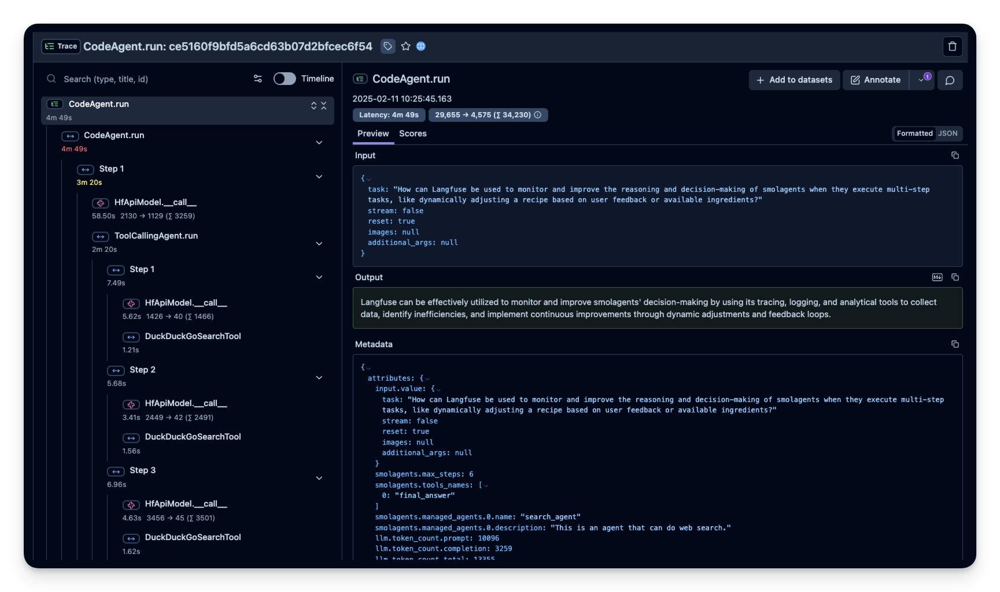
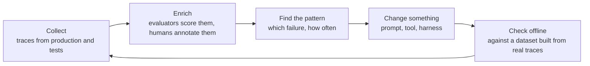

# Observability

With normal software, if you want to know what the system will do, you read its code. The code
describes the behaviour completely.

With an agent, that stops being true. The code only says "ask the AI, run whatever tool it asks
for, and repeat". It does not tell you what actually happened on a given run:

- which tools the agent chose
- in what order
- what came back
- where it went wrong

That information exists only in the record of that run. The record is called a **trace**.

  
*A real trace of one agent run, in a tool called Langfuse. On the left is every step, AI call and tool call, each with how long it took and how much text went in and out. The whole run took 4 minutes 49 seconds. The final answer on the right says none of this.*

## Why This Matters to You

If your company uses an AI assistant and it gives a wrong answer, someone will ask "why did it do
that?". The trace is where you find the answer. Traces also contain everything users
typed and everything the tools returned, so where they are stored is a question for your data and
privacy rules.

## What a Trace Holds

Think of a trace as a **bank statement for one agent run**. Every step is a line, with its time
and its cost. It holds:

- every call to the AI, with what went in and what came out
- every tool call, with its details and its result
- every helper agent it used

Mistakes usually happen *between* the steps, not inside one. For example: the AI chose the right
tool but gave it a slightly wrong detail. A tool returned nothing, and the agent treated "nothing"
as an answer. The agent went over the same file four times. The final answer is often a confident
paragraph that hides all of this. The trace shows it.

LangChain says it plainly: in normal software, the code describes the behaviour. With agents, the
traces do.

## Tools for Traces

- **LangSmith** is LangChain's own tool, the easy choice for teams that already use LangChain.
- **[Langfuse](https://github.com/langfuse/langfuse)** is open source, the usual choice when traces must stay on the company's own computers.
- **[Latitude](https://github.com/latitude-dev/latitude-llm)** is also open source, and it focuses on watching live systems.

Before choosing one, ask two questions. Can it collect traces from the systems we already use?
And can it keep the traces where our data policy says they must stay? Traces are full of customer
text, so this is the same discussion as the data policy in
[Inference Providers](../4_ecosystem/inference_providers.md).

## The Improvement Loop

Collecting traces is not the goal. The goal is the cycle they make possible:

In plain words: collect the traces, mark the good and the bad ones, find the most common mistake,
change something to fix it, test the change on real past examples, and start again. Each round
gives better data, so the next fix is better aimed than the last.

## Agents That Read the Traces

Teams that collect traces well soon have a new problem: too many of them. One developer described
recording more than 100,000 traces every day, and reading none of them. Nobody can read a hundred
thousand of anything.

So the newest answer is **an agent that reads the traces**. It groups thousands of conversations
and finds the common patterns and failures by itself, including the ones nobody thought to look
for. The same technology that made the pile now reads it.

## Words You Now Know

- **Trace**: the full record of one agent run, step by step, with time and cost.
- **Observability**: being able to see what an AI system actually did.
- **Evaluator**: a check that scores a trace as good or bad.
- **Improvement loop**: collect, mark, find the pattern, fix, test, repeat.

## Summary

You cannot learn what an agent did from its code. You learn it from the trace: the bank statement
of one run. Mistakes hide between the steps, and the trace shows them. Traces start an improvement
loop, and when there are too many of them, an agent reads them for you. Because traces hold
customer text, where they are stored is a data-policy decision.

**Quick check**: Your company's assistant gives a confident, wrong answer. What would a trace show
you that the answer cannot?

## References

### 📄 Articles

- [The Agent Improvement Loop Starts with a Trace](https://www.langchain.com/blog/traces-start-agent-improvement-loop): why traces now describe the behaviour, and the loop they start
- [From Traces to Insights: Understanding Agent Behavior at Scale](https://www.langchain.com/blog/from-traces-to-insights-understanding-agent-behavior-at-scale): the hundred-thousand-traces problem, and an agent that reads them

### 🗃️ Repositories

- [Langfuse](https://github.com/langfuse/langfuse): open-source tracing
- [Latitude](https://github.com/latitude-dev/latitude-llm): open-source monitoring for live systems
