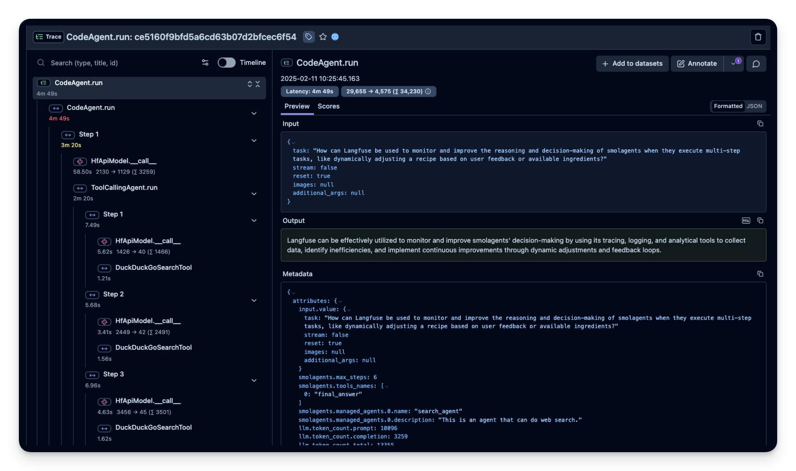
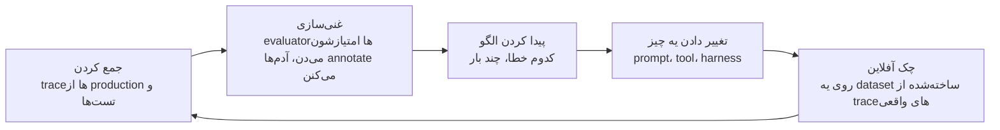

# Observability

توی نرم‌افزار معمولی، اگه بخوای بدونی سیستم چی کار می‌کنه، کدش رو می‌خونی. کد رفتار سیستم رو کامل توصیف می‌کنه.

با یه agent این دیگه صدق نمی‌کنه. کد فقط می‌گه «از هوش مصنوعی بپرس، هر tool‌ای که خواست اجرا کن، و تکرار کن». نمی‌گه توی یه اجرای مشخص واقعاً چی اتفاق افتاده:

- agent کدوم tool‌ها رو انتخاب کرد
- به چه ترتیبی
- چی برگشت
- کجا اشتباه کرد

این اطلاعات فقط توی ثبت همون اجرا وجود داره. اون ثبت اسمش **trace**‌ه.

  
*یه trace واقعی از یه اجرای agent، توی ابزاری به اسم Langfuse. سمت چپ هر قدم رو می‌بینی، چه صدا زدن هوش مصنوعی و چه tool call، هر کدوم با مدت زمانش و این‌که چقدر متن رفته تو و اومده بیرون. کل اجرا 4 دقیقه و 49 ثانیه طول کشیده. جواب نهایی سمت راست هیچ‌کدوم از این‌ها رو نمی‌گه.*

## چرا این برای تو مهمه

اگه شرکتت یه دستیار هوش مصنوعی داره و یه جواب غلط می‌ده، یکی می‌پرسه «چرا این کار رو کرد؟». trace جاییه که جواب این سؤال رو توش پیدا می‌کنی. trace‌ها هر چیزی که کاربرها تایپ کردن و هر چیزی که tool‌ها برگردوندن رو هم دارن، پس این‌که کجا نگه‌داری بشن یه سؤال برای قانون‌های داده و حریم خصوصی شرکتته.

## یه trace چی توش داره

یه trace رو مثل **صورت‌حساب بانکی برای یه اجرای agent** در نظر بگیر. هر قدم یه خطه، با زمان و هزینه‌ش. توش این‌ها هست:

- هر بار صدا زدن هوش مصنوعی، با چیزی که رفته تو و چیزی که اومده بیرون
- هر tool call، با جزئیات و نتیجه‌ش
- هر agent کمکی که استفاده کرده

اشتباه‌ها معمولاً *بین* قدم‌ها اتفاق می‌افتن، نه توی یه قدم. مثلاً: هوش مصنوعی tool درست رو انتخاب کرده ولی یه جزئیات رو یه کم غلط بهش داده. یه tool هیچی برنگردونده و agent «هیچی» رو به‌عنوان جواب گرفته. agent چهار بار یه فایل رو از اول تا آخر گشته. جواب نهایی اغلب یه پاراگراف مطمئنه که همه‌ی این‌ها رو قایم می‌کنه. trace نشونشون می‌ده.

LangChain صاف می‌گه: توی نرم‌افزار معمولی، کد رفتار رو توصیف می‌کنه. توی agent‌ها، trace‌ها این کار رو می‌کنن.

## ابزارهای Observability

- **LangSmith** ابزار خودِ LangChain‌ه، انتخاب راحت برای تیم‌هایی که از قبل از LangChain استفاده می‌کنن.
- **[Langfuse](https://github.com/langfuse/langfuse)** متن‌بازه، و انتخاب معمول وقتیه که trace‌ها باید روی کامپیوترهای خودِ شرکت بمونن.
- **[Latitude](https://github.com/latitude-dev/latitude-llm)** هم متن‌بازه، و روی نظارت بر سیستم‌هایی که زنده‌ان تمرکز داره.

قبل از انتخاب یکی‌شون، دو تا سؤال بپرس. می‌تونه از سیستم‌هایی که از قبل داریم trace جمع کنه؟ و می‌تونه trace‌ها رو همون جایی نگه داره که سیاست داده‌مون می‌گه باید بمونن؟ trace‌ها پر از متن مشتری‌ان، پس این همون بحثیه که درباره‌ی سیاست داده توی [Inference Providers](../4_ecosystem/inference_providers_fa.md) هم هست.

## حلقه‌ی بهبود

جمع کردن trace‌ها هدف نیست. هدف چرخه‌ایه که با اون‌ها ممکن می‌شه:

به زبون ساده: trace‌ها رو جمع کن، خوب و بدها رو علامت بزن، رایج‌ترین اشتباه رو پیدا کن، یه چیزی رو برای درست کردنش عوض کن، تغییر رو روی مثال‌های واقعیِ گذشته تست کن، و دوباره شروع کن. هر دور داده‌ی بهتری می‌ده، پس اصلاح بعدی دقیق‌تر از قبلی نشونه می‌ره.

## agent‌هایی که agent‌های دیگه رو زیر نظر دارن

تیم‌هایی که trace جمع کردن رو خوب انجام می‌دن، خیلی زود به یه مشکل جدید می‌رسن: خیلی زیاد می‌شن. یه developer تعریف کرد که روزی بیشتر از 100,000 تا trace ثبت می‌کرده و هیچ‌کدوم رو نمی‌خونده. هیچ‌کس نمی‌تونه صد هزار تا از هیچ چیزی رو بخونه.

برای همین جدیدترین جواب **یه agent‌ه که trace‌ها رو می‌خونه.** هزاران گفت‌وگو رو دسته‌بندی می‌کنه و الگوهای رایج و خطاها رو خودش پیدا می‌کنه، حتی اون‌هایی که هیچ‌کس به فکرش نرسیده بود دنبالشون بگرده. همون فناوری‌ای که این توده رو ساخته، حالا می‌خونتش.

## کلمه‌هایی که الان بلدی

- **Trace**: ثبت کامل یه اجرای agent، قدم به قدم، با زمان و هزینه.
- **Observability**: این‌که بتونی ببینی یه سیستم هوش مصنوعی واقعاً چی کار کرده.
- **Evaluator**: یه چک که یه trace رو خوب یا بد امتیاز می‌ده.
- **Improvement loop (حلقه‌ی بهبود)**: جمع کن، علامت بزن، الگو رو پیدا کن، درست کن، تست کن، تکرار کن.

## خلاصه

از روی کد نمی‌تونی بفهمی یه agent چی کار کرده. از روی trace می‌فهمی: صورت‌حساب بانکی یه اجرا. اشتباه‌ها بین قدم‌ها قایم می‌شن و trace نشونشون می‌ده. trace‌ها یه حلقه‌ی بهبود رو شروع می‌کنن، و وقتی خیلی زیاد می‌شن، یه agent برات می‌خونتشون. چون trace‌ها متن مشتری دارن، این‌که کجا نگه‌داری بشن یه تصمیم درباره‌ی سیاست داده‌ست.

**بررسی سریع**: دستیار شرکتت یه جواب مطمئن و غلط می‌ده. trace چی رو بهت نشون می‌ده که از خودِ جواب درنمیاد؟

## منابع

### 📄 مقاله‌ها

- [The Agent Improvement Loop Starts with a Trace](https://www.langchain.com/blog/traces-start-agent-improvement-loop): چرا حالا trace‌ها رفتار رو توصیف می‌کنن، و حلقه‌ای که شروع می‌کنن
- [From Traces to Insights: Understanding Agent Behavior at Scale](https://www.langchain.com/blog/from-traces-to-insights-understanding-agent-behavior-at-scale): مشکل صد هزار trace، و یه agent که اون‌ها رو می‌خونه

### 🗃️ Repository‌ها

- [Langfuse](https://github.com/langfuse/langfuse): ردیابی متن‌باز
- [Latitude](https://github.com/latitude-dev/latitude-llm): نظارت متن‌باز برای سیستم‌های زنده
