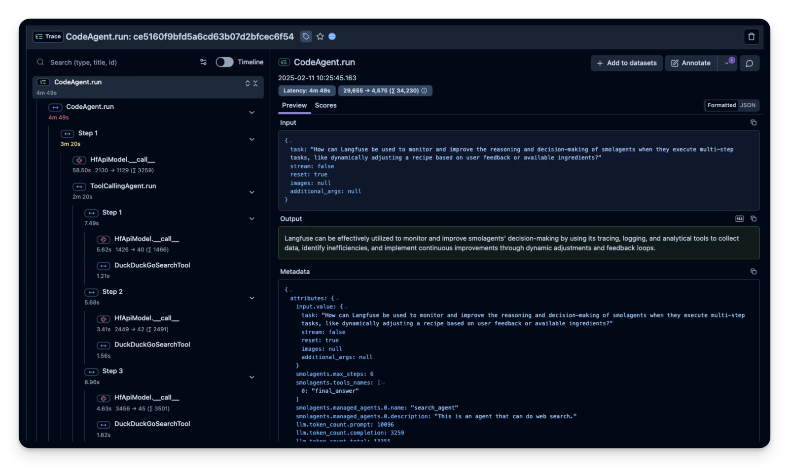
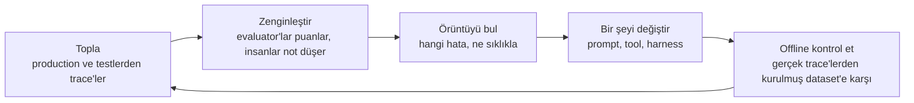

# Observability

Normal bir yazılımda sistemin ne yapacağını bilmek istiyorsan kodunu okursun. Kod, davranışı eksiksiz anlatır.

Bir agent'ta bu artık doğru değil. Kod yalnızca "yapay zekâya sor, o ne tool istiyorsa çalıştır ve tekrarla" der. Belirli bir çalıştırmada gerçekte ne olduğunu söylemez:

- agent hangi tool'ları seçti
- hangi sırayla
- ne geri geldi
- nerede yanlış gitti

Bu bilgi yalnızca o çalıştırmanın kaydında bulunur. Bu kayda **trace** denir.

  
*Langfuse adlı bir araçta, bir agent çalıştırmasının gerçek bir trace'i. Solda her adım, yapay zekâ çağrısı ve tool çağrısı var; her birinin ne kadar sürdüğü ve içeri ile dışarı ne kadar metin girip çıktığı görünüyor. Çalıştırmanın tamamı 4 dakika 49 saniye sürdü. Sağdaki nihai cevap bunların hiçbirini söylemiyor.*

## Bu Senin İçin Neden Önemli

Şirketin bir yapay zekâ asistanı kullanıyorsa ve asistan yanlış bir cevap verirse, biri "bunu neden yaptı?" diye soracak. Bu sorunun cevabını trace'te bulursun. Trace'ler ayrıca kullanıcıların yazdığı her şeyi ve tool'ların döndürdüğü her şeyi de içerir; bu yüzden nerede saklandıkları, veri ve gizlilik kurallarınla ilgili bir sorudur.

## Bir Trace'te Neler Var

Bir trace'i, **tek bir agent çalıştırmasının banka hesap özeti** gibi düşün. Her adım, zamanı ve maliyetiyle bir satırdır. İçinde şunlar bulunur:

- yapay zekâya yapılan her çağrı, içeri ne girdi ve dışarı ne çıktı
- her tool çağrısı, ayrıntıları ve sonucuyla
- kullandığı her yardımcı agent

Hatalar genellikle adımların *arasında* olur, bir adımın içinde değil. Örneğin: yapay zekâ doğru tool'u seçti ama ona biraz yanlış bir ayrıntı verdi. Bir tool hiçbir şey döndürmedi ve agent "hiçbir şeyi" bir cevap saydı. Agent aynı dosyanın üzerinden dört kez geçti. Nihai cevap çoğu zaman bunların hepsini saklayan, kendinden emin bir paragraftır. Trace ise bunları gösterir.

LangChain bunu açıkça söylüyor: normal yazılımda davranışı kod anlatır. Agent'larda ise trace'ler anlatır.

## Observability Araçları

- **LangSmith**, LangChain'in kendi aracı; zaten LangChain kullanan ekipler için kolay seçim.
- **[Langfuse](https://github.com/langfuse/langfuse)** açık kaynak; trace'lerin şirketin kendi bilgisayarlarında kalması gerektiğinde olağan seçim.
- **[Latitude](https://github.com/latitude-dev/latitude-llm)** de açık kaynak ve canlı sistemleri izlemeye odaklanıyor.

Birini seçmeden önce iki soru sor. Zaten kullandığımız sistemlerden trace toplayabiliyor mu? Ve trace'leri, veri politikamızın tutulmaları gerektiğini söylediği yerde tutabiliyor mu? Trace'ler müşteri metniyle dolu olduğu için bu, [Inference Providers](../4_ecosystem/inference_providers_tr.md) modülündeki veri politikası tartışmasının aynısı.

## İyileştirme Döngüsü

Trace toplamak amaç değil. Amaç, onların mümkün kıldığı döngü:

Sade bir dille: trace'leri topla, iyi ve kötü olanları işaretle, en yaygın hatayı bul, onu düzeltmek için bir şeyi değiştir, değişikliği geçmişteki gerçek örnekler üzerinde test et ve baştan başla. Her tur daha iyi veri verir, bu yüzden sonraki düzeltme bir öncekinden daha iyi hedeflenir.

## Agent'ları Başka Agent'larla İzlemek

Trace'leri iyi toplayan ekiplerin kısa sürede yeni bir sorunu olur: çok fazla trace. Bir geliştirici, her gün 100.000'den fazla trace kaydettiğini ve hiçbirini okumadığını anlattı. Kimse yüz bin şeyin hiçbirini okuyamaz.

Bu yüzden en yeni cevap, **trace'leri okuyan bir agent**. Binlerce konuşmayı gruplar ve ortak örüntüleri ve hataları kendi başına bulur; kimsenin bakmayı düşünmediği hatalar da dahil. Yığını oluşturan aynı teknoloji, şimdi onu okuyor.

## Artık Bildiğin Terimler

- **Trace**: tek bir agent çalıştırmasının adım adım, zamanı ve maliyetiyle tam kaydı.
- **Observability**: bir yapay zekâ sisteminin gerçekte ne yaptığını görebilmek.
- **Evaluator**: bir trace'i iyi ya da kötü diye puanlayan kontrol.
- **İyileştirme döngüsü**: topla, işaretle, örüntüyü bul, düzelt, test et, tekrarla.

## Özet

Bir agent'ın ne yaptığını kodundan öğrenemezsin. Bunu trace'ten öğrenirsin: tek bir çalıştırmanın banka hesap özeti. Hatalar adımların arasında saklanır ve trace onları gösterir. Trace'ler bir iyileştirme döngüsü başlatır ve sayıları çok olduğunda, onları senin yerine bir agent okur. Trace'ler müşteri metni taşıdığı için nerede saklandıkları bir veri politikası kararıdır.

**Hızlı Kontrol**: Şirketinin asistanı kendinden emin ama yanlış bir cevap veriyor. Bir trace sana, cevabın gösteremeyeceği hangi şeyi gösterir?

## Kaynaklar

### 📄 Makaleler

- [The Agent Improvement Loop Starts with a Trace](https://www.langchain.com/blog/traces-start-agent-improvement-loop): trace'lerin neden davranışı anlattığı ve başlattığı iyileştirme döngüsü
- [From Traces to Insights: Understanding Agent Behavior at Scale](https://www.langchain.com/blog/from-traces-to-insights-understanding-agent-behavior-at-scale): yüz bin trace sorunu ve onları okuyan bir agent

### 🗃️ Repolar

- [Langfuse](https://github.com/langfuse/langfuse): açık kaynak izleme (tracing)
- [Latitude](https://github.com/latitude-dev/latitude-llm): canlı sistemler için açık kaynak izleme
