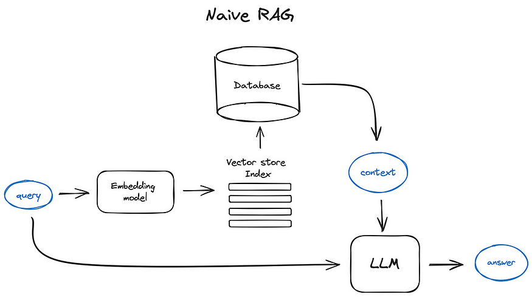
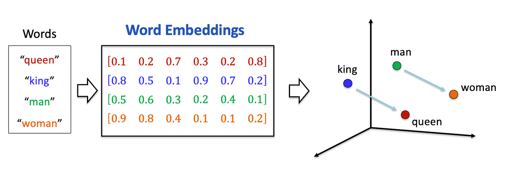
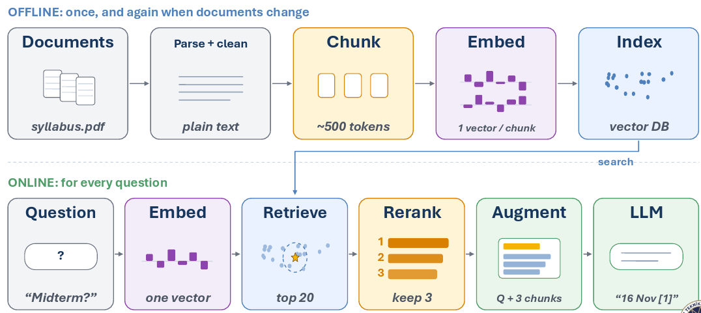

# RAG & Embeddings

[LLM Fundamentals](llms.md) gave you the chat that the AI reads, and its maximum size, the
context window. [Training LLMs](training.md) gave you fine-tuning, which changes the model
itself. This module is about a third way to give a model knowledge. It is also the one used
most often.

## Why This Matters to You

Many "chat with your documents" products, and many company assistants that
answers questions about internal policies, works this way. When someone offers your company an
"AI that knows all your documents", this module tells you what is happening inside, and what to
ask.

## Why RAG Exists

Your company has useful documents:

- contracts
- policies and handbooks
- years of support tickets
- reports and spreadsheets

There is far more of it than fits in the chat. You cannot paste two hundred contracts into
ChatGPT.

But here is the important point: **for one question, you do not need all of it.** Someone asks
about the termination clause in one vendor contract. They do not need the other two hundred
contracts. They need one clause.

So RAG does this: it keeps the documents outside the AI. When a question comes in, it finds only
the parts that answer it, and it adds those parts to the chat, next to the question. Then the AI
answers from what it can now see. The name says it: **Retrieval-Augmented Generation**. First
retrieve (find), then generate (answer).

### The Desktop and the Library

Here is a simple picture.

**What the model learned in training is a huge library.** Everything it read is in there
somewhere. **The chat is your desk.** It is small, but whatever is on it is right in front of
you.

Remembering one exact sentence from a huge library is hard and unreliable. Reading a page that
is open on your desk is easy and exact. RAG chooses which pages go on the desk.

  
*The basic RAG flow. The question goes two ways at once. One way goes to a search over your documents (the "embedding model" and "vector store index" boxes in the picture). The other goes straight to the AI, together with the pages the search found.*

## Vector Embeddings

How does the search find the right clause? It does not look for matching words. It looks for
matching *meaning*.

A special model turns each piece of text into a list of numbers, called an **embedding**. Think
of it as a fingerprint of the meaning. **Texts with a similar meaning get similar
fingerprints.** It works like addresses in a city: close addresses mean nearby places.

The classic picture uses four words:

  
*Each word becomes a point in space. "King" lands near "queen", and "man" lands near "woman". The two arrows are parallel: the step from king to queen is the same step as from man to woman. Meaning has turned into distance and direction.*

The useful part is that it finds meaning, not words. Look at these two contract clauses:

- "The Vendor may terminate this Agreement upon 30 days written notice."
- "Either party may end this Contract with a 30-day notice period."

They share almost no words. But they mean nearly the same thing, so their fingerprints are
close. A normal keyword search would miss the second clause. A RAG search finds it.

These fingerprints are kept in a special database, called a **vector database**. It stores
millions of them, each linked to its original text, and it can find the closest ones very fast.

## The RAG Process

RAG has two parts.

**Once, and again whenever the documents change (preparing):**

1. Collect the documents: contracts, policies, PDFs, any text.
2. Cut them into small pieces (called **chunks**), such as one paragraph or one clause.
3. Make a fingerprint for each piece.
4. Store the fingerprints in the vector database.

**For every question (answering):**

1. Take the question and make its fingerprint.
2. Find the pieces with the closest fingerprints.
3. Add the text of those pieces to the chat, next to the question.
4. The AI answers from what it can now see.

  
*The top half runs once, and again when the documents change. The bottom half runs for every question. The picture adds one step: a second check (a "reranker") reads the 20 closest pieces and keeps the best 3, so the chat holds only what answers the question.*

## Measuring Retrieval

The answer can only be as good as the pages that reach the desk. If the search brings the wrong
pages, the AI never sees the right ones, and the answer is wrong. So a good team tests the search
on its own, before it judges the answers. Two simple measures:

- **Recall**: did the search find all the right pages?
- **Precision**: of the pages it found, how many were right?

The wrong pages are not harmless. They also go on the desk, where they take space and can confuse
the AI.

## Why Not Just Fine-tune the Model on Your Documents?

You met fine-tuning in [Training LLMs](training.md), so this is a fair question.

**Your company's knowledge changes, and fine-tuning is a photo.** Contracts change, policies
change, new documents arrive every day. Fine-tuning takes hours or days and costs money, so you
cannot repeat it every time a file changes. With RAG, you update the database, and the next
question already sees the change.

**Fine-tuning teaches skills, not facts.** Your hundred pages get mixed into billions of numbers
that hold everything else the model ever read. So a fine-tuned model can easily confuse your
details with something it half-remembers.

**A RAG answer can be checked.** With RAG, you know exactly which pages the AI read. So the app
can show them next to the answer, as sources. A person can open the source and check it. This
matters a lot in HR, finance and legal work, where you must be able to say where an answer came
from. A fine-tuned model cannot show you this: its knowledge is mixed into its numbers.

In one line: **fine-tuning changes what the model *knows*; RAG changes what the model *sees*.**

You can also use both: fine-tune a model for *how* it should behave, and use RAG for *what* it
should know. Many companies do exactly that.

## Words You Now Know

- **RAG**: find the relevant pieces of your documents, add them to the chat, then answer.
- **Retrieval**: the "find" step.
- **Embedding**: a fingerprint of meaning, made of numbers.
- **Vector database**: a database that stores fingerprints and finds the closest ones fast.
- **Chunk**: one small piece of a document.
- **Recall** and **precision**: did the search find all the right pages, and how many found pages were right.
- **Citation**: showing the source page next to the answer.

## Summary

RAG keeps your documents outside the AI and, for each question, puts only the relevant pieces on
the desk. It finds them by meaning, using fingerprints called embeddings, kept in a vector
database. Remember the picture: training fills the library, and RAG chooses what goes on the
desk.

Next comes tools: how an AI stops only reading and starts doing things.

**Quick check**: What are the steps of answering a question with RAG? Why can RAG find a clause
that shares no words with the question? And why can a RAG answer be checked when a fine-tuned
answer cannot?

## References

### 📄 Articles

- [RAG vs fine-tuning](https://www.redhat.com/en/topics/ai/rag-vs-fine-tuning): Red Hat's comparison of the two

### 🎬 Videos

- [What is RAG?](https://youtube.com/shorts/KBRvB_NDY-o?si=DIUHt8lihi0EzgxT): the whole idea, in one short video
- [Fine-Tuning vs RAG: Why Not Both?](https://youtube.com/shorts/24jqSMs10zE?si=zuhAbSZcFGkTKVfI): on using the two together

### 🛠️ Tools

- [LlamaIndex](https://www.llamaindex.ai/): connecting an AI to your own data

### 🗃️ Repositories

- [RAGFlow](https://github.com/infiniflow/ragflow): a complete RAG system with a web interface, which shows its sources
