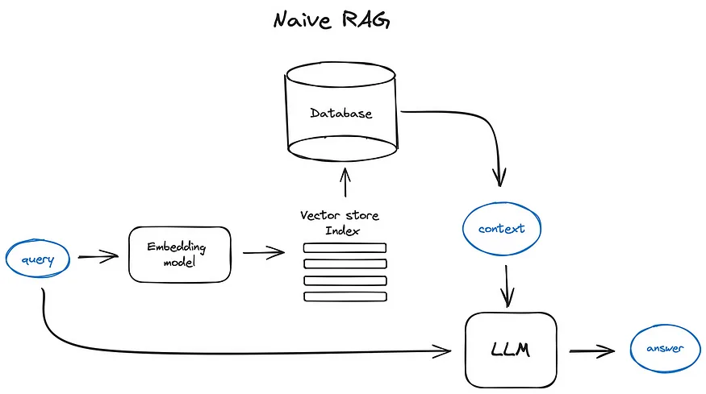
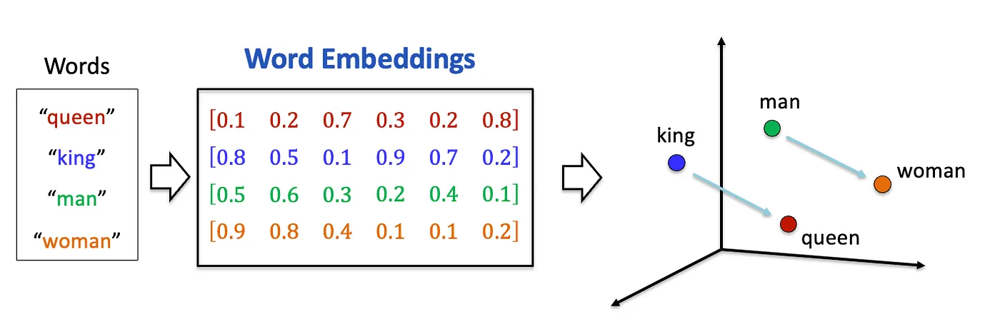
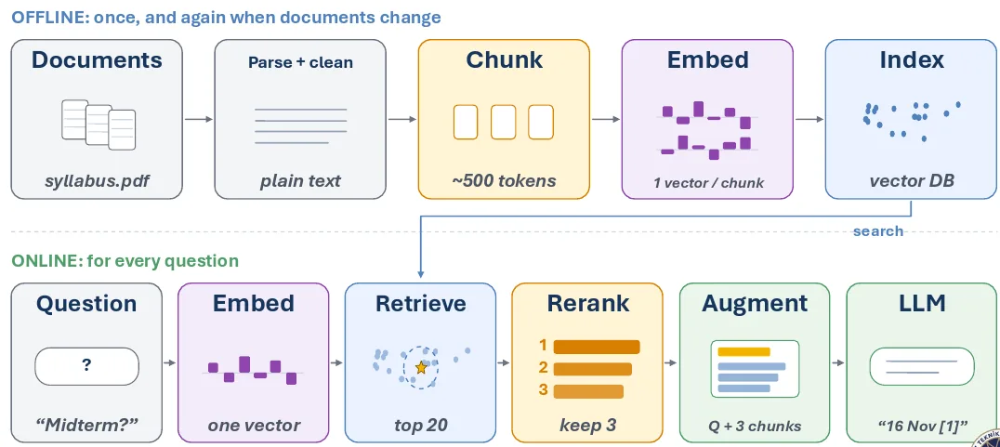

# RAG و Embedding‌ها

توی [مبانی LLM](llms_fa.md) چتی رو دیدی که هوش مصنوعی می‌خونه، و بیشترین اندازه‌ش رو، یعنی context window. توی [Training LLMs](training_fa.md) هم fine-tuning رو دیدی، که خودِ مدل رو عوض می‌کنه. این درس درباره‌ی راه سومیه برای دادن دانش به یه مدل، و پرکاربردترین راه هم همینه.

## چرا این برای تو مهمه

خیلی از محصول‌هایی که می‌گن «با سندهات چت کن»، و خیلی از دستیارهای شرکتی که درباره‌ی سیاست‌های داخلی جواب می‌دن، به همین روش کار می‌کنن. وقتی یکی به شرکتت «یه هوش مصنوعی که همه‌ی سندهات رو می‌شناسه» پیشنهاد می‌ده، این درس بهت می‌گه تو دلش چی داره می‌گذره و باید چی بپرسی.

## چرا RAG لازمه

شرکتت یه عالمه سند به‌دردبخور داره:

- قرارداد
- سیاست‌نامه و راهنما
- سال‌ها تیکت پشتیبانی
- گزارش و spreadsheet

حجمش خیلی بیشتر از چیزیه که تو چت جا می‌شه. نمی‌تونی دویست تا قرارداد رو توی ChatGPT paste کنی.

ولی نکته‌ی مهم اینجاست: **برای یه سؤال، همه‌ش رو لازم نداری.** یکی درباره‌ی بند فسخ توی قرارداد یه تأمین‌کننده می‌پرسه. به اون دویست قرارداد دیگه نیازی نداره. یه بند لازم داره.

پس RAG این کار رو می‌کنه: سندها رو بیرون از هوش مصنوعی نگه می‌داره. وقتی یه سؤال میاد، فقط بخش‌هایی رو پیدا می‌کنه که جوابش رو دارن و کنار سؤال به چت اضافه‌شون می‌کنه. بعد هوش مصنوعی از روی چیزی که حالا می‌تونه ببینه جواب می‌ده. اسمش هم همینو می‌گه: **Retrieval-Augmented Generation**. اول retrieve (پیدا کردن)، بعد generate (جواب دادن).

### میز کار و کتابخونه

یه تصویر ساده بگم.

**چیزی که مدل توی training یاد گرفته یه کتابخونه‌ی عظیمه.** هر چی خونده یه جایی اون تو هست. **چت میز کار توئه.** کوچیکه، ولی هر چی روش باشه درست جلوی چشمته.

یادآوری یه جمله‌ی دقیق از یه کتابخونه‌ی عظیم سخته و قابل‌اعتماد نیست. خوندن یه صفحه که روی میزت بازه آسونه و دقیقه. RAG انتخاب می‌کنه کدوم صفحه‌ها بیان روی میز.

  
*جریان پایه‌ی RAG. سؤال هم‌زمان از دو راه می‌ره. یه راه به سمت جست‌وجو توی سندهای تو می‌ره (کادرهای «embedding model» و «vector store index» توی تصویر). راه دیگه مستقیم به هوش مصنوعی می‌رسه، همراه صفحه‌هایی که جست‌وجو پیدا کرده.*

## Vector Embedding‌ها

جست‌وجو چطور بند درست رو پیدا می‌کنه؟ دنبال کلمه‌های یکسان نمی‌گرده. دنبال *معنیِ* یکسان می‌گرده.

یه مدل مخصوص هر تیکه از متن رو به یه فهرست از عددها تبدیل می‌کنه، که بهش می‌گن **embedding**. می‌تونی مثل یه اثر انگشت از معنی بهش فکر کنی. **متن‌هایی که معنی مشابه دارن، اثر انگشت مشابه می‌گیرن.** شبیه آدرس‌های یه شهره: آدرس‌های نزدیک یعنی جاهای نزدیک.

تصویر کلاسیکش از چهار تا کلمه استفاده می‌کنه:

  
*هر کلمه یه نقطه تو فضا می‌شه. «king» نزدیک «queen» می‌افته و «man» نزدیک «woman». دو تا فلش موازین: قدم از king به queen همون قدم از man به woman‌ه. معنی تبدیل شده به فاصله و جهت.*

نکته‌ی کاربردی اینه که معنی رو پیدا می‌کنه، نه کلمه رو. این دو تا بند قرارداد رو ببین:

- "The Vendor may terminate this Agreement upon 30 days written notice."
- "Either party may end this Contract with a 30-day notice period."

تقریباً هیچ کلمه‌ی مشترکی ندارن. ولی معنیشون تقریباً یکیه، برای همین اثر انگشت‌هاشون نزدیک هم‌ان. یه جست‌وجوی معمولی با کلمه‌ی کلیدی بند دوم رو پیدا نمی‌کنه. جست‌وجوی RAG پیداش می‌کنه.

این اثر انگشت‌ها توی یه دیتابیس مخصوص نگه‌داری می‌شن که بهش می‌گن **vector database**. میلیون‌ها تا از این‌ها رو ذخیره می‌کنه، هر کدوم به متن اصلی‌ش وصله، و می‌تونه نزدیک‌ترین‌ها رو خیلی سریع پیدا کنه.

## مراحل RAG

RAG دو بخش داره.

**یک بار، و هر بار که سندها عوض شدن (آماده‌سازی):**

1. سندها رو جمع می‌کنی: قرارداد، سیاست‌نامه، PDF، هر متنی.
2. اون‌ها رو به تیکه‌های کوچیک (که بهشون **chunk** می‌گن) می‌بری، مثلاً یه پاراگراف یا یه بند.
3. برای هر تیکه یه اثر انگشت می‌سازی.
4. اثر انگشت‌ها رو توی vector database ذخیره می‌کنی.

**برای هر سؤال (جواب دادن):**

1. سؤال رو می‌گیری و اثر انگشتش رو می‌سازی.
2. تیکه‌هایی رو پیدا می‌کنی که نزدیک‌ترین اثر انگشت رو دارن.
3. متن اون تیکه‌ها رو کنار سؤال به چت اضافه می‌کنی.
4. هوش مصنوعی از روی چیزی که حالا می‌بینه جواب می‌ده.

  
*نیمه‌ی بالا یک بار اجرا می‌شه، و هر وقت سندها عوض شدن دوباره. نیمه‌ی پایین برای هر سؤال اجرا می‌شه. توی تصویر یه قدم اضافه هم هست: یه چک دوم (یه «reranker») 20 تیکه‌ی نزدیک‌تر رو می‌خونه و بهترین 3 تا رو نگه می‌داره، که چت فقط چیزی داشته باشه که به سؤال جواب می‌ده.*

## سنجیدن Retrieval

جواب فقط می‌تونه به اندازه‌ی صفحه‌هایی خوب باشه که به میز می‌رسن. اگه جست‌وجو صفحه‌های اشتباه بیاره، هوش مصنوعی هیچ‌وقت صفحه‌ی درست رو نمی‌بینه، و جواب غلط می‌شه. برای همین یه تیم خوب قبل از این‌که جواب‌ها رو قضاوت کنه، جست‌وجو رو جداگانه تست می‌کنه. دو تا معیار ساده:

- **Recall**: جست‌وجو همه‌ی صفحه‌های درست رو پیدا کرد؟
- **Precision**: از صفحه‌هایی که پیدا کرد، چندتاش درست بود؟

صفحه‌های اشتباه بی‌ضرر نیستن. اون‌ها هم میان روی میز، جا می‌گیرن و می‌تونن هوش مصنوعی رو گیج کنن.

## چرا فقط مدل رو روی اسنادت fine-tune نکنیم؟

fine-tuning رو توی [Training LLMs](training_fa.md) دیدی، پس این سؤال بجاییه.

**دانش شرکتت عوض می‌شه، و fine-tuning یه عکسه.** قرارداد عوض می‌شه، سیاست عوض می‌شه، هر روز سند جدید میاد. fine-tuning ساعت‌ها یا روزها طول می‌کشه و پول می‌خواد، پس نمی‌تونی هر بار که یه فایل عوض شد تکرارش کنی. با RAG فقط دیتابیس رو آپدیت می‌کنی و سؤال بعدی همون تغییر رو می‌بینه.

**fine-tuning مهارت یاد می‌ده، نه واقعیت.** صد صفحه‌ی تو با میلیاردها عددی قاطی می‌شه که هر چیز دیگه‌ای که مدل خونده رو نگه می‌دارن. برای همین یه مدل fine-tune‌شده راحت می‌تونه جزئیات تو رو با چیزی که نصفه‌نیمه یادشه قاطی کنه.

**جواب RAG رو می‌شه چک کرد.** توی RAG دقیقاً می‌دونی هوش مصنوعی کدوم صفحه‌ها رو خونده. پس اپ می‌تونه اون‌ها رو کنار جواب، به‌عنوان منبع نشون بده. یه آدم می‌تونه منبع رو باز کنه و چک کنه. این توی کار منابع انسانی، مالی و حقوقی خیلی مهمه، چون باید بتونی بگی یه جواب از کجا اومده. یه مدل fine-tune‌شده نمی‌تونه این رو نشونت بده: دانشش توی عددهاش قاطی شده.

در یه جمله: **fine-tuning چیزی رو عوض می‌کنه که مدل *می‌دونه*؛ RAG چیزی رو عوض می‌کنه که مدل *می‌بینه*.**

می‌تونی هر دو رو هم با هم به کار ببری: یه مدل رو برای این‌که *چطور* رفتار کنه fine-tune کنی، و از RAG برای این‌که *چی* بدونه استفاده کنی. خیلی از شرکت‌ها دقیقاً همین کار رو می‌کنن.

## کلمه‌هایی که الان بلدی

- **RAG**: تیکه‌های مربوط از سندهات رو پیدا کن، به چت اضافه کن، بعد جواب بده.
- **Retrieval**: قدم «پیدا کردن».
- **Embedding**: یه اثر انگشت از معنی، ساخته‌شده از عددها.
- **Vector database**: دیتابیسی که اثر انگشت‌ها رو ذخیره می‌کنه و نزدیک‌ترین‌ها رو سریع پیدا می‌کنه.
- **Chunk**: یه تیکه‌ی کوچیک از یه سند.
- **Recall** و **precision**: جست‌وجو همه‌ی صفحه‌های درست رو پیدا کرد یا نه، و از صفحه‌های پیداشده چندتاش درست بود.
- **Citation**: نشون دادن صفحه‌ی منبع کنار جواب.

## خلاصه

RAG سندهات رو بیرون از هوش مصنوعی نگه می‌داره و برای هر سؤال فقط تیکه‌های مربوط رو روی میز می‌ذاره. این تیکه‌ها رو با معنی پیدا می‌کنه، با اثر انگشت‌هایی به اسم embedding که توی یه vector database نگه‌داری می‌شن. اون تصویر رو یادت نگه دار: training کتابخونه رو پر می‌کنه، و RAG انتخاب می‌کنه چی بیاد روی میز.

درس بعدی tool‌هاست: این‌که یه هوش مصنوعی چطور از «فقط خوندن» به «کار کردن» می‌رسه.

**بررسی سریع**: قدم‌های جواب دادن به یه سؤال با RAG چیان؟ چرا RAG می‌تونه بندی رو پیدا کنه که هیچ کلمه‌ی مشترکی با سؤال نداره؟ و چرا جواب RAG رو می‌شه چک کرد ولی جواب یه مدل fine-tune‌شده رو نه؟

## منابع

### 📄 مقاله‌ها

- [RAG vs fine-tuning](https://www.redhat.com/en/topics/ai/rag-vs-fine-tuning): مقایسه‌ی Red Hat از این دو

### 🎬 ویدیوها

- [What is RAG?](https://youtube.com/shorts/KBRvB_NDY-o?si=DIUHt8lihi0EzgxT): کل ایده، تو یه ویدیوی کوتاه
- [Fine-Tuning vs RAG: Why Not Both?](https://youtube.com/shorts/24jqSMs10zE?si=zuhAbSZcFGkTKVfI): درباره‌ی استفاده از هر دو با هم

### 🛠️ ابزارها

- [LlamaIndex](https://www.llamaindex.ai/): وصل کردن یه هوش مصنوعی به داده‌های خودت

### 🗃️ Repository‌ها

- [RAGFlow](https://github.com/infiniflow/ragflow): یه سیستم RAG کامل با رابط وب، که منبع‌هاش رو نشون می‌ده
