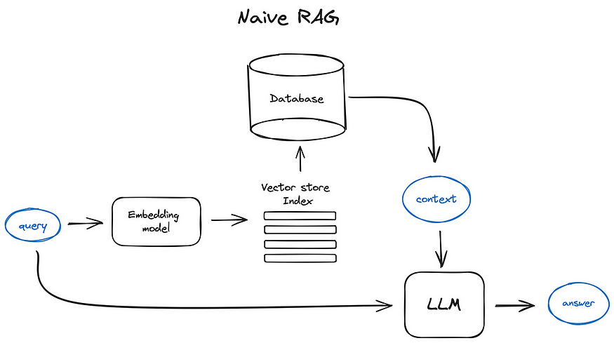
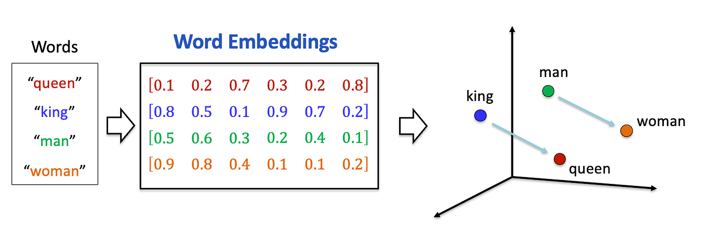
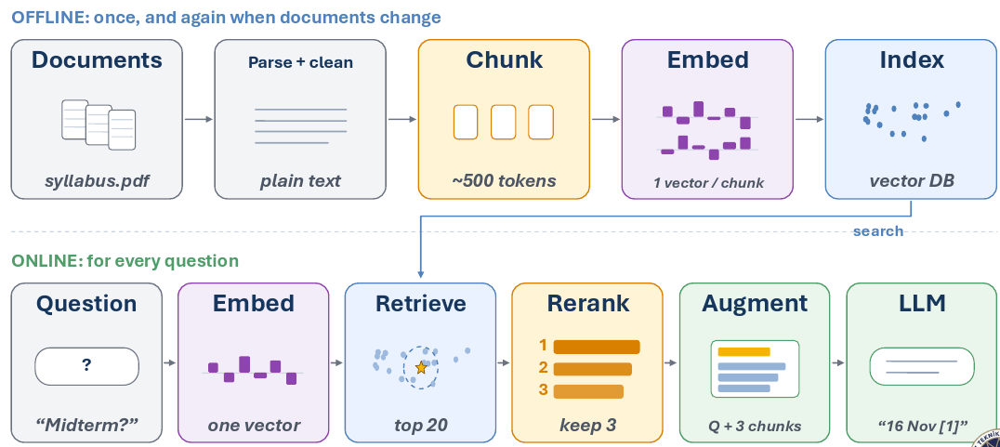

# RAG & Embeddings

[LLM Temelleri](llms_tr.md) modülü sana yapay zekânın okuduğu sohbeti ve onun en büyük boyutunu, yani context window'u verdi. [Training LLMs](training_tr.md) modülü fine-tuning'i verdi; bu yöntem modelin kendisini değiştiriyor. Bu modül ise bir modele bilgi vermenin üçüncü yolunu anlatıyor. Ve en çok kullanılan yol da bu.

## Bu Senin İçin Neden Önemli

"Dokümanlarınla sohbet et" diyen hemen her ürün ve şirket içi politikalarla ilgili soruları cevaplayan hemen her şirket asistanı bu şekilde çalışır. Biri şirketine "tüm dokümanlarını bilen bir yapay zekâ" sunduğunda, bu modül içeride neyin olduğunu ve neyi sorman gerektiğini anlatıyor.

## RAG Neden Var?

Şirketinin işe yarar dokümanları var:

- sözleşmeler
- politikalar ve el kitapları
- yıllardır biriken destek talepleri
- raporlar ve tablolar

Bunların miktarı sohbete sığacak olandan çok daha fazla. İki yüz sözleşmeyi ChatGPT'ye yapıştıramazsın.

Ama önemli nokta şu: **tek bir soru için bunların hepsine ihtiyacın yok.** Biri, tek bir tedarikçi sözleşmesindeki fesih maddesini soruyor. Diğer iki yüz sözleşmeye ihtiyacı yok. Tek bir maddeye ihtiyacı var.

RAG de şunu yapıyor: dokümanları yapay zekânın dışında tutuyor. Bir soru geldiğinde, yalnızca onu cevaplayan parçaları buluyor ve onları sohbete, sorunun yanına ekliyor. Sonra yapay zekâ, artık görebildiği şeyden yola çıkarak cevap veriyor. Adı da bunu söylüyor: **Retrieval-Augmented Generation**, yani getirmeyle güçlendirilmiş üretim. Önce retrieve (bul), sonra generate (cevapla).

### Masa ve Kütüphane

İşte basit bir resim.

**Modelin eğitimde öğrendikleri dev bir kütüphanedir.** Okuduğu her şey orada bir yerlerde duruyor. **Sohbet ise senin masan.** Küçük, ama üzerinde ne varsa tam önünde.

Dev bir kütüphaneden tam bir cümleyi hatırlamak zor ve güvenilmezdir. Masanda açık duran bir sayfayı okumak ise kolay ve kesindir. RAG, hangi sayfaların masaya konacağını seçer.

  
*Temel RAG akışı. Soru aynı anda iki yöne gider. Bir yol, dokümanlarında yapılan aramaya gider (aşağıdaki "embedding model" ve "vector store"). Diğeri doğrudan yapay zekâya gider ve yanında aramanın bulduğu sayfalar vardır.*

## Anlamın Parmak İzi (Embedding'ler)

Arama doğru maddeyi nasıl buluyor? Eşleşen kelimeleri aramıyor. Eşleşen *anlamı* arıyor.

Özel bir model, her metin parçasını **embedding** denen bir sayı listesine çevirir. Bunu anlamın parmak izi gibi düşün. **Benzer anlamdaki metinler benzer parmak izleri alır.** Bir şehirdeki adreslere benziyor: yakın adresler, yakın yerler demektir.

Klasik resimde dört kelime kullanılır:

  
*Her kelime uzayda bir noktaya dönüşür. "King", "queen"in yakınına, "man" de "woman"ın yakınına düşer. İki ok paraleldir: king'den queen'e geçiş, man'den woman'a geçişle aynı adımdır. Anlam, mesafeye ve yöne dönüşmüştür.*

Asıl işe yarayan kısım, kelimeleri değil anlamı bulması. Şu iki sözleşme maddesine bak:

- "The Vendor may terminate this Agreement upon 30 days written notice."
- "Either party may end this Contract with a 30-day notice period."

Neredeyse hiç ortak kelimeleri yok. Ama anlamları neredeyse aynı, bu yüzden parmak izleri birbirine yakın. Normal bir anahtar kelime araması ikinci maddeyi kaçırırdı. RAG araması onu bulur.

Bu parmak izleri, **vektör veritabanı (vector database)** denen özel bir veritabanında tutulur. Milyonlarcasını saklar, her birini asıl metnine bağlar ve en yakın olanları çok hızlı bulabilir.

## İki Aşama

RAG iki parçadan oluşur.

**Bir kez, bir de dokümanlar değiştikçe (hazırlık):**

1. Dokümanları topla: sözleşmeler, politikalar, PDF'ler, herhangi bir metin.
2. Onları küçük parçalara böl; örneğin bir paragraf ya da bir madde.
3. Her parça için bir parmak izi üret.
4. Parmak izlerini vektör veritabanında sakla.

**Her soru için (cevaplama):**

1. Soruyu al ve onun parmak izini üret.
2. Parmak izleri en yakın olan parçaları bul.
3. O parçaların metnini, sorunun yanına, sohbete ekle.
4. Yapay zekâ, artık görebildiği şeyden yola çıkarak cevap verir.

  
*Üst yarı bir kez, bir de dokümanlar değiştiğinde çalışır. Alt yarı her soruda çalışır. Resim bir adım daha ekliyor: ikinci bir kontrol ("reranker") en yakın 20 parçayı okuyup en iyi 3'ünü tutar; böylece sohbette yalnızca soruyu cevaplayan parçalar kalır.*

## Aramayı Test Etmek

Cevap, ancak masaya ulaşan sayfalar kadar iyi olabilir. Arama yanlış sayfaları getirirse yapay zekâ doğru sayfaları hiç görmez ve cevap yanlış çıkar. Bu yüzden iyi bir ekip, cevapları değerlendirmeden önce aramayı kendi başına test eder. İki basit ölçü var:

- **Recall**: arama, doğru sayfaların hepsini buldu mu?
- **Precision**: bulduğu sayfaların kaçı doğruydu?

Yanlış sayfalar zararsız değil. Onlar da masaya konur, orada yer kaplar ve yapay zekâyı şaşırtabilir.

## Modeli Neden Dokümanların Üzerinde Eğitmiyoruz?

[Training LLMs](training_tr.md) modülünde fine-tuning'i gördün, o yüzden bu adil bir soru.

**Şirketinin bilgisi değişir ve fine-tuning bir fotoğraftır.** Sözleşmeler değişir, politikalar değişir, her gün yeni dokümanlar gelir. Fine-tuning saatler ya da günler sürer ve paraya mal olur, bu yüzden bir dosya her değiştiğinde onu tekrarlayamazsın. RAG'de ise veritabanını güncellersin ve bir sonraki soru değişikliği zaten görür.

**Fine-tuning bilgiyi değil, beceriyi öğretir.** Yüz sayfan, modelin okuduğu diğer her şeyi tutan milyarlarca sayının arasına karışır. Bu yüzden fine-tune edilmiş bir model, senin ayrıntılarını yarı hatırladığı başka bir şeyle kolayca karıştırabilir.

**Bir RAG cevabı kontrol edilebilir.** RAG'de yapay zekânın hangi sayfaları okuduğunu tam olarak bilirsin. Bu yüzden uygulama onları cevabın yanında kaynak olarak gösterebilir. Bir insan kaynağı açıp kontrol edebilir. Bir cevabın nereden geldiğini söyleyebilmen gereken İK, finans ve hukuk işlerinde bu çok önemli. Fine-tune edilmiş bir model bunu gösteremez: bilgisi sayılarının içine karışmıştır.

Tek cümleyle: **fine-tuning modelin neyi *bildiğini* değiştirir; RAG modelin neyi *gördüğünü* değiştirir.**

İkisini birlikte de kullanabilirsin: modelin *nasıl* davranacağı için fine-tune yaparsın, *neyi* bilmesi gerektiği için RAG kullanırsın. Birçok şirket tam olarak bunu yapıyor.

## Artık Bildiğin Terimler

- **RAG**: dokümanlarının ilgili parçalarını bul, sohbete ekle, sonra cevapla.
- **Retrieval**: "bul" adımı.
- **Embedding**: anlamın sayılardan oluşan parmak izi.
- **Vektör veritabanı**: parmak izlerini saklayan ve en yakın olanları hızlıca bulan veritabanı.
- **Chunk**: bir dokümanın küçük bir parçası.
- **Recall** ve **precision**: arama doğru sayfaların hepsini buldu mu ve bulunan sayfaların kaçı doğruydu.
- **Citation**: kaynak sayfayı cevabın yanında göstermek.

## Özet

RAG, dokümanlarını yapay zekânın dışında tutar ve her soru için masaya yalnızca ilgili parçaları koyar. Onları anlamla bulur; bunun için embedding denen parmak izlerini kullanır ve bu parmak izleri bir vektör veritabanında durur. Bu resmi aklında tut: eğitim kütüphaneyi doldurur, RAG ise masaya neyin konacağını seçer.

Sırada tool'lar var: bir yapay zekâ yalnızca okumayı bırakıp nasıl bir şeyler yapmaya başlıyor.

**Hızlı Kontrol**: RAG ile bir soruyu cevaplamanın adımları neler? RAG, soruyla hiç ortak kelimesi olmayan bir maddeyi neden bulabiliyor? Fine-tune edilmiş bir cevap kontrol edilemezken, bir RAG cevabı neden kontrol edilebiliyor?

## Kaynaklar

### 📄 Makaleler

- [RAG vs fine-tuning](https://www.redhat.com/en/topics/ai/rag-vs-fine-tuning): Red Hat'in ikisini karşılaştırması

### 🎬 Videolar

- [What is RAG?](https://youtube.com/shorts/KBRvB_NDY-o?si=DIUHt8lihi0EzgxT): bütün fikir, kısa bir videoda
- [Fine-Tuning vs RAG: Why Not Both?](https://youtube.com/shorts/24jqSMs10zE?si=zuhAbSZcFGkTKVfI): ikisini birlikte kullanmak üzerine

### 🛠️ Araçlar

- [LlamaIndex](https://www.llamaindex.ai/): bir yapay zekâyı kendi verine bağlamak

### 🗃️ Repolar

- [RAGFlow](https://github.com/infiniflow/ragflow): web arayüzü olan ve kaynaklarını gösteren eksiksiz bir RAG sistemi
