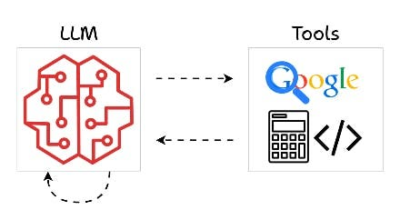
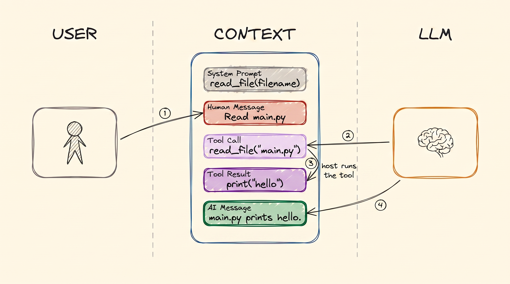

# Tool Calling

[LLM Fundamentals](llms.md), [Training LLMs](training.md) and [RAG & Embeddings](rag.md)
covered what a model is, how it learned, and how to put your own documents in front of it. In
all of that, the AI only reads and writes. In this module, it starts *doing* things: it searches
the web, reads a file, creates a calendar event or sends an email.

This is the mechanism under every AI agent, so it is worth understanding exactly.

## Why This Matters to You

This is the step that turns a chatbot into an assistant that works for you. When an AI product
says it can "connect to your calendar" or "update your CRM", it is using tools. Knowing how tools
work tells you what such an assistant can really do, and what it could do by mistake.

## What is a Tool?

  
*Tools are how a model reaches outside its own head. It searches the web, does maths or runs code, and then comes back with an answer.*

A **tool** is a small program that someone wrote. It has a name, a short description, and some
details it needs, such as a city name or an email address.

Here is the part people get wrong: **the AI never runs the tool itself.** It cannot. It has no
computer and no hands. The only thing it can do is write text.

So go back to the chat picture from [LLM Fundamentals](llms.md). You ask "what is the weather in
Istanbul?". The AI cannot know that. So instead of answering, it writes a special message: "I
would like to run *check weather* with city = Istanbul". A normal program on a computer reads
that message, runs the weather tool, and adds the result to the chat: "34°C". Then the AI reads
the result and answers you. **The AI asks; the computer does the work.**

## Tool Calls Grow the Chat

A tool call adds two new kinds of message to the chat. This picture shows the whole flow:

  
*One tool call, in order. The system prompt lists the tool before anyone speaks. Then you ask, and the AI writes a Tool Call. The computer runs it and writes the Tool Result. Then the AI reads that result and writes the answer.*

Follow the four arrows, because it matters who writes each message:

1. **You** write your question.
2. **The AI** writes the **tool call**. It is asking, not doing.
3. **The computer** (your laptop, or a company server) runs the tool and writes the **tool
   result**.
4. **The AI** reads the whole chat, which now includes that result, and writes the answer.

Both new messages stay in the chat. That is why an assistant's chat grows much faster than a
normal chat: one question can add four or more messages instead of two.

## Why Tools Exist

A model learned from data that stops at some date. So, on its own, it cannot know anything new,
and it cannot change anything in the world. Tools fix both problems.

**It cannot search the web.** So someone writes a tool that searches the web and returns the
results. Now it can.

**It cannot read your files.** So someone writes a tool that opens a file and returns what is
inside. Now it can see your documents.

Without tools, an AI is a chatbot. With tools, it is an agent.

## The Tool's Menu Card

Before the AI can choose a tool, it has to know three things: that the tool exists, what it
does, and what details it needs. That description is called the **tool schema**. Think of it as
a menu card for the tool. It sits in the system prompt, at the top of the chat.

A programmer writes the tool as a short piece of code, and software makes the menu card from it
automatically. For example:

```python
@tool
def get_weather(city: str) -> str:
    """Get the current temperature for a city."""
    return requests.get(f"https://api.example.com/weather?city={city}").text
```

If you do not read code, that is fine. Only three parts matter: the name (`get_weather`), the
description in quotes, and the detail it needs (`city`).

**Here is the key lesson: the AI chooses tools only from their menu cards.** The name and the
description are the only things it sees. Imagine a tool called "get data", with the description
"gets data". The AI will pick it at the wrong moments and skip it at the right ones. A clear name
and a clear description are not decoration. They decide whether the assistant works well.

## One Tool Call, Step by Step

Here is the weather example as it really happens:

- **The AI receives** the system prompt with the weather tool's menu card, and your question:
  "What is the weather in Istanbul?"
- **The AI writes a tool call**, not an answer. It looks something like this:

```json
{
  "role": "assistant",
  "content": null,
  "tool_calls": [
    {
      "id": "call_9k2m4Xq7",
      "type": "function",
      "function": {
        "name": "get_weather",
        "arguments": "{\"city\":\"Istanbul\"}"
      }
    }
  ]
}
```

- **The computer** sees the request, runs the weather tool with "Istanbul", and adds the result
  to the chat: `34°C, sunny`.
- **The AI reads everything again**, including the result, and writes: "It is 34°C and sunny in
  Istanbul."

Every AI agent you will ever use repeats these same steps, again and again.

## Example Tools

Almost anything a computer can do can become a tool:

- search the web
- read or search company documents (this is the RAG search from [RAG & Embeddings](rag.md),
  turned into a tool, so the AI decides *when* to look something up)
- send an email from Gmail
- create a ticket in Jira
- add an event to your calendar
- look up a number in a database

**Most useful tools are a thin wrapper around a service your company already uses.** Gmail,
your calendar and your payment system already have a way for programs to talk to them. The tool
only connects the AI to that.

Two warnings come with this. First, **a tool is exactly as powerful as the access you give it.**
A tool that can send email from your account can send anything to anyone. For HR and finance
work, think carefully before you give an assistant that kind of access. Second, you rarely have
to build these tools yourself any more. A standard called **MCP** (Model Context Protocol)
packages tools so that one tool works in any AI assistant. Often someone has already built the
one you need. The [Code Agents](../2_intermediate/coding_agents.md) module covers it.

## Words You Now Know

- **Tool**: a small program the AI can ask to run, such as "check weather" or "send email".
- **Tool call**: the AI's message asking for a tool to run.
- **Tool result**: the answer the computer adds to the chat after running the tool.
- **Tool schema**: the tool's menu card: its name, description and the details it needs.
- **Host**: the computer that actually runs the tool.
- **MCP**: a standard way to package tools so any AI assistant can use them.

## Summary

The AI cannot do anything except write text. So when it needs something from the world, it
writes a tool call, a normal program runs the tool, and the result goes back into the chat. The
AI chooses tools only from their menu cards, so a clear name and description matter. And a tool
can do whatever its access allows, so access is a decision to take seriously.

Next comes memory: what an AI remembers, and where.

**Quick check**: Who runs the tool, the AI or the computer? What are the four messages of one
tool call? And why does a vague tool name make an assistant worse?

## References

### 📄 Articles

- [Mastering LLM tool calling](https://machinelearningmastery.com/mastering-llm-tool-calling-the-complete-framework-for-connecting-models-to-the-real-world/): the full picture, with more technical detail
