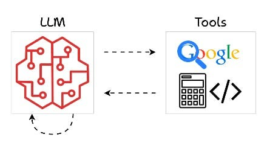
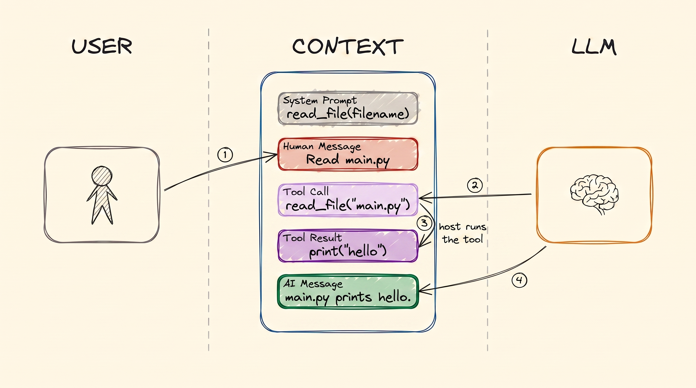

# Tool Calling

توی [مبانی LLM](llms_fa.md)، [Training LLMs](training_fa.md) و [RAG و Embedding‌ها](rag_fa.md) دیدیم یه مدل چیه، چطور یاد گرفته، و چطور سندهای خودت رو جلوی چشمش بذاری. توی همه‌ی این‌ها هوش مصنوعی فقط می‌خونه و می‌نویسه. توی این درس شروع می‌کنه به *انجام دادن* کارها: توی وب می‌گرده، یه فایل رو می‌خونه، یه رویداد توی تقویم می‌سازه یا یه ایمیل می‌فرسته.

این مکانیزمِ زیر هر AI agent هست، پس ارزش داره دقیق بفهمیش.

## چرا این برای تو مهمه

این همون قدمیه که یه chatbot رو به دستیاری تبدیل می‌کنه که برات کار می‌کنه. وقتی یه محصول هوش مصنوعی می‌گه «می‌تونه به تقویمت وصل بشه» یا «CRM رو آپدیت کنه»، داره از tool استفاده می‌کنه. وقتی بدونی tool‌ها چطور کار می‌کنن، می‌فهمی همچین دستیاری واقعاً چی کار می‌تونه بکنه، و چه کاری رو ممکنه اشتباهی بکنه.

## tool چیه؟

  
*tool‌ها راهیه که یه مدل از «توی سر خودش» به بیرون می‌رسه. توی وب می‌گرده، حساب و کتاب می‌کنه یا کد اجرا می‌کنه، و بعد با یه جواب برمی‌گرده.*

یه **tool** یه برنامه‌ی کوچیکه که یکی نوشته. یه اسم داره، یه توضیح کوتاه، و چند تا جزئیاتی که لازم داره، مثل اسم یه شهر یا یه آدرس ایمیل.

حالا اون نکته‌ای که آدم‌ها اشتباه می‌فهمن: **هوش مصنوعی هیچ‌وقت خودش tool رو اجرا نمی‌کنه.** نمی‌تونه. نه کامپیوتر داره نه دست. تنها کاری که از دستش برمیاد نوشتن متنه.

پس برگرد به تصویر چت از [مبانی LLM](llms_fa.md). می‌پرسی «هوای استانبول چطوره؟». هوش مصنوعی نمی‌تونه این رو بدونه. برای همین به‌جای جواب دادن، یه پیام مخصوص می‌نویسه: «می‌خوام *چک کردن هوا* رو با city = Istanbul اجرا کنم». یه برنامه‌ی معمولی روی یه کامپیوتر اون پیام رو می‌خونه، tool هوا رو اجرا می‌کنه و نتیجه رو به چت اضافه می‌کنه: «34°C». بعد هوش مصنوعی نتیجه رو می‌خونه و به تو جواب می‌ده. **هوش مصنوعی درخواست می‌ده؛ کامپیوتر کار رو انجام می‌ده.**

## چرا Tool Call‌ها context رو بزرگ می‌کنن

یه tool call دو جور پیام جدید به چت اضافه می‌کنه. این تصویر کل جریان رو نشون می‌ده:

  
*یه tool call، به ترتیب. system prompt قبل از این‌که کسی حرف بزنه، tool رو فهرست می‌کنه. بعد تو می‌پرسی و هوش مصنوعی یه Tool Call می‌نویسه. کامپیوتر اجراش می‌کنه و Tool Result رو می‌نویسه. بعد هوش مصنوعی اون نتیجه رو می‌خونه و جواب رو می‌نویسه.*

چهار تا فلش رو دنبال کن، چون مهمه که هر پیام رو کی می‌نویسه:

1. **تو** سؤالت رو می‌نویسی.
2. **هوش مصنوعی** **tool call** رو می‌نویسه. داره درخواست می‌ده، نه کار رو انجام می‌ده.
3. **کامپیوتر** (لپ‌تاپ تو، یا یه سرور شرکت) tool رو اجرا می‌کنه و **tool result** رو می‌نویسه.
4. **هوش مصنوعی** کل چت رو می‌خونه، که حالا اون نتیجه هم توشه، و جواب رو می‌نویسه.

هر دو پیام جدید توی چت می‌مونن. برای همین چت یه دستیار خیلی سریع‌تر از یه چت معمولی بزرگ می‌شه: یه سؤال می‌تونه چهار تا پیام یا بیشتر اضافه کنه، به‌جای دو تا.

## چرا اصلاً tool لازمه؟

یه مدل از داده‌ای یاد گرفته که تا یه تاریخی بیشتر نیست. پس به‌تنهایی نمی‌تونه چیز جدیدی بدونه، و نمی‌تونه چیزی رو توی دنیا عوض کنه. tool‌ها هر دو مشکل رو حل می‌کنن.

**نمی‌تونه توی وب بگرده.** پس یکی یه tool می‌نویسه که توی وب می‌گرده و نتیجه‌ها رو برمی‌گردونه. حالا می‌تونه.

**نمی‌تونه فایل‌های تو رو بخونه.** پس یکی یه tool می‌نویسه که یه فایل رو باز می‌کنه و چیزی که توشه رو برمی‌گردونه. حالا می‌تونه سندهات رو ببینه.

بدون tool، هوش مصنوعی یه chatbot‌ه. با tool، یه agent‌ه.

## tool schema

قبل از این‌که هوش مصنوعی بتونه یه tool انتخاب کنه، باید سه چیز رو بدونه: این‌که tool وجود داره، چی کار می‌کنه، و چه جزئیاتی لازم داره. اون توضیح اسمش **tool schema**‌ه. مثل یه کارت منو برای tool بهش فکر کن. توی system prompt، بالای چت می‌شینه.

یه برنامه‌نویس tool رو به‌شکل یه تیکه کد کوتاه می‌نویسه، و یه نرم‌افزار کارت منو رو خودکار ازش درمیاره. مثلاً:

```python
@tool
def get_weather(city: str) -> str:
    """Get the current temperature for a city."""
    return requests.get(f"https://api.example.com/weather?city={city}").text
```

اگه کد نمی‌خونی، اشکالی نداره. فقط سه تا بخش مهمه: اسم (`get_weather`)، توضیحی که تو گیومه‌ست، و جزئیاتی که لازم داره (`city`).

**درس اصلی اینه: هوش مصنوعی tool‌ها رو فقط از روی کارت منوشون انتخاب می‌کنه.** اسم و توضیح تنها چیزهایی‌ان که می‌بینه. فرض کن یه tool اسمش «get data» باشه و توضیحش «داده می‌گیره». هوش مصنوعی اون رو سر وقت‌های اشتباه انتخاب می‌کنه و سر وقت‌های درست ازش رد می‌شه. یه اسم واضح و یه توضیح واضح تزئین نیستن. تعیین می‌کنن دستیار خوب کار کنه یا نه.

## یه Tool Call واقعی

مثال هوا همون‌طوری که واقعاً اتفاق می‌افته:

- **هوش مصنوعی** system prompt رو، با کارت منوی tool هوا، و سؤال تو رو می‌گیره: «هوای استانبول چطوره؟»
- **هوش مصنوعی یه tool call می‌نویسه**، نه یه جواب. چیزی شبیه این:

```json
{
  "role": "assistant",
  "content": null,
  "tool_calls": [
    {
      "id": "call_9k2m4Xq7",
      "type": "function",
      "function": {
        "name": "get_weather",
        "arguments": "{\"city\":\"Istanbul\"}"
      }
    }
  ]
}
```

- **کامپیوتر** درخواست رو می‌بینه، tool هوا رو با «Istanbul» اجرا می‌کنه و نتیجه رو به چت اضافه می‌کنه: `34°C, sunny`.
- **هوش مصنوعی دوباره همه‌چیز رو می‌خونه**، از جمله نتیجه، و می‌نویسه: «استانبول 34 درجه‌ست و آفتابیه.»

هر AI agent‌ای که تا حالا استفاده می‌کنی، همین قدم‌ها رو بارها و بارها تکرار می‌کنه.

## چند تا tool نمونه

تقریباً هر کاری که یه کامپیوتر می‌تونه بکنه، می‌تونه یه tool بشه:

- گشتن توی وب
- خوندن یا گشتن توی سندهای شرکت (این همون جست‌وجوی RAG از [RAG و Embedding‌ها](rag_fa.md)‌ه که تبدیل شده به یه tool، تا هوش مصنوعی خودش تصمیم بگیره *کی* دنبال چیزی بگرده)
- فرستادن ایمیل از Gmail
- ساختن یه تیکت توی Jira
- اضافه کردن یه رویداد به تقویمت
- پیدا کردن یه عدد توی یه دیتابیس

**بیشتر tool‌های به‌دردبخور یه لایه‌ی نازکن دور یه سرویسی که شرکتت از قبل استفاده می‌کنه.** Gmail، تقویمت و سیستم پرداختت از قبل یه راه دارن که برنامه‌ها باهاشون حرف بزنن. tool فقط هوش مصنوعی رو بهش وصل می‌کنه.

دو تا هشدار هم هست. اول، **یه tool دقیقاً به اندازه‌ی دسترسی‌ای قدرت داره که بهش می‌دی.** یه tool که بتونه از حساب تو ایمیل بفرسته، می‌تونه هر چیزی رو برای هر کسی بفرسته. توی کار منابع انسانی و مالی، قبل از این‌که همچین دسترسی‌ای به یه دستیار بدی، خوب فکر کن. دوم، دیگه کمتر پیش میاد که خودت مجبور باشی این tool‌ها رو بسازی. یه استاندارد هست به اسم **MCP** (Model Context Protocol) که tool‌ها رو جوری بسته‌بندی می‌کنه که یه tool توی هر دستیار هوش مصنوعی کار کنه. اغلب یکی قبلاً همونی رو که لازم داری ساخته. درس [Code Agent‌ها](../2_intermediate/coding_agents_fa.md) درباره‌ش حرف می‌زنه.

## کلمه‌هایی که الان بلدی

- **Tool**: یه برنامه‌ی کوچیک که هوش مصنوعی می‌تونه ازش بخواد اجرا بشه، مثل «چک کردن هوا» یا «فرستادن ایمیل».
- **Tool call**: پیام هوش مصنوعی که می‌خواد یه tool اجرا بشه.
- **Tool result**: جوابی که کامپیوتر بعد از اجرای tool به چت اضافه می‌کنه.
- **Tool schema**: کارت منوی tool: اسمش، توضیحش و جزئیاتی که لازم داره.
- **Host**: کامپیوتری که tool رو واقعاً اجرا می‌کنه.
- **MCP**: یه روش استاندارد برای بسته‌بندی tool‌ها، که هر دستیار هوش مصنوعی بتونه استفاده‌شون کنه.

## خلاصه

هوش مصنوعی هیچ کاری جز نوشتن متن نمی‌تونه بکنه. پس وقتی از دنیا چیزی لازم داره، یه tool call می‌نویسه، یه برنامه‌ی معمولی tool رو اجرا می‌کنه، و نتیجه برمی‌گرده توی چت. هوش مصنوعی tool‌ها رو فقط از روی کارت منوشون انتخاب می‌کنه، پس اسم و توضیح واضح مهمه. و یه tool هر کاری رو می‌تونه بکنه که دسترسیش اجازه بده، پس دسترسی دادن تصمیمیه که باید جدی بگیریش.

درس بعدی memory‌ه: هوش مصنوعی چی یادش می‌مونه، و کجا.

**بررسی سریع**: tool رو کی اجرا می‌کنه، هوش مصنوعی یا کامپیوتر؟ چهار تا قدم یه tool call چیان و هر کدوم رو کی انجام می‌ده؟ و چرا یه اسم مبهم برای tool دستیار رو بدتر می‌کنه؟

## منابع

### 📄 مقاله‌ها

- [Mastering LLM tool calling](https://machinelearningmastery.com/mastering-llm-tool-calling-the-complete-framework-for-connecting-models-to-the-real-world/): تصویر کامل، با جزئیات فنی بیشتر
