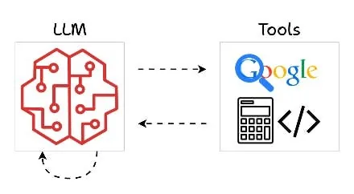
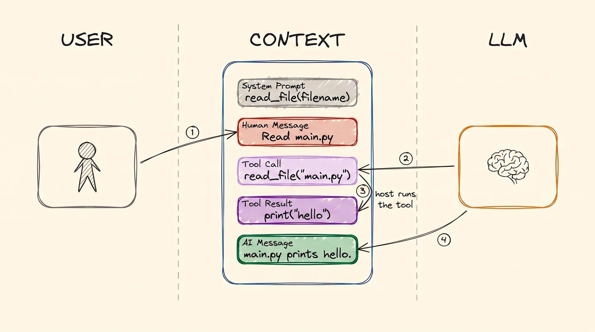
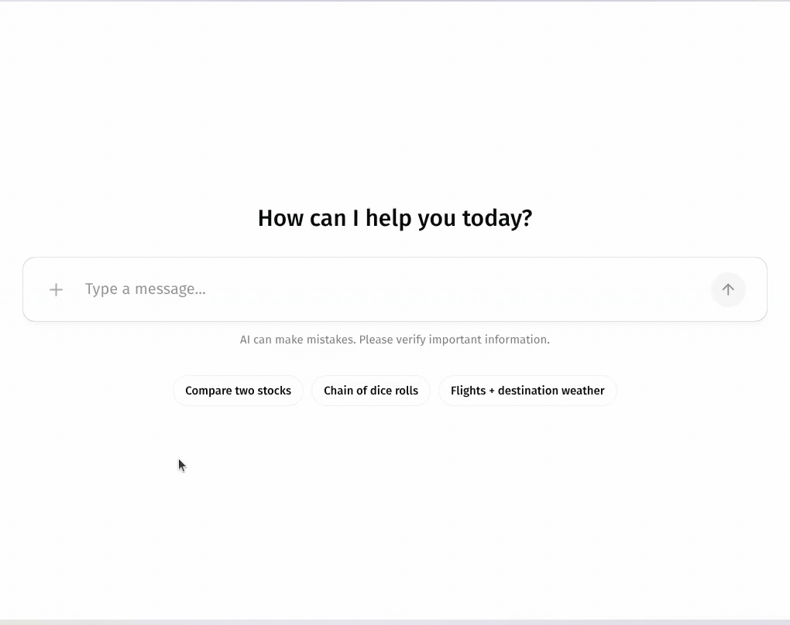

---
objectives:
  - "Yapay zekânın tool'u neden hiçbir zaman kendisi çalıştırmadığını ve bunu kimin yaptığını açıkla"
  - "Tek bir tool çağrısındaki dört mesajı adlandır ve her birini kimin yazdığını söyle"
  - "Bir tool'un adının ve açıklamasının, yapay zekânın onu ne kadar iyi kullandığını neden belirlediğini açıkla"
---

# Tool Calling

[LLM Temelleri](llms_tr.md), [Training LLMs](training_tr.md) ve [RAG & Embeddings](rag_tr.md) modülleri bir modelin ne olduğunu, nasıl öğrendiğini ve kendi dokümanlarını onun önüne nasıl koyacağını anlattı. Bunların hepsinde yapay zekâ yalnızca okuyor ve yazıyordu. Bu modülde ise bir şeyler *yapmaya* başlıyor: internette arama yapıyor, bir dosyayı okuyor, takvimde bir etkinlik oluşturuyor ya da bir e-posta gönderiyor.

Bu, her AI agent'ının altındaki mekanizma. O yüzden onu tam olarak anlamaya değer.

## Bu Senin İçin Neden Önemli

Bu adım, bir sohbet botunu senin için çalışan bir asistana çeviren adımdır. Bir yapay zekâ ürünü "takvimine bağlanabildiğini" ya da "CRM'ini güncelleyebildiğini" söylediğinde tool kullanıyordur. Tool'ların nasıl çalıştığını bilmek, böyle bir asistanın gerçekte neler yapabileceğini ve yanlışlıkla neler yapabileceğini de bilmeni sağlar.

## Tool Nedir?

  
*Tool'lar, bir modelin kendi kafasının dışına uzanma yoludur. İnternette arar, hesap yapar ya da kod çalıştırır, sonra bir cevapla geri döner.*

**Tool**, birinin yazdığı küçük bir programdır. Bir adı, kısa bir açıklaması ve ihtiyaç duyduğu bazı bilgiler vardır; örneğin bir şehir adı ya da bir e-posta adresi.

İnsanların yanlış anladığı kısım şu: **yapay zekâ tool'u kendisi çalıştırmaz.** Çalıştıramaz. Bilgisayarı da elleri de yok. Yapabildiği tek şey metin yazmak.

Şimdi [LLM Temelleri](llms_tr.md) modülündeki sohbet resmine dön. "İstanbul'da hava nasıl?" diye soruyorsun. Yapay zekâ bunu bilemez. Bu yüzden cevap vermek yerine özel bir mesaj yazar: "*hava durumuna bak* tool'unu, şehir = İstanbul ile çalıştırmak istiyorum". Bir bilgisayardaki normal bir program bu mesajı okur, hava durumu tool'unu çalıştırır ve sonucu sohbete ekler: "34°C". Sonra yapay zekâ sonucu okur ve sana cevap verir. **Yapay zekâ ister; bilgisayar işi yapar.**

## Tool Call'lar Context'i Büyütür

Bir tool çağrısı sohbete iki yeni tür mesaj ekler. Bu resim bütün akışı gösteriyor:

  
*Tek bir tool çağrısı, sırasıyla. System prompt, daha kimse konuşmadan önce tool'u listeler. Sonra sen soruyorsun ve yapay zekâ bir Tool Call yazıyor. Bilgisayar onu çalıştırıp Tool Result'ı yazıyor. Sonra yapay zekâ o sonucu okuyup cevabı yazıyor.*

Dört oku takip et, çünkü her mesajı kimin yazdığı önemli:

1. **Sen** sorunu yazarsın.
2. **Yapay zekâ**, **tool call**'u yazar. Bir şey istiyor, yapmıyor.
3. **Bilgisayar** (dizüstü bilgisayarın ya da bir şirket sunucusu) tool'u çalıştırır ve **tool result**'ı yazar.
4. **Yapay zekâ**, artık o sonucu da içeren sohbetin tamamını okur ve cevabı yazar.

İki yeni mesaj da sohbette kalır. Bir asistanın sohbetinin normal bir sohbetten çok daha hızlı büyümesinin nedeni bu: tek bir soru, iki yerine dört ya da daha fazla mesaj ekleyebilir.

## Tool'lar Neden Var?

Bir model, belli bir tarihte biten verilerden öğrendi. Bu yüzden tek başına yeni hiçbir şeyi bilemez ve dünyada hiçbir şeyi değiştiremez. Tool'lar bu iki sorunu da çözer.

**İnternette arama yapamaz.** Bu yüzden biri, internette arayan ve sonuçları geri veren bir tool yazar. Artık yapabilir.

**Dosyalarını okuyamaz.** Bu yüzden biri, bir dosyayı açan ve içindekini geri veren bir tool yazar. Artık dokümanlarını görebilir.

Tool olmadan bir yapay zekâ sohbet botudur. Tool'larla bir agent'tır.

## Tool Schema

Yapay zekâ bir tool seçebilmeden önce üç şeyi bilmek zorunda: tool'un var olduğunu, ne yaptığını ve hangi bilgilere ihtiyaç duyduğunu. Bu tanıma **tool schema** denir. Bunu tool'un menü kartı gibi düşün. System prompt'un içinde, sohbetin en üstünde durur.

Bir programcı tool'u kısa bir kod parçası olarak yazar ve bir yazılım menü kartını bundan otomatik olarak üretir. Örneğin:

```python
@tool
def get_weather(city: str) -> str:
    """Get the current temperature for a city."""
    return requests.get(f"https://api.example.com/weather?city={city}").text
```

Kod okumuyorsan sorun değil. Yalnızca üç parça önemli: ad (`get_weather`), tırnak içindeki açıklama ve ihtiyaç duyduğu bilgi (`city`).

**İşte asıl ders: yapay zekâ tool'ları yalnızca menü kartlarına bakarak seçer.** Gördüğü tek şey ad ve açıklamadır. "get data" adında ve "gets data" açıklamasında bir tool düşün. Yapay zekâ onu yanlış zamanlarda seçer, doğru zamanlarda atlar. Net bir ad ve net bir açıklama süs değildir. Asistanın iyi çalışıp çalışmayacağını onlar belirler.

## Bir Örnekte Tool Call

Hava durumu örneği, gerçekte olduğu gibi şöyle:

- **Yapay zekâ**, hava durumu tool'unun menü kartı olan system prompt'u ve senin sorunu alır: "İstanbul'da hava nasıl?"
- **Yapay zekâ bir tool call yazar**, cevap yazmaz. Kabaca şöyle görünür:

```json
{
  "role": "assistant",
  "content": null,
  "tool_calls": [
    {
      "id": "call_9k2m4Xq7",
      "type": "function",
      "function": {
        "name": "get_weather",
        "arguments": "{\"city\":\"Istanbul\"}"
      }
    }
  ]
}
```

- **Bilgisayar** isteği görür, hava durumu tool'unu "Istanbul" ile çalıştırır ve sonucu sohbete ekler: `34°C, sunny`.
- **Yapay zekâ her şeyi yeniden okur**, sonuç da dahil, ve şunu yazar: "İstanbul'da hava 34°C ve güneşli."

Kullanacağın her AI agent'ı bu adımları tekrar tekrar uygular.

Bazı chat ekranları bu adımları olurken gösterir. Bu kayıtta her hisse sorgusu bir kart olarak görünüyor; böylece yapay zekânın ne istediğini ve ne cevap geldiğini görebiliyorsun.

  
*Her kart tek bir tool kullanımı: yapay zekânın ne istediği (bir hisse) ve tool'un ne cevap verdiği. Yapay zekâ cevabını, iki kart da bitince yazıyor. CopilotKit'in AG-UI Dojo'sundaki bir demodan kaydedildi.*

## Örnek Tool'lar

Bir bilgisayarın yapabildiği hemen her şey bir tool olabilir:

- internette arama yapmak
- şirket dokümanlarını okumak ya da aramak (bu, [RAG & Embeddings](rag_tr.md) modülündeki RAG aramasının bir tool'a çevrilmiş hâli; böylece bir şeye *ne zaman* bakacağına yapay zekâ karar verir)
- Gmail'den e-posta göndermek
- Jira'da bir ticket oluşturmak
- takvimine bir etkinlik eklemek
- bir veritabanında bir sayıyı aramak

**Faydalı tool'ların çoğu, şirketinin zaten kullandığı bir servisin üstüne ince bir kılıftır.** Gmail'in, takviminin ve ödeme sisteminin programlarla konuşmak için zaten bir yolu var. Tool yalnızca yapay zekâyı buna bağlar.

Bununla birlikte iki uyarı var. Birincisi, **bir tool, ona verdiğin erişim kadar güçlüdür.** Hesabından e-posta gönderebilen bir tool, herkese her şeyi gönderebilir. İK ve finans işlerinde bir asistana bu tür bir erişim vermeden önce iyi düşün. İkincisi, bu tool'ları artık nadiren kendin yapmak zorundasın. **MCP** (Model Context Protocol) adlı bir standart, tool'ları öyle paketliyor ki tek bir tool her yapay zekâ asistanında çalışabiliyor. İhtiyacın olanı çoğu zaman biri zaten yapmıştır. [Code Agents](../2_intermediate/coding_agents_tr.md) modülü bunu anlatıyor.

## Artık Bildiğin Terimler

- **Tool**: yapay zekânın çalıştırılmasını isteyebildiği küçük bir program; örneğin "hava durumuna bak" ya da "e-posta gönder".
- **Tool call**: yapay zekânın bir tool'un çalıştırılmasını istediği mesaj.
- **Tool result**: bilgisayarın tool'u çalıştırdıktan sonra sohbete eklediği cevap.
- **Tool schema**: tool'un menü kartı; adı, açıklaması ve ihtiyaç duyduğu bilgiler.
- **Host**: tool'u gerçekten çalıştıran bilgisayar.
- **MCP**: tool'ları, her yapay zekâ asistanı kullanabilsin diye paketlemenin standart yolu.

## Özet

Yapay zekâ, metin yazmaktan başka bir şey yapamaz. Bu yüzden dünyadan bir şeye ihtiyaç duyduğunda bir tool call yazar, normal bir program tool'u çalıştırır ve sonuç sohbete geri girer. Yapay zekâ tool'ları yalnızca menü kartlarından seçer, bu yüzden net bir ad ve açıklama önemlidir. Bir tool, erişiminin izin verdiği her şeyi yapabilir; bu yüzden erişim, ciddiye alınması gereken bir karardır.

Sırada hafıza var: bir yapay zekâ neyi, nerede hatırlıyor.

**Hızlı Kontrol**: Tool'u kim çalıştırır, yapay zekâ mı bilgisayar mı? Tek bir tool çağrısının dört adımı nedir ve her birini kim yapar? Belirsiz bir tool adı, asistanı neden daha kötü yapar?

## Kaynaklar

### 📄 Makaleler

- [Mastering LLM tool calling](https://machinelearningmastery.com/mastering-llm-tool-calling-the-complete-framework-for-connecting-models-to-the-real-world/): daha teknik ayrıntılarla bütün resim
