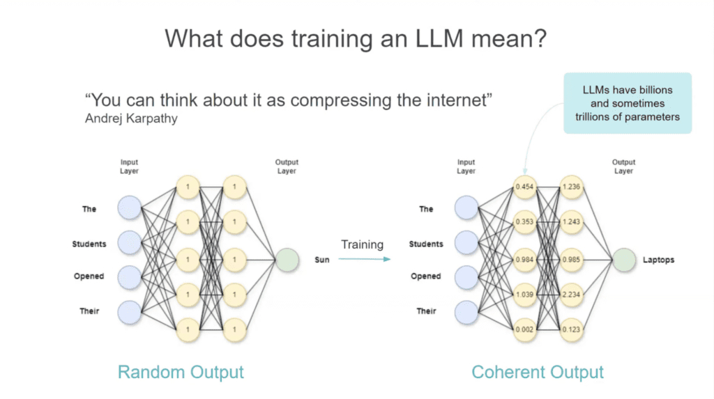
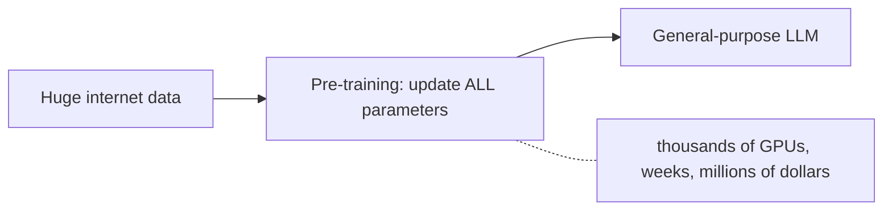
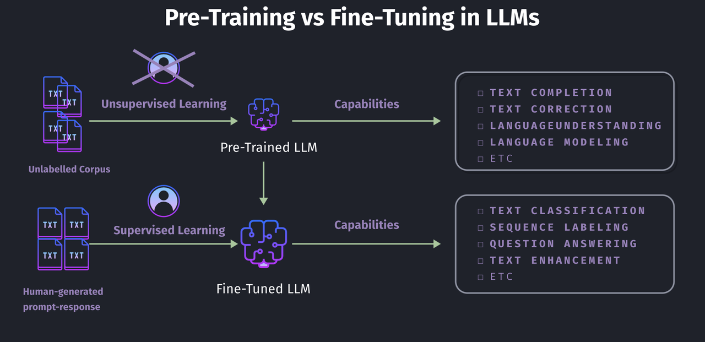

# Training LLMs

[LLM Fundamentals](llms.md) said that an LLM is a network of numbers, called parameters, and
that it guesses the next word. This module answers the next question: where do those numbers
come from? The answer has two steps, and they are very different. One costs millions of
dollars. The other can run on one computer overnight.

## Why This Matters to You

Every AI company says its model was "trained on" something, or "fine-tuned" for something. If
you know what these two words mean, you know what a vendor can really do for you, and what it
cannot. You will also know why "let's train the AI on our company documents" is usually the
wrong request, and what to ask for instead.

## What Training Means

Think of a new model as an empty brain. At the start it knows nothing. Every parameter is a
random number, so every answer is random too.

Training means that you show the model text and correct its numbers by a tiny amount each
time. You do this millions of times, until its guesses stop being random and start being right.

  
*The same network before and after training. The text is "The students opened their". With random numbers (left) it guesses "Sun". With trained numbers (right) it guesses "Laptops". The shape did not change. Only the numbers inside it changed.*

That is all training does. It does not write rules or facts into the model in a form you can
open and read. It only changes numbers. The knowledge ends up spread across billions of them.
This is why people say that training **compresses the internet** into a model.

## Pre-training

The first step is **pre-training**, and it is by far the biggest.

- The model starts as an empty brain, with random numbers.
- It reads a huge part of the internet: books, websites, articles and code. From this, it learns
  language itself and a little about almost everything. It does this by guessing the next word
  billions of times and correcting itself each time.
- This needs thousands of powerful computers running for weeks or months. It costs **millions
  of dollars**. So only a few large companies do it: OpenAI, Google, Anthropic, Meta and a few
  others.

The result is a **general-purpose** model. It is like a person who finished school: they know a
little about many things, but they are not an expert in anything yet.

## You Don't Have to Pre-train

You never need to pre-train your own model. Someone else already spent the millions. You can
take their finished model and teach it one more thing. This is called **fine-tuning**.

If pre-training is going to school, fine-tuning is learning one job after school. The person
already speaks the language and knows the world. Now you teach them one specific skill.

The clearest difference is in the data that each step uses:

  
*Pre-training reads a huge pile of ordinary text, and nobody has to label it. It gives the model general abilities, like understanding and completing text. Fine-tuning reads pairs that people wrote: a question, and the answer it should get. It adds one specific ability.*

- **Pre-training** reads ordinary text from the whole internet. Nobody writes answers for it,
  because the next word in the text *is* the answer.
- **Fine-tuning** reads a small collection of **pairs**: an input, and the output you want for
  it. People usually write or check these pairs. That is a few thousand pairs, not billions of
  pages.

That difference is why one costs millions and the other fits on a single computer.

## Fine-tuning, with an Example

Say you want a model that writes very good short summaries of articles.

1. Start with a finished, pre-trained model.
2. Collect a few thousand examples: a long article, and a short summary that a person wrote.
3. Train the model a little more on these pairs, so it learns the pattern "long text in, short
   and accurate summary out".
4. The result writes better summaries than the original model. And you did not pay for
   pre-training.

Here are a few of those training pairs:

| Article (input) | Human summary (output) |
|---|---|
| "The city opened three new public parks this year, adding over 50 acres of green space. Officials say the parks will host weekend markets and free yoga classes starting next spring." | "The city added 50 acres of new parks, which will host markets and yoga classes." |
| "The company's quarterly earnings report showed a 15% increase in revenue, driven mainly by strong sales in its cloud computing division." | "The company's revenue grew 15% this quarter, led by cloud computing sales." |
| "The local football team won their championship game 3-1, securing their first title in a decade." | "The team won the championship 3-1, their first title in ten years." |

The model does not memorise these answers. It learns the *pattern*: take the key facts out of a
long text, and put them into one short, plain sentence.

### Does it Work?

Here is a new article that the model has never seen:

> "The tech startup announced today that it raised $50 million in Series B funding, led by two
> major venture capital firms. The company plans to use the funds to expand its engineering team
> and launch operations in three new countries by next year."

**The original model, before fine-tuning:**
> "This is an interesting piece of news about a technology startup. The article talks about how
> the company managed to secure a significant amount of funding, specifically $50 million, in
> what is known as a Series B funding round, which was led by two prominent venture capital
> firms. According to the article, the startup intends to allocate this capital towards growing
> its engineering department and expanding its business operations into three additional
> countries within the coming year."

**The fine-tuned model:**
> "The startup raised $50 million in Series B funding to grow its engineering team and expand
> into three new countries next year."

The first answer is long and repeats the article almost sentence by sentence. The second one
followed the pattern it learned, on an article it had never seen.

## A Cheaper Way: LoRA

Normal fine-tuning changes every number in the model, so a big model still needs big
computers. There is a cheaper way, called **PEFT** (parameter-efficient fine-tuning). It keeps
almost the whole model frozen and trains only a tiny extra part, often less than 1% of the
numbers. The most common version has a name you will hear often: **LoRA**. It runs on a single
computer, it is fast, and it is what most real projects use.

## Side by Side

| | Pre-training | Fine-tuning |
|---|---|---|
| What it is like | Going to school | Learning one job after school |
| What it learns from | Ordinary text from the whole internet | A few thousand example pairs |
| What it gives you | A general model that knows a little about everything | A model that is good at one task |
| Cost | Millions of dollars | Small, often one computer |
| Who does it | A few big AI companies | Almost anyone |

## When Not to Fine-tune

Many people who ask for fine-tuning do not need it. There are three common cases where the
answer is no.

**Do not fine-tune to teach the model your company's knowledge.** Company knowledge changes all
the time: contracts are updated, policies change, new documents arrive. Fine-tuning is like a
photo of one day. It does not change after that, and doing it again every week costs time and
money. For company knowledge you want retrieval, which is the next module,
[RAG & Embeddings](rag.md).

**Fine-tune for skills, not for facts.** Fine-tuning is good at teaching a *behaviour*: write in
this format, sort texts into these categories. It is poor at teaching *facts*, because your few
hundred pages get mixed into billions of numbers that hold everything else the model read.

**The next model may beat you.** Say you spend a month fine-tuning a model for your task. By the
time you finish, a new model may come out that does your task better with no fine-tuning at
all. Fine-tuning still wins when your task is truly narrow and truly your own.

## Hugging Face

You will hear this name a lot. [Hugging Face](https://huggingface.co/) is a large public library where companies and
researchers share AI models, most of them free to download. When a team releases an open model,
this is usually where it appears. It also makes the free software that most people use to
fine-tune those models.

## Words You Now Know

- **Training**: correcting a model's numbers, millions of times, until its guesses are right.
- **Pre-training**: the first, huge step. The model reads the internet and learns language.
- **Fine-tuning**: teaching a finished model one skill, with a few thousand example pairs.
- **PEFT / LoRA**: a cheap way to fine-tune that changes only a tiny part of the model.
- **General-purpose model**: a model that knows a little about everything.
- **Hugging Face**: the public library of open AI models.

## Summary

Training is the slow correction of a model's numbers. Pre-training is going to school: the
model reads the internet, and it costs millions, so only a few companies do it. Fine-tuning is
learning one job: a few thousand examples, on one computer. LoRA makes it cheaper still.

But a fine-tuned model still knows nothing about your private documents or about today. The
next module, RAG, solves exactly that.

**Quick check**: What is the difference between pre-training and fine-tuning? And why is
fine-tuning a poor way to give a model your company's documents?

## References

### 📄 Articles

- [Unsloth: is fine-tuning right for me?](https://unsloth.ai/docs/get-started/fine-tuning-for-beginners/faq-+-is-fine-tuning-right-for-me): read this before you ask for fine-tuning
- [Fine-tuning AI models](https://cloud.google.com/use-cases/fine-tuning-ai-models?hl=en#fine-tuning-llms-and-ai-models): Google Cloud's overview, useful for the words

### 🎬 Videos

- [What is LLM Fine-Tuning? (Explained Simply)](https://youtube.com/shorts/Ei4E2lWStqw?si=q0PttlRmBsARGHZU): the whole idea in under a minute

### 🛠️ Tools

- [Hugging Face](https://huggingface.co/): the public library of open models
