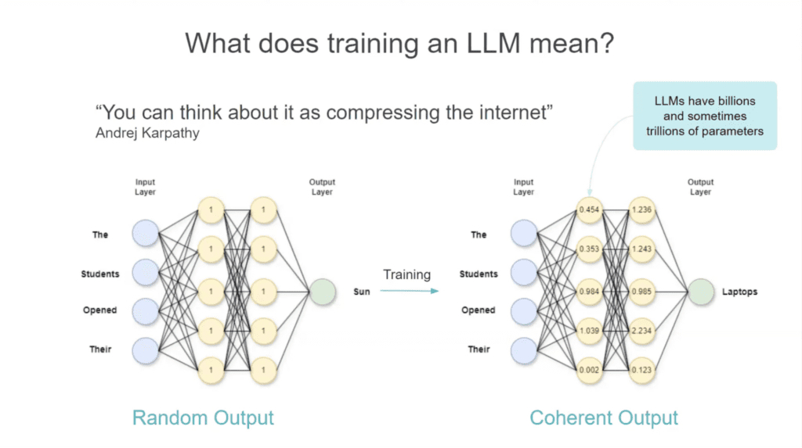
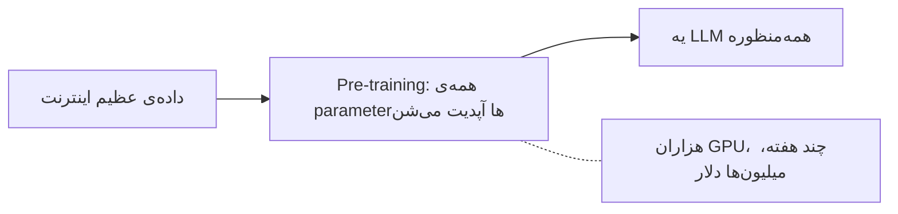
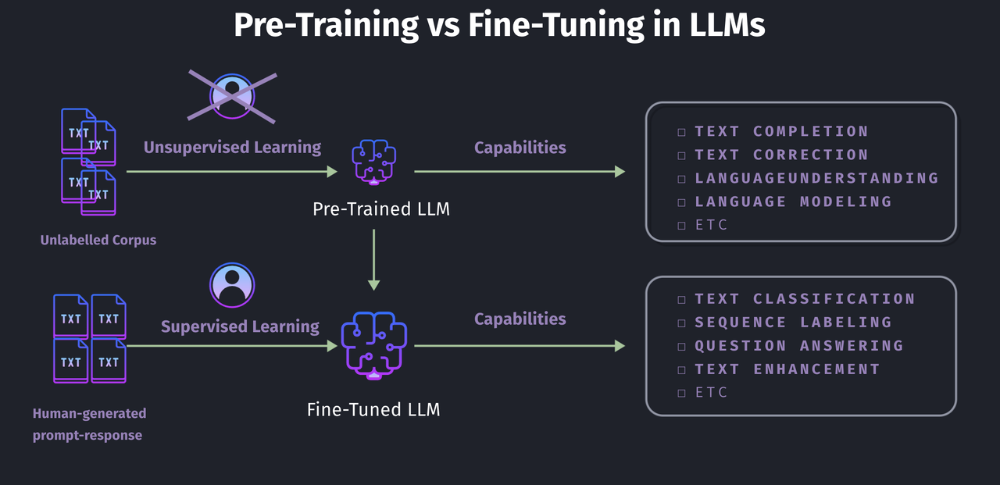

# Training LLMs

توی درس [مبانی LLM](llms_fa.md) گفتیم یه LLM یه شبکه از عددهاست به اسم parameter، و کارش حدس زدن کلمه‌ی بعدیه. این درس به سؤال بعدی جواب می‌ده: این عددها از کجا میان؟ جواب دو مرحله داره، و این دو مرحله خیلی با هم فرق دارن. یکیش میلیون‌ها دلار خرج داره. اون یکی رو می‌شه یه شبه روی یه کامپیوتر اجرا کرد.

## چرا این برای تو مهمه

هر شرکت هوش مصنوعی می‌گه مدلش روی یه چیزی «train شده» یا برای یه کاری «fine-tune شده». اگه معنی این دو تا کلمه رو بدونی، می‌فهمی یه فروشنده واقعاً چی کار می‌تونه برات بکنه و چی کار نمی‌تونه. اون‌وقت می‌دونی چرا «بیا هوش مصنوعی رو روی سندهای شرکت train کنیم» معمولاً درخواست اشتباهیه، و به‌جاش باید چی بخوای.

## Training یعنی چی

یه مدل تازه رو مثل یه مغز خالی در نظر بگیر. اول کار هیچی نمی‌دونه. هر parameter یه عدد تصادفیه، پس هر جوابی هم تصادفیه.

Training یعنی به مدل متن نشون بدی و هر بار عددهاش رو یه ذره اصلاح کنی. این کار رو دوباره و دوباره تکرار می‌کنی، تا حدس‌هاش دیگه تصادفی نباشن و درست دربیان.

  
*همون شبکه، قبل و بعد از training. متن اینه: «The students opened their». با عددهای تصادفی (چپ) حدس می‌زنه «Sun». با عددهای train‌شده (راست) حدس می‌زنه «Laptops». شکل شبکه عوض نشده. فقط عددهای داخلش عوض شدن.*

training فقط همین کار رو می‌کنه. قاعده یا واقعیتی رو به شکلی که بشه بازش کرد و خوند تو مدل نمی‌نویسه. فقط عددها رو عوض می‌کنه. دانش بین میلیاردها عدد پخش می‌شه. برای همین آدم‌ها می‌گن training **اینترنت رو فشرده می‌کنه** و می‌ذاره تو یه مدل.

## Pre-training

مرحله‌ی اول **pre-training**‌ه، و با اختلاف از همه بزرگ‌تره.

- مدل از یه مغز خالی با عددهای تصادفی شروع می‌کنه.
- یه بخش خیلی بزرگ از اینترنت رو می‌خونه: کتاب، وب‌سایت، مقاله و کد. از این راه خودِ زبان رو یاد می‌گیره و یه ذره درباره‌ی تقریباً همه‌چیز. این کار رو با حدس زدن کلمه‌ی بعدی انجام می‌ده، میلیاردها بار، و هر بار خودش رو اصلاح می‌کنه.
- برای این کار هزاران کامپیوتر قوی باید هفته‌ها یا ماه‌ها روشن باشن. **میلیون‌ها دلار** خرج داره. برای همین فقط چند شرکت بزرگ انجامش می‌دن: OpenAI، Google، Anthropic، Meta و چند تای دیگه.

نتیجه یه مدل **همه‌منظوره** (general-purpose) می‌شه. مثل آدمیه که مدرسه رو تموم کرده: درباره‌ی خیلی چیزها یه چیزی می‌دونه، ولی هنوز توی هیچ‌کدوم متخصص نیست.

## لازم نیست pre-train کنی

هیچ‌وقت لازم نیست مدل خودت رو pre-train کنی. یکی دیگه قبلاً اون میلیون‌ها دلار رو خرج کرده. تو می‌تونی مدل آماده‌ی اون‌ها رو برداری و یه چیز دیگه بهش یاد بدی. اسم این کار **fine-tuning**‌ه.

اگه pre-training رفتن به مدرسه‌ست، fine-tuning یاد گرفتن یه شغله بعد از مدرسه. آدم قبلاً زبون رو بلده و دنیا رو می‌شناسه. حالا یه مهارت مشخص بهش یاد می‌دی.

روشن‌ترین فرق این دو مرحله توی داده‌ایه که هر کدوم استفاده می‌کنن:

  
*Pre-training یه توده‌ی عظیم متن معمولی می‌خونه و لازم نیست کسی برچسب‌گذاری‌ش کنه. این کار توانایی‌های عمومی مثل فهمیدن و ادامه دادن متن رو به مدل می‌ده. Fine-tuning جفت‌هایی می‌خونه که آدم‌ها نوشتن: یه سؤال، و جوابی که باید بگیره. این یه توانایی مشخص رو بهش اضافه می‌کنه.*

- **Pre-training** متن معمولی کل اینترنت رو می‌خونه. هیچ‌کس برای جواب‌هاش چیزی نمی‌نویسه، چون کلمه‌ی بعدیِ خودِ متن همون جوابه.
- **Fine-tuning** یه مجموعه‌ی کوچیک از **جفت‌ها** می‌خونه: یه ورودی، و خروجی‌ای که برای اون می‌خوای. معمولاً آدم‌ها این جفت‌ها رو می‌نویسن یا چک می‌کنن. یعنی چند هزار جفت، نه میلیاردها صفحه.

همین فرق باعث می‌شه pre-training میلیون‌ها دلار خرج داشته باشه و fine-tuning خیلی کمتر. LoRA، که پایین‌تر می‌گیم، همون نسخه‌ایه که روی یه کامپیوتر جا می‌شه.

## Fine-tuning با یه مثال

فرض کن یه مدل می‌خوای که برای مقاله‌ها خلاصه‌ی کوتاه خیلی خوب بنویسه.

1. با یه مدل آماده‌ی pre-train‌شده شروع می‌کنی.
2. چند هزار مثال جمع می‌کنی: یه مقاله‌ی بلند، و یه خلاصه‌ی کوتاه که یه آدم نوشته.
3. مدل رو روی این جفت‌ها یه کم دیگه train می‌کنی، که الگوی «متن بلند بده، خلاصه‌ی کوتاه و دقیق بگیر» رو یاد بگیره.
4. نتیجه خلاصه‌هایی می‌نویسه که از مدل اول بهترن. و برای pre-training هم پولی ندادی.

این‌ها چند تا از اون جفت‌های آموزشین:

| مقاله (ورودی) | خلاصه‌ی آدم (خروجی) |
|---|---|
| «شهرداری امسال سه تا پارک عمومی جدید افتتاح کرد و بیشتر از 50 اکر فضای سبز به شهر اضافه شد. مسئول‌ها می‌گن از بهار سال بعد توی این پارک‌ها آخر هفته‌ها بازارچه و کلاس یوگای رایگان برگزار می‌شه.» | «شهرداری 50 اکر پارک جدید ساخت، که توش بازارچه و کلاس یوگا برگزار می‌شه.» |
| «گزارش درآمد سه‌ماهه‌ی شرکت نشون داد درآمد 15% بیشتر شده، که بیشتر به‌خاطر فروش خوب بخش رایانش ابری بوده.» | «درآمد شرکت توی این سه ماه 15% رشد کرد، و فروش رایانش ابری بیشترین سهم رو داشت.» |
| «تیم فوتبال محلی توی بازی فینال 3 بر 1 برد و بعد از ده سال برای اولین بار قهرمان شد.» | «تیم فینال رو 3 بر 1 برد و بعد از ده سال قهرمان شد.» |

مدل این جواب‌ها رو حفظ نمی‌کنه. *الگو* رو یاد می‌گیره: نکته‌های اصلی رو از یه متن بلند دربیار و بذارشون تو یه جمله‌ی کوتاه و ساده.

### جواب می‌ده؟

این یه مقاله‌ی جدیده که مدل تا حالا ندیده:

> «یه استارتاپ فناوری امروز اعلام کرد که توی دور Series B مبلغ 50 میلیون دلار جذب کرده، و دو تا
> شرکت سرمایه‌گذاری بزرگ این دور رو رهبری کردن. شرکت می‌خواد از این پول برای بزرگ‌تر کردن تیم
> مهندسیش استفاده کنه و تا سال بعد توی سه کشور جدید فعالیتش رو شروع کنه.»

**مدل اصلی، قبل از fine-tuning:**
> «این یه خبر جالب درباره‌ی یه استارتاپ فناوریه. مقاله می‌گه این شرکت تونسته مبلغ قابل‌توجهی
> پول جذب کنه، یعنی دقیقاً 50 میلیون دلار، توی چیزی که بهش دور تأمین مالی Series B می‌گن، و
> دو تا شرکت سرمایه‌گذاری سرشناس این دور رو رهبری کردن. طبق مقاله، استارتاپ قصد داره این
> سرمایه رو صرف رشد بخش مهندسیش و گسترش فعالیت‌های تجاریش به سه کشور دیگه توی سال آینده بکنه.»

**مدل fine-tune‌شده:**
> «استارتاپ توی دور Series B مبلغ 50 میلیون دلار جذب کرد تا تیم مهندسیش رو بزرگ‌تر کنه و سال
> بعد به سه کشور جدید بره.»

جواب اول بلنده و تقریباً جمله به جمله مقاله رو تکرار می‌کنه. جواب دوم از الگویی که یاد گرفته بود پیروی کرده، اون هم روی مقاله‌ای که قبلاً ندیده بود.

## یه راه ارزون‌تر: LoRA

fine-tuning معمولی همه‌ی عددهای مدل رو عوض می‌کنه، پس یه مدل بزرگ هنوز کامپیوترهای بزرگ می‌خواد. یه راه ارزون‌تر هم هست به اسم **PEFT** (parameter-efficient fine-tuning، یعنی fine-tuning کم‌خرج از نظر parameter). تقریباً کل مدل رو ثابت نگه می‌داره و فقط یه تیکه‌ی اضافه‌ی خیلی کوچیک رو train می‌کنه، اغلب کمتر از 1% عددها. رایج‌ترین نسخه‌ش اسمیه که زیاد می‌شنوی: **LoRA**. روی یه کامپیوتر اجرا می‌شه، سریعه، و بیشتر پروژه‌های واقعی از همین استفاده می‌کنن.

## کنار هم

| | Pre-training | Fine-tuning |
|---|---|---|
| شبیه چیه | رفتن به مدرسه | یاد گرفتن یه شغل بعد از مدرسه |
| از چی یاد می‌گیره | متن معمولی کل اینترنت | چند هزار جفت مثال |
| چی بهت می‌ده | یه مدل همه‌منظوره که درباره‌ی همه‌چیز یه چیزی می‌دونه | یه مدل که توی یه کار خوبه |
| هزینه | میلیون‌ها دلار | خیلی کمتر؛ با LoRA، اغلب یه کامپیوتر |
| کی انجامش می‌ده | چند شرکت بزرگ هوش مصنوعی | تقریباً هر کسی |

## کی fine-tune نکنیم

خیلی از آدم‌هایی که fine-tuning می‌خوان، بهش احتیاج ندارن. سه حالت رایج هست که جواب «نه»ست.

**برای یاد دادن دانش شرکتت به مدل، fine-tune نکن.** دانش شرکت همیشه عوض می‌شه: قرارداد آپدیت می‌شه، سیاست‌ها عوض می‌شن، سندهای جدید میان. fine-tuning مثل عکس یه روزه. بعدش دیگه تغییر نمی‌کنه، و هر بار که یه فایل عوض می‌شه دوباره انجامش دادن هم وقت می‌خواد هم پول. برای دانش شرکت چیزی که لازم داری retrieval (پیدا کردن) ‌ه، که درس بعدیه: [RAG و Embedding‌ها](rag_fa.md).

**fine-tuning رو برای مهارت بزن، نه برای واقعیت.** fine-tuning توی یاد دادن یه *رفتار* خوبه: با این قالب بنویس، متن‌ها رو توی این دسته‌ها بذار. ولی توی یاد دادن *واقعیت‌ها* ضعیفه، چون چند صد صفحه‌ی تو با میلیاردها عددی قاطی می‌شه که هر چیز دیگه‌ای که مدل خونده رو نگه می‌دارن.

**مدل بعدی ممکنه از تو جلو بزنه.** فرض کن یه ماه وقت می‌ذاری و یه مدل رو برای کارت fine-tune می‌کنی. تا تموم بشه، ممکنه یه مدل جدید بیاد که کار تو رو بدون هیچ fine-tuning‌ای بهتر انجام می‌ده. fine-tuning وقتی هنوز برنده‌ست که کارت واقعاً محدود و واقعاً مال خودت باشه.

## Hugging Face

این اسم رو زیاد می‌شنوی. [Hugging Face](https://huggingface.co/) یه کتابخونه‌ی عمومی بزرگه که شرکت‌ها و پژوهشگرها مدل‌های هوش مصنوعی‌شون رو توش به اشتراک می‌ذارن، و بیشترشون رایگان قابل دانلودن. وقتی یه تیم یه مدل باز منتشر می‌کنه، معمولاً همین‌جا می‌بینیش. نرم‌افزار رایگانی هم می‌سازه که بیشتر آدم‌ها برای fine-tune کردن اون مدل‌ها استفاده می‌کنن.

## کلمه‌هایی که الان بلدی

- **Training**: اصلاح عددهای مدل، میلیون‌ها بار، تا حدس‌هاش درست بشن.
- **Pre-training**: مرحله‌ی اول و عظیم. مدل اینترنت رو می‌خونه و زبان یاد می‌گیره.
- **Fine-tuning**: یاد دادن یه مهارت به یه مدل آماده، با چند هزار جفت مثال.
- **PEFT / LoRA**: یه راه ارزون برای fine-tune که فقط یه تیکه‌ی خیلی کوچیک از مدل رو عوض می‌کنه.
- **مدل همه‌منظوره (General-purpose)**: مدلی که درباره‌ی همه‌چیز یه چیزی می‌دونه.
- **Hugging Face**: کتابخونه‌ی عمومی مدل‌های باز هوش مصنوعی.

## خلاصه

Training اصلاح آروم عددهای یه مدله. Pre-training رفتن به مدرسه‌ست: مدل اینترنت رو می‌خونه، میلیون‌ها خرج داره، و برای همین فقط چند شرکت انجامش می‌دن. Fine-tuning یاد گرفتن یه شغله: چند هزار مثال، روی یه کامپیوتر. LoRA این رو باز هم ارزون‌تر می‌کنه.

ولی یه مدل fine-tune‌شده هنوز چیزی درباره‌ی سندهای خصوصی تو یا درباره‌ی امروز نمی‌دونه. درس بعدی، یعنی RAG، دقیقاً همین رو حل می‌کنه.

**بررسی سریع**: فرق pre-training با fine-tuning چیه؟ و چرا fine-tuning راه بدی برای دادن سندهای شرکتت به مدله؟

## منابع

### 📄 مقاله‌ها

- [Unsloth: is fine-tuning right for me?](https://unsloth.ai/docs/get-started/fine-tuning-for-beginners/faq-+-is-fine-tuning-right-for-me): قبل از این‌که fine-tuning بخوای این رو بخون
- [Fine-tuning AI models](https://cloud.google.com/use-cases/fine-tuning-ai-models?hl=en#fine-tuning-llms-and-ai-models): مرور Google Cloud، برای آشنا شدن با واژه‌ها خوبه

### 🎬 ویدیوها

- [What is LLM Fine-Tuning? (Explained Simply)](https://youtube.com/shorts/Ei4E2lWStqw?si=q0PttlRmBsARGHZU): کل ایده در کمتر از یه دقیقه

### 🛠️ ابزارها

- [Hugging Face](https://huggingface.co/): کتابخونه‌ی عمومی مدل‌های باز
