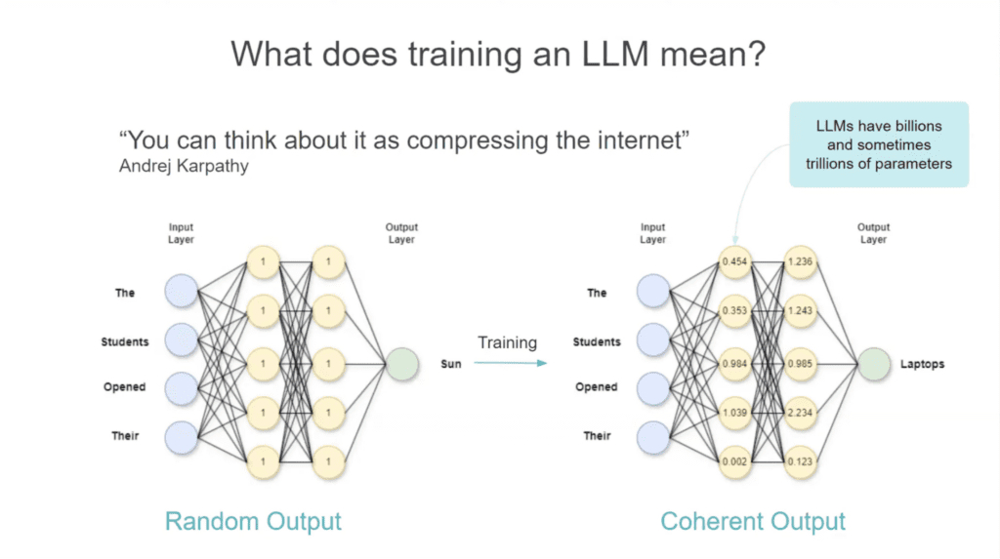
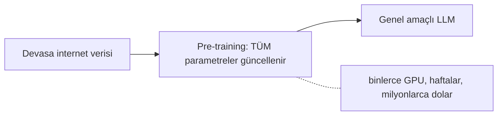
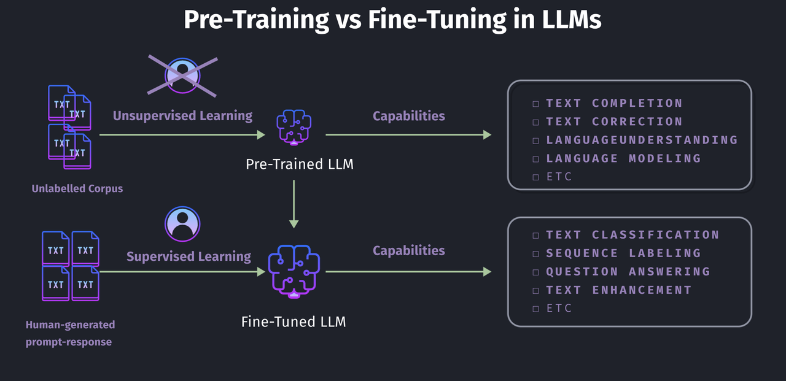

# Training LLMs

[LLM Temelleri](llms_tr.md) modülünde bir LLM'in parametre denen sayılardan oluşan bir ağ olduğunu ve bir sonraki kelimeyi tahmin ettiğini gördük. Bu modül bir sonraki soruyu cevaplıyor: bu sayılar nereden geliyor? Cevap iki adımdan oluşuyor ve bu iki adım birbirinden çok farklı. Biri milyonlarca dolara mal oluyor. Diğeri bir gecede tek bir bilgisayarda çalışabiliyor.

## Bu Senin İçin Neden Önemli

Her yapay zekâ şirketi, modelinin bir şey üzerinde "eğitildiğini (trained)" ya da bir iş için "fine-tune edildiğini" söyler. Bu iki sözün ne demek olduğunu bilirsen, bir satıcının senin için gerçekte neler yapabileceğini ve neler yapamayacağını da bilirsin. Ayrıca "yapay zekâyı şirket dokümanlarımız üzerinde eğitelim" isteğinin neden çoğu zaman yanlış olduğunu ve onun yerine ne istemen gerektiğini öğrenirsin.

## Eğitim Ne Demek?

Yeni bir modeli boş bir beyin gibi düşün. Başlangıçta hiçbir şey bilmez. Her parametre rastgele bir sayıdır, dolayısıyla her cevap da rastgeledir.

Eğitim, modele metin göstermen ve her seferinde sayılarını çok küçük bir miktar düzeltmen demektir. Bunu tekrar tekrar yaparsın; sonunda modelin tahminleri rastgele olmaktan çıkar ve doğru olmaya başlar.

  
*Aynı ağ, eğitimden önce ve sonra. Metin "The students opened their". Rastgele sayılarla (solda) "Sun" tahmin ediyor. Eğitilmiş sayılarla (sağda) "Laptops" tahmin ediyor. Ağın şekli değişmedi. Yalnızca içindeki sayılar değişti.*

Eğitimin yaptığı bundan ibaret. Modelin içine, açıp okuyabileceğin kurallar ya da bilgiler yazmaz. Yalnızca sayıları değiştirir. Bilgi milyarlarca sayının arasına yayılır. İnsanların eğitim için **interneti bir modelin içine sıkıştırmak** demesinin nedeni bu.

## Pre-training

İlk adım **pre-training**'dir ve açık ara en büyük adımdır.

- Model, rastgele sayılarla dolu boş bir beyin olarak başlar.
- İnternetin çok büyük bir kısmını okur: kitapları, web sitelerini, makaleleri ve kodu. Böylece dilin kendisini ve hemen hemen her konu hakkında biraz bilgi öğrenir. Bunu, milyarlarca kez bir sonraki kelimeyi tahmin edip her seferinde kendini düzelterek yapar.
- Bunun için binlerce güçlü bilgisayarın haftalarca ya da aylarca çalışması gerekir. Maliyeti **milyonlarca dolardır**. Bu yüzden yalnızca birkaç büyük şirket yapabilir: OpenAI, Google, Anthropic, Meta ve birkaçı daha.

Sonuçta **genel amaçlı** bir model ortaya çıkar. Okulu bitirmiş bir insana benzer: birçok konuda biraz bilgisi vardır, ama henüz hiçbirinde uzman değildir.

## Pre-training Yapman Gerekmiyor

Kendi modelini sıfırdan pre-train etmen hiçbir zaman gerekmez. Milyonları başkası zaten harcadı. Onların bitmiş modelini alıp ona bir şey daha öğretebilirsin. Buna **fine-tuning** denir.

Pre-training okula gitmekse, fine-tuning okuldan sonra bir meslek öğrenmektir. Kişi dili zaten konuşuyor ve dünyayı biliyor. Şimdi ona belirli bir beceriyi öğretiyorsun.

Aradaki farkın en net göründüğü yer, her adımın kullandığı veri:

  
*Pre-training, dev bir sıradan metin yığınını okur ve kimsenin bunları etiketlemesi gerekmez. Modele metni anlamak ve tamamlamak gibi genel yetenekler kazandırır. Fine-tuning ise insanların yazdığı çiftleri okur: bir soru ve onun alması gereken cevap. Modele tek bir özel yetenek ekler.*

- **Pre-training**, tüm internetten sıradan metin okur. Kimse onun için cevap yazmaz, çünkü metindeki bir sonraki kelime zaten cevabın kendisidir.
- **Fine-tuning**, küçük bir **çift** koleksiyonu okur: bir girdi ve o girdi için istediğin çıktı. Bu çiftleri genellikle insanlar yazar ya da kontrol eder. Bu da milyarlarca sayfa değil, birkaç bin çift demektir.

Pre-training'in milyonlara mal olmasının, fine-tuning'in ise çok daha ucuz olmasının nedeni bu fark. Aşağıdaki LoRA, tek bir bilgisayara sığan sürüm.

## Bir Örnekle Fine-tuning

Makalelerin çok iyi kısa özetlerini yazan bir model istediğini varsayalım.

1. Bitmiş, pre-train edilmiş bir modelle başla.
2. Birkaç bin örnek topla: uzun bir makale ve bir insanın yazdığı kısa bir özet.
3. Modeli bu çiftler üzerinde biraz daha eğit; böylece "içeri uzun metin, dışarı kısa ve doğru özet" kalıbını öğrenir.
4. Sonuçta ortaya, ilk modelden daha iyi özet yazan bir model çıkar. Üstelik pre-training için para ödemedin.

Eğitim çiftlerinden birkaçı şöyle:

| Makale (girdi) | İnsan özeti (çıktı) |
|---|---|
| "Şehir bu yıl üç yeni halk parkı açtı ve yeşil alana 50 akreden fazla ekledi. Yetkililer, parkların gelecek baharla birlikte hafta sonu pazarlarına ve ücretsiz yoga derslerine ev sahipliği yapacağını söylüyor." | "Şehir 50 akrelik yeni park ekledi; parklarda pazarlar kurulacak ve yoga dersleri verilecek." |
| "Şirketin üç aylık kazanç raporu, gelirde yüzde 15'lik bir artış gösterdi; bu artışın ana nedeni bulut bilişim biriminin güçlü satışları oldu." | "Şirketin geliri bu çeyrekte yüzde 15 büyüdü; büyümeyi bulut bilişim satışları sürükledi." |
| "Yerel futbol takımı şampiyonluk maçını 3-1 kazandı ve on yıl sonra ilk kupasını aldı." | "Takım şampiyonluk maçını 3-1 kazandı; on yıl sonraki ilk kupası bu oldu." |

Model bu cevapları ezberlemez. *Kalıbı* öğrenir: uzun bir metinden temel bilgileri çıkarıp bunları kısa ve sade tek bir cümleye koymak.

### İşe Yarıyor mu?

Modelin hiç görmediği yeni bir makale şu:

> "Teknoloji girişimi bugün, iki büyük risk sermayesi şirketinin liderliğinde Seri B turunda 50
> milyon dolar yatırım aldığını duyurdu. Şirket bu parayı mühendislik ekibini büyütmek ve gelecek
> yıla kadar üç yeni ülkede faaliyete başlamak için kullanmayı planlıyor."

**Fine-tuning öncesi orijinal model:**
> "Bu, bir teknoloji girişimiyle ilgili ilginç bir haber. Makale, şirketin Seri B yatırım turu
> olarak bilinen bir turda, yani tam olarak 50 milyon dolarlık önemli bir finansmanı nasıl
> sağladığından söz ediyor; bu tura iki önde gelen risk sermayesi şirketi liderlik etmiş.
> Makaleye göre girişim, bu sermayeyi mühendislik departmanını büyütmek ve iş faaliyetlerini
> önümüzdeki yıl içinde üç ek ülkeye yaymak için kullanmayı düşünüyor."

**Fine-tune edilmiş model:**
> "Girişim, mühendislik ekibini büyütmek ve gelecek yıl üç yeni ülkeye açılmak için Seri B
> turunda 50 milyon dolar topladı."

İlk cevap uzun ve makaleyi neredeyse cümle cümle tekrar ediyor. İkincisi, öğrendiği kalıbı hiç görmediği bir makaleye uygulamış.

## Daha Ucuz Bir Yol: LoRA

Normal fine-tuning modeldeki her sayıyı değiştirir, bu yüzden büyük bir model yine büyük bilgisayarlar ister. Daha ucuz bir yol var; adı **PEFT** (parameter-efficient fine-tuning, yani parametre açısından verimli fine-tuning). Modelin neredeyse tamamını dondurur ve yalnızca küçücük bir ek parçayı eğitir; çoğu zaman sayıların yüzde 1'inden azını. En yaygın sürümünün sık sık duyacağın bir adı var: **LoRA**. Tek bir bilgisayarda çalışır, hızlıdır ve gerçek projelerin çoğu onu kullanır.

## Yan Yana Karşılaştırma

| | Pre-training | Fine-tuning |
|---|---|---|
| Neye benzer | Okula gitmek | Okuldan sonra bir meslek öğrenmek |
| Neyden öğrenir | Tüm internetten sıradan metin | Birkaç bin örnek çift |
| Ne kazandırır | Her şey hakkında biraz bilgisi olan genel bir model | Tek bir işte iyi olan bir model |
| Maliyeti | Milyonlarca dolar | Çok daha az; LoRA ile çoğu zaman tek bir bilgisayar |
| Kim yapar | Birkaç büyük yapay zekâ şirketi | Neredeyse herkes |

## Fine-tuning Ne Zaman Yapılmaz?

Fine-tuning isteyen birçok insanın aslında buna ihtiyacı yoktur. Cevabın "hayır" olduğu üç yaygın durum var.

**Modele şirketinin bilgisini öğretmek için fine-tuning yapma.** Şirket bilgisi sürekli değişir: sözleşmeler güncellenir, politikalar değişir, yeni dokümanlar gelir. Fine-tuning, bir günün fotoğrafı gibidir. Sonrasında değişmez ve bir dosya her değiştiğinde yeniden yapmak hem zaman hem para harcatır. Şirket bilgisi için ihtiyacın olan şey retrieval, yani bir sonraki modül olan [RAG & Embeddings](rag_tr.md).

**Fine-tuning'i bilgi için değil, beceri için yap.** Fine-tuning bir *davranışı* öğretmekte iyidir: şu biçimde yaz, metinleri şu kategorilere ayır. *Bilgi* öğretmekte ise zayıftır, çünkü senin birkaç yüz sayfan, modelin okuduğu diğer her şeyi tutan milyarlarca sayının arasına karışır.

**Bir sonraki model seni geçebilir.** Bir modeli kendi işin için bir ay boyunca fine-tune ettiğini düşün. Sen bitirene kadar, hiç fine-tuning yapılmadan senin işini daha iyi yapan yeni bir model çıkabilir. Fine-tuning, işin gerçekten çok dar ve gerçekten sana özgü olduğu durumlarda hâlâ kazanır.

## Hugging Face

Bu ismi çok duyacaksın. [Hugging Face](https://huggingface.co/), şirketlerin ve araştırmacıların yapay zekâ modellerini paylaştığı büyük, herkese açık bir kütüphane; modellerin çoğu ücretsiz indirilebiliyor. Bir ekip açık bir model yayımladığında genellikle burada görünür. Ayrıca bu modelleri fine-tune etmek için çoğu insanın kullandığı ücretsiz yazılımları da o yapıyor.

## Artık Bildiğin Terimler

- **Training**: bir modelin sayılarını, tahminleri doğru olana kadar milyonlarca kez düzeltmek.
- **Pre-training**: ilk ve devasa adım. Model interneti okur ve dili öğrenir.
- **Fine-tuning**: bitmiş bir modele birkaç bin örnek çiftle tek bir beceri öğretmek.
- **PEFT / LoRA**: modelin yalnızca küçük bir kısmını değiştiren, ucuz bir fine-tuning yolu.
- **Genel amaçlı model**: her şey hakkında biraz bilgisi olan model.
- **Hugging Face**: açık yapay zekâ modellerinin herkese açık kütüphanesi.

## Özet

Eğitim, bir modelin sayılarının yavaş yavaş düzeltilmesidir. Pre-training okula gitmektir: model interneti okur ve milyonlara mal olur, bu yüzden yalnızca birkaç şirket yapabilir. Fine-tuning bir meslek öğrenmektir: birkaç bin örnek ve tek bir bilgisayar. LoRA onu daha da ucuzlatır.

Ama fine-tune edilmiş bir model de senin özel dokümanların ya da bugün olanlar hakkında hâlâ hiçbir şey bilmez. Bir sonraki modül olan RAG tam olarak bunu çözüyor.

**Hızlı Kontrol**: Pre-training ile fine-tuning arasındaki fark ne? Fine-tuning, bir modele şirket dokümanlarını vermek için neden kötü bir yol?

## Kaynaklar

### 📄 Makaleler

- [Unsloth: is fine-tuning right for me?](https://unsloth.ai/docs/get-started/fine-tuning-for-beginners/faq-+-is-fine-tuning-right-for-me): fine-tuning istemeden önce bunu oku
- [Fine-tuning AI models](https://cloud.google.com/use-cases/fine-tuning-ai-models?hl=en#fine-tuning-llms-and-ai-models): Google Cloud'un genel bakışı, terimleri öğrenmek için faydalı

### 🎬 Videolar

- [What is LLM Fine-Tuning? (Explained Simply)](https://youtube.com/shorts/Ei4E2lWStqw?si=q0PttlRmBsARGHZU): bütün fikir bir dakikadan kısa sürede

### 🛠️ Araçlar

- [Hugging Face](https://huggingface.co/): açık modellerin herkese açık kütüphanesi
