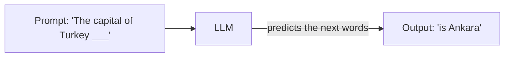
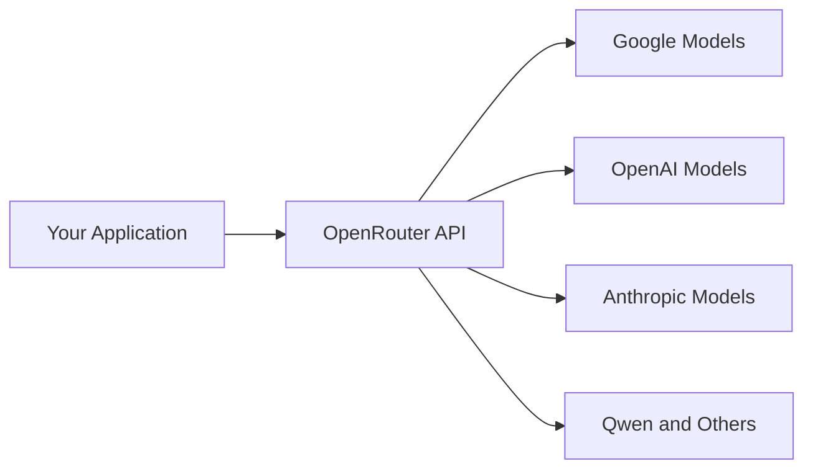
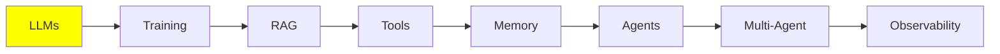

# LLM Fundamentals

Everything else in this series is built on top of this module. An LLM is simple to describe:
text goes in, and text comes out. But almost every idea later in the series (RAG, tools,
memory, agents) exists because of one specific limit. We will get to that limit in a minute.

So let's start with the model itself. Then we look at the limit, and then at how you run a
model.

## What is an LLM?

An LLM is a model that takes text as input and gives you text as output. You send it some
words (the **prompt**), and it sends back more words (the **generation**).

Inside, it is a deep neural network. It was trained on a huge amount of text: books,
websites, code. From all that text, it learned one skill: guessing the most likely next word.



That is really all it does. Everything impressive that an LLM seems to do is that one guess.
The model repeats it over and over, one word at a time.

## How Big is an LLM?

An LLM is a neural network with a huge number of **parameters**. You can think of parameters
as something like the connections in a brain. The more parameters there are, the more the
network can hold.

Why does this matter to you? In general, more parameters give you a more capable model with
better reasoning. More parameters also mean that you need a bigger machine to run the model.
Model size is the main thing that decides whether you can run a model at all.

This is not just something people say. It was measured. The 2020 paper
[Scaling Laws for Neural Language Models](https://arxiv.org/abs/2001.08361) showed what
happens when you grow parameters, training data and compute together. Performance improves
smoothly and predictably. It follows a power law, and it does not jump around. Those
**scaling laws** are the reason why the whole industry spent the following years focused on
one thing: building bigger models.

Models come in three rough sizes:

| Size | Parameters | Where it runs |
| --- | --- | --- |
| Small | 0.6B – 8B | Your own machine, if you have a GPU |
| Medium | 8B – 128B | Server-grade or enterprise GPUs |
| Large | 128B – 2.4T (yes, trillion) | Data centers only |

The large ones are the frontier models behind tools like Claude Code and ChatGPT. You will
never run those locally. That is fine, because you call them over an API instead.

To compare specific models and their benchmark scores, use
[artificialanalysis.ai](https://artificialanalysis.ai/).

## The Context Window

Here is the limit that shapes everything else.

Every LLM has a **context window**. It is the maximum amount of text that the model can
handle at one time, input and output together. Think of it as the model's working desk.
Everything that the model is allowed to look at right now has to fit on that desk.

The easiest way to picture it is your chat history with ChatGPT. At the start of a new
conversation, the history is empty. As you talk back and forth, each of your messages and
each reply from the model goes into it. Eventually, it fills up.

So the context is really just a **stack of messages**. The stack is built up one message at
a time, and then it is sent to the model. The LLM takes that whole stack as input, processes
it, and generates the next message.

**What happens if you exceed it?** You get an error. That is all. The request simply fails.

There are techniques to work around this limit. They are important enough to have their own
topic later: [Context Engineering](../2_intermediate/context_engineering.md) in the
Intermediate section.

### What Goes into the Context

Three kinds of message make up a normal chat:

- **HumanMessage**: what you type, meaning your request. This is what people mean by "the
  prompt".
- **AIMessage**: the model's reply.
- **SystemMessage**: a default set of instructions, written by the vendor or the developer
  (OpenAI, Anthropic, or you). It goes at the top, one time. It tells the model how to
  behave: what to do, when to do it, and which tool to use.

These messages stack up every time you use the system:

  
*Two turns of a plain chat: two Human Messages and two AI Messages. Nothing is ever removed. So on the second turn, the model also reads everything from the first turn.*

One HumanMessage plus the AIMessage that answers it is called a **turn**. In a plain LLM chat,
there is nothing between the two: you send the prompt, and you get the reply. The figure above
shows two turns.

That stack has several names, and the name depends on who is talking: **context**,
**working memory**, **message history**, or **short-term memory**. Don't rush. Short-term
memory gets its own module: [Memory](memory.md).

The SystemMessage deserves a closer look, because it is not one plain piece of text. It
normally holds the behaviour instructions *and* the **tool schemas**. The tool schemas are
the list of tools that the model is allowed to call, with their names and arguments:

  
*Inside a system prompt: the behaviour instructions, the tool schemas, and sometimes a block of static reference text. All of it sits at the very top of the context.*

In the API, the tool schemas are a separate field, not part of the system text. But the model
receives them as one block at the start. So it is fair to picture them together.

You can read real leaked system prompts from many products here:
[system_prompts_leaks](https://github.com/asgeirtj/system_prompts_leaks).

There are also **two more message types**, and you will meet them once we get to agents. An
agent is just an LLM that can call tools. A tool is nothing special: it is a function, usually
a plain Python function that you wrote.

Say you ask about the weather in Istanbul. The model cannot look that up by itself. So it says
that it wants to run one of your functions: it produces a **ToolCall**, something like
`get_weather(city="Istanbul")`. Your machine is the one with Python installed. So your machine
runs the function and gets `34°C` back. Then it gives that result to the model as a
**ToolResult**. Both messages are added to the same stack.

So here is the part to remember: **the LLM generates the ToolCall, but the host machine
generates the ToolResult**. The host machine is your laptop or a server. It generates the
ToolResult because it is the one that actually runs the function. The model asks. Something
else does the work.

An agent turn has more inside it. After your HumanMessage, the model decides whether it needs
a tool to answer you. If it does, the ToolCall and the ToolResult are also added to the
context. Only after that does the model write the final answer. All of that is still
**one turn**: a HumanMessage, any tool messages, and the AIMessage at the end.

  
*A single turn of an agent: you prompt, the AI thinks, the AI calls a tool, then the AI answers. Look at who writes what. The LLM produces the thinking, the Tool Call and the answer. The Tool Result comes from the host machine that runs the function.*

That split is the whole basis of how agents work. We come back to it in
[Tool Calling](tools.md) and [AI Agents](agents.md).

## LLM Hyperparameters

You can change how the model responds with **hyperparameters**. Note the "hyper" part.
Hyperparameters affect generation. The parameters above are different: they are the model's
size.

You will use two of them all the time:

- **Temperature**: the creativity dial, usually from 0.0 to 1.0. Low (0.1) gives predictable
  and consistent answers. High (0.9) gives more creative answers, but they are less reliable.
- **Max output tokens**: the maximum length of the reply. Set it to control cost, and to stop
  the model from writing more than you need. 2K is plenty for short answers.

## Running an LLM (Inference)

Running a model is called **inference**. It means exactly what we described earlier: you
send the context, the model processes it, and then the model completes it.

As the name Large Language Model tells you, these models are big. So inference needs a GPU.
That gives you two options.

**1. Cloud inference (API calls).** You call a service like ChatGPT or Google AI Studio.
They own the huge GPUs, and they run the model for you.

- **Pros:** you get access to the biggest and most capable models, and you have no hardware
  to buy.
- **Cons:** it costs money, it needs internet, and it can be slow.

**2. Local inference.** The model runs on your own computer.

- **Requirement:** a good GPU with enough memory (VRAM).
- **Pros:** it is free after setup (you only pay for electricity), and it works offline.
- **Cons:** you are limited to the smaller models.

Let's look at them one at a time.

## Local LLMs

### Quantization

**What is quantization?** It is a way to compress the model so that it fits in less memory.
Models normally ship with 16-bit weights. Quantizing reduces each weight to 4 bits. This cuts
the memory that you need by about four times.

The numbers make this clear. Take a 32B model as an example:

| Precision | Memory needed | Fits on a consumer GPU? |
| --- | --- | --- |
| 16-bit (as it ships) | ~64 GB | No |
| 4-bit (quantized) | ~16 GB, plus a little for context | Yes, easily on a 24 GB or 32 GB card |

Same model, same weights, one quarter of the memory. That is the difference between "I
cannot run this at all" and "this runs on my desktop".

**Do you have to quantize models yourself?** No, and you almost never should.
[Ollama](https://ollama.com/) and [Unsloth](https://unsloth.ai/) already publish
ready-made quantized versions of the popular models: Qwen, Llama, Mistral, Gemma and
more. Just pull one and run it.

### The Engines That Actually Run the Model

Under everything, there is an **inference engine** that does the real work:

- **llama.cpp**
- **vLLM** (NVIDIA, AMD, TPUs)
- **SGLang** (NVIDIA only)
- **TensorRT-LLM** (NVIDIA, AMD)
- **MLX** (Apple only)

These engines are not easy for beginners, and they need a lot of setup work before they run.
Luckily, you rarely touch them directly. Other tools use them in the background and hide their
interfaces. With those tools, you go from nothing to a running model with a few lines of code,
or directly from the terminal.

### The Easy Tools

- **[LMStudio](https://lmstudio.ai/)**: a simple GUI to download models and chat with them.
  It is great for getting started.
- **[Ollama](https://ollama.com/)**: a command-line tool to pull and serve models fast. It
  is the better choice once you are comfortable in a terminal.

**Try it now:** pull a very small 0.6B model with the Ollama CLI, and chat with it in your
terminal. It takes a couple of minutes. It also helps you see everything above in practice.

## Cloud LLMs

For the larger models, or when you want no setup at all, you use an **inference provider**.
The provider gives you an API key. Then you call its models from your code with a client
library.

Both of the providers below have a free tier with daily limits. That is enough to learn on.

### Google AI Studio

Start here: [aistudio.google.com](https://aistudio.google.com/). Sign up and get your
personal API key. The free tier covers the basic models with daily limits.

### OpenRouter

[OpenRouter](https://openrouter.ai/) is a gateway. It forwards your request to many different
providers. Because it is a router, one API key reaches almost every model. You do not have to
manage separate keys for Google, OpenAI, Qwen and the rest.



It also has free models with daily limits. And to switch to another model, you change one
line. That makes OpenRouter the fastest way to compare models on your own task.

## LLM Prompting

**Prompt engineering** is writing the input so that you get the output you want. It is the
same idea as giving instructions to students. Clear instructions get the homework done
properly. Vague instructions get you whatever each student felt like doing.

Remember what the model actually computes. It computes the probability of the next token,
given everything in the context:

```
P(next token | context)
```

Your prompt *is* that context. So your job is to find the input that makes the output you
want the most likely one:

```
best prompt = the prompt that maximises P(the output you want | prompt)
```

That is the whole discipline in one line. There are many named techniques, and we cover
them in [Prompt Engineering](../2_intermediate/prompt_engineering.md). But most of the real
work is experimenting: try a wording, look at the output, change it, and try again.

These are worth reading, to see how much effort goes into production prompts:

- [System prompts of AI tools](https://github.com/x1xhlol/system-prompts-and-models-of-ai-tools)
- [System prompt leaks](https://github.com/asgeirtj/system_prompts_leaks)
- [Large Language Models explained briefly](https://youtu.be/LPZh9BOjkQs?si=8kH-lzHbfHRL1_8h): a video
  that covers the same topics, if you prefer to watch rather than read
- [Leaked system prompts](https://github.com/jujumilk3/leaked-system-prompts)

## Where this fits in the series



You now know what an LLM is, the one limit that matters (the context window), what lives
inside that context, and how to run a model either locally or in the cloud.

Keep the context window in mind as you go. RAG, memory, agents and context engineering are
all, in one way or another, answers to the question: *what do we put on that limited desk?*

## References

- [Scaling Laws for Neural Language Models](https://arxiv.org/abs/2001.08361): Kaplan et
  al., 2020, the measurement behind "bigger models are better"
- [Artificial Analysis](https://artificialanalysis.ai/): model comparisons and benchmarks
- [Ollama](https://ollama.com/): pull and serve models locally
- [LMStudio](https://lmstudio.ai/): GUI for running models locally
- [Unsloth](https://unsloth.ai/): pre-quantized model releases
- [Google AI Studio](https://aistudio.google.com/): free-tier API keys
- [OpenRouter](https://openrouter.ai/): one key for many providers
- [System prompt leaks](https://github.com/asgeirtj/system_prompts_leaks)
- [Large Language Models explained briefly](https://youtu.be/LPZh9BOjkQs?si=8kH-lzHbfHRL1_8h): a video
  that covers the same topics, if you prefer to watch rather than read
