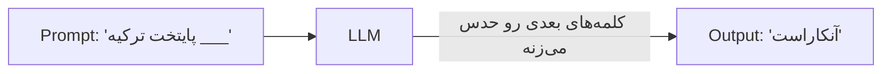
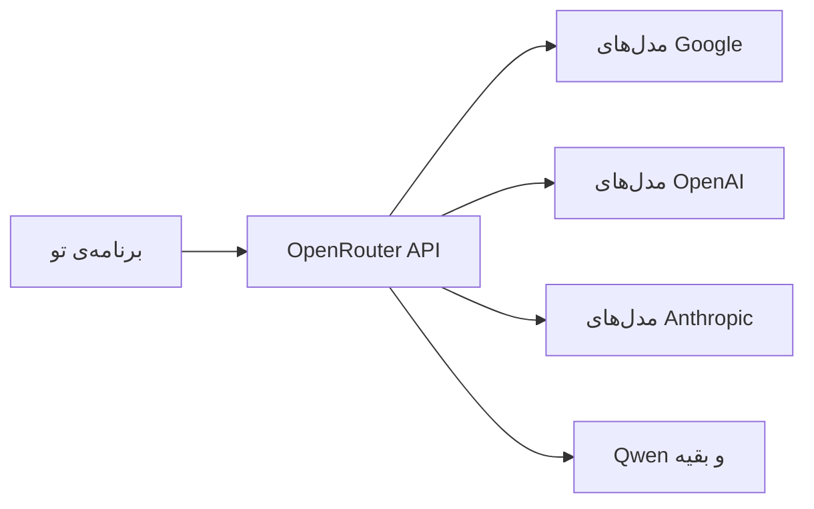
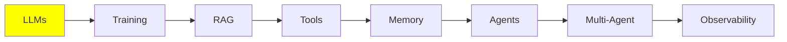

# مبانی LLM

این درس پایه‌ی کل این مجموعه‌ست. LLM رو خیلی ساده می‌شه توضیح داد: بهش متن می‌دی و متن تحویلت می‌ده. ولی تقریباً همه‌ی ایده‌هایی که بعداً می‌بینیم، از RAG و tool گرفته تا memory و agent، از دل یه محدودیت مشخص بیرون اومدن که کمی جلوتر بهش می‌رسیم.

پس اول با خود مدل شروع می‌کنیم، بعد می‌ریم سراغ اون محدودیت، و آخر سر هم می‌بینیم یه مدل رو چطور اجرا می‌کنن.

## LLM چیست؟

LLM مدلیه که ورودیش متنه و خروجیش هم متن. تو چند تا کلمه براش می‌فرستی که بهش می‌گن **prompt**، و اون در جواب چند تا کلمه‌ی دیگه پس می‌ده که اسمش **generation** هست.

از داخل، یه شبکه‌ی عصبی عمیقه که با حجم خیلی زیادی متن آموزش دیده، از کتاب و سایت گرفته تا کد. از این همه متن فقط یه کار رو یاد گرفته: این‌که حدس بزنه محتمل‌ترین کلمه‌ی بعدی چیه.



کل کارش واقعاً همینه. همه‌ی اون کارهای عجیبی که از یه LLM می‌بینی، در اصل همین یه حدسه که مدل کلمه به کلمه، پشت سر هم تکرارش می‌کنه.

## LLM چقدر بزرگه؟

LLM یه شبکه‌ی عصبیه با تعداد خیلی زیادی **parameter**. parameter‌ها رو می‌تونی یه چیزی شبیه اتصال‌های داخل مغز در نظر بگیری؛ هرچی تعدادشون بیشتر باشه، گنجایش شبکه هم بیشتره.

حالا چرا این برات مهمه؟ معمولاً parameter بیشتر یعنی مدل قوی‌تری که بهتر استدلال می‌کنه، ولی در عوض برای اجراش یه ماشین قوی‌تر هم لازم داری. در واقع اولین چیزی که معلوم می‌کنه اصلاً می‌تونی یه مدل رو اجرا کنی یا نه، اندازه‌ی همون مدله.

این فقط حرفی نیست که سر زبون‌ها افتاده باشه؛ اندازه‌گیری شده. مقاله‌ی [Scaling Laws for Neural Language Models](https://arxiv.org/abs/2001.08361) توی سال 2020 نشون داد اگه parameter‌ها، داده‌ی آموزشی و compute رو با هم بیشتر کنی، عملکرد مدل آروم و قابل‌پیش‌بینی بهتر می‌شه؛ یعنی از یه power law پیروی می‌کنه و یهو بالا و پایین نمی‌پره. همین **scaling laws** باعث شد کل صنعت چند سال بعدش همه‌ی زورش رو بذاره روی یه کار: ساختن مدل‌های بزرگ‌تر.

مدل‌ها رو تقریباً می‌شه سه دسته کرد:

| اندازه | تعداد parameter | کجا اجرا می‌شه |
| --- | --- | --- |
| کوچیک | 0.6B تا 8B | روی کامپیوتر خودت، اگه GPU داشته باشی |
| متوسط | 8B تا 128B | روی GPU‌های سروری یا سازمانی |
| بزرگ | 128B تا 2.4T (درست خوندی، تریلیون) | فقط توی data center |

مدل‌های بزرگ همون frontier model‌هایی‌ان که ابزارهایی مثل Claude Code و ChatGPT روشون ساخته شدن. این‌ها رو هیچ‌وقت روی سیستم خودت اجرا نمی‌کنی، و مشکلی هم نیست، چون از طریق API ازشون استفاده می‌کنی.

اگه می‌خوای مدل‌ها رو دونه‌دونه با هم مقایسه کنی و امتیاز benchmark‌هاشون رو ببینی، یه سر به [artificialanalysis.ai](https://artificialanalysis.ai/) بزن.

## Context Window

حالا برسیم به همون محدودیتی که گفتم همه‌چیز دورش می‌چرخه.

هر LLM یه **context window** داره، یعنی سقف متنی که مدل می‌تونه یک‌جا باهاش سر و کار داشته باشه، ورودی و خروجی روی هم. فرض کن context window میز کار مدله: هر چیزی که مدل الان باید بهش نگاه کنه، باید روی همین میز جا بشه.

ساده‌ترین مثالش تاریخچه‌ی چتت با ChatGPT هست. چت جدید که باز می‌کنی، تاریخچه خالیه. بعد هرچی جلوتر می‌رید، هر پیام تو و هر جواب مدل بهش اضافه می‌شه، تا جایی که بالاخره پر می‌شه.

پس context در اصل یه **stack of messages** هست، یعنی یه سری پیام که روی هم چیده شدن. این پشته پیام به پیام بزرگ‌تر می‌شه و بعد کلش برای مدل فرستاده می‌شه. LLM کل پشته رو به‌عنوان ورودی می‌خونه، پردازشش می‌کنه و پیام بعدی رو تولید می‌کنه.

**اگه از این سقف رد بشی چی می‌شه؟** خیلی ساده خطا می‌گیری و درخواستت fail می‌شه، همین.

برای دور زدن این محدودیت تکنیک‌هایی هست که اون‌قدر مهمن که بعداً یه موضوع جدا براشون داریم: [Context Engineering](../2_intermediate/context_engineering_fa.md) توی بخش Intermediate.

### چی وارد context می‌شه

یه چت معمولی از سه جور پیام تشکیل شده:

- **HumanMessage**: همون چیزی که تایپ می‌کنی، یعنی درخواستت. وقتی کسی می‌گه «prompt»، منظورش همینه.
- **AIMessage**: جوابی که مدل می‌ده.
- **SystemMessage**: یه سری دستورالعمل پیش‌فرض که سازنده‌ی محصول یا developer نوشته، مثلاً OpenAI، Anthropic یا خود تو. فقط یه بار و بالای همه‌ی پیام‌ها می‌شینه و به مدل می‌گه چطور رفتار کنه: چی کار کنه، کی بکنه و سراغ کدوم tool بره.

هر بار که از سیستم استفاده می‌کنی، این پیام‌ها روی هم جمع می‌شن:

  
*دو نوبت از یه چت ساده: دو تا Human Message و دو تا AI Message. هیچ پیامی پاک نمی‌شه، واسه همین مدل توی نوبت دوم، کل نوبت اول رو هم دوباره می‌خونه.*

به یه HumanMessage و AIMessage‌ای که جوابشه، روی هم می‌گن یه **turn** (نوبت). توی یه چت ساده با LLM، بین این دو تا هیچ‌چیز دیگه‌ای نیست: prompt رو می‌فرستی و جوابت رو می‌گیری. شکل بالا دو تا نوبت رو نشون می‌ده.

این پشته چند تا اسم داره و بسته به این‌که کی داره ازش حرف می‌زنه، بهش می‌گن **context**، **working memory**، **message history** یا **short-term memory**. فعلاً درگیرش نشو؛ short-term memory یه درس جدا برای خودش داره: [Memory](memory_fa.md).

SystemMessage رو بد نیست یه کم دقیق‌تر ببینیم، چون فقط یه تیکه متن ساده نیست. معمولاً هم دستورهای رفتاری توشه *و* هم **tool schema‌ها**، یعنی فهرست tool‌هایی که مدل اجازه داره صداشون بزنه، با اسم و argument‌هاشون:

  
*توی یه system prompt این‌ها هست: دستورهای رفتاری، tool schema‌ها و گاهی هم یه تیکه متن مرجع ثابت. همه‌ش هم بالای بالای context می‌شینه.*

توی API، tool schema‌ها یه فیلد جدان و جزو متن system حساب نمی‌شن، ولی وقتی به مدل می‌رسن، همه با هم یه بلوکن که اول کار میاد. پس بی‌راه نیست اگه توی ذهنت این دو تا رو یه‌جا تصور کنی.

system prompt‌های واقعی خیلی از محصولات لو رفته و می‌تونی این‌جا بخونی‌شون: [system_prompts_leaks](https://github.com/asgeirtj/system_prompts_leaks).

دو نوع پیام دیگه هم هست که وقتی به agent‌ها برسیم باهاشون آشنا می‌شی. agent در واقع یه LLM‌ه که می‌تونه tool صدا بزنه. tool هم چیز عجیبی نیست، یه function‌ه، معمولاً یه function ساده‌ی Python که خودت نوشتی.

فرض کن هوای استانبول رو می‌پرسی. مدل خودش راهی نداره که این رو بفهمه، پس اعلام می‌کنه که می‌خواد یکی از function‌های تو اجرا بشه؛ یعنی یه **ToolCall** تولید می‌کنه، چیزی مثل `get_weather(city="Istanbul")`. Python روی ماشین تو نصبه، پس ماشین تو function رو اجرا می‌کنه و `34°C` رو می‌گیره، بعد هم این نتیجه رو به شکل یه **ToolResult** به مدل برمی‌گردونه. هر دو تا پیام هم به همون پشته اضافه می‌شن.

این یکی رو خوب یادت بمونه: **ToolCall رو LLM تولید می‌کنه، ولی ToolResult رو host machine**. host machine همون لپ‌تاپ تو یا یه سروره، و ToolResult رو اون می‌سازه چون اونه که واقعاً function رو اجرا می‌کنه. مدل فقط درخواست می‌ده و کار رو یکی دیگه انجام می‌ده.

یه نوبت توی agent شلوغ‌تره. بعد از HumanMessage تو، مدل تصمیم می‌گیره که برای جواب دادن به tool احتیاج داره یا نه. اگه داشته باشه، ToolCall و ToolResult هم به context اضافه می‌شن و تازه بعد از اون مدل جواب نهایی رو می‌نویسه. با این همه، کل این‌ها هنوز **یه نوبت** حساب می‌شه: یه HumanMessage، هر چند تا پیام tool که لازم شد، و یه AIMessage آخر کار.

  
*یه نوبت از کار یه agent: تو prompt می‌دی، AI فکر می‌کنه، یه tool صدا می‌زنه و بعد جواب می‌ده. دقت کن هر پیام رو کی نوشته: فکر کردن، Tool Call و جواب کار LLM‌ه، ولی Tool Result از host machine میاد که function رو اجرا می‌کنه.*

کل کار agent‌ها روی همین تقسیم کار بنا شده، و توی [Tool Calling](tools_fa.md) و [AI Agents](agents_fa.md) دوباره سراغش میایم.

## Hyperparameter‌های LLM

با **hyperparameter‌ها** می‌تونی نحوه‌ی جواب دادن مدل رو تغییر بدی. حواست به اون «hyper» باشه: hyperparameter‌ها روی تولید متن اثر می‌ذارن، ولی parameter‌هایی که بالاتر گفتیم یه چیز دیگه‌ان: همون عددهای داخل شبکه‌ان که تعدادشون اندازه‌ی مدل رو تعیین می‌کنه.

با دو تاشون همیشه سر و کار داری:

- **Temperature**: درجه‌ی خلاقیت مدل، که معمولاً بین 0.0 تا 1.0 تنظیم می‌شه. مقدار پایین (0.1) جواب‌های قابل‌پیش‌بینی و یکدست می‌ده؛ مقدار بالا (0.9) جواب‌ها رو خلاقانه‌تر می‌کنه، ولی کمتر می‌شه بهشون تکیه کرد.
- **Max output tokens**: سقف طول جواب. با این هم هزینه رو کنترل می‌کنی و هم نمی‌ذاری مدل بیشتر از چیزی که لازم داری بنویسه. برای جواب‌های کوتاه، 2K بیشتر از کافیه.

## اجرای LLM (Inference)

به اجرا کردن مدل می‌گن **inference**، و دقیقاً همون کاریه که بالاتر گفتیم: context رو می‌فرستی، مدل پردازشش می‌کنه و ادامه‌ش رو می‌نویسه.

همون‌طور که از اسم Large Language Model پیداست، این مدل‌ها بزرگن، پس برای inference به GPU احتیاج داری. این‌جا دو تا راه جلوت هست.

**1. Cloud inference (صدا زدن API).** از سرویسی مثل ChatGPT یا Google AI Studio استفاده می‌کنی. GPU‌های غول‌پیکر مال اون‌هاست و مدل رو اون‌ها برات اجرا می‌کنن.

- **مزایا:** به بزرگ‌ترین و قوی‌ترین مدل‌ها دسترسی داری و لازم نیست سخت‌افزاری بخری.
- **معایب:** پول می‌خواد، بدون اینترنت کار نمی‌کنه و ممکنه کند باشه.

**2. Local inference.** مدل روی کامپیوتر خودت اجرا می‌شه.

- **پیش‌نیاز:** یه GPU خوب که حافظه‌ش (VRAM) کافی باشه.
- **مزایا:** بعد از راه‌اندازی دیگه پولی بابتش نمی‌دی (به‌جز پول برق) و آفلاین هم کار می‌کنه.
- **معایب:** دستت فقط به مدل‌های کوچیک‌تر می‌رسه.

حالا بریم سراغ هر کدوم.

## LLM‌های local

### Quantization

**quantization چیه؟** روشیه برای فشرده کردن مدل، که توی حافظه‌ی کمتری جا بشه. مدل‌ها معمولاً با weight‌های 16-bit منتشر می‌شن و quantization هر weight رو به 4 بیت می‌رسونه. نتیجه‌ش این می‌شه که حافظه‌ای که لازم داری تقریباً یک‌چهارم می‌شه.

با عدد بهتر می‌شه فهمید. یه مدل 32B رو در نظر بگیر:

| دقت | حافظه‌ی لازم | روی GPU خونگی جا می‌شه؟ |
| --- | --- | --- |
| 16-bit (همون‌طور که منتشر می‌شه) | حدود 64 GB | نه |
| 4-bit (quantized) | حدود 16 GB، به‌اضافه‌ی یه کم برای context | آره، راحت روی یه کارت 24 GB یا 32 GB |

مدل همونه و weight‌ها همون، فقط حافظه یک‌چهارم شده؛ و فرق «اصلاً نمی‌تونم اجراش کنم» با «روی کامپیوتر خودم اجرا می‌شه» دقیقاً همین‌جاست.

**یعنی باید خودت مدل‌ها رو quantize کنی؟** نه، و بهتره تقریباً هیچ‌وقت سراغش نری. [Ollama](https://ollama.com/) و [Unsloth](https://unsloth.ai/) نسخه‌های quantize‌شده‌ی آماده‌ی مدل‌های معروف رو منتشر کردن، مثل Qwen، Llama، Mistral، Gemma و کلی مدل دیگه. کافیه یکی‌شون رو pull کنی و اجراش کنی.

### موتورهایی که واقعاً مدل رو اجرا می‌کنن

توی پایین‌ترین لایه، یه **inference engine** هست که کار اصلی رو انجام می‌ده:

- **llama.cpp**
- **vLLM** (NVIDIA، AMD، TPUs)
- **SGLang** (فقط NVIDIA)
- **TensorRT-LLM** (NVIDIA، AMD)
- **MLX** (فقط Apple)

کار کردن با این موتورها برای تازه‌کارها راحت نیست و تا راه بیفتن، کلی باید تنظیمشون کنی. خوشبختانه کمتر پیش میاد که مستقیم بهشون دست بزنی، چون ابزارهای دیگه پشت صحنه ازشون استفاده می‌کنن و رابطشون رو از تو پنهان می‌کنن. با این ابزارها از صفر شروع می‌کنی و با چند خط کد، یا حتی مستقیم از ترمینال، یه مدل رو بالا میاری.

### ابزارهای ساده

- **[LMStudio](https://lmstudio.ai/)**: یه GUI ساده برای دانلود مدل‌ها و چت کردن باهاشون؛ برای شروع عالیه.
- **[Ollama](https://ollama.com/)**: یه ابزار command-line که باهاش سریع مدل‌ها رو pull و serve می‌کنی. وقتی دستت با ترمینال راه افتاد، این انتخاب بهتریه.

**همین الان امتحانش کن:** با Ollama CLI یه مدل خیلی کوچیک 0.6B رو pull کن و توی ترمینال باهاش چت کن. دو سه دقیقه بیشتر وقت نمی‌گیره و هر چیزی که تا این‌جا گفتیم رو با چشم خودت می‌بینی.

## LLM‌های cloud

برای مدل‌های بزرگ‌تر، یا وقتی نمی‌خوای هیچ چیزی راه بندازی، سراغ یه **inference provider** می‌ری. provider یه API key بهت می‌ده و بعد با یه client library از توی کدت مدل‌هاش رو صدا می‌زنی.

هر دو provider پایین یه پلن رایگان با سقف روزانه دارن که برای یاد گرفتن کافیه.

### Google AI Studio

از این‌جا شروع کن: [aistudio.google.com](https://aistudio.google.com/). ثبت‌نام کن و API key شخصی خودت رو بگیر. پلن رایگانش مدل‌های پایه رو با سقف روزانه در اختیارت می‌ذاره.

### OpenRouter

[OpenRouter](https://openrouter.ai/) یه gateway‌ه که درخواستت رو به provider‌های مختلف می‌رسونه. چون کارش router بودنه، با یه API key تقریباً به همه‌ی مدل‌ها دسترسی داری و لازم نیست برای Google و OpenAI و Qwen و بقیه، key‌های جدا نگه داری.



یه سری مدل رایگان با سقف روزانه هم داره، و برای عوض کردن مدل فقط یه خط رو تغییر می‌دی. واسه همین OpenRouter سریع‌ترین راهیه که مدل‌ها رو روی کار خودت با هم مقایسه کنی.

## نوشتن prompt

**Prompt engineering** یعنی ورودی رو جوری بنویسی که خروجی دلخواهت رو بگیری. مثل تکلیف دادن به دانش‌آموزهاست: اگه دستورت روشن باشه، تکلیف درست انجام می‌شه، ولی اگه مبهم باشه، هر کدوم هر کاری دلش خواسته می‌کنه.

یادت باشه مدل در اصل چی رو حساب می‌کنه: احتمال token بعدی، با توجه به هر چیزی که توی context هست:

```
P(next token | context)
```

prompt تو *همون* context‌ه. پس کار تو اینه که ورودی‌ای پیدا کنی که خروجی موردنظرت رو به محتمل‌ترین خروجی تبدیل کنه:

```
best prompt = the prompt that maximises P(the output you want | prompt)
```

کل prompt engineering توی همین یه خط خلاصه می‌شه. تکنیک‌های اسم‌دار زیادی هم هست که توی [Prompt Engineering](../2_intermediate/prompt_engineering_fa.md) بهشون می‌پردازیم، ولی بیشتر کار واقعی آزمون و خطاست: یه جمله‌بندی رو امتحان می‌کنی، خروجی رو می‌بینی، عوضش می‌کنی و دوباره امتحان می‌کنی.

این‌ها رو بخون تا ببینی برای prompt‌های production چقدر زحمت کشیده می‌شه:

- [System prompts of AI tools](https://github.com/x1xhlol/system-prompts-and-models-of-ai-tools)
- [System prompt leaks](https://github.com/asgeirtj/system_prompts_leaks)
- [Large Language Models explained briefly](https://youtu.be/LPZh9BOjkQs?si=8kH-lzHbfHRL1_8h): یه ویدیو درباره‌ی همین موضوع‌ها، اگه دیدن رو به خوندن ترجیح می‌دی
- [Leaked system prompts](https://github.com/jujumilk3/leaked-system-prompts)

## کجای این مجموعه هستیم



حالا می‌دونی LLM چیه، اون یه محدودیتی که واقعاً اهمیت داره (یعنی context window) کدومه، توی context چی‌ها جا می‌گیره، و یه مدل رو چطور می‌شه روی سیستم خودت یا روی cloud اجرا کرد.

از این‌جا به بعد context window رو همیشه جلوی چشمت داشته باش. RAG، memory، agent‌ها و context engineering هر کدوم یه جوری جواب این سوالن: *روی اون میز کوچیک چی بذاریم؟*

## منابع

- [Scaling Laws for Neural Language Models](https://arxiv.org/abs/2001.08361): Kaplan و همکاران، 2020؛ همون اندازه‌گیری‌ای که حرف «مدل بزرگ‌تر، بهتر» ازش میاد
- [Artificial Analysis](https://artificialanalysis.ai/): مقایسه‌ی مدل‌ها و benchmark‌هاشون
- [Ollama](https://ollama.com/): برای pull و serve کردن مدل‌ها روی سیستم خودت
- [LMStudio](https://lmstudio.ai/): یه GUI برای اجرای مدل‌ها روی سیستم خودت
- [Unsloth](https://unsloth.ai/): نسخه‌های آماده‌ی quantize‌شده‌ی مدل‌ها
- [Google AI Studio](https://aistudio.google.com/): API key با پلن رایگان
- [OpenRouter](https://openrouter.ai/): یه key برای کلی provider
- [System prompt leaks](https://github.com/asgeirtj/system_prompts_leaks)
- [Large Language Models explained briefly](https://youtu.be/LPZh9BOjkQs?si=8kH-lzHbfHRL1_8h): یه ویدیو درباره‌ی همین موضوع‌ها، اگه دیدن رو به خوندن ترجیح می‌دی
