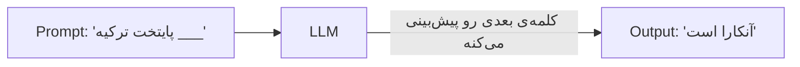
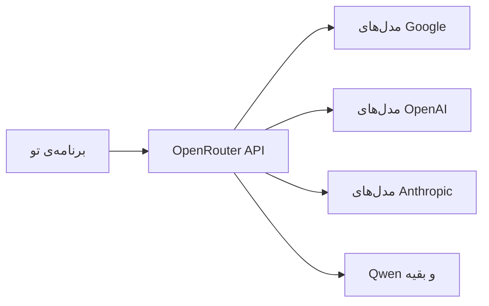
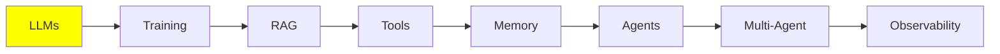

# مبانی LLM

بقیه‌ی این مجموعه، همه روی همین ماژول ساخته شدن. توضیح LLM ساده‌ست: یه متن می‌ره داخل و یه متن بیرون میاد. ولی تقریباً هر ایده‌ای که بعداً می‌بینیم، از RAG و tool گرفته تا memory و agent، به خاطر یه محدودیت مشخص وجود داره. به اون محدودیت هم یه دقیقه‌ی دیگه می‌رسیم. پس اول سراغ خود مدل می‌ریم، بعد اون محدودیت رو بررسی می‌کنیم، و آخرش یاد می‌گیریم یه مدل رو چه‌جوری اجرا کنی.

## LLM چیست؟

LLM یه مدله که متن می‌گیره و متن برمی‌گردونه. تو یه سری کلمه براش می‌فرستی، که بهش می‌گن **prompt**، و اون هم در جواب یه سری کلمه‌ی بیشتر پس می‌ده، که بهش می‌گن **generation**.

داخلش یه شبکه‌ی عصبی عمیق هست که روی حجم عظیمی از متن، مثل کتاب، سایت و کد، آموزش دیده. و از همه‌ی اون متن‌ها یه مهارت یاد گرفته: حدس زدن محتمل‌ترین کلمه‌ی بعدی.



در واقع کل کار LLM همین‌قدر ساده‌ست: هر کار چشم‌گیری که ازش می‌بینی، در اصل همون یه حدسه. مدل این حدس رو کلمه به کلمه و بارها تکرار می‌کنه.

## LLM چقدر بزرگه؟

یه LLM یه شبکه‌ی عصبیه با تعداد عظیمی **parameter‌ها**. می‌تونی parameter‌ها رو یه چیزی شبیه اتصال‌های داخل مغز تصور کنی. هرچی تعداد parameter‌ها بیشتر باشه، شبکه ظرفیت بیشتری برای نگه داشتن چیزها داره.

چرا این برای تو مهمه؟ به‌طور کلی، parameter‌های بیشتر یعنی مدلی توانمندتر با استدلال بهتر. ولی یه روی دیگه‌ی سکه هم هست: مدل بزرگ‌تر یعنی به یه ماشین بزرگ‌تر نیاز داری تا اجراش کنی. اندازه‌ی مدل مهم‌ترین عاملیه که تعیین می‌کنه آیا اصلاً می‌تونی یه مدل رو اجرا کنی یا نه.

این فقط یه حرف کلی نیست، اندازه‌گیری هم شده. مقاله‌ی 2020 با عنوان [Scaling Laws for Neural Language Models](https://arxiv.org/abs/2001.08361) نشون داد وقتی parameter‌ها، داده‌ی آموزشی و compute رو با هم زیاد کنی، چه اتفاقی می‌افته. عملکرد مدل به‌صورت یکنواخت و قابل‌پیش‌بینی بهتر می‌شه. این بهبود یه power law هست و یهو بالا و پایین نمی‌پره. به خاطر همین **scaling laws** بود که کل صنعت سال‌های بعدش فقط روی یه چیز تمرکز کرد: ساختن مدل‌های بزرگ‌تر.

مدل‌ها تقریباً در سه اندازه‌ی کلی پیدا می‌شن:

| اندازه | تعداد parameter‌ها | کجا اجرا می‌شه |
| --- | --- | --- |
| کوچک | 0.6B تا 8B | روی کامپیوتر خودت، اگه GPU داشته باشی |
| متوسط | 8B تا 128B | روی GPU‌های مخصوص سرور یا سازمان |
| بزرگ | 128B تا 2.4T (آره، تریلیون) | فقط توی data center |

مدل‌های بزرگ همون frontier model‌هایی هستن که پشت ابزارهایی مثل Claude Code و ChatGPT قرار دارن. این‌ها رو هیچ‌وقت نمی‌تونی به‌صورت local اجرا کنی. ولی اشکالی هم نداره، چون به‌جاش از طریق API صداشون می‌زنی.

برای مقایسه‌ی مدل‌های مشخص و امتیاز benchmark‌هاشون، سر بزن به [artificialanalysis.ai](https://artificialanalysis.ai/).

## Context Window

حالا برسیم به محدودیتی که همه‌چیز رو شکل می‌ده. هر LLM یه **context window** داره، یعنی بیشترین مقدار متنی که مدل می‌تونه در یه لحظه پردازش کنه، ورودی و خروجی با هم. می‌تونی context window رو مثل میز کار مدل تصور کنی. هر چیزی که مدل در همون لحظه اجازه داره بهش نگاه کنه، باید روی همین میز جا بشه.

ساده‌ترین راه برای تصورش، تاریخچه‌ی چتت با ChatGPT هست. وقتی یه گفتگوی جدید رو شروع می‌کنی، تاریخچه خالیه. هر پیامی که تو می‌فرستی و هر جوابی که مدل می‌ده، می‌ره توی همون تاریخچه، و کم‌کم هم کل تاریخچه پر می‌شه.

پس context در واقع فقط یه **stack of messages** هست، یعنی یه پشته‌ی پیام. این پشته پیام به پیام ساخته می‌شه، و بعد کل پشته به مدل فرستاده می‌شه. LLM کل پشته رو به‌عنوان ورودی می‌گیره، پردازشش می‌کنه، و پیام بعدی رو تولید می‌کنه.

**اگه از این حد رد بشی چی می‌شه؟** خطا می‌گیری و همین. درخواست همون‌جا fail می‌شه.

برای کنار اومدن با این محدودیت، راه‌حل‌های مختلفی هست. اون‌قدر مهمن که بعداً یه موضوع جدا دارن: [Context Engineering](../2_intermediate/context_engineering_fa.md) توی بخش Intermediate.

### چی وارد context می‌شه

یه چت معمولی از سه نوع پیام ساخته می‌شه:

- **HumanMessage**: هر چیزی که تایپ می‌کنی، یعنی درخواستت. وقتی آدم‌ها می‌گن «prompt»، همین منظورشونه.
- **AIMessage**: جواب مدل.
- **SystemMessage**: یه مجموعه دستور پیش‌فرضه که ارائه‌دهنده یا توسعه‌دهنده‌ش نوشته، یعنی OpenAI، Anthropic یا خودت. این پیام یه بار و بالای همه‌ی پیام‌ها قرار می‌گیره. بهش می‌گه چه رفتاری داشته باشه: چی رو انجام بده، کی انجامش بده، و از کدوم tool استفاده کنه.

این پیام‌ها هر بار که از سیستم استفاده می‌کنی، روی هم جمع می‌شن:

  
*این شکل دو نوبت از یک چت ساده رو نشون می‌ده: دو HumanMessage و دو AIMessage. هیچ‌چیز حذف نمی‌شه، پس توی نوبت دوم، مدل همه‌ی حرف‌های نوبت اول رو هم می‌خونه.*

یه HumanMessage به‌علاوه‌ی AIMessage که جوابشه، می‌شه یه **turn** (نوبت). توی یه چت ساده‌ی LLM، بین این دو چیز دیگه‌ای نیست: تو prompt رو می‌فرستی و جواب رو می‌گیری. شکل بالا دو نوبت رو نشون می‌ده.

این پشته چند تا اسم داره، و اسمش بستگی داره کی داره حرف می‌زنه: **context**، **working memory**، **message history** یا **short-term memory**. عجله نکن؛ short-term memory یه ماژول مخصوص خودش داره: [Memory](memory_fa.md).

SystemMessage ارزش یه نگاه دقیق‌تر رو داره، چون یه متن ساده و تک‌تیکه نیست. معمولاً هم دستورهای رفتاری رو داره و هم **tool schema‌ها** رو. tool schema‌ها فهرستی از tool‌هاست که مدل اجازه داره صداشون بزنه، همراه با اسم و argument‌هاشون:

  
*داخل یه system prompt هست: دستورهای رفتاری، tool schema‌ها و گاهی یه بلوک متن مرجع ثابت. همه‌ی این‌ها بالای context قرار می‌گیرن.*

توی API، tool schema‌ها یه فیلد جداگانه‌ان و جزو متن system نیستن. ولی مدل همه‌شون رو به‌صورت یه بلوک، از ابتدا دریافت می‌کنه. پس اشکالی نداره که توی ذهنت کنار هم تصورشون کنی.

system prompt‌های لو رفته‌ی خیلی از محصولات رو می‌تونی این‌جا بخونی: [system_prompts_leaks](https://github.com/asgeirtj/system_prompts_leaks).

دو نوع پیام دیگه هم هست که وقتی به agent‌ها برسیم باهاشون آشنا می‌شی. agent فقط یه LLM هست که می‌تونه tool صدا بزنه. tool هم چیز خاصی نیست: یه function هست، معمولاً یه function ساده‌ی Python که خودت نوشتی.

فرض کن از آب‌وهوای استانبول می‌پرسی، و مدل به‌تنهایی نمی‌تونه این اطلاعات رو پیدا کنه. پس اعلام می‌کنه که دلش می‌خواد یکی از function‌های تو اجرا بشه. این کار رو با ساختن یه **ToolCall** انجام می‌ده، یه چیزی شبیه `get_weather(city="Istanbul")`. ماشین تو همونیه که Python روش نصب شده. پس اون ماشین function رو اجرا می‌کنه و `34°C` رو برمی‌گردونه. بعد اون نتیجه رو به‌عنوان **ToolResult** به مدل می‌ده. هر دو پیام به همون پشته اضافه می‌شن.

حالا این رو حتماً یادت بمونه: **LLM، ToolCall رو تولید می‌کنه، ولی ToolResult رو host machine می‌سازه**. host machine همون لپ‌تاپ تو یا یه سرور هست. ToolResult رو اون می‌سازه، چون فقط اونه که واقعاً function رو اجرا می‌کنه. مدل درخواست می‌ده و یه چیز دیگه کار رو انجام می‌ده.

یه نوبت agent چیزهای بیشتری توی خودش داره. بعد از HumanMessage تو، مدل خودش تصمیم می‌گیره که برای جواب دادن به تو به tool نیاز داره یا نه. اگه نیاز داشته باشه، ToolCall و ToolResult هم به context اضافه می‌شن. بعد از اون، مدل جواب نهایی رو می‌نویسه. با این حال، همه‌ی این‌ها هنوز **یک نوبت** حساب می‌شه: یه HumanMessage، هر پیام tool که لازم شده، و در آخر یه AIMessage.

  
*یه نوبت از یک agent: تو prompt می‌دی، AI فکر می‌کنه، AI یه tool رو صدا می‌زنه و بعد AI جواب می‌ده. به این توجه کن که هر کدوم چی می‌نویسه. LLM فکر، Tool Call و جواب رو تولید می‌کنه. Tool Result از host machine میاد، همونی که function رو اجرا می‌کنه.*

این تقسیم کار، اساس کار agent‌هاست، و توی [Tool Calling](tools_fa.md) و [AI Agents](agents_fa.md) دوباره بهش برمی‌گردیم.

## Hyperparameter‌های LLM

می‌تونی با **hyperparameter‌ها** طرز جواب دادن مدل رو عوض کنی. به کلمه‌ی «hyper» دقت کن؛ Hyperparameter‌ها روی تولید متن اثر می‌ذارن. اون parameter‌هایی که قبلاً گفتیم فرق دارن، چون اندازه‌ی مدل رو نشون می‌دن.

دو تاشون رو همیشه استفاده می‌کنی:

- **Temperature**: یه دکمه‌ی خلاقیته که معمولاً بین 0.0 تا 1.0 تنظیم می‌شه. اگه روی مقدار پایین باشه (مثلاً 0.1)، جواب‌های قابل‌پیش‌بینی و یکدست می‌ده. اگه بالا باشه (مثلاً 0.9)، جواب‌ها خلاقانه‌تر می‌شن، ولی کمتر می‌شه بهشون اعتماد کرد.
- **Max output tokens**: حداکثر طول جواب. این رو برای کنترل هزینه تنظیم می‌کنی، و جلوی نوشتن بیشتر از چیزی که لازم داری رو می‌گیره. برای جواب‌های کوتاه، 2K کاملاً کافیه.

## اجرای LLM (Inference)

به اجرای یه مدل می‌گن **inference**. دقیقاً همون چیزیه که قبلاً توصیف کردیم: context رو می‌فرستی، مدل پردازشش می‌کنه، و بعدش متن رو کامل می‌کنه.

همون‌طور که اسم Large Language Model نشون می‌ده، این مدل‌ها بزرگن. پس inference به یه GPU نیاز داره، و این یعنی دو راه پیش روی تو هست.

**1. Cloud inference (درخواست به API).** سرویسی مثل ChatGPT یا Google AI Studio رو صدا می‌زنی. GPU‌های عظیم مال اون‌هاست، و اون‌ها به‌جای تو مدل رو اجرا می‌کنن.

- **مزایا:** به بزرگ‌ترین و توانمندترین مدل‌ها دسترسی داری، و لازم نیست سخت‌افزاری بخری.
- **معایب:** پول می‌بره، به اینترنت نیاز داره، و ممکنه کند باشه.

**2. Local inference.** مدل روی کامپیوتر خودت اجرا می‌شه.

- **شرط:** یه GPU خوب با حافظه‌ی کافی (VRAM).
- **مزایا:** بعد از راه‌اندازی رایگانه، فقط هزینه‌ی برق رو می‌دی، و بدون اینترنت هم کار می‌کنه.
- **معایب:** محدود می‌شی به مدل‌های کوچک‌تر.

بذار یکی‌یکی بررسی‌شون کنیم.

## LLM‌های local

### Quantization

**quantization چیه؟** یه روش برای فشرده کردن مدله، تا با حافظه‌ی کمتری جا بشه. مدل‌ها معمولاً با weight‌های 16-bit منتشر می‌شن. quantization هر weight رو به 4 بیت کاهش می‌ده. این کار حافظه‌ی مورد نیازت رو تقریباً چهار برابر کم می‌کنه.

عددها این موضوع رو روشن‌تر می‌کنن، پس بیا یه مدل 32B رو مثال بزنیم:

| دقت | حافظه‌ی لازم | روی GPU خانگی جا می‌شه؟ |
| --- | --- | --- |
| 16-bit (همون‌طور که منتشر شده) | حدود 64 GB | نه |
| 4-bit (quantized) | حدود 16 GB، به‌اضافه‌ی کمی برای context | بله، راحت روی کارت 24 GB یا 32 GB |

این یعنی همون مدل، با همون weight‌ها، ولی با یک‌چهارم حافظه. فرق بین «اصلاً نمی‌تونم این رو اجرا کنم» و «این رو روی دسکتاپم اجرا می‌کنم» همین‌جاست.

**آیا خودت باید مدل‌ها رو quantize کنی؟** نه، و تقریباً هیچ‌وقت هم نباید این کار رو بکنی. [Ollama](https://ollama.com/) و [Unsloth](https://unsloth.ai/) از قبل نسخه‌های quantize شده‌ی آماده‌ی مدل‌های معروف رو منتشر کردن، مثل Qwen، Llama، Mistral، Gemma و خیلی‌های دیگه. فقط کافیه یکی‌شون رو pull کنی و اجراش کنی.

### موتورهایی که واقعاً مدل رو اجرا می‌کنن

زیر همه‌چیز، یه **inference engine** هست که کار واقعی رو انجام می‌ده:

- **llama.cpp**
- **vLLM** (NVIDIA، AMD، TPUs)
- **SGLang** (فقط NVIDIA)
- **TensorRT-LLM** (NVIDIA، AMD)
- **MLX** (فقط Apple)

این موتورها برای مبتدی‌ها راحت نیستن، و قبل از اینکه اجرا بشن، کلی کار راه‌اندازی می‌خوان. خوشبختانه معمولاً لازم نیست مستقیم باهاشون کار کنی. ابزارهای دیگه توی پس‌زمینه ازشون استفاده می‌کنن و رابط‌هاشون رو پنهان می‌کنن. با اون ابزارها، از صفر تا یه مدل در حال اجرا فقط با چند خط کد می‌رسی، یا مستقیم از ترمینال.

### ابزارهای ساده

- **[LMStudio](https://lmstudio.ai/)**: یه رابط گرافیکی ساده برای دانلود مدل و چت کردن باهاشون. برای شروع کردن عالیه.
- **[Ollama](https://ollama.com/)**: یه ابزار خط فرمان برای pull و serve سریع مدل‌ها. وقتی با ترمینال راحت شدی، گزینه‌ی بهتریه.

**همین حالا امتحانش کن:** با Ollama CLI یه مدل خیلی کوچیک 0.6B رو pull کن و از توی ترمینال باهاش چت کن. حدود چند دقیقه طول می‌کشه. این کار همه‌ی چیزهایی که گفتیم رو هم عملاً نشونت می‌ده.

## LLM‌های cloud

برای مدل‌های بزرگ‌تر، یا وقتی اصلاً نمی‌خوای هیچ راه‌اندازی‌ای داشته باشی، از یه **inference provider** استفاده می‌کنی. ارائه‌دهنده یه API key بهت می‌ده، و بعد با یه client library از داخل کدت مدل‌هاش رو صدا می‌زنی.

هر دو ارائه‌دهنده‌ای که پایین‌تر می‌بینی، یه نسخه‌ی رایگان با محدودیت روزانه دارن که برای یاد گرفتن کافیه.

### Google AI Studio

از همین‌جا شروع کن: [aistudio.google.com](https://aistudio.google.com/). ثبت‌نام کن و API key شخصی‌ت رو بگیر. نسخه‌ی رایگان، مدل‌های پایه رو با محدودیت روزانه پوشش می‌ده.

### OpenRouter

[OpenRouter](https://openrouter.ai/) یه gateway هست که درخواست تو رو به ارائه‌دهنده‌های مختلف می‌فرسته. چون یه router هست، با یه API key تقریباً به همه‌ی مدل‌ها می‌رسی. لازم نیست برای Google و OpenAI و Qwen و بقیه، key‌های جدا رو مدیریت کنی.



همچنین یه سری مدل رایگان با محدودیت روزانه هم داره. و برای این‌که به یه مدل دیگه بری، فقط یه خط رو عوض می‌کنی. این ویژگی، OpenRouter رو سریع‌ترین راه برای مقایسه‌ی مدل‌ها روی کار خودت می‌کنه.

## نوشتن prompt

**Prompt engineering** یعنی ورودی رو طوری بنویسی که خروجی‌ای که می‌خوای رو بگیری. این درست همون ایده‌ی دادن دستور به دانش‌آموزهاست. دستور واضح باعث می‌شه تکلیف‌ها درست انجام بشن. ولی دستور مبهم یعنی هر دانش‌آموز هر کاری که دلش خواست رو انجام بده.

یادت باشه مدل واقعاً چی رو حساب می‌کنه. احتمال token بعدی رو حساب می‌کنه، با توجه به همه‌ی چیزهایی که توی context هست:

```
P(next token | context)
```

prompt تو *همون* context هست. پس کار تو اینه که ورودی‌ای پیدا کنی که خروجی موردنظرت رو محتمل‌ترین خروجی کنه:

```
best prompt = the prompt that maximises P(the output you want | prompt)
```

کل این ماجرا توی یه خط جمع می‌شه. تکنیک‌های اسم‌داری زیادی هست که توی [Prompt Engineering](../2_intermediate/prompt_engineering_fa.md) بررسی‌شون می‌کنیم. ولی بیشتر کار واقعی آزمایش کردنه: یه جور نوشتن رو امتحان می‌کنی، خروجی رو نگاه می‌کنی، یه تغییر می‌دی و دوباره امتحان می‌کنی.

خوندن این‌ها ارزش داره، تا ببینی برای prompt‌های production چقدر وقت گذاشته می‌شه:

- [System prompts of AI tools](https://github.com/x1xhlol/system-prompts-and-models-of-ai-tools)
- [System prompt leaks](https://github.com/asgeirtj/system_prompts_leaks)
- [Large Language Models explained briefly](https://youtu.be/LPZh9BOjkQs?si=8kH-lzHbfHRL1_8h): یه ویدیو که همین موضوع‌ها رو پوشش می‌ده، اگه ترجیح می‌دی تماشا کنی به‌جای خوندن
- [Leaked system prompts](https://github.com/jujumilk3/leaked-system-prompts)

## کجای این مجموعه هستیم



حالا می‌دونی LLM چیه، کدوم محدودیت واقعاً مهمه (یعنی context window)، و توی اون context چی جا می‌گیره. هم‌چنین می‌دونی یه مدل رو چه‌جوری می‌شه به‌صورت local اجرا کرد یا روی cloud.

موقع خوندن ادامه‌ی مجموعه، context window رو همیشه توی ذهنت داشته باش. RAG، memory، agent‌ها و context engineering همه‌شون، به یه شکلی، جواب این سوالن: *روی اون میز محدود چی می‌ذاریم؟*

## منابع

- [Scaling Laws for Neural Language Models](https://arxiv.org/abs/2001.08361): Kaplan و همکاران، 2020. اندازه‌گیری‌ای که پشت حرف «مدل‌های بزرگ‌تر بهترن» قرار داره.
- [Artificial Analysis](https://artificialanalysis.ai/): مقایسه‌ی مدل‌ها و benchmark‌ها
- [Ollama](https://ollama.com/): برای pull و serve کردن مدل‌ها به‌صورت local
- [LMStudio](https://lmstudio.ai/): یه رابط گرافیکی برای اجرای مدل‌ها به‌صورت local
- [Unsloth](https://unsloth.ai/): نسخه‌های از قبل quantize شده‌ی مدل‌ها
- [Google AI Studio](https://aistudio.google.com/): API key‌های نسخه‌ی رایگان
- [OpenRouter](https://openrouter.ai/): یه key برای چندین ارائه‌دهنده
- [System prompt leaks](https://github.com/asgeirtj/system_prompts_leaks)
- [Large Language Models explained briefly](https://youtu.be/LPZh9BOjkQs?si=8kH-lzHbfHRL1_8h): یه ویدیو با همین موضوع‌ها، اگه ترجیح می‌دی ببینی به‌جای خوندن
