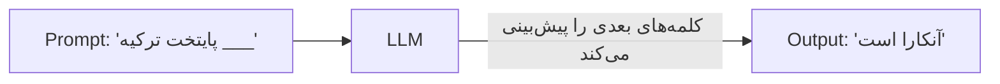
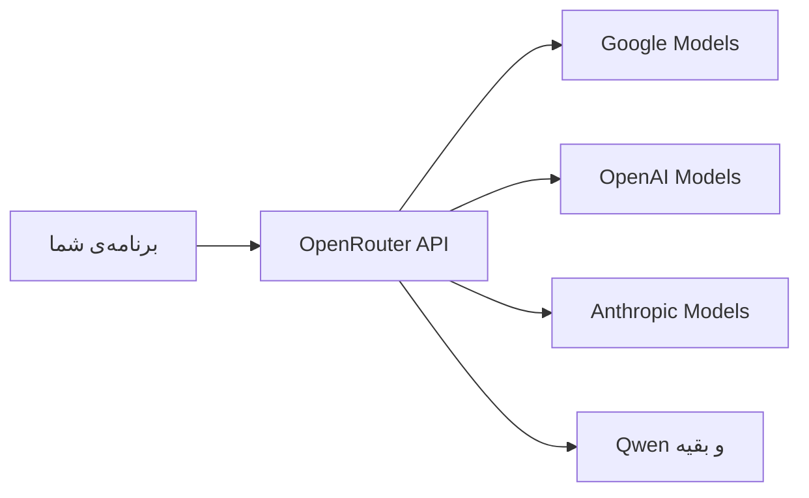
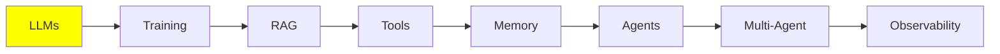

# مبانی LLM

همه‌ی بخش‌های دیگر این مجموعه روی همین ماژول (module) ساخته شده‌اند. توصیف یک LLM ساده است: متن وارد می‌شود و متن خارج می‌شود. اما تقریباً هر ایده‌ی بعدی در این مجموعه (RAG، tool‌ها، memory، agent‌ها) به خاطر یک محدودیت مشخص وجود دارد. دقیقاً در یک دقیقه به آن محدودیت می‌رسیم.

پس بیایید از خود model شروع کنیم. بعد به آن محدودیت نگاه می‌کنیم، و سپس می‌بینیم که چطور یک model را اجرا می‌کنید.

## LLM چیست؟

LLM یک model است که متن را به‌عنوان input می‌گیرد و متن را به‌عنوان output به شما می‌دهد. شما چند کلمه برای آن می‌فرستید (**prompt**)، و آن کلمه‌های بیشتری را برمی‌گرداند (**generation**).

داخل آن یک deep neural network است. این model روی مقدار زیادی متن آموزش دیده است: کتاب، وب‌سایت و کد. از همه‌ی این متن‌ها، یک مهارت یاد گرفته است: حدس زدن محتمل‌ترین کلمه‌ی بعدی.



در واقع فقط همین کار را می‌کند. هر کار چشمگیری که به نظر می‌رسد LLM انجام می‌دهد، از همین یک حدس می‌آید. model این کار را بارها تکرار می‌کند، هر بار یک کلمه.

## LLM چقدر بزرگ است؟

LLM یک neural network با تعداد زیادی **parameter** است. می‌توانید parameter‌ها را تا حدی مثل اتصال‌های داخل مغز تصور کنید. هرچه parameter بیشتری وجود داشته باشد، network می‌تواند بیشتری را در خود نگه دارد.

چرا این برای شما مهم است؟ به‌طور کلی، parameter بیشتر یعنی یک model توانمندتر با reasoning بهتر. parameter بیشتر همچنین یعنی برای اجرای model به یک ماشین بزرگ‌تر نیاز دارید. اندازه‌ی model مهم‌ترین عاملی است که تعیین می‌کند آیا اصلاً می‌توانید یک model را اجرا کنید.

این فقط یک حرف رایج نیست. این موضوع اندازه‌گیری شده است. مقاله‌ی سال 2020 با عنوان [Scaling Laws for Neural Language Models](https://arxiv.org/abs/2001.08361) نشان داد وقتی parameter، training data و compute با هم رشد کنند، چه اتفاقی می‌افتد. عملکرد به‌آرامی و قابل‌پیش‌بینی بهتر می‌شود. این رابطه از یک power law پیروی می‌کند و جهش ناگهانی ندارد. همین **scaling laws** دلیل آن است که کل صنعت، سال‌های بعد را روی یک کار متمرکز کرد: ساختن model‌های بزرگ‌تر.

model‌ها تقریباً در سه اندازه‌ی کلی وجود دارند:

| اندازه | Parameter‌ها | کجا اجرا می‌شود |
| --- | --- | --- |
| کوچک | 0.6B تا 8B | روی سیستم خودتان، اگر GPU داشته باشید |
| متوسط | 8B تا 128B | GPU‌های سطح server یا سازمانی |
| بزرگ | 128B تا 2.4T (بله، تریلیون) | فقط در data center‌ها |

model‌های بزرگ همان frontier model‌ها هستند که پشت ابزارهایی مثل Claude Code و ChatGPT قرار دارند. شما هرگز آن‌ها را به‌صورت local اجرا نمی‌کنید. این مشکلی نیست، چون به‌جای آن از طریق API آن‌ها را صدا می‌زنید.

برای مقایسه‌ی model‌های مشخص و نمره‌های benchmark آن‌ها، از [artificialanalysis.ai](https://artificialanalysis.ai/) استفاده کنید.

## Context Window

این همان محدودیتی است که بقیه‌ی همه‌چیز را شکل می‌دهد.

هر LLM یک **context window** دارد. این بیشترین مقدار متنی است که model می‌تواند در یک زمان پردازش کند، input و output با هم. آن را مثل میز کار model تصور کنید. هر چیزی که model اجازه دارد همین حالا به آن نگاه کند، باید روی این میز جا شود.

ساده‌ترین راه برای تصور کردن آن، تاریخچه‌ی chat شما با ChatGPT است. در ابتدای یک گفت‌وگوی تازه، تاریخچه خالی است. وقتی رفت‌وبرگشت می‌کنید، هر پیام شما و هر پاسخ model به آن اضافه می‌شود. در نهایت پر می‌شود.

پس context در واقع فقط یک **stack of messages** است. این stack یک پیام در هر بار ساخته می‌شود و بعد برای model فرستاده می‌شود. LLM کل این stack را به‌عنوان input می‌گیرد، آن را پردازش می‌کند و پیام بعدی را generate می‌کند.

**اگر از این حد بگذرید چه اتفاقی می‌افتد؟** خطا می‌گیرید. همین. request به سادگی شکست می‌خورد.

راه‌هایی برای دور زدن این محدودیت وجود دارد. آن‌قدر مهم‌اند که موضوع جداگانه‌ای دارند: [Context Engineering](../2_intermediate/context_engineering_fa.md) در بخش Intermediate.

### چه چیزی وارد Context می‌شود

سه نوع پیام، یک chat معمولی را می‌سازند:

- **HumanMessage**: چیزی که شما تایپ می‌کنید، یعنی درخواستتان. وقتی مردم «prompt» می‌گویند، منظورشان همین است.
- **AIMessage**: پاسخ model.
- **SystemMessage**: یک مجموعه‌ی پیش‌فرض از دستورالعمل‌ها که توسط ارائه‌دهنده یا developer نوشته می‌شود (OpenAI، Anthropic یا خودتان). این پیام یک بار و در بالای context قرار می‌گیرد. به model می‌گوید چطور رفتار کند: چه کاری انجام دهد، کی آن را انجام دهد و از کدام tool استفاده کند.

این پیام‌ها هر بار که از سیستم استفاده می‌کنید، روی هم انباشته می‌شوند:

  
*دو turn از یک chat ساده: دو Human Message و دو AI Message. هیچ‌چیز حذف نمی‌شود. پس در turn دوم، model همه‌ی چیزهای turn اول را هم می‌خواند.*

یک HumanMessage به‌همراه AIMessage ای که جوابش را می‌دهد، **turn** نامیده می‌شود. در یک chat ساده‌ی LLM، بین این دو هیچ چیز دیگری نیست: prompt را می‌فرستید و پاسخ را می‌گیرید. شکل بالا دو turn را نشان می‌دهد.

این stack چند نام دارد و نامش بسته به این است که چه کسی صحبت می‌کند: **context**، **working memory**، **message history** یا **short-term memory**. عجله نکنید. short-term memory ماژول جداگانه‌ی خودش را دارد: [Memory](memory_fa.md).

**SystemMessage** ارزش نگاه دقیق‌تری دارد، چون فقط یک متن ساده نیست. معمولاً هم دستورالعمل‌های رفتاری را نگه می‌دارد *و* **tool schema‌ها** را. tool schema‌ها فهرستی از tool‌هایی هستند که model اجازه دارد صدا بزند، همراه با نام‌ها و argument‌هایشان:

  
*داخل یک system prompt: دستورالعمل‌های رفتاری، tool schema‌ها، و گاهی یک بلوک متن مرجع ثابت. همه‌ی این‌ها در بالاترین بخش context قرار دارند.*

در API، tool schema‌ها یک field جداگانه هستند و بخشی از متن system نیستند. اما model آن‌ها را در ابتدا به‌صورت یک بلوک دریافت می‌کند. پس منطقی است که آن‌ها را کنار هم تصور کنیم.

می‌توانید system prompt‌های واقعی و لو رفته‌ی بسیاری از محصولات را اینجا بخوانید: [system_prompts_leaks](https://github.com/asgeirtj/system_prompts_leaks).

همچنین **دو نوع پیام دیگر** وجود دارد و وقتی به agent‌ها برسیم، با آن‌ها آشنا می‌شوید. یک agent فقط یک LLM است که می‌تواند tool صدا بزند. یک tool چیز خاصی نیست: فقط یک function است، معمولاً یک function ساده‌ی Python که خودتان نوشته‌اید.

فرض کنید درباره‌ی آب‌وهوای استانبول می‌پرسید. model نمی‌تواند خودش این را پیدا کند. پس می‌گوید که می‌خواهد یکی از function‌های شما را اجرا کند: یک **ToolCall** تولید می‌کند، چیزی مثل `get_weather(city="Istanbul")`. ماشین شما همان ماشینی است که Python روی آن نصب شده. پس ماشین شما آن function را اجرا می‌کند و `34°C` را برمی‌گرداند. بعد این نتیجه را به‌عنوان **ToolResult** به model می‌دهد. هر دو پیام به همان stack اضافه می‌شوند.

پس این بخشی است که باید به خاطر بسپارید: **LLM، ToolCall را generate می‌کند، اما host machine، ToolResult را generate می‌کند**. host machine، لپ‌تاپ شما یا یک server است. ToolResult را آن generate می‌کند، چون همان است که واقعاً function را اجرا می‌کند. model درخواست می‌کند. کار را یک چیز دیگر انجام می‌دهد.

یک agent turn چیزهای بیشتری در خود دارد. بعد از HumanMessage شما، model تصمیم می‌گیرد که برای جواب دادن به شما به tool نیاز دارد یا نه. اگر نیاز داشته باشد، ToolCall و ToolResult هم به context اضافه می‌شوند. model فقط بعد از آن پاسخ نهایی را می‌نویسد. همه‌ی این‌ها باز هم **یک turn** است: یک HumanMessage، هر پیام tool ای که باشد، و AIMessage در انتها.

  
*یک turn تکی از یک agent: شما prompt می‌دهید، AI فکر می‌کند، AI یک tool را صدا می‌زند، و بعد AI پاسخ می‌دهد. ببینید هر کس چه چیزی را می‌نویسد. LLM بخش thinking، Tool Call و پاسخ را تولید می‌کند. Tool Result از host machine می‌آید که function را اجرا می‌کند.*

این تقسیم‌بندی، کل پایه‌ی کار agent‌ها است. به آن در [Tool Calling](tools_fa.md) و [AI Agents](agents_fa.md) برمی‌گردیم.

## Hyperparameter‌های LLM

با **hyperparameter‌ها** می‌توانید طرز پاسخ دادن model را تغییر دهید. به بخش «hyper» توجه کنید. hyperparameter‌ها روی generation اثر می‌گذارند. parameter‌هایی که بالاتر گفتیم فرق دارند: آن‌ها اندازه‌ی model بودند.

دو تا از آن‌ها را همیشه استفاده می‌کنید:

- **Temperature**: دکمه‌ی خلاقیت، معمولاً از 0.0 تا 1.0. مقدار پایین (0.1) پاسخ‌های قابل‌پیش‌بینی و یکدست می‌دهد. مقدار بالا (0.9) پاسخ‌های خلاقانه‌تری می‌دهد، اما این پاسخ‌ها کمتر قابل‌اعتماد هستند.
- **Max output tokens**: بیشترین طول پاسخ. این را تنظیم کنید تا هزینه را کنترل کنید و model بیشتر از نیازتان ننویسد. برای پاسخ‌های کوتاه، 2K کاملاً کافی است.

## اجرای LLM (Inference)

اجرای یک model را **inference** می‌نامند. دقیقاً همان چیزی است که قبلاً توضیح دادیم: context را می‌فرستید، model آن را پردازش می‌کند، و بعد model آن را کامل می‌کند.

همان‌طور که اسم Large Language Model نشان می‌دهد، این model‌ها بزرگ هستند. پس inference به یک GPU نیاز دارد. این به شما دو گزینه می‌دهد.

**1. Cloud inference (API calls).** شما یک سرویس مثل ChatGPT یا Google AI Studio را صدا می‌زنید. GPU‌های عظیم مال آن‌هاست و model را برای شما اجرا می‌کنند.

- **مزایا:** به بزرگ‌ترین و توانمندترین model‌ها دسترسی دارید، و سخت‌افزاری برای خریدن ندارید.
- **معایب:** هزینه دارد، به اینترنت نیاز دارد و ممکن است کند باشد.

**2. Local inference.** model روی کامپیوتر خودتان اجرا می‌شود.

- **نیازمندی:** یک GPU خوب با حافظه‌ی کافی (VRAM).
- **مزایا:** بعد از راه‌اندازی رایگان است (فقط هزینه‌ی برق را می‌پردازید)، و آفلاین هم کار می‌کند.
- **معایب:** فقط به model‌های کوچک‌تر محدود می‌شوید.

بیایید هر کدام را جداگانه ببینیم.

## LLM‌های محلی

### Quantization

**Quantization چیست؟** راهی است برای فشرده کردن model تا در حافظه‌ی کمتری جا شود. model‌ها معمولاً با weight‌های 16-bit منتشر می‌شوند. Quantization هر weight را به 4 بیت کاهش می‌دهد. این کار حافظه‌ای را که لازم دارید تقریباً چهار برابر کم می‌کند.

عددها این موضوع را روشن می‌کنند. یک model با 32B را به‌عنوان مثال در نظر بگیرید:

| Precision | حافظه‌ی لازم | روی GPU مصرفی جا می‌شود؟ |
| --- | --- | --- |
| 16-bit (همان‌طور که منتشر می‌شود) | ~64 GB | خیر |
| 4-bit (quantize شده) | ~16 GB، به‌علاوه‌ی کمی برای context | بله، به‌راحتی روی کارت 24 GB یا 32 GB |

همان model، همان weight‌ها، و یک چهارم حافظه. تفاوت بین «اصلاً نمی‌توانم این را اجرا کنم» و «این روی دسک‌تاپ من اجرا می‌شود» همین است.

**آیا باید خودتان model‌ها را quantize کنید؟** نه، و تقریباً هیچ‌وقت نباید این کار را بکنید. [Ollama](https://ollama.com/) و [Unsloth](https://unsloth.ai/) از قبل نسخه‌های quantize شده‌ی آماده‌ی model‌های محبوب را منتشر کرده‌اند: Qwen، Llama، Mistral، Gemma و بیشتر. فقط یکی از آن‌ها را pull کنید و اجرایش کنید.

### Engine‌هایی که واقعاً model را اجرا می‌کنند

زیر همه‌چیز، یک **inference engine** وجود دارد که کار اصلی را انجام می‌دهد:

- **llama.cpp**
- **vLLM** (NVIDIA، AMD، TPU‌ها)
- **SGLang** (فقط NVIDIA)
- **TensorRT-LLM** (NVIDIA، AMD)
- **MLX** (فقط Apple)

این engine‌ها برای مبتدی‌ها آسان نیستند و قبل از اجرا به کار زیادی برای راه‌اندازی نیاز دارند. خوشبختانه، به‌ندرت مستقیم با آن‌ها سروکار دارید. ابزارهای دیگر در پس‌زمینه از آن‌ها استفاده می‌کنند و interface‌هایشان را پنهان می‌کنند. با آن ابزارها، با چند خط کد، یا مستقیم از terminal، از هیچ به یک model در حال اجرا می‌رسید.

### ابزارهای ساده

- **[LMStudio](https://lmstudio.ai/)**: یک GUI ساده برای دانلود model‌ها و chat با آن‌ها. برای شروع کردن عالی است.
- **[Ollama](https://ollama.com/)**: یک ابزار command-line برای pull و serve کردن سریع model‌ها. وقتی با terminal راحت باشید، انتخاب بهتری است.

**همین حالا امتحان کنید:** با Ollama CLI یک model خیلی کوچک 0.6B را pull کنید و در terminal با آن chat کنید. حدود دو دقیقه طول می‌کشد. همچنین کمک می‌کند همه‌ی آنچه بالاتر گفتیم را در عمل ببینید.

## LLM‌های ابری

برای model‌های بزرگ‌تر، یا وقتی که اصلاً نمی‌خواهید هیچ راه‌اندازی‌ای داشته باشید، از یک **inference provider** استفاده می‌کنید. provider به شما یک API key می‌دهد. بعد با یک client library از داخل کد خود، model‌های آن را صدا می‌زنید.

هر دو provider زیر یک free tier با محدودیت روزانه دارند. برای یادگیری همین کافی است.

### Google AI Studio

از این‌جا شروع کنید: [aistudio.google.com](https://aistudio.google.com/). ثبت‌نام کنید و API key شخصی‌تان را بگیرید. free tier، model‌های پایه را با محدودیت روزانه پوشش می‌دهد.

### OpenRouter

[OpenRouter](https://openrouter.ai/) یک gateway است. درخواست شما را به provider‌های مختلف فوروارد می‌کند. چون یک router است، با یک API key به تقریباً هر model دسترسی دارید. لازم نیست برای Google، OpenAI، Qwen و بقیه، key‌های جداگانه مدیریت کنید.



همچنین model‌های رایگان با محدودیت روزانه هم دارد. و برای رفتن به model دیگر، فقط یک خط کد را عوض می‌کنید. این کار OpenRouter را سریع‌ترین راه برای مقایسه‌ی model‌ها روی کار خودتان می‌کند.

## LLM Prompting

**Prompt engineering** یعنی نوشتن input طوری که output دلخواهتان را بگیرید. این همان ایده‌ی دادن دستورالعمل به دانش‌آموزان است. دستور روشن باعث می‌شود تکلیف درست انجام شود. دستور مبهم باعث می‌شود هر دانش‌آموز هر کاری را که دلش می‌خواهد انجام دهد.

به یاد داشته باشید که model واقعاً چه چیزی را حساب می‌کند. model با داشتن هر چیزی که در context است، احتمال token بعدی را حساب می‌کند:

```
P(next token | context)
```

prompt شما همان context *است*. پس کار شما این است که input‌ای پیدا کنید که output مورد نظرتان را محتمل‌ترین حالت کند:

```
best prompt = the prompt that maximises P(the output you want | prompt)
```

این کل اصل کار است در یک خط. تکنیک‌های نام‌دار زیادی وجود دارد و آن‌ها را در [Prompt Engineering](../2_intermediate/prompt_engineering_fa.md) پوشش می‌دهیم. اما بیشتر کار واقعی، آزمایش کردن است: یک جمله‌بندی را امتحان کنید، output را ببینید، آن را تغییر دهید و دوباره امتحان کنید.

خواندن این‌ها ارزش دارد تا ببینید برای prompt‌های production چقدر تلاش می‌شود:

- [System prompts of AI tools](https://github.com/x1xhlol/system-prompts-and-models-of-ai-tools)
- [System prompt leaks](https://github.com/asgeirtj/system_prompts_leaks)
- [Large Language Models explained briefly](https://youtu.be/LPZh9BOjkQs?si=8kH-lzHbfHRL1_8h): یک ویدیو که همان موضوع‌ها را پوشش می‌دهد، اگر ترجیح می‌دهید تماشا کنید به‌جای خواندن
- [Leaked system prompts](https://github.com/jujumilk3/leaked-system-prompts)

## کجای این مجموعه هستیم



حالا می‌دانید LLM چیست، محدودیت مهمی که وجود دارد (context window) چیست، داخل آن context چه چیزی است، و چطور یک model را به‌صورت local یا در cloud اجرا کنید.

در ادامه، context window را در ذهن داشته باشید. RAG، memory، agent‌ها و context engineering، به یک شکل یا شکل دیگر، همگی جواب این سؤال هستند: *روی آن میز محدود چه چیزی بگذاریم؟*

## منابع

- [Scaling Laws for Neural Language Models](https://arxiv.org/abs/2001.08361): Kaplan et al., 2020، اندازه‌گیری‌ای که پشت این حرف است که «model‌های بزرگ‌تر بهترند»
- [Artificial Analysis](https://artificialanalysis.ai/): مقایسه‌ی model‌ها و benchmark‌ها
- [Ollama](https://ollama.com/): pull و serve کردن model‌ها به‌صورت local
- [LMStudio](https://lmstudio.ai/): GUI برای اجرای model‌ها به‌صورت local
- [Unsloth](https://unsloth.ai/): نسخه‌های از پیش quantize شده‌ی model
- [Google AI Studio](https://aistudio.google.com/): API key‌های free tier
- [OpenRouter](https://openrouter.ai/): یک key برای provider‌های زیاد
- [System prompt leaks](https://github.com/asgeirtj/system_prompts_leaks)
- [Large Language Models explained briefly](https://youtu.be/LPZh9BOjkQs?si=8kH-lzHbfHRL1_8h): یک ویدیو که همان موضوع‌ها را پوشش می‌دهد، اگر ترجیح می‌دهید تماشا کنید به‌جای خواندن
