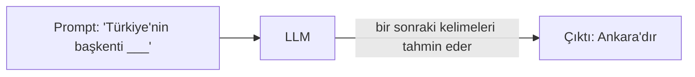
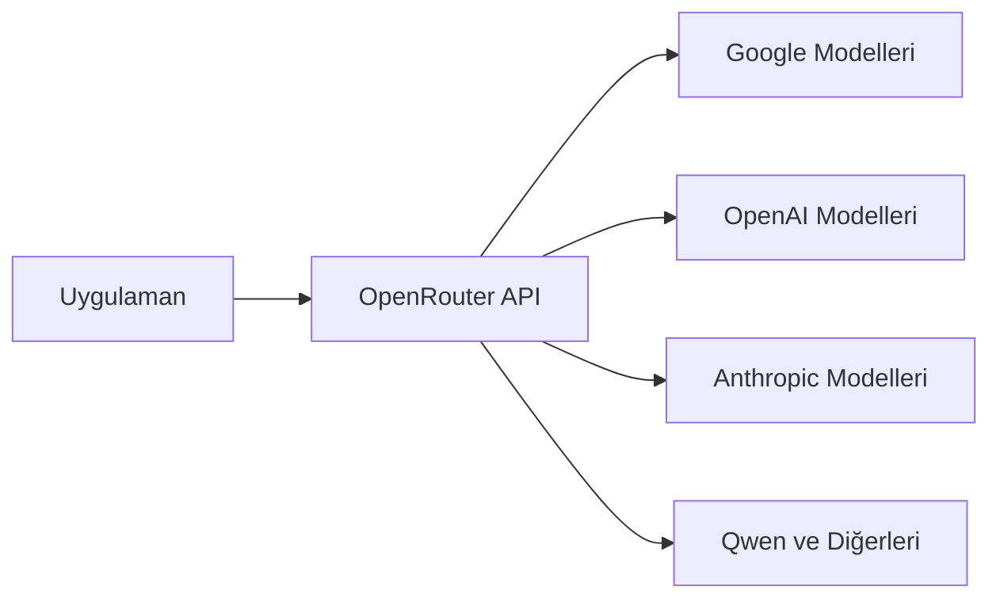
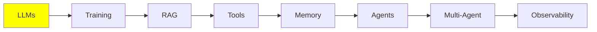

# LLM Temelleri

Serideki diğer her şey bu modülün üzerine kurulu. Bir LLM'i anlatmak aslında kolay: içeri metin girer, dışarıya metin çıkar. Ancak seride ele alacağımız neredeyse her fikir, yani RAG, tool'lar, hafıza (memory) ve agent'lar, tek bir sınırın yüzünden ortaya çıktı. O sınıra birazdan geleceğiz.

Önce modelin kendisine bakalım. Sonra o sınırı inceleyeceğiz, en sonunda da bir modeli nasıl çalıştırabileceğini göreceğiz.

## LLM Nedir?

Bir LLM, metni girdi (input) olarak alıp metin çıktı (output) olarak veren bir modeldir. Ona birkaç kelime (**prompt**) gönderirsin, o da daha fazla kelimeyle (**generation**) geri döner.

İçeride ise bir derin sinir ağı (deep neural network) var. Bu ağ; kitaplar, web siteleri ve kod gibi çok büyük bir metin yığınıyla eğitildi. Bütün bu metinden tek bir yetenek (skill) öğrendi: bir sonraki kelimeyi en olası şekilde tahmin etmek.



Yaptığı iş aslında bundan ibaret. Bir LLM'in yaptığı etkileyici her şey bu tek tahminin sonucudur. Model bu tahmini, bir seferde bir kelime olacak şekilde, tekrar tekrar yapar.

## Bir LLM Ne Kadar Büyük?

Bir LLM, son derece çok sayıda **parametre (parameter)** barındıran bir sinir ağıdır. Bu parametreleri bir beyindeki bağlantılara benzetebilirsin. Parametre sayısı ne kadar fazlaysa ağ o kadar çok şey tutabilir.

Bunun neden önemli olduğuna gelince: genel olarak parametre sayısı arttıkça model daha yetenekli olur ve daha iyi akıl yürütür. Öte yandan modeli çalıştırmak için daha büyük bir makineye de ihtiyaç duyarsın. Bir modeli hiç çalıştırıp çalıştıramayacağını belirleyen ana etken model boyutudur.

Bu yalnızca bir söz değil, ölçülmüş bir gerçek. 2020'de yayımlanan [Scaling Laws for Neural Language Models](https://arxiv.org/abs/2001.08361) makalesi, parametre sayısı, eğitim verisi ve hesaplama gücü (compute) birlikte büyüdüğünde neler olduğunu gösterdi. Performans düzgün ve öngörülebilir biçimde artıyor. Bu artış bir power law'a (kuvvet yasası) uyar, rastgele zıplamaz. İşte bu **scaling laws** (ölçekleme yasaları), sektörün sonraki yıllarda neden tek bir hedefe, yani daha büyük modeller yapmaya odaklandığını açıklıyor.

Modeller kabaca üç boyutta gelir:

| Boyut | Parametre | Nerede çalışır |
| --- | --- | --- |
| Küçük | 0.6B ile 8B arası | Kendi makinen, eğer bir GPU'n varsa |
| Orta | 8B ile 128B arası | Sunucu sınıfı ya da kurumsal GPU'lar |
| Büyük | 128B ile 2.4T arası (evet, trilyon) | Yalnızca veri merkezlerinde |

Büyük olanlar, Claude Code ve ChatGPT gibi araçların arkasındaki öncü (frontier) modellerdir. Bunları asla kendi bilgisayarında çalıştıramazsın. Bu bir sorun değil, çünkü onları bir API üzerinden çağırırsın.

Belirli modelleri ve onların benchmark skorlarını karşılaştırmak için [artificialanalysis.ai](https://artificialanalysis.ai/) sitesini kullan.

## Context Window

İşte her şeyi şekillendiren sınır budur.

Her LLM'in bir **context window**'u vardır. Bu, modelin tek seferde işleyebildiği en fazla metin miktarıdır ve girdi ile çıktı bu sınırın içinde birlikte sayılır. Bunu modelin çalışma masası gibi düşünebilirsin. Model o an bakmasına izin verilen her şeyin bu masaya sığması gerekir.

Bunu gözünde canlandırmanın en kolay yolu, ChatGPT ile yaptığın sohbet geçmişine bakmak. Yeni bir konuşmaya başladığında geçmiş boştur. Karşılıklı konuştukça hem senin her mesajın hem de modelin her yanıtı bu geçmişe eklenir ve zamanla geçmiş dolar.

Yani **context** dediğimiz şey aslında bir **mesaj yığını (stack)**. Yığın her seferinde bir mesaj eklenerek oluşur ve sonra bütünüyle modele gönderilir. LLM bu yığının tamamını girdi olarak alır, işler ve bir sonraki mesajı üretir.

**Sınır aşılırsa ne olur?** Bir hata alırsın, hepsi bu. İstek başarısız olur.

Bu sınırı aşmak için kullanılan teknikler var. Bunlar, ileride kendi modülünü hak edecek kadar önemli. Bunlara Intermediate bölümündeki [Context Engineering](../2_intermediate/context_engineering_tr.md) modülünde bakacağız.

### Context'e Ne Girer?

Normal bir sohbet üç tür mesajdan oluşur:

- **HumanMessage**: yazdığın şey, yani isteğin. İnsanların "prompt" dediği şey tam olarak budur.
- **AIMessage**: modelin yanıtı.
- **SystemMessage**: geliştirici ya da satıcı (OpenAI, Anthropic veya sen) tarafından yazılmış, varsayılan bir talimat seti. En üste bir kez konur ve modele nasıl davranacağını söyler: ne yapacağını, ne zaman yapacağını ve hangi tool'u kullanacağını.

Bu mesajlar, sistemi her kullandığında üst üste yığılır:

  
*İki turn'lük düz bir sohbet: iki HumanMessage ve iki AIMessage. Hiçbir şey silinmez. Bu yüzden ikinci turn'de model birinci turn'deki her şeyi de okur.*

Bir HumanMessage ile onu yanıtlayan AIMessage'a birlikte bir **turn** denir. Düz bir LLM sohbetinde bu ikisinin arasında başka bir şey yoktur: prompt'u gönderirsin, yanıtı alırsın. Yukarıdaki şekilde iki turn var.

Bu yığının birkaç adı var ve hangisinin kullanıldığı kimin konuştuğuna bağlı: **context**, **working memory**, **message history** ya da **short-term memory**. İsimlerin hepsini şimdiden ezberlemene gerek yok. Kısa süreli hafıza kendi modülünü hak ediyor: [Memory](memory_tr.md).

SystemMessage'a daha yakından bakmak gerekiyor, çünkü o tek bir düz metin değil. Normalde hem davranış talimatlarını *hem de* **tool schema'larını** taşır. Tool schema'ları, modelin çağırmasına izin verilen tool'ların listesidir ve her birinin adını ile argümanlarını içerir:

  
*Bir system prompt'un içinde davranış talimatları, tool schema'ları ve bazen sabit bir referans metin bloğu bulunur. Hepsi context'in en üstünde yer alır.*

API'de tool schema'ları system metninin parçası değildir, ayrı bir alan olarak gelir. Ancak model bunları başta tek bir blok halinde alır. Bu yüzden onları birlikte hayal etmek makul.

Birçok üründen sızdırılmış gerçek system prompt'ları şu adreste okuyabilirsin: [system_prompts_leaks](https://github.com/asgeirtj/system_prompts_leaks).

Bunlara ek olarak **iki mesaj türü daha** var ve bunlarla agent'lara geldiğimizde karşılaşacaksın. Agent, tool çağırabilen bir LLM'den ibarettir. Tool ise özel bir şey değildir: genellikle senin yazdığın sade bir Python fonksiyonudur.

Diyelim ki İstanbul'daki hava durumunu soruyorsun. Model bunu kendi başına öğrenemez. Bu yüzden senin fonksiyonlarından birini çalıştırmak istediğini belirtir: `get_weather(city="Istanbul")` gibi bir **ToolCall** üretir. Python kurulu olan makine senin bilgisayarındır. Fonksiyonu da o çalıştırır ve `34°C` sonucunu alır. Sonra bu sonucu bir **ToolResult** olarak modele verir. İki mesaj da aynı yığına eklenir.

Burada hatırlaman gereken kısım şu: **ToolCall'u LLM üretir, ToolResult'u ise host makine üretir**. Host makine (host machine), senin laptop'un ya da bir sunucu olabilir. ToolResult'u o üretir, çünkü fonksiyonu gerçekten çalıştıran odur. Model sorar, iş başka bir şey tarafından yapılır.

Bir agent turn'ünün içi daha kalabalıktır. HumanMessage'ından sonra model, sana cevap verebilmek için bir tool'a ihtiyacı olup olmadığına karar verir. İhtiyacı varsa ToolCall ve ToolResult de context'e eklenir. Model son cevabı ancak bundan sonra yazar. Bütün bunlar yine **tek bir turn**: bir HumanMessage, varsa tool mesajları ve en sonda bir AIMessage.

  
*Bir agent'ın tek turn'ü: sen prompt'u yazarsın, AI düşünür, bir tool'u çağırır ve sonra cevap verir. Kimin neyi yazdığına bak. LLM düşünceyi, Tool Call'u ve cevabı üretir. Tool Result ise fonksiyonu çalıştıran host makineden gelir.*

Agent'ların nasıl işlediğinin temeli tam olarak bu ayrımdır. Bunu [LLM Tool Calling](tools_tr.md) ve [AI Agents](agents_tr.md) modüllerinde yeniden ele alacağız.

## LLM Hiperparametreleri

Modelin nasıl yanıt verdiğini **hiperparametre (hyperparameter)** ayarlarıyla değiştirebilirsin. Bu kelimedeki "hyper" kısmına dikkat et. Hiperparametreler üretimi etkiler. Yukarıda andığımız parametreler ise başka bir şeydir: onlar modelin boyutudur.

Bunlardan ikisini sürekli kullanacaksın:

- **Temperature**: yaratıcılık düğmesi, genellikle 0.0 ile 1.0 arasında. Düşük bir değer (0.1) öngörülebilir ve tutarlı cevaplar verir. Yüksek bir değer (0.9) daha yaratıcı cevaplar verir, ama bunlar daha az güvenilirdir.
- **Max output tokens**: cevabın en fazla uzunluğu. Maliyeti kontrol etmek ve modelin ihtiyacından fazla yazmasını önlemek için bunu ayarlarsın. Kısa cevaplar için 2K fazlasıyla yeterli.

## Bir LLM'i Çalıştırmak (Inference)

Bir modeli çalıştırmaya **inference** denir. Bu, daha önce anlattığımız şeyin tam karşılığıdır: context'i gönderirsin, model onu işler ve sonra cevabı tamamlar.

Adındaki "Large" kelimesinin de belirttiği gibi bu modeller çok büyük. Bu yüzden inference için bir GPU gerekir. Bu da sana iki seçenek sunar.

**1. Cloud inference (API çağrıları).** ChatGPT ya da Google AI Studio gibi bir servisi çağırırsın. Devasa GPU'lar onların elinde olduğu için modeli senin yerine onlar çalıştırır.

- **Artılar:** en büyük ve en yetenekli modellere erişirsin ve satın alman gereken bir donanım yoktur.
- **Eksiler:** para gerektirir, internet bağlantısı ister ve yavaş olabilir.

**2. Local inference.** Model kendi bilgisayarında çalışır.

- **Gereksinim:** iyi bir GPU ve yeterince büyük bir video belleği (VRAM).
- **Artılar:** kurulumdan sonra ücretsizdir (yalnızca elektrik faturası ödersin) ve internet olmadan da çalışır.
- **Eksiler:** yalnızca daha küçük modellerle sınırlısın.

Şimdi bunlara tek tek bakalım.

## Yerel LLM'ler

### Quantization

**Quantization nedir?** Modeli daha az belleğe sığacak şekilde sıkıştırmanın bir yoludur. Modeller normalde 16 bit'lik ağırlıklarla (weight) dağıtılır. Quantization her ağırlığı 4 bit'e indirir ve bu da ihtiyaç duyulan belleği yaklaşık dört kat azaltır.

Rakamlar bunu açıkça gösteriyor. Örnek olarak 32B'lik bir modele bakalım:

| Precision | Gereken bellek | Tüketici GPU'suna sığar mı? |
| --- | --- | --- |
| 16-bit (dağıtıldığı haliyle) | ~64 GB | Hayır |
| 4-bit (quantized) | ~16 GB, bir miktar context için ek | Evet, 24 GB ya da 32 GB'lık bir kartta rahatlıkla |

Aynı model, aynı ağırlıklar, ama bellek ihtiyacı dörtte bir. Fark, "bunu hiç çalıştıramam" ile "bu masaüstümde çalışıyor" arasındaki farktır.

**Modelleri kendin quantize etmen gerekir mi?** Hayır, ve neredeyse hiç etmemelisin. [Ollama](https://ollama.com/) ve [Unsloth](https://unsloth.ai/), Qwen, Llama, Mistral, Gemma ve daha fazlası gibi popüler modellerin hazır quantize edilmiş sürümlerini zaten yayımlıyor. Bunlardan birini çekip çalıştırman yeterli.

### Modeli Gerçekte Çalıştıran Motorlar

Her şeyin altında, asıl işi yapan bir **inference engine** var:

- **llama.cpp**
- **vLLM** (NVIDIA, AMD, TPU'lar)
- **SGLang** (yalnızca NVIDIA)
- **TensorRT-LLM** (NVIDIA, AMD)
- **MLX** (yalnızca Apple)

Bu motorlar yeni başlayanlar için kolay değildir ve çalışmaya başlamadan önce ciddi bir kurulum işi gerektirir. Neyse ki çoğu zaman onlara doğrudan dokunmazsın. Başka araçlar bunları arka planda kullanır ve arayüzlerini gizler. Bu araçlarla sıfırdan çalışan bir modele birkaç satır kodla ya da doğrudan terminalden ulaşabilirsin.

### Kolay Araçlar

- **[LMStudio](https://lmstudio.ai/)**: modelleri indirip onlarla sohbet etmeye yarayan basit bir GUI. Başlamak için harika bir seçenek.
- **[Ollama](https://ollama.com/)**: modelleri hızla çekip sunmak için bir komut satırı aracı. Terminalde rahat etmeye başladığında daha iyi bir seçim olur.

**Şimdi dene:** Ollama CLI ile çok küçük bir 0.6B modeli çek ve onunla terminalde sohbet et. Birkaç dakikanı alır. Yukarıda anlattığımız her şeyi pratikte görmene de yardımcı olur.

## Bulut LLM'leri

Daha büyük modellere ihtiyacın olduğunda ya da hiç kurulum yapmak istemediğinde bir **inference provider** kullanırsın. Sağlayıcı sana bir API anahtarı (API key) verir. Sonra bu anahtarla, kendi kodundan bir istemci kütüphanesi (client library) üzerinden modellerini çağırırsın.

Aşağıdaki iki sağlayıcının da günlük limitli bir ücretsiz katmanı (free tier) var. Öğrenmek için bu fazlasıyla yeterli.

### Google AI Studio

Buradan başla: [aistudio.google.com](https://aistudio.google.com/). Kaydol ve kişisel API anahtarını al. Ücretsiz katman, günlük limitlerle birlikte temel modelleri kapsar.

### OpenRouter

[OpenRouter](https://openrouter.ai/) bir **gateway** (geçit) gibi çalışır. İsteğini birçok farklı sağlayıcıya iletir. Bir yönlendirici (router) olduğu için tek bir API anahtarı hemen hemen her modele ulaşmanı sağlar. Google, OpenAI, Qwen ve diğerleri için ayrı anahtarlar yönetmen gerekmez.



Ayrıca günlük limitli ücretsiz modelleri de var. Başka bir modele geçmek istediğinde ise yalnızca bir satır değiştirirsin. Bu da OpenRouter'ı kendi işin üzerinde modelleri karşılaştırmanın en hızlı yolu yapar.

## LLM'lere Prompt Yazmak

**Prompt engineering**, istediğin çıktıyı alabilmek için girdiyi özenle yazma işidir. Bu, öğrencilere talimat vermeye benzer. Net bir talimat ödevin düzgün yapılmasını sağlar. Belirsiz bir talimat ise her öğrencinin o an canının istediğini yapmasına yol açar.

Modelin gerçekte ne hesapladığını hatırla. Model, context'teki her şeyi göz önünde bulundurarak bir sonraki token'ın olasılığını hesaplar:

```
P(next token | context)
```

Senin prompt'un *tam olarak* bu context'tir. Bu yüzden senin işin, istediğin çıktıyı en olası hale getiren girdiyi bulmaktır:

```
best prompt = the prompt that maximises P(the output you want | prompt)
```

Disiplinin tamamı bu tek satırda özetlenebilir. Adı konmuş pek çok teknik var ve bunları [Prompt Engineering](../2_intermediate/prompt_engineering_tr.md) modülünde anlatıyoruz. Ama işin büyük kısmı deneyerek ilerler: bir ifadeyi dene, çıktıya bak, değiştir ve yeniden dene.

Gerçek ürünlerdeki prompt'lara ne kadar emek verildiğini görmek için şunlara bakmaya değer:

- [System prompts of AI tools](https://github.com/x1xhlol/system-prompts-and-models-of-ai-tools)
- [System prompt leaks](https://github.com/asgeirtj/system_prompts_leaks)
- [Large Language Models explained briefly](https://youtu.be/LPZh9BOjkQs?si=8kH-lzHbfHRL1_8h): aynı konuları işleyen bir video, okumak yerine izlemeyi tercih ediyorsan.
- [Leaked system prompts](https://github.com/jujumilk3/leaked-system-prompts)

## Bu serinin neresindeyiz



Artık LLM'in ne olduğunu, önemli olan tek sınırı (context window), bu sınırın içinde neler olduğunu ve bir modeli yerelde ya da bulutta nasıl çalıştıracağını anlıyorsun.

Serinin geri kalanında context window'u aklında tut. RAG, memory, agent'lar ve context engineering, bir biçimde hepsi aynı soruya verilen cevaplardır: *bu sınırlı masaya ne koyacağız?*

## Kaynaklar

- [Scaling Laws for Neural Language Models](https://arxiv.org/abs/2001.08361): Kaplan et al., 2020. "Büyük modeller daha iyidir" fikrinin arkasındaki ölçüm.
- [Artificial Analysis](https://artificialanalysis.ai/): model karşılaştırmaları ve benchmark'lar
- [Ollama](https://ollama.com/): modelleri yerelde indirip sunmak
- [LMStudio](https://lmstudio.ai/): modelleri yerelde çalıştırmak için bir GUI
- [Unsloth](https://unsloth.ai/): önceden quantize edilmiş model sürümleri
- [Google AI Studio](https://aistudio.google.com/): ücretsiz katman için API anahtarları
- [OpenRouter](https://openrouter.ai/): birçok sağlayıcı için tek anahtar
- [System prompt leaks](https://github.com/asgeirtj/system_prompts_leaks)
- [Large Language Models explained briefly](https://youtu.be/LPZh9BOjkQs?si=8kH-lzHbfHRL1_8h): aynı konuları işleyen bir video, okumak yerine izlemeyi tercih edenler için
