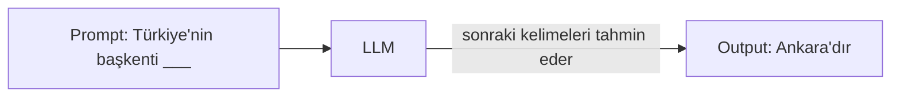
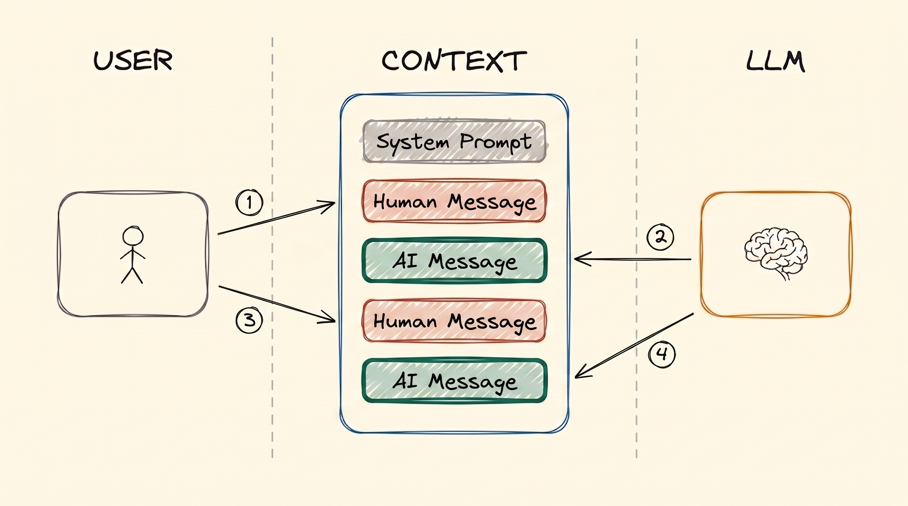
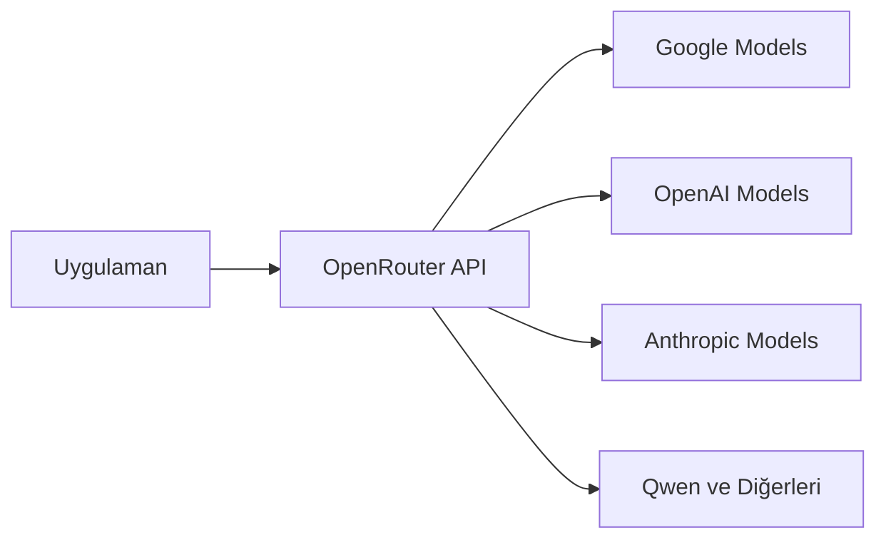
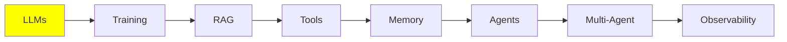

# LLM Temelleri

Bu serideki her şey bu modülün üstüne kuruluyor. Bir LLM'i tanımlamak kolay: metin girer,
metin çıkar. Ama sonraki konuların neredeyse tamamı (RAG, tools, memory, agents) tek bir
sınır yüzünden var. Birazdan o sınıra geliyoruz.

Önce modelin kendisiyle başlayalım. Sonra sınıra, sonra da bir modeli nasıl çalıştırdığına
bakalım.

## LLM Nedir?

Bir LLM, input olarak metin alıp output olarak metin veren bir modeldir. Ona birkaç kelime
yollarsın (**prompt**), o da sana daha fazla kelime yollar (**generation**).

İçeride, çok büyük miktarda metinle eğitilmiş derin bir neural network var: kitaplar, web
siteleri, kod. Bütün o metinden tek bir beceri öğrendi: en olası sonraki kelimeyi tahmin
etmek.



Yaptığı gerçekten bundan fazlası değil. Bir LLM'in yaptığı etkileyici görünen her şey bu tek
tahmin. Model bunu tekrar tekrar, kelime kelime yapar.

## Bir LLM Ne Kadar Büyük?

Bir LLM, çok sayıda **parameter**'a sahip bir neural network'tür. Parameter'ları biraz
beyindeki bağlantılar gibi düşün. Sayısı arttıkça network'ün tutabildiği de artar.

Bu senin için neden önemli? Genel olarak, daha fazla parameter daha yetenekli ve daha iyi
reasoning yapan bir model demek. Aynı zamanda onu çalıştırmak için daha büyük bir makine
gerektiği anlamına gelir. Bir modeli çalıştırıp çalıştıramayacağını belirleyen ana şey model
boyutudur.

Bu sadece kulaktan dolma bir bilgi değil. Ölçüldü. 2020'de yayınlanan
[Scaling Laws for Neural Language Models](https://arxiv.org/abs/2001.08361) makalesi,
parameter, training data ve compute birlikte büyüdüğünde ne olduğunu gösterdi. Performans
düzgün ve öngörülebilir biçimde artar. Zıplamalar yapmaz, bir power law'a uyar. Bu
**scaling laws**, sektörün sonraki yıllarını neden sadece daha büyük model üretmekle
geçirdiğini açıklıyor.

Kabaca üç boyut var:

| Boyut | Parameter | Nerede çalışır |
| --- | --- | --- |
| Küçük | 0.6B – 8B | GPU'n varsa kendi makinende |
| Orta | 8B – 128B | Server sınıfı ve kurumsal GPU'lar |
| Büyük | 128B – 2.4T (evet, trilyon) | Sadece data center'lar |

Büyük olanlar, Claude Code ve ChatGPT gibi araçların arkasındaki frontier model'ler. Onları
local'de asla çalıştıramayacaksın. Bu sorun değil, çünkü onları API üzerinden çağırırsın.

Belirli modelleri ve benchmark puanlarını karşılaştırmak için
[artificialanalysis.ai](https://artificialanalysis.ai/) kullan.

## Context Window

Geri kalan her şeyi şekillendiren sınır burada.

Her LLM'in bir **context window**'u vardır. Bu, modelin input ve output birlikte, tek seferde
işleyebileceği maksimum metin miktarıdır. Bunu modelin çalışma masası gibi düşün. Şu anda
bakmasına izin verilen her şeyin o masaya sığması gerekir.

Bunu gözünde canlandırmanın en kolay yolu, ChatGPT'deki chat geçmişin. Yeni bir chat'in
başında geçmiş boştur. Karşılıklı yazdıkça her mesajın ve modelin her yanıtı oraya eklenir.
Sonunda dolar.

Yani context aslında sadece bir **message stack**'tir. Bu stack mesaj mesaj oluşturulur ve
modele gönderilir. LLM bu stack'in tamamını input olarak alır, işler ve sıradaki mesajı üretir.

**Sınırı aşarsan ne olur?** Hata alırsın. Bu kadar. Request basitçe fail eder.

Bu sınırın etrafından dolaşmak için teknikler var. Bunlar kendi başlığını hak edecek kadar
önemli: Intermediate bölümündeki
[Context Engineering](../2_intermediate/context_engineering_tr.md).

### Context'in İçinde Ne Var

Normal bir chat'i üç tür mesaj oluşturur:

- **HumanMessage**: senin yazdığın şey, yani isteğin. İnsanların "prompt" derken kastettiği
  bu.
- **AIMessage**: modelin yanıtı.
- **SystemMessage**: modelin sağlayıcısı ya da geliştiricisi (OpenAI, Anthropic veya sen)
  tarafından yazılan default instruction seti. En tepeye bir kez konur. Modele nasıl
  davranacağını söyler: ne yapacağını, ne zaman yapacağını ve hangi tool'u kullanacağını.

Bu mesajlar sistemle her etkileşiminde üst üste birikir:

  
*Düz bir chat'in iki turu: iki Human Message ve iki AI Message. Hiçbir şey silinmez. Bu yüzden ikinci turda model birinci turdaki her şeyi de okur.*

Bir HumanMessage ile ona cevap veren AIMessage'a birlikte **tur** denir. Düz bir LLM chat'inde
aralarında hiçbir şey yoktur: prompt'u yollarsın, cevabı alırsın. Yukarıdaki figürde iki tur
var.

Bu stack'in, kimin konuştuğuna göre birkaç adı var: **context**, **working memory**,
**message history** ya da **short-term memory**. Acele etme. Short-term memory'nin kendi
modülü var: [Memory](memory_tr.md).

SystemMessage'a daha yakından bakmaya değer, çünkü tek parça düz bir metin değildir. Genelde
davranış instruction'larını *ve* **tool schema**'larını tutar. Tool schema'lar, modelin
çağırmasına izin verilen tool'ların isimleri ve argümanlarıyla birlikte listesidir:

  
*Bir system prompt'un içi: davranış instruction'ları, tool schema'ları ve bazen bir blok static reference metni. Hepsi context'in en tepesinde durur.*

API tarafında tool schema'lar system metninin parçası değil, ayrı bir field'dır. Ama model
onları en başta tek blok olarak alır. Bu yüzden ikisini birlikte düşünmek yanlış olmaz.

Birçok üründen sızmış gerçek system prompt'ları burada okuyabilirsin:
[system_prompts_leaks](https://github.com/asgeirtj/system_prompts_leaks).

Agent'lara geldiğimizde tanışacağın **iki mesaj türü daha** var. Agent, tool çağırabilen bir
LLM'den başka bir şey değil. Tool ise özel bir şey değil: sadece bir fonksiyon, genelde senin
yazdığın düz bir Python fonksiyonu.

Diyelim İstanbul'un hava durumunu sordun. Model buna kendisi bakamaz. Bu yüzden
fonksiyonlarından birini çalıştırmak istediğini söyler: bir **ToolCall** üretir, mesela
`get_weather(city="Istanbul")`. Python kurulu olan makine senin makinen. Bu yüzden fonksiyonu
senin makinen çalıştırır ve `34°C` sonucunu alır. Sonra bunu modele **ToolResult** olarak
verir. İki mesaj da aynı message stack'e eklenir.

Yani aklında tutman gereken kısım şu: **ToolCall'ı LLM üretir, ama ToolResult'ı host makine
üretir**. Host makine senin laptop'un ya da bir server'dır. ToolResult'ı o üretir, çünkü
fonksiyonu asıl çalıştıran odur. Model ister. İşi başka bir şey yapar.

Bir agent turunun içinde daha fazla şey olur. HumanMessage'ından sonra model, sana cevap vermek
için bir tool'a ihtiyacı olup olmadığına karar verir. İhtiyacı varsa ToolCall ve ToolResult da
context'e eklenir. Model final cevabı ancak ondan sonra yazar. Bunların hepsi hâlâ **tek bir
tur**: bir HumanMessage, varsa tool mesajları, ve sonda AIMessage.

  
*Bir agent'ın tek turu: sen prompt yazarsın, AI düşünür, AI tool çağırır, sonra AI cevaplar. Kimin ne yazdığına dikkat et. Thinking'i, Tool Call'ı ve cevabı LLM üretir. Tool Result ise fonksiyonu çalıştıran host makineden gelir.*

Bu ayrım, agent'ların nasıl çalıştığının temeli. [LLM Tool Calling](tools_tr.md) ve
[AI Agents](agents_tr.md) modüllerinde buna geri döneceğiz.

## LLM Hyperparameter'ları

Modelin nasıl yanıt verdiğini **hyperparameter**'larla değiştirebilirsin. "Hyper" kısmına
dikkat. Hyperparameter'lar generation'ı etkiler. Yukarıda konuştuğumuz parameter'lar ise
farklı: onlar modelin boyutuydu.

Sürekli kullanacağın iki tanesi:

- **Temperature**: yaratıcılık ayarı, genelde 0.0 ile 1.0 arası. Düşük (0.1) öngörülebilir ve
  tutarlı yanıtlar verir. Yüksek (0.9) daha yaratıcı yanıtlar verir, ama bunlar daha az
  güvenilirdir.
- **Max output tokens**: yanıtın maksimum uzunluğu. Maliyeti kontrol etmek ve modelin
  gereğinden fazla yazmasını engellemek için ayarla. Kısa yanıtlar için 2K bol bol yeter.

## LLM Çalıştırmak (Inference)

Bir modeli çalıştırmaya **inference** denir. Tam da yukarıda anlattığımız şey: context'i
gönderirsin, model onu işler ve sonra tamamlar.

Large Language Model adından da anlaşıldığı gibi bu modeller büyük. Bu yüzden inference GPU
gerektirir. Bu da sana iki seçenek bırakır.

**1. Cloud inference (API çağrıları).** ChatGPT ya da Google AI Studio gibi bir servisi
çağırırsın. Devasa GPU'lar onların, modeli senin için onlar çalıştırır.

- **Artıları:** en büyük ve en yetenekli modellere erişirsin, ve satın alacağın donanım yok.
- **Eksileri:** para tutar, internet gerekir, yavaş olabilir.

**2. Local inference.** Model kendi bilgisayarında çalışır.

- **Gereksinim:** yeterli belleğe (VRAM) sahip iyi bir GPU.
- **Artıları:** kurulumdan sonra bedava (sadece elektrik ödersin), ve internetsiz çalışır.
- **Eksileri:** küçük modellerle sınırlı kalırsın.

Sırayla bakalım.

## Local LLM'ler

### Quantization

**Quantization nedir?** Modeli daha az belleğe sığacak şekilde sıkıştırmanın bir yoludur.
Modeller normalde 16-bit weight'lerle dağıtılır. Quantization her weight'i 4 bite düşürür. Bu,
gereken belleği yaklaşık dörde böler.

Sayılar durumu netleştiriyor. Örnek olarak 32B'lik bir modeli ele al:

| Precision | Gereken bellek | Consumer GPU'ya sığar mı? |
| --- | --- | --- |
| 16-bit (dağıtıldığı hali) | ~64 GB | Hayır |
| 4-bit (quantize edilmiş) | ~16 GB, artı context için biraz | Evet, 24 GB veya 32 GB'lık bir kartta rahatça |

Aynı model, aynı weight'ler, belleğin dörtte biri. "Bunu hiç çalıştıramam" ile "bu benim
masaüstümde çalışır" arasındaki fark bu.

**Modelleri kendin quantize etmen gerekir mi?** Hayır, ve neredeyse hiç gerekmez.
[Ollama](https://ollama.com/) ve [Unsloth](https://unsloth.ai/) popüler modellerin hazır
quantize edilmiş sürümlerini yayınlıyor: Qwen, Llama, Mistral, Gemma ve daha fazlası. Sadece
çek ve çalıştır.

### Modeli Asıl Çalıştıran Engine'ler

Her şeyin altında gerçek işi yapan bir **inference engine** var:

- **llama.cpp**
- **vLLM** (NVIDIA, AMD, TPU)
- **SGLang** (sadece NVIDIA)
- **TensorRT-LLM** (NVIDIA, AMD)
- **MLX** (sadece Apple)

Bunlar yeni başlayanlar için kolay değil ve çalışır hale getirmek epey uğraş gerektirir. Neyse
ki onlara doğrudan pek dokunmazsın. Başka araçlar bunları arka planda kullanır ve
interface'lerini saklar. Bu araçlarla birkaç satır kodla, hatta doğrudan terminalden çalışan
bir modele ulaşırsın.

### Kolay Araçlar

- **[LMStudio](https://lmstudio.ai/)**: model indirip chat etmek için basit bir GUI. Başlamak
  için harika.
- **[Ollama](https://ollama.com/)**: modelleri hızlıca çekip serve etmek için bir CLI aracı.
  Terminalde rahatsan daha iyi bir seçim.

**Hemen dene:** Ollama CLI ile çok küçük bir 0.6B model çek ve terminalde onunla chat et. İki
dakika sürer. Yukarıdaki her şeyi uygulamada görmeni de sağlar.

## Cloud LLM'ler

Daha büyük modeller için, ya da hiç kurulum yapmak istemediğinde, bir **inference provider**
kullanırsın. Provider sana bir API key verir. Sen de kodundan bir client kütüphanesiyle onların
modellerini çağırırsın.

Aşağıdaki ikisinin de günlük limitli bir free tier'ı var. Bu, öğrenmek için yeter.

### Google AI Studio

Buradan başla: [aistudio.google.com](https://aistudio.google.com/). Kaydol ve kendi API
key'ini al. Free tier temel modelleri günlük limitlerle kapsıyor.

### OpenRouter

[OpenRouter](https://openrouter.ai/) bir gateway. Request'ini birçok farklı provider'a
yönlendirir. Bir router olduğu için tek bir API key neredeyse her modele ulaşır. Google,
OpenAI, Qwen ve diğerleri için ayrı ayrı key yönetmen gerekmez.



Ayrıca günlük limitli free model'leri var. Başka bir modele geçmek için tek bir satırı
değiştirirsin. Bu da OpenRouter'ı, kendi görevinde modelleri karşılaştırmanın en hızlı yolu
yapıyor.

## LLM Prompting

**Prompt engineering**, istediğin output'u alacak şekilde input'u yazmaktır. Öğrencilere
talimat vermekle aynı fikir. Net talimat, ödevin düzgün yapılmasını sağlar. Muğlak talimat ise
her öğrencinin canının istediğini yapmasıyla sonuçlanır.

Modelin gerçekte ne hesapladığını hatırla. Model, context'teki her şey verildiğinde sonraki
token'ın olasılığını hesaplar:

```
P(sonraki token | context)
```

Senin prompt'un o context'in kendisi. Yani işin, istediğin output'u en olası hale getiren
input'u bulmak:

```
en iyi prompt = P(istediğin output | prompt) değerini en büyük yapan prompt
```

Bütün disiplin tek satırda bu. İsimlendirilmiş birçok teknik var ve onları
[Prompt Engineering](../2_intermediate/prompt_engineering_tr.md) modülünde ele
alıyoruz. Ama asıl işin çoğu denemekten oluşur: bir ifade dene, output'a bak, değiştir ve
tekrar dene.

Production prompt'larına ne kadar emek gittiğini görmek için bunları okumaya değer:

- [AI araçlarının system prompt'ları](https://github.com/x1xhlol/system-prompts-and-models-of-ai-tools)
- [System prompt sızıntıları](https://github.com/asgeirtj/system_prompts_leaks)
- [Large Language Models explained briefly](https://youtu.be/LPZh9BOjkQs?si=8kH-lzHbfHRL1_8h): aynı
  konuları anlatan bir video, okumak yerine izlemek istersen
- [Sızmış system prompt'lar](https://github.com/jujumilk3/leaked-system-prompts)

## Bu serinin neresindeyiz



Artık bir LLM'in ne olduğunu, önemli olan tek sınırı (context window), o context'in içinde ne
yaşadığını, ve bir modeli local'de ya da cloud'da nasıl çalıştıracağını biliyorsun.

İlerlerken context window'u aklında tut. RAG, memory, agents ve context engineering, hepsi bir
şekilde şu sorunun cevabı: *o kısıtlı masaya ne koyacağız?*

## Kaynaklar

- [Scaling Laws for Neural Language Models](https://arxiv.org/abs/2001.08361): Kaplan ve
  arkadaşları, 2020, "daha büyük model daha iyi" fikrinin arkasındaki ölçüm
- [Artificial Analysis](https://artificialanalysis.ai/): model karşılaştırmaları ve benchmark'lar
- [Ollama](https://ollama.com/): modelleri local'de çekip serve etme
- [LMStudio](https://lmstudio.ai/): local'de model çalıştırmak için GUI
- [Unsloth](https://unsloth.ai/): hazır quantize edilmiş model sürümleri
- [Google AI Studio](https://aistudio.google.com/): free tier API key'leri
- [OpenRouter](https://openrouter.ai/): birçok provider için tek key
- [System prompt sızıntıları](https://github.com/asgeirtj/system_prompts_leaks)
- [Large Language Models explained briefly](https://youtu.be/LPZh9BOjkQs?si=8kH-lzHbfHRL1_8h): okumak yerine izlemeyi tercih edersen aynı konuları anlatan bir video
