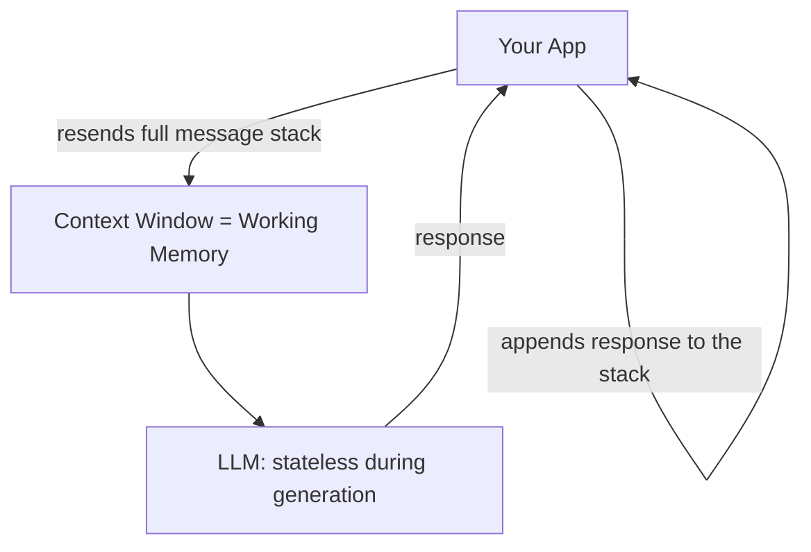
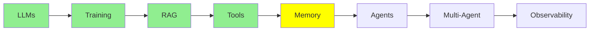

# Memory

Before we get to agents, here is one idea that sits quietly under everything so far: an LLM does not remember anything on its own. And "memory" is not one thing. There are three kinds. They live in different places, and they behave in completely different ways.

## Three Types of Memory

- **Parametric memory** (offline, permanent): knowledge that training or fine-tuning stores inside the model's weights.
- **Short-term memory**, also called **working memory** (online, temporary): all the text that is inside the LLM's context window right now.
- **Long-term memory** (online, temporary): a summary or index of past conversations and documents. It is stored outside the model. When it is needed, it is retrieved back into working memory.

Let's go through each one.

## Parametric Memory

Remember [Training LLMs](training.md), where we trained and fine-tuned models? Say you fine-tune a model on a large set of legal documents. That information is then stored permanently inside the model's weights (its parameters).

- **Permanent**: it does not disappear when the session ends. You also do not need to send it again on every call. It is just *in* the model.
- **Imprecise at scale**: the problem is that a model's weights hold a very large amount of information, from billions of documents. When you push your one document in among all of that, it becomes hard for the model to memorize it and retrieve it *exactly*.

Think of it like a person who has read 1,000 books. They know in general what those books were about. But ask them to quote page 214 of book #537 word for word, and they will struggle. The information is in there somewhere, but they cannot retrieve it precisely.

## Working Memory

It is useful to call this memory what it really is: **working memory**. It is the memory that the LLM is actively "working with" at this exact moment. That is the text inside its context window right now.

Compare it to the person-with-1000-books analogy. Working memory is like that same person, but now they have *one specific book open right in front of their eyes*. They do not need to recall anything from a vague memory of everything they have ever read. They can just read it. That is why LLMs do so much better with working memory than with parametric memory. The information is not buried among billions of other documents. It is right there in front of them.

**The problem**: working memory is limited in size (for example, 200K or 1M tokens), and it can fill up. And when you start a new session (a new Claude Code or ChatGPT conversation), it is gone. Every new session starts with a completely empty context window. This is because the LLM keeps no state of its own between sessions.

### An LLM is Stateless During Generation

This is an important distinction: LLMs are stateless **during generation**. (Training is different. Training is a one-time process, and it produces parametric memory.) "During generation" means every time the model replies to you. During that time, the model saves nothing on its own. Technically, every single message you send is a new and independent call to the LLM, as if it were a new session. This is because the LLM itself keeps no state of the conversation.

So why does it feel like a continuous conversation? Because *we* fake it. We keep a growing stack of every message exchanged so far. Something new happens each time you send a message or the LLM generates a reply. Every time, we add that new message to the stack. Then, on the next call, we send the **entire stack** back to the LLM.

  
*This stack is working memory. You write a message, and the model writes one back. Nothing is ever removed. On the second turn, the model reads everything from the first turn again. This is because we send this whole container on every single call.*

Notice that every call sends the *whole* stack, not only the newest message. This is because the LLM remembers nothing from the previous call on its own. So "memory" here is really only this: we show it everything again, every single time.

  
*Short-term (working) memory is just this growing stack of Human and AI messages. Long-term memory is a separate store. The stack is saved into this store and retrieved from it, across sessions. The labels "Checkpointer" and "Store" come from the LangGraph framework. Other frameworks use different names for the same idea.*

## Long-term Memory

We go much deeper into this later, in the Expert track's [Advanced Memory](../3_expert/advanced_memory.md) module. For now, here is the basic idea.

Sometimes we do not let working memory disappear when a session ends. Instead, we save a summary or an index of it somewhere outside the model. Later, in a completely different session, we can pull that saved information back into working memory when it is needed. We often use [RAG](rag.md) to do this.

**Example**: say you upload 5 PDFs to ChatGPT in one session. Later, you start a brand-new session and ask a question about those PDFs. ChatGPT may still answer. This is not because the model "remembers" them in its weights (parametric memory). It is also not because they are in the new session's context window (working memory), which is empty. It is because ChatGPT indexed those PDFs during the earlier session. Now that you ask about them again, it can retrieve the relevant parts back into context.

## Side-by-side Comparison

| | Parametric | Working (Short-Term) | Long-Term |
|---|---|---|---|
| Stored in | Model weights | Context window | External storage (DB, vector store, files) |
| Persistence | Permanent | Temporary, gone when the session ends or the context fills up | Persists across sessions |
| Precision | Fuzzy: hard to recall exactly among billions of documents | Very precise: the LLM reads it directly | Precise once retrieved back into context |
| Created by | [Training / fine-tuning](training.md) | A growing stack of messages | Explicit save + retrieval, often with [RAG](rag.md) |
| Analogy | Someone who has read 1,000 books | Someone reading a book open right in front of them | Someone's own notes, looked up later |

The main point: **the LLM itself has no memory of its own. Parametric memory is what training stored in its weights. Working memory is what your app is showing it right now. Long-term memory is what your app saves and brings back later.**

## Where this fits in the series

## Summary

There are three kinds of memory, and you cannot use one in place of another. **Parametric memory** is permanent, and training puts it into the weights. But it is fuzzy, because your data is mixed in with billions of other documents. **Working memory** is precise but temporary: it is just a growing stack of messages that we send again on every call. **Long-term memory** is saved outside the model and retrieved back into working memory when needed, often with RAG. Next come agents. They depend on this same working memory to plan and act across many steps.

**Quick Check**: What are the three types of memory? Why is parametric memory imprecise even though it is permanent? Why do we call short-term memory "working memory"? How does information from long-term memory get back into the LLM's context?

## References

- [The three memory types every LLM developer must know](https://medium.com/@sahilnanga4/the-three-memory-types-every-llm-developer-must-know-3358c26fdff3): the same split, seen from a different angle
- [RAG & Embeddings](rag.md): how long-term memory gets retrieved back into working memory
- [Advanced Memory](../3_expert/advanced_memory.md): where this goes next
