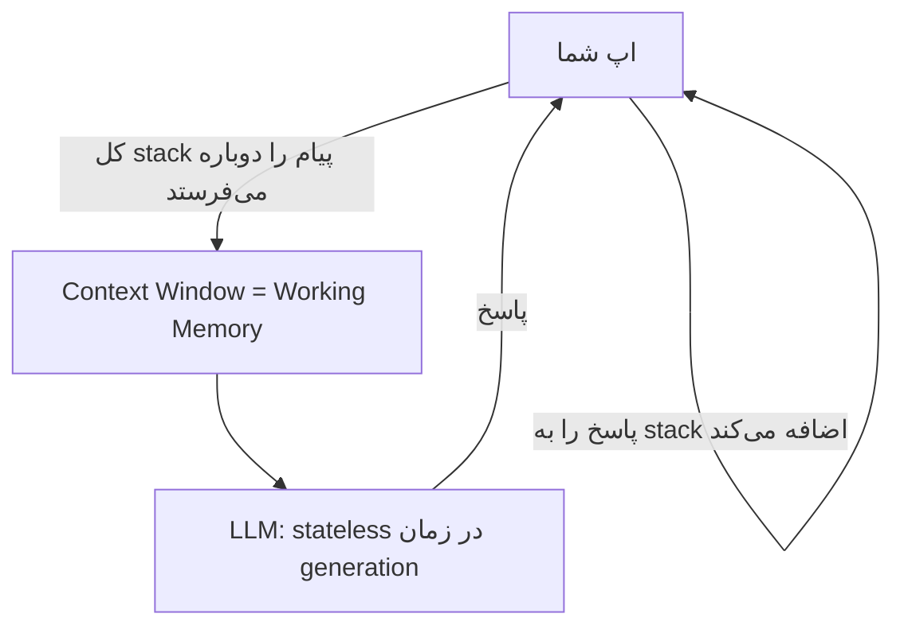
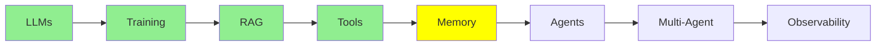

# Memory

پیش از رسیدن به Agent‌ها، بیایید با هم یک ایده را ببینیم. این ایده بی‌صدا زیر همه چیزهایی است که تاکنون گفته‌ایم: یک LLM به خودی خود چیزی را به یاد ندارد. و «memory» یک چیز واحد نیست. سه نوع دارد. آن‌ها در جاهای مختلفی قرار دارند و رفتارشان کاملاً با هم فرق دارد.

## سه نوع Memory

- **Parametric memory** (offline، دائمی): دانشی که training یا fine-tuning درون weight‌های مدل ذخیره می‌کند.
- **Short-term memory**، که به آن **working memory** هم می‌گویند (online، موقت): تمام متنی که هم‌اکنون درون context window مربوط به LLM قرار دارد.
- **Long-term memory** (online، موقت): یک خلاصه یا index از گفتگوها و سندهای گذشته. این‌ها بیرون از مدل ذخیره می‌شوند. وقتی لازم شوند، دوباره به working memory retrieve می‌شوند.

حالا هر کدام را جداگانه بررسی کنیم.

## Parametric Memory

یادتان هست در [Training LLMs](training_fa.md) مدل‌ها را training و fine-tune کردیم؟ فرض کنید یک مدل را روی مجموعه بزرگی از سندهای حقوقی fine-tune می‌کنید. پس از آن، آن اطلاعات به‌طور دائمی درون weight‌های مدل (parameter‌های آن) ذخیره می‌شود.

- **دائمی**: با پایان یافتن session از بین نمی‌رود. لازم هم نیست در هر call دوباره آن را بفرستید. این اطلاعات فقط *درون* مدل است.
- **نادقیق در مقیاس بزرگ**: مشکل این است که weight‌های یک مدل مقدار خیلی زیادی اطلاعات دارند، از میلیاردها سند. وقتی سند شما را میان همه آن‌ها قرار می‌دهید، برای مدل سخت می‌شود که آن را حفظ کند و *دقیقاً* retrieve کند.

این موضوع را مثل آدمی در نظر بگیرید که 1,000 کتاب خوانده است. او به‌طور کلی می‌داند آن کتاب‌ها درباره چه بوده‌اند. اما اگر از او بخواهید صفحه 214 کتاب #537 را کلمه به کلمه نقل کند، دچار مشکل می‌شود. اطلاعات جایی در ذهنش هست، اما او نمی‌تواند آن را دقیقاً retrieve کند.

## Working Memory

بهتر است این memory را با اسم واقعی‌اش صدا بزنیم: **working memory**. این همان memory‌ای است که LLM در همین لحظه فعالانه با آن «کار می‌کند». یعنی همان متنی که هم‌اکنون درون context window آن است.

آن را با تشبیه «آدمی با 1,000 کتاب» مقایسه کنید. Working memory مثل همان آدم است، با این تفاوت که حالا *یک کتاب مشخص را درست جلوی چشمش باز* دارد. او دیگر لازم نیست چیزی را از یک خاطره مبهم از همه کتاب‌هایی که خوانده به یاد بیاورد. فقط می‌تواند همان کتاب را بخواند. به همین دلیل LLM‌ها با working memory خیلی بهتر از parametric memory کار می‌کنند. اطلاعات زیر میلیاردها سند دیگر دفن نشده است. درست جلوی آن‌هاست.

**مشکل**: اندازه working memory محدود است (مثلاً 200K یا 1M token) و ممکن است پر شود. وقتی یک session جدید را شروع می‌کنید (یک گفتگوی تازه در Claude Code یا ChatGPT)، working memory از بین می‌رود. هر session جدید با یک context window کاملاً خالی شروع می‌شود. دلیلش این است که LLM بین session‌ها هیچ state‌ای از خودش نگه نمی‌دارد.

### LLM در زمان Generation، Stateless است

این تفاوت مهمی است: LLM‌ها **در زمان generation** stateless هستند. (Training فرق دارد. Training یک فرآیند یک‌باره است و parametric memory را تولید می‌کند.) «در زمان generation» یعنی هر بار که مدل به شما پاسخ می‌دهد. در آن مدت، مدل خودش چیزی ذخیره نمی‌کند. از نظر فنی، هر پیامی که می‌فرستید یک call تازه و مستقل به LLM است، درست مثل یک session جدید. دلیلش این است که خود LLM هیچ state‌ای از گفتگو نگه نمی‌دارد.

پس چرا گفتگو مثل یک مکالمه پیوسته به نظر می‌رسد؟ چون *ما* این را وانمود می‌کنیم. ما یک stack در حال رشد از همه پیام‌هایی را نگه می‌داریم که تاکنون رد و بدل شده‌اند. هر بار که شما پیامی می‌فرستید یا LLM پاسخی تولید می‌کند، یک چیز تازه پیش می‌آید. هر بار آن پیام تازه را به stack اضافه می‌کنیم. سپس در call بعدی، **کل stack** را دوباره به LLM می‌فرستیم.

  
*این stack همان working memory است. شما یک پیام می‌نویسید و مدل هم یکی در جوابش می‌نویسد. هیچ چیزی هرگز حذف نمی‌شود. در نوبت دوم، مدل دوباره همه چیزهای نوبت اول را می‌خواند. دلیلش این است که ما این container کامل را در هر call می‌فرستیم.*

دقت کنید که هر call کل stack را می‌فرستد، نه فقط جدیدترین پیام. دلیلش این است که LLM از call قبلی به خودی خود چیزی به یاد ندارد. پس «memory» در اینجا واقعاً فقط همین است: ما هر بار همه چیز را دوباره به مدل نشان می‌دهیم.

  
*Short-term (working) memory فقط همین stack در حال رشد از پیام‌های Human و AI است. Long-term memory یک store جداگانه است. stack در طول session‌ها در این store ذخیره می‌شود و بین session‌ها از آن retrieve می‌شود. برچسب‌های «Checkpointer» و «Store» از framework مربوط به LangGraph آمده‌اند. framework‌های دیگر برای همین ایده، اسم‌های دیگری به کار می‌برند.*

## Long-term Memory

این موضوع را بعداً در ماژول [Advanced Memory](../3_expert/advanced_memory.md) از مسیر Expert، خیلی عمیق‌تر بررسی می‌کنیم. فعلاً ایده اصلی را ببینیم.

گاهی اجازه نمی‌دهیم working memory وقتی session تمام می‌شود از بین برود. به‌جایش، یک خلاصه یا index از آن را جایی بیرون از مدل ذخیره می‌کنیم. بعدها، در یک session کاملاً متفاوت، وقتی لازم شد می‌توانیم آن اطلاعات ذخیره‌شده را دوباره به working memory برگردانیم. برای این کار اغلب از [RAG و Embedding‌ها](rag_fa.md) استفاده می‌کنیم.

**مثال**: فرض کنید در یک session، 5 فایل PDF را در ChatGPT upload می‌کنید. بعد یک session کاملاً تازه شروع می‌کنید و درباره آن PDF‌ها سؤال می‌پرسید. ChatGPT ممکن است همچنان جواب بدهد. این به این خاطر نیست که مدل آن‌ها را در weight‌هایش «به یاد دارد» (parametric memory). این هم به این خاطر نیست که آن‌ها در context window مربوط به session جدید هستند (working memory)، چون آن context window خالی است. دلیلش این است که ChatGPT آن PDF‌ها را در session قبلی index کرده بود. حالا که دوباره درباره آن‌ها سؤال می‌کنید، می‌تواند بخش‌های مرتبط را دوباره به context retrieve کند.

## مقایسه کنار هم

| | Parametric | Working (Short-Term) | Long-Term |
|---|---|---|---|
| محل ذخیره | Model weight‌ها | Context window | ذخیره‌سازی بیرونی (DB، vector store، فایل‌ها) |
| ماندگاری | دائمی | موقت، با پایان session یا پر شدن context از بین می‌رود | بین session‌ها باقی می‌ماند |
| دقت | مبهم: سخت است که از میان میلیاردها سند دقیقاً به یاد آورده شود | خیلی دقیق: LLM مستقیماً آن را می‌خواند | دقیق، وقتی دوباره به context retrieve شود |
| ساخته می‌شود با | [Training LLMs](training_fa.md) / fine-tuning | یک stack در حال رشد از پیام‌ها | ذخیره صریح + retrieval، اغلب با [RAG و Embedding‌ها](rag_fa.md) |
| تشبیه | کسی که 1,000 کتاب خوانده | کسی که یک کتاب را درست جلوی چشمش باز دارد و می‌خواند | یادداشت‌های خودِ آدم که بعداً به آن‌ها نگاه می‌کند |

نکته اصلی این است: **خود LLM هیچ memory‌ای از خودش ندارد. Parametric memory همان چیزی است که training در weight‌هایش ذخیره کرده است. Working memory همان چیزی است که اپ شما هم‌اکنون به آن نشان می‌دهد. Long-term memory همان چیزی است که اپ شما ذخیره می‌کند و بعداً برمی‌گرداند.**

## کجای این مجموعه هستیم

## خلاصه

سه نوع memory وجود دارد و نمی‌توانید یکی را به جای دیگری به کار ببرید. **Parametric memory** دائمی است، اما در مقیاس بزرگ مبهم است و training آن را درون weight‌ها قرار می‌دهد. **Working memory** دقیق است، اما موقت است: فقط یک stack در حال رشد از پیام‌هاست که در هر call دوباره برای مدل فرستاده می‌شود. **Long-term memory** بیرون از مدل ذخیره می‌شود و وقتی لازم شد دوباره به working memory برگردانده می‌شود، اغلب با RAG. بعد نوبت Agent‌ها می‌رسد. آن‌ها برای برنامه‌ریزی و انجام کار در چند گام، به همین working memory وابسته‌اند.

**بررسی سریع**: سه نوع memory کدام‌اند؟ چرا parametric memory با وجود دائمی بودن، نادقیق است؟ چرا به short-term memory می‌گوییم «working memory»؟ اطلاعات long-term memory چطور دوباره به context مربوط به LLM برمی‌گردد؟

## منابع

- [The three memory types every LLM developer must know](https://medium.com/@sahilnanga4/the-three-memory-types-every-llm-developer-must-know-3358c26fdff3): همان تقسیم‌بندی، از زاویه‌ای دیگر
- [RAG و Embedding‌ها](rag_fa.md): چطور long-term memory دوباره به working memory برگردانده می‌شود
- [Advanced Memory](../3_expert/advanced_memory.md): ادامه این بحث کجاست
