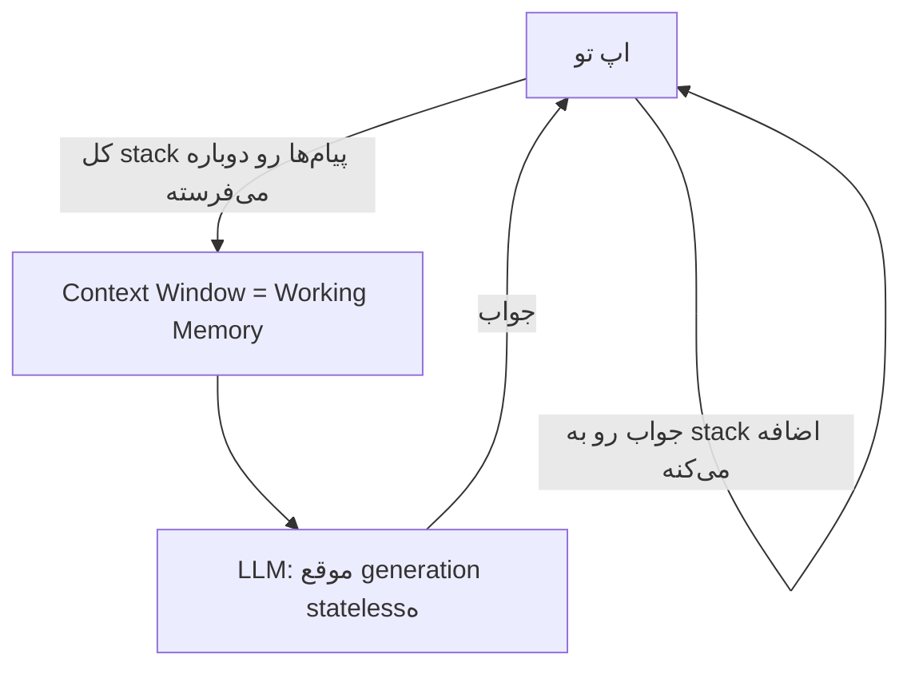
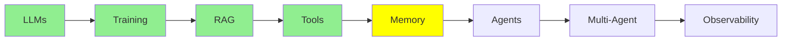

# Memory

قبل از این‌که بریم سراغ agent‌ها، یه نکته هست که تا این‌جا بی‌سر و صدا پشت همه‌ی حرف‌هامون بوده: LLM خودش هیچی یادش نمی‌مونه. تازه وقتی می‌گیم «memory»، منظورمون یه چیز نیست؛ سه جور memory داریم که هر کدوم یه جای جدا نگه داشته می‌شن و رفتارشون هم هیچ شباهتی به هم نداره.

## سه نوع memory

- **Parametric memory** (آفلاین، دائمی): اطلاعاتی که training یا fine-tuning توی weight‌های مدل ذخیره می‌کنه.
- **Short-term memory**، که بهش **working memory** هم می‌گن (آنلاین، موقت): کل متنی که همین الان توی context window مدل هست.
- **Long-term memory** (آنلاین، موقت): یه خلاصه یا index از گفتگوها و سندهای قبلی که بیرون از مدل ذخیره می‌شه و هر وقت لازم بشه، دوباره برگردونده می‌شه توی working memory.

حالا بریم سراغ تک‌تکشون.

## Parametric Memory

یادته توی [Training LLMs](training_fa.md) مدل‌ها رو train و fine-tune کردیم؟ فرض کن یه مدل رو روی یه عالمه سند حقوقی fine-tune کنی؛ اون اطلاعات از اون به بعد برای همیشه توی weight‌های مدل، یعنی parameter‌هاش، می‌مونه.

- **دائمیه**: با تموم شدن session پاک نمی‌شه و لازم هم نیست با هر call دوباره بفرستیش؛ همین‌جوری *توی* خود مدله.
- **وقتی حجم بالا بره، دقیق نیست**: مشکل اینه که weight‌های مدل حجم خیلی زیادی اطلاعات از میلیاردها سند رو توی خودشون دارن، و وقتی سند تو هم بره وسط این همه، برای مدل سخت می‌شه که حفظش کنه و *مو به مو* دوباره بیرونش بکشه.

مثل آدمیه که هزار تا کتاب خونده: کلیات این‌که هر کتاب درباره‌ی چی بوده رو می‌دونه، ولی اگه ازش بخوای صفحه‌ی 214 کتاب شماره‌ی 537 رو کلمه به کلمه نقل کنه، می‌مونه. اطلاعات یه جایی توی ذهنش هست، ولی نمی‌تونه دقیق پیداش کنه.

## Working Memory

بهتره این memory رو با اسم واقعیش صدا بزنیم: **working memory**، یعنی حافظه‌ای که LLM همین لحظه داره باهاش «کار می‌کنه»؛ همون متنی که الان توی context window‌ش هست.

برگردیم سراغ همون آدمی که هزار تا کتاب خونده. working memory یعنی همون آدم، با این فرق که حالا *یه کتاب مشخص درست جلوی چشمش بازه*. دیگه لازم نیست از خاطره‌ی محوی که از همه‌ی کتاب‌ها داره چیزی رو به یاد بیاره؛ کافیه بخونه. واسه همینه که LLM‌ها با working memory خیلی بهتر از parametric memory کار می‌کنن: اطلاعات زیر میلیاردها سند دیگه دفن نشده، درست جلوی چشمشونه.

**مشکلش اینه**: working memory جای محدودی داره (مثلاً 200K یا 1M token) و ممکنه پر بشه. تازه وقتی یه session جدید باز می‌کنی (یه گفتگوی تازه توی Claude Code یا ChatGPT)، کلاً پاک می‌شه و هر session جدید با یه context window کاملاً خالی شروع می‌شه، چون خود LLM بین session‌ها هیچ state‌ای نگه نمی‌داره.

### LLM موقع Generation، Stateless‌ه

این فرق ظریف ولی مهمیه: LLM‌ها **موقع generation** stateless‌ان، یعنی هیچ حالتی رو پیش خودشون نگه نمی‌دارن. (training حسابش جداست؛ یه فرایند یک‌باره‌ست که parametric memory رو می‌سازه.) «موقع generation» یعنی هر باری که مدل داره بهت جواب می‌ده، و توی این مدت مدل خودش هیچی ذخیره نمی‌کنه. از نظر فنی، هر پیامی که می‌فرستی یه call جدید و مستقل به LLM‌ه، انگار که یه session تازه باشه، چون خود LLM هیچ state‌ای از گفتگو نگه نمی‌داره.

پس چرا حس می‌کنی داری یه گفتگوی پیوسته می‌کنی؟ چون *ما* داریم این توهم رو می‌سازیم. یه stack از همه‌ی پیام‌هایی که تا الان رد و بدل شده نگه می‌داریم که مدام بزرگ‌تر می‌شه: هر بار که تو پیام می‌فرستی یا LLM جواب می‌ده، اون پیام جدید رو به stack اضافه می‌کنیم، و توی call بعدی **کل stack** رو دوباره برای LLM می‌فرستیم.

  
*working memory همین stack‌ه. تو یه پیام می‌نویسی و مدل یکی در جوابت می‌نویسه، و هیچ‌چیز هیچ‌وقت پاک نمی‌شه. توی نوبت دوم، مدل کل نوبت اول رو دوباره می‌خونه، چون ما با هر call کل این ظرف رو می‌فرستیم.*

دقت کن که هر call *کل* stack رو می‌فرسته، نه فقط آخرین پیام رو، چون LLM خودش از call قبلی هیچی یادش نیست. پس «memory» این‌جا در واقع یعنی فقط همین: هر بار همه‌چیز رو از اول جلوش می‌ذاریم.

  
*short-term memory (همون working memory) چیزی نیست جز همین stack پیام‌های Human و AI که مدام بزرگ‌تر می‌شه. long-term memory یه store جداست که stack توش ذخیره می‌شه و توی session‌های بعدی ازش بیرون کشیده می‌شه. برچسب‌های «Checkpointer» و «Store» مال framework‌ای به اسم LangGraph‌ان؛ framework‌های دیگه همین ایده رو با اسم‌های دیگه‌ای صدا می‌زنن.*

## Long-term Memory

بعداً توی بخش Expert و درس [Advanced Memory](../3_expert/advanced_memory.md) خیلی مفصل‌تر سراغش می‌ریم؛ فعلاً ایده‌ی اصلیش رو ببینیم.

گاهی نمی‌ذاریم working memory با تموم شدن session از بین بره و یه خلاصه یا index ازش رو یه جایی بیرون از مدل ذخیره می‌کنیم. بعداً، توی یه session کاملاً جدا، هر وقت لازم شد اون اطلاعات ذخیره‌شده رو دوباره می‌کشیم توی working memory. برای این کار معمولاً سراغ RAG می‌ریم که توی [RAG و Embedding‌ها](rag_fa.md) دیدیمش.

**یه مثال**: فرض کن توی یه session، 5 تا PDF توی ChatGPT آپلود می‌کنی. بعد یه session کاملاً جدید باز می‌کنی و یه سوال درباره‌ی همون PDF‌ها می‌پرسی، و ChatGPT ممکنه باز هم جوابت رو بده. دلیلش این نیست که مدل اون‌ها رو توی weight‌هاش «یادشه» (parametric memory)، این هم نیست که توی context window این session جدیدن (working memory)، چون اون context window خالیه. دلیلش اینه که ChatGPT توی session قبلی اون PDF‌ها رو index کرده و حالا که دوباره درباره‌شون می‌پرسی، می‌تونه تیکه‌های مربوط رو برگردونه توی context.

## مقایسه‌ی کنار هم

| | Parametric | Working (Short-Term) | Long-Term |
|---|---|---|---|
| کجا ذخیره می‌شه | weight‌های مدل | context window | storage بیرونی (DB، vector store، فایل) |
| چقدر می‌مونه | دائمی | موقت؛ با تموم شدن session یا پر شدن context از بین می‌ره | بین session‌ها می‌مونه |
| دقت | محو: به یاد آوردن دقیقش بین میلیاردها سند سخته | خیلی دقیق: LLM مستقیم می‌خونه‌ش | دقیق، به شرطی که برگرده توی context |
| از کجا میاد | [Training LLMs](training_fa.md) / fine-tuning | یه stack پیام که مدام بزرگ‌تر می‌شه | ذخیره و retrieval صریح، معمولاً با [RAG و Embedding‌ها](rag_fa.md) |
| تشبیه | آدمی که هزار تا کتاب خونده | آدمی که یه کتاب باز جلوی چشمشه | یادداشت‌های خود آدم که بعداً سراغشون می‌ره |

حرف اصلی این بخش: **خود LLM هیچ memory‌ای از خودش نداره. parametric memory چیزیه که training توی weight‌هاش گذاشته، working memory چیزیه که اپ تو همین الان جلوش گذاشته، و long-term memory چیزیه که اپ تو ذخیره می‌کنه و بعداً برمی‌گردونه.**

## کجای این مجموعه هستیم

## خلاصه

سه جور memory داریم و هیچ‌کدوم جای اون یکی‌ها رو نمی‌گیره. **parametric memory** رو training توی weight‌ها می‌ذاره؛ دائمیه، ولی دقیق نیست، چون داده‌ی تو بین میلیاردها سند دیگه قاطی شده. **working memory** دقیقه ولی موقت، و در اصل همون stack پیام‌هاست که مدام بزرگ‌تر می‌شه و با هر call از نو فرستاده می‌شه. **long-term memory** بیرون از مدل ذخیره می‌شه و هر وقت لازم شد، معمولاً با RAG، برمی‌گرده توی working memory. بعدی نوبت agent‌هاست، که برای برنامه‌ریزی و کار کردن توی چند مرحله، به همین working memory تکیه دارن.

**بررسی سریع**: سه نوع memory چی‌ان؟ چرا parametric memory با این‌که دائمیه، دقیق نیست؟ چرا به short-term memory می‌گیم «working memory»؟ و اطلاعات long-term memory چطور دوباره به context مدل برمی‌گرده؟

## منابع

- [The three memory types every LLM developer must know](https://medium.com/@sahilnanga4/the-three-memory-types-every-llm-developer-must-know-3358c26fdff3): همین تقسیم‌بندی، از یه زاویه‌ی دیگه
- [RAG و Embedding‌ها](rag_fa.md): این‌که long-term memory چطور برمی‌گرده توی working memory
- [Advanced Memory](../3_expert/advanced_memory.md): ادامه‌ی این بحث
