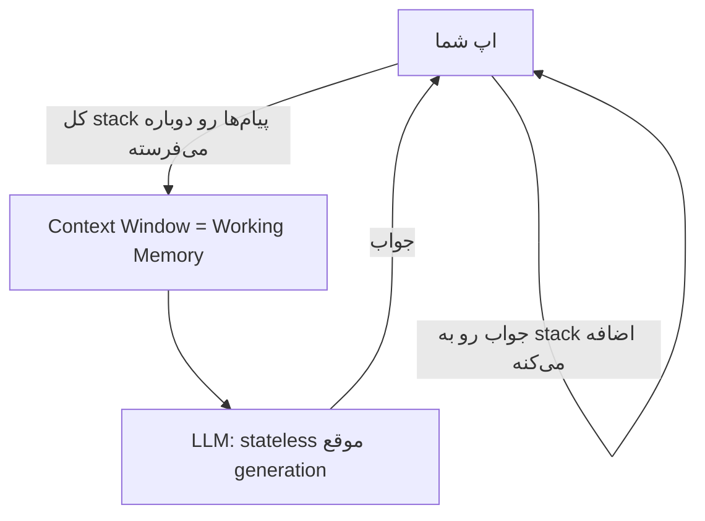
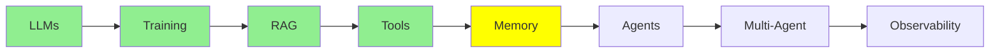

# Memory

یه نکته هست که تا اینجای کار زیر همه‌ی حرف‌هامون بوده، ولی هیچ‌وقت مستقیم بهش اشاره نکردیم: LLM خودش به‌تنهایی هیچی به یاد نمی‌آره. تازه، وقتی می‌گیم «memory»، منظورمون یه چیز واحد نیست. سه نوع memory داریم که هر کدوم توی یه جای جدا زندگی می‌کنن و رفتارشون هم کاملاً با هم فرق داره.

## سه نوع memory

- **Parametric memory** (آفلاین، دائمی): دانشی که training یا fine-tuning داخل weight‌های مدل ذخیره می‌کنه.
- **Short-term memory**، که بهش **working memory** هم می‌گن (آنلاین، موقت): همه‌ی متنی که الان داخل context window مدل قرار داره.
- **Long-term memory** (آنلاین، موقت): یه خلاصه یا index از گفتگوها و سندهای قبلی. این‌ها بیرون از مدل ذخیره می‌شن و وقتی لازم بشن، دوباره به working memory برگردونده می‌شن.

بیاین یکی‌یکی بررسی‌شون کنیم.

## Parametric Memory

یادته [Training LLMs](training_fa.md) رو که توش مدل‌ها رو train و fine-tune کردیم؟ فرض کن یه مدل رو روی یه مجموعه‌ی بزرگ از سندهای حقوقی fine-tune کردی. اون اطلاعات بعدش برای همیشه داخل weight‌های مدل ذخیره می‌شه، یعنی توی parameter‌هاش.

- **دائمی**: با تموم شدن session پاک نمی‌شه و لازم هم نیست توی هر call دوباره بفرستیش. اصلاً همین‌طوری *توی* خود مدله.
- **نادقیق در مقیاس بزرگ**: مشکل اینجاست که weight‌های یه مدل، اطلاعات میلیاردها سند رو با هم نگه می‌دارن. وقتی سند تو هم وسط این همه سند بیفته، برای مدل سخت می‌شه که اون رو حفظ کنه و *دقیقاً* دوباره بیرون بکشه.

بیا یه تشبیه بزنیم. یه آدم رو تصور کن که هزار تا کتاب خونده. کلی‌کلی می‌دونه اون کتاب‌ها درباره‌ی چی بودن. ولی اگه ازش بخوای صفحه‌ی 214 کتاب #537 رو کلمه‌به‌کلمه نقل کنه، گیر می‌کنه. اطلاعات یه جایی توی ذهنشه، ولی نمی‌تونه دقیق بیرونش بکشه.

## Working Memory

بهتره اسم واقعی این نوع memory رو بذاریم: **working memory**. این همون چیزیه که LLM همین لحظه فعالانه داره باهاش کار می‌کنه، یعنی متنی که الان داخل context window اونه.

همون تشبیه آدمی که هزار تا کتاب خونده رو برداریم. working memory مثل همون آدمه، با این تفاوت که این بار یه کتاب مشخص رو درست جلوی چشمش باز کرده. دیگه لازم نیست از یه خاطره‌ی مبهم از همه‌ی کتاب‌هایی که خونده، چیزی رو بازسازی کنه؛ فقط می‌تونه همون کتاب رو بخونه. برای همین LLMها با working memory خیلی بهتر کار می‌کنن تا با parametric memory. اطلاعات زیر میلیاردها سند دیگه گم نشده، درست جلوی چشم خودشه.

**مشکل اینجاست**: working memory اندازه‌ی محدودی داره (مثلاً 200K یا 1M token) و ممکنه پر بشه. از اون طرف، وقتی یه session جدید شروع می‌کنی (مثلاً یه گفتگوی تازه توی Claude Code یا ChatGPT)، این memory از بین می‌ره. هر session جدید با یه context window کاملاً خالی شروع می‌شه، چون LLM بین session‌ها هیچ state‌ای از خودش نگه نمی‌داره.

### LLM موقع Generation Stateless هست

این فرق مهمه که LLMها **موقع generation** stateless هستن. (training فرق داره، چون یه فرایند یک‌باره‌ست که parametric memory رو می‌سازه.) منظور از «موقع generation» اینه که هر بار مدل داره بهت جواب می‌ده، و توی همون لحظه خودش هم چیزی ذخیره نمی‌کنه. از نظر فنی، هر پیامی که می‌فرستی یه call جدید و مستقل به LLM حساب می‌شه، انگار یه session تازه باشه. دلیلش هم اینه که خود LLM هیچ state‌ای از گفتگو نگه نمی‌داره.

پس چرا حس می‌کنی یه گفتگوی پیوسته‌ست؟ چون *ما* داریم اون رو شبیه‌سازی می‌کنیم. یه stack در حال رشد از همه‌ی پیام‌هایی که تا الان رد و بدل شدن نگه می‌داریم. هر بار که تو پیامی می‌فرستی یا مدل جوابی می‌ده، یه پیام تازه ساخته می‌شه و ما اون رو به stack اضافه می‌کنیم. بعد توی call بعدی، کل **stack** رو دوباره برای LLM می‌فرستیم.

  
*این stack همون working memory هست. تو یه پیام می‌نویسی و مدل هم جواب می‌ده. چیزی هم هیچ‌وقت حذف نمی‌شه. توی نوبت دوم، مدل دوباره همه‌ی حرف‌های نوبت اول رو می‌خونه، چون ما توی هر call کل این ظرف رو می‌فرستیم.*

یه نکته رو خوب توجه کن: هر call *کل* stack رو می‌فرسته، نه فقط جدیدترین پیام. دلیلش اینه که LLM از call قبلی خودش چیزی به یاد نداره. پس «memory» توی این‌جا در واقع فقط همین کاره: هر بار همه‌چیز رو دوباره بهش نشون می‌دیم.

  
*Short-term memory، یعنی همون working memory، فقط همین stack در حال رشد از پیام‌های Human و AI هست. Long-term memory یه store جداست. stack توی این store ذخیره می‌شه و بین session‌ها دوباره ازش برداشته می‌شه. برچسب‌های «Checkpointer» و «Store» از فریم‌ورک LangGraph میان. فریم‌ورک‌های دیگه برای همین ایده، اسم‌های دیگه‌ای دارن.*

## Long-term Memory

بعداً توی بخش Expert، توی ماژول [Advanced Memory](../3_expert/advanced_memory.md) خیلی عمیق‌تر سراغش می‌ریم. فعلاً همون ایده‌ی پایه کافیه.

گاهی نمی‌ذاریم working memory وقتی session تموم می‌شه از بین بره. به‌جاش یه خلاصه یا یه index ازش رو بیرون از مدل ذخیره می‌کنیم. بعداً، توی یه session کاملاً دیگه، هر وقت لازم شد، می‌تونیم اون اطلاعات ذخیره‌شده رو دوباره به working memory برگردونیم. معمولاً برای این کار از [RAG و Embedding‌ها](rag_fa.md) استفاده می‌کنیم.

**مثال**: فرض کن توی یه session، 5 تا PDF رو توی ChatGPT آپلود می‌کنی. بعد یه session کاملاً تازه شروع می‌کنی و یه سؤال درباره‌ی اون PDF‌ها می‌پرسی. ChatGPT ممکنه بازم جواب بده. این نه به خاطر اینه که مدل اون‌ها رو توی weight‌هاش «به یاد داره» (parametric memory)، و نه به خاطر اینه که اون‌ها هنوز توی context window این session جدید هستن (working memory)؛ اون context window از اول خالیه. دلیلش اینه که ChatGPT اون PDF‌ها رو توی session قبلی index کرده. حالا که دوباره درباره‌شون می‌پرسی، می‌تونه بخش‌های مرتبط رو دوباره به context برگردونه.

## مقایسه‌ی کنار هم

| | Parametric | Working (Short-Term) | Long-Term |
|---|---|---|---|
| ذخیره می‌شه توی | weight‌های مدل | Context window | storage بیرونی (DB، vector store، فایل‌ها) |
| ماندگاری | دائمی | موقت؛ با تموم شدن session یا پر شدن context از بین می‌ره | بین session‌ها باقی می‌مونه |
| دقت | مبهم: پیدا کردن دقیق یه سند بین میلیاردها سند سخته | خیلی دقیق: LLM مستقیم می‌خونه‌ش | دقیق، بعد از اینکه دوباره به context برگردونده بشه |
| ساخته می‌شه با | [Training LLMs](training_fa.md) / fine-tuning | یه stack در حال رشد از پیام‌ها | ذخیره‌ی صریح + retrieval، که معمولاً با [RAG و Embedding‌ها](rag_fa.md) انجام می‌شه |
| تشبیه | آدمی که هزار تا کتاب خونده | آدمی که یه کتاب رو جلوی چشمش باز داره | یادداشت‌های خود آدم، که بعداً دنبالشون می‌گرده |

نکته‌ی اصلی اینه: **خود LLM هیچ memory‌ای از خودش نداره. Parametric memory همون چیزیه که training توی weight‌هاش ذخیره کرده. Working memory همون چیزیه که اپ همین الان بهش نشون می‌ده. Long-term memory همون چیزیه که اپ ذخیره می‌کنه و بعداً برمی‌گردونه.**

## کجای این مجموعه هستیم

## خلاصه

سه نوع memory داریم و نمی‌شه یکی رو به جای اون یکی گذاشت. **Parametric memory** دائمیه، ولی در مقیاس بزرگ مبهمه و training اون رو توی weight‌ها می‌ذاره. **Working memory** دقیقه، ولی موقته؛ در واقع فقط یه stack در حال رشد از پیام‌هاست که توی هر call دوباره فرستاده می‌شه. **Long-term memory** بیرون از مدل ذخیره می‌شه و وقتی لازم شد دوباره به working memory برمی‌گرده، که معمولاً با RAG انجام می‌شه. قدم بعدی agent‌هاست، و اون‌ها برای برنامه‌ریزی و عمل کردن توی چند مرحله، به همین working memory تکیه می‌کنن.

**بررسی سریع**: سه نوع memory چیه؟ چرا parametric memory با اینکه دائمیه، نادقیقه؟ چرا به short-term memory می‌گیم «working memory»؟ اطلاعات از long-term memory چطوری دوباره وارد context مدل می‌شه؟

## منابع

- [The three memory types every LLM developer must know](https://medium.com/@sahilnanga4/the-three-memory-types-every-llm-developer-must-know-3358c26fdff3): همون تقسیم‌بندی، ولی از یه زاویه‌ی دیگه
- [RAG و Embedding‌ها](rag_fa.md): این‌که long-term memory چطوری دوباره به working memory برمی‌گرده
- [Advanced Memory](../3_expert/advanced_memory.md): ادامه‌ی این بحث کجاست
