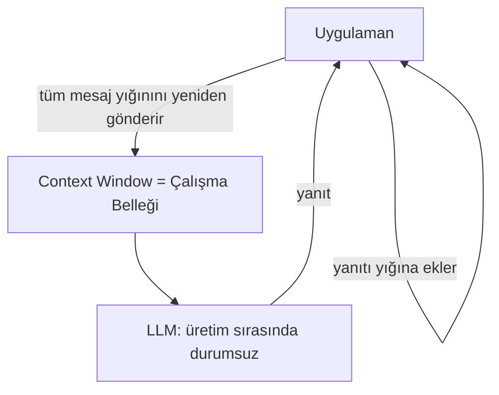
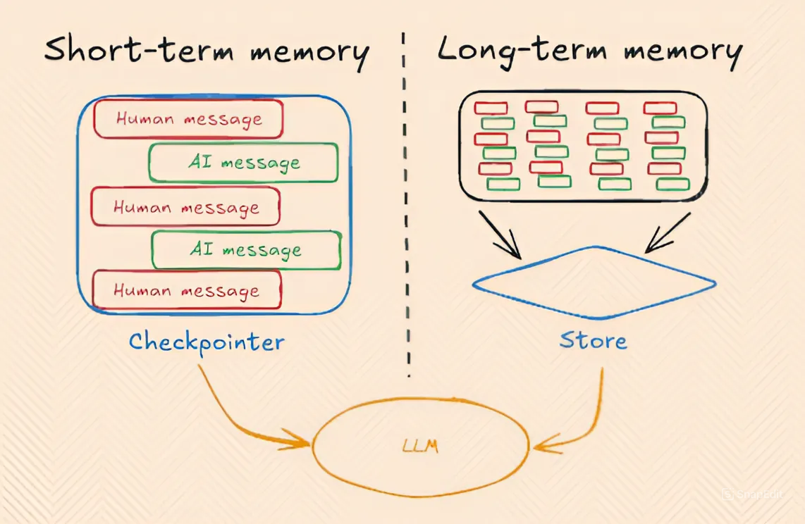
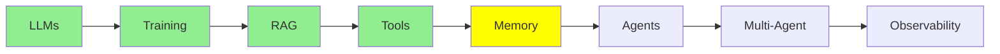

# Memory

Agent'lara geçmeden önce, şimdiye kadar anlattığımız her şeyin altında sessizce duran bir fikre bakalım: bir LLM kendi başına hiçbir şey hatırlamaz. Ayrıca "bellek" dediğimiz şey de tek bir şey değildir. Üç türü vardır ve bunlar farklı yerlerde yaşar, birbirinden tamamen farklı davranır.

## Üç Bellek Türü

- **Parametrik bellek** (parametric memory; çevrimdışı, kalıcı): Eğitimin ya da fine-tuning'in modelin ağırlıklarına (weights) kaydettiği bilgidir.
- **Kısa süreli bellek** (short-term memory), diğer adıyla **çalışma belleği** (working memory; çevrimiçi, geçici): LLM'in context window'unda o anda bulunan bütün metindir.
- **Uzun süreli bellek** (long-term memory; çevrimiçi, geçici): Geçmiş konuşmaların ve dokümanların bir özeti ya da indeksidir. Modelin dışında saklanır ve gerektiğinde çalışma belleğine geri getirilir.

Şimdi her birine tek tek bakalım.

## Parametrik Bellek

[Training LLMs](training_tr.md) modülünde modelleri nasıl eğittiğimizi ve fine-tune ettiğimizi hatırlıyor musun? Diyelim ki bir modeli büyük bir hukuk dokümanı kümesi üzerinde fine-tune ettin. Bu bilgi artık modelin ağırlıklarında (parametrelerinde) kalıcı olarak saklanır.

- **Kalıcıdır**: Oturum bittiğinde kaybolmaz ve her çağrıda yeniden göndermen de gerekmez, çünkü bilgi zaten modelin *içinde* durur.
- **Ölçek büyüdükçe bulanıklaşır**: Bir modelin ağırlıkları milyarlarca dokümandan gelen çok büyük miktarda bilgiyi taşır. Senin tek dokümanını bu devasa bilginin arasına koyduğunda, modelin onu *tam olarak* ezberleyip geri çağırması zorlaşır.

Bunu şöyle düşün: 1,000 kitap okumuş bir insan, bu kitapların genel olarak ne hakkında olduğunu bilir. Ama ondan #537 numaralı kitabın 214. sayfasını kelimesi kelimesine aktarmasını istersen zorlanır. Bilgi onun kafasında bir yerdedir, ama bunu tam olarak geri çağıramaz.

## Çalışma Belleği

Bu belleğe asıl adıyla, **çalışma belleği** (working memory) demek daha doğru olur. Bu, LLM'in tam şu anda aktif olarak "üzerinde çalıştığı" bellektir, yani context window'unun içindeki metin.

Daha önce gördüğümüz 1,000 kitaplı insan benzetmesine dönelim. Çalışma belleği, aynı insanın gözünün önüne tek bir kitabın açılmış olması gibidir. Artık okudukları her şeyin bulanık bir anısından bir şey hatırlamaya çalışmaları gerekmez, kitabı sadece okuyabilirler. LLM'lerin parametrik bellekle değil de çalışma belleğiyle çok daha iyi sonuç vermesinin nedeni budur. Bilgi milyarlarca başka doküman arasına gömülü değildir, tam gözlerinin önündedir.

**Sorun**: Çalışma belleğinin boyutu sınırlıdır (örneğin 200K ya da 1M token) ve dolabilir. Yeni bir oturum açtığında, yani yeni bir Claude Code ya da ChatGPT konuşması başlattığında, bu bellek tamamen gider. Her yeni oturum, tamamen boş bir context window ile başlar. Bunun nedeni, LLM'in oturumlar arasında kendi durumunu hiçbir şekilde tutmamasıdır.

### Bir LLM Üretim Sırasında Durumsuzdur

Bu ayrım önemli: LLM'ler **üretim sırasında** (generation) durumsuzdur (stateless). Eğitim ise başka bir şeydir: tek seferlik bir süreçtir ve parametrik belleği üretir. Üretim sırasında derken, model sana her cevap verdiği anı kastediyoruz. O süre boyunca model kendi başına hiçbir şey kaydetmez. Teknik olarak, gönderdiğin her mesaj, sanki yeni bir oturummuş gibi, LLM'e yapılan yeni ve bağımsız bir çağrıdır. Bunun nedeni, LLM'in kendisinin konuşmanın hiçbir durumunu tutmamasıdır.

Peki neden yine de sürekli bir konuşma gibi hissettiriyor? Cevap şu: bu sürekliliği aslında biz taklit ediyoruz. Şu ana kadar değiş tokuş edilen her mesajın büyüyen bir yığınını (stack) tutarız. Sen bir mesaj gönderdiğinde ya da LLM bir cevap ürettiğinde yeni bir şey olur ve biz bunu her seferinde yığına ekleriz. Bir sonraki çağrıda ise bütün yığını baştan modele geri göndeririz.

  
*Bu yığın çalışma belleğidir: sen bir mesaj yazarsın, model de bir mesajla karşılık verir. Hiçbir şey asla çıkarılmaz, bu yüzden ikinci turda model birinci turdaki her şeyi yeniden okur. Çünkü her çağrıda bu bütün yığını modele yeniden gönderiyoruz.*

Her çağrının yalnızca en yeni mesajı değil, *bütün* yığını gönderdiğine dikkat et. Bunun nedeni, LLM'in önceki çağrıdan kendi başına hiçbir şey hatırlamamasıdır. Yani buradaki "bellek" aslında yalnızca şudur: modele her seferinde her şeyi baştan gösteriyoruz.

  
*Kısa süreli (çalışma) bellek, büyüyen Human ve AI mesajlarından oluşan bir yığından başka bir şey değildir. Uzun süreli bellek ise ayrı bir depodur. Yığın bu depoya kaydedilir ve oturumlar arasında oradan geri alınır. "Checkpointer" ve "Store" etiketleri LangGraph framework'ünden gelir. Diğer framework'ler aynı fikre farklı adlar verir.*

## Uzun Süreli Bellek

Bunu daha sonra, Expert track'teki [İleri Seviye Hafıza](../3_expert/advanced_memory_tr.md) modülünde çok daha derinlemesine inceleyeceğiz, ama şimdilik temel fikre bakmak yeterli.

Bazen çalışma belleğinin oturum bitince yok olmasına izin vermeyiz. Bunun yerine onun bir özetini ya da indeksini modelin dışında bir yere kaydederiz. Daha sonra, tamamen farklı bir oturumda, bu bilgiyi gerektiğinde çalışma belleğine geri alabiliriz. Bunu yapmak için çoğu zaman [RAG](rag_tr.md) kullanırız.

**Örnek**: Diyelim ki bir oturumda ChatGPT'ye 5 PDF yükledin. Sonra yepyeni bir oturum açıp bu PDF'lerle ilgili bir soru sorduğunda ChatGPT yine de cevap verebilir. Bunun nedeni modelin PDF'leri ağırlıklarında "hatırlaması" değildir (parametrik bellek). Yeni oturumun context window'unda olmaları da değildir (çalışma belleği), çünkü o pencere boştur. Asıl neden, ChatGPT'nin PDF'leri önceki oturumda indekslemiş olmasıdır. Şimdi sen tekrar sorduğun için, ilgili kısımları geri alıp context'e koyabilir.

## Yan Yana Karşılaştırma

| | Parametrik | Çalışma (Kısa Süreli) | Uzun Süreli |
|---|---|---|---|
| Nerede tutulur | Model ağırlıkları | Context window | Harici depolama (veritabanı, vector store, dosyalar) |
| Kalıcılık | Kalıcı | Geçici: oturum biter ya da context dolarsa kaybolur | Oturumlar arasında kalır |
| Hassasiyet | Bulanık: milyarlarca doküman arasında tam olarak hatırlamak zordur | Çok hassas: LLM onu doğrudan okur | Context'e geri alındıktan sonra hassas |
| Nasıl oluşur | [Training LLMs](training_tr.md) (eğitim ve fine-tuning) | Büyüyen bir mesaj yığını | Açık kayıt ve geri getirme, çoğu zaman [RAG](rag_tr.md) ile |
| Benzetme | 1,000 kitap okumuş biri | Önünde açık duran bir kitabı okuyan biri | Kendi notlarına sonradan bakan biri |

Asıl önemli nokta şu: **LLM'in kendisinin bir belleği yoktur. Parametrik bellek, eğitimin ağırlıklara yazdığı şeydir. Çalışma belleği, uygulamanın modele o anda gösterdiği şeydir. Uzun süreli bellek ise uygulamanın kaydedip daha sonra geri getirdiği şeydir.**

## Bu serinin neresindeyiz

## Özet

Üç tür bellek vardır ve birini diğerinin yerine kullanamazsın. **Parametrik bellek** kalıcıdır ama ölçek büyüdükçe bulanıklaşır. Bunu eğitim, modelin ağırlıklarına yazar. **Çalışma belleği** kesindir ama geçicidir: her çağrıda yeniden gönderdiğimiz büyüyen bir mesaj yığınından başka bir şey değildir. **Uzun süreli bellek** modelin dışında saklanır ve gerektiğinde, çoğu zaman [RAG](rag_tr.md) ile, çalışma belleğine geri getirilir. Sıradaki konu agent'lar: onlar, birçok adım boyunca plan yapıp eylem almak için bu aynı çalışma belleğine dayanır.

**Hızlı Kontrol**: Üç bellek türü nedir? Parametrik bellek kalıcı olmasına rağmen neden kesin değildir? Kısa süreli belleğe neden "çalışma belleği" diyoruz? Uzun süreli bellekteki bilgi LLM'in context'ine nasıl geri döner?

## Kaynaklar

- [The three memory types every LLM developer must know](https://medium.com/@sahilnanga4/the-three-memory-types-every-llm-developer-must-know-3358c26fdff3): aynı üçlü ayrım, bu kez farklı bir açıdan
- [Retrieval-Augmented Generation (RAG)](rag_tr.md): uzun süreli belleğin çalışma belleğine nasıl geri getirildiğini anlatır
- [İleri Seviye Hafıza](../3_expert/advanced_memory_tr.md): bu konunun devamı
