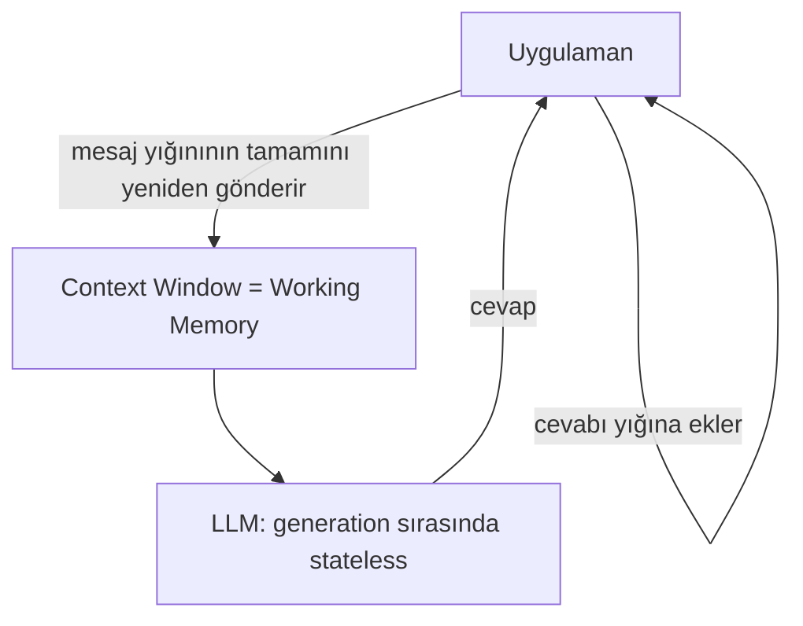
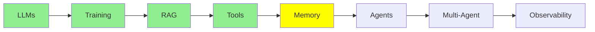

# Memory

Agent'lara geçmeden önce, buraya kadar anlattığımız her şeyin altında sessizce duran bir fikir var:
bir LLM kendi başına hiçbir şey hatırlamıyor. Ve "memory" tek bir şey değil. Üç türü var. Farklı
yerlerde duruyorlar ve birbirlerine hiç benzemiyorlar.

## Üç Tür Memory

- **Parametric memory** (offline, kalıcı): training ya da fine-tuning sırasında modelin
  weight'lerine gömülmüş bilgi.
- **Short-term memory**, diğer adıyla **working memory** (online, geçici): şu anda LLM'in context
  window'unun içinde duran her şey.
- **Long-term memory** (online, geçici): geçmiş konuşmaların ve dokümanların bir özeti ya da
  index'i. Modelin dışında saklanıyor. Gerektiğinde working memory'ye geri getiriliyor.

Sırayla bakalım.

## Parametric Memory

[Training LLMs](training_tr.md) modülünü hatırla: orada modelleri eğittik ve fine-tune ettik.
Diyelim bir modeli çok sayıda hukuki dokümanla fine-tune ettin. O bilgi modelin weight'lerinin
(parameter'larının) içinde kalıcı olarak saklanıyor.

- **Kalıcı**: session bittiğinde kaybolmuyor. Her çağrıda yeniden göndermen de gerekmiyor. Zaten
  modelin *içinde*.
- **Ölçekte belirsiz**: sorun şu ki bir modelin weight'leri çok büyük miktarda bilgi tutuyor,
  milyarlarca dokümandan gelen bilgi. Senin tek dokümanını bunların arasına eklediğinde, modelin onu
  *tam olarak* ezberleyip geri getirmesi zorlaşıyor.

Bunu 1.000 kitap okumuş bir insan gibi düşün. O kitapların genel olarak neyle ilgili olduğunu bilir.
Ama ondan 537 numaralı kitabın 214. sayfasını kelime kelime alıntılamasını istersen zorlanır. Bilgi
bir yerlerde var, ama onu tam olarak geri getiremez.

## Working Memory

Bu memory'ye gerçek adını vermek işe yarar: **working memory**. Bu, LLM'in tam bu anda aktif olarak
"üzerinde çalıştığı" memory. Yani şu anda context window'unun içinde duran metin.

1.000 kitap analojisiyle karşılaştır. Working memory, aynı insanın *tam gözlerinin önünde açık
duran belirli bir kitabı* olması gibi. Okuduğu her şeyin bulanık hatırasından bir şey çıkarması
gerekmiyor. Doğrudan okuyabiliyor. LLM'lerin working memory ile parametric memory'ye göre çok daha
iyi iş çıkarmasının sebebi bu. Bilgi milyarlarca başka dokümanın arasına gömülü değil. Tam
önlerinde duruyor.

**Ama bir sorun var**: working memory'nin boyutu sınırlı (mesela 200K ya da 1M token) ve dolabiliyor.
Ve yeni bir session başlattığında (yeni bir Claude Code ya da ChatGPT konuşması), working memory
gidiyor. Her yeni session tamamen boş bir context window ile başlıyor. Bunun sebebi, LLM'in
session'lar arasında kendine ait hiçbir state tutmaması.

### Bir LLM Generation Sırasında Stateless

Bu önemli bir ayrım: LLM'ler **generation sırasında** stateless. (Training farklı bir şey. Training
tek seferlik bir süreç ve parametric memory'yi o üretiyor.) "Generation sırasında", model sana her
cevap verdiğinde demek. Bu sırada model kendi başına hiçbir şey kaydetmiyor. Teknik olarak
gönderdiğin her mesaj yepyeni ve bağımsız bir LLM çağrısı, sanki yeni bir session gibi. Bunun
sebebi, LLM'in konuşmanın state'ini kendisi tutmaması.

O zaman neden kesintisiz bir konuşma gibi geliyor? Çünkü *biz* öyle gösteriyoruz. O ana kadar gidip
gelen her mesajı büyüyen bir yığında tutuyoruz. Sen bir mesaj gönderdiğinde ya da LLM bir cevap
ürettiğinde yeni bir şey olmuş oluyor. Her seferinde bu yeni mesajı yığına ekliyoruz. Sonra, bir
sonraki çağrıda, **yığının tamamını** LLM'e geri gönderiyoruz.

  
*Bu yığın working memory'nin kendisi. Sen bir mesaj yazıyorsun, model de bir tane geri yazıyor. Hiçbir şey silinmiyor. İkinci turda model birinci turdaki her şeyi yeniden okuyor. Çünkü her çağrıda bu container'ın tamamını gönderiyoruz.*

Dikkat et: her çağrı yığının *tamamını* gönderiyor, sadece en yeni mesajı değil. Çünkü LLM önceki
çağrıdan kendi başına hiçbir şey hatırlamıyor. Yani buradaki "memory" gerçekte sadece şu: ona her
seferinde her şeyi yeniden gösteriyoruz.

  
*Short-term (working) memory, Human ve AI mesajlarının bu büyüyen yığını. Long-term memory ise ayrı bir store. Yığın, session'lar arasında bu store'a kaydediliyor ve oradan geri getiriliyor. "Checkpointer" ve "Store" etiketleri LangGraph framework'ünden geliyor. Başka framework'ler aynı fikir için başka isimler kullanıyor.*

## Long-term Memory

Bu konuya daha sonra, Expert track'teki [İleri Seviye Memory](../3_expert/advanced_memory_tr.md)
modülünde çok daha derinlemesine gireceğiz. Şimdilik temel fikir şu.

Bazen working memory'nin session bittiğinde yok olmasına izin vermiyoruz. Bunun yerine, onun bir
özetini ya da index'ini modelin dışında bir yere kaydediyoruz. Daha sonra, tamamen farklı bir
session'da, bu kayıtlı bilgiyi ihtiyaç olduğunda working memory'ye geri çekebiliyoruz. Bunu genelde
[RAG](rag_tr.md) ile yapıyoruz.

**Örnek**: diyelim bir session'da ChatGPT'ye 5 PDF yükledin. Daha sonra yepyeni bir session başlatıp
o PDF'ler hakkında bir soru sordun. ChatGPT yine cevaplayabilir. Bunun sebebi, modelin onları
weight'lerinde "hatırlaması" değil (parametric memory). Yeni session'ın context window'unda duruyor
olmaları da değil (working memory), çünkü o context window boş. Sebep şu: ChatGPT o PDF'leri önceki
session sırasında index'ledi. Şimdi onlar hakkında soru sorduğunda, ilgili parçaları context'e geri
getirebiliyor.

## Yan Yana Karşılaştırma

| | Parametric | Working (short-term) | Long-term |
|---|---|---|---|
| Nerede saklanıyor | Model weight'leri | Context window | Dış depolama (DB, vector store, dosyalar) |
| Kalıcılık | Kalıcı | Geçici, session bitince ya da context dolunca gidiyor | Session'lar arasında kalıyor |
| Kesinlik | Puslu, milyarlarca doküman arasından tam hatırlamak zor | Çok kesin, LLM doğrudan okuyor | Context'e geri getirildiğinde kesin |
| Nasıl oluşuyor | [Training / fine-tuning](training_tr.md) | Büyüyen bir mesaj yığını | Açık kaydetme + geri getirme, genelde [RAG](rag_tr.md) ile |
| Analoji | 1.000 kitap okumuş biri | Tam önünde açık bir kitap okuyan biri | Birinin sonradan baktığı kendi notları |

Özet olarak: **LLM'in kendine ait bir memory'si yok. Parametric memory, training'in weight'lere
gömdüğü şey. Working memory, uygulamanın ona şu anda gösterdiği şey. Long-term memory ise
uygulamanın kaydedip sonra geri getirdiği şey.**

## Bu serinin neresindeyiz

## Özet

Üç tür memory var ve biri diğerinin yerine geçmiyor. **Parametric memory** kalıcı ama ölçekte
puslu. Onu weight'lere training yerleştiriyor. **Working memory** kesin ama geçici: her çağrıda
yeniden gönderdiğimiz, büyüyen bir mesaj yığınından ibaret. **Long-term memory** modelin dışında
kaydediliyor ve gerektiğinde working memory'ye geri getiriliyor, genelde RAG ile. Sırada agent'lar
var. Çok adımlı plan yapmak ve iş yapmak için tam bu working memory'ye dayanıyorlar.

**Hızlı Kontrol**: üç memory türü nedir? Parametric memory kalıcı olduğu hâlde neden belirsiz?
Short-term memory'ye neden "working memory" diyoruz? Long-term memory'deki bilgi LLM'in context'ine
nasıl geri dönüyor?

## Kaynaklar

- [The three memory types every LLM developer must know](https://medium.com/@sahilnanga4/the-three-memory-types-every-llm-developer-must-know-3358c26fdff3): aynı ayrım, başka bir açıdan
- [RAG](rag_tr.md): long-term memory'nin working memory'ye nasıl geri getirildiği
- [İleri Seviye Memory](../3_expert/advanced_memory_tr.md): bunun devamı
