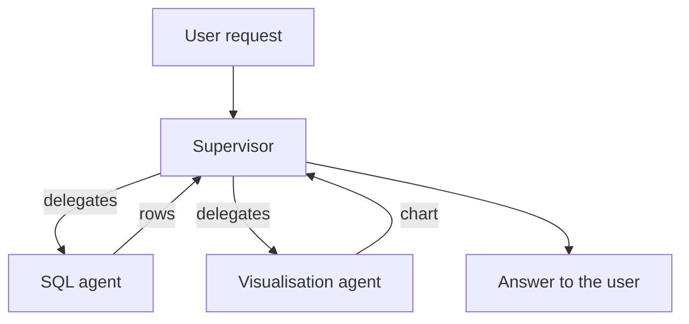
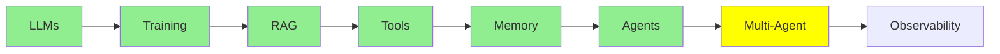

# Multi-Agent Systems

[AI Agents](agents.md) ended with one agent: one loop, one system prompt, one set of tools. This
module is about what happens when you use several agents, and what that costs you.

## Why We Might Need Multi-agents

Take a real request: *"How many rows are in my database tables? Show them in a bar chart."*

That is two different jobs. First you write and run SQL, then you draw a chart. One agent can do
both, but you pay a price for it. The system prompt now has to explain SQL *and* charting, and the
tool list gets longer. Every call also carries instructions that have nothing to do with the
current step. So the model has more ways to pick the wrong tool, and more room to confuse the two
jobs.

If you split the work, each agent gets a short prompt, a small tool list and one job:

- a **SQL agent** that writes and runs queries
- a **visualisation agent** that turns results into charts

Each one is just an agent from [AI Agents](agents.md). Nothing new has been invented. You have
only gone from one loop to several loops.

## Basic Multi-agent Architectures

  
*Left: one agent with its tools. This is where [AI Agents](agents.md) ended. Middle: a network, where every agent can talk to every other agent. Right: a supervisor. It receives the request and delegates the work to workers, and the workers only talk to the supervisor.*

**Supervisor.** One agent receives the request. Then, in this order, it:

- decides which worker should handle the request
- passes the work to that worker
- collects what comes back
- answers the user

Workers talk to the supervisor and to no one else. Our SQL and chart example fits this shape
exactly. The supervisor sends the question to the SQL agent and takes the rows. Then it hands the
rows to the visualisation agent and returns the chart.

You will also see this called manager-worker or orchestrator-worker. It is the same shape.

**Network, sometimes called a swarm.** There is no boss. Every agent can hand work to any other
agent. The agents decide among themselves who does what next. This is more flexible. It is also
much harder to predict, because there is no single place where you can see what the system
decided.



**Start with a supervisor.** It is easier to debug, because every decision passes through one
place. Also, most problems that look like they need a swarm do not need one.

## Multi-agent Drawbacks

This is the part to take seriously, because both problems come *from* splitting the work. A single
agent has neither.

**Coordination.** Who does what, and in what order? How does anyone know that a step is finished?
With one agent, the loop answered these questions. With several agents, something has to decide,
and that decision can be wrong. Two agents can do the same work. An agent can wait for something
that never arrives. A supervisor can keep delegating and never stop. More agents means more ways
to deadlock, or to loop without end.

**Context transfer.** Each agent has its own context: its own message stack. So when the SQL agent
finishes, what exactly does the visualisation agent get? Does it get only the rows? Does it also
get the original question? Does it get the SQL that produced the rows? If you hand over too little,
the second agent works blind. If you hand over everything, you pay for a huge context. You also
bring back the confusion that you split the agents to avoid.

Getting this wrong is the usual reason why a multi-agent system performs *worse* than the single
agent it replaced.

### Shared Context, or Isolated Context

That leads to a choice that sits under every multi-agent design. Do the agents **share** one
context, or does each agent work in its own **isolated** context?

- **Shared:** everyone sees everything. Nothing gets lost in the handover, but the context grows
  fast.
- **Isolated:** each agent sees only what it was handed. This is cheap and focused. But whatever
  you forgot to pass along is simply gone.

Production systems use both. This choice decides almost everything else about the design. The
topic is deep enough to deserve its own discussion, so we come back to it in
[Advanced Multi-Agent](../3_expert/advanced_multiagent.md).

## Advanced Multi-agent Architectures

We name these here so that the words are familiar. We cover all of them later:

- **Hierarchical:** supervisors of supervisors. You use this when one layer is not enough.
- **Agent-as-a-tool:** one agent is given to another agent as if it were a plain tool. This fits
  directly into the mechanism from [Tool Calling](tools.md).
- **Subagents:** an agent starts short-lived helpers, and each helper has its own isolated context.
  The agent then keeps only their results.

## Building a Multi-agent

```python
from smolagents import CodeAgent, tool, InferenceClientModel

@tool
def sql_query(query: str) -> list:
    """Run a SQL query against the application database and return the rows."""
    return db.execute(query).fetchall()

@tool
def visualise(data: list) -> str:
    """Draw a bar chart from rows and return the path to the image."""
    return chart_from(data)

sql_agent = CodeAgent(tools=[sql_query], model=InferenceClientModel(), name="sql",
                      description="Answers questions by querying the database.")
viz_agent = CodeAgent(tools=[visualise], model=InferenceClientModel(), name="viz",
                      description="Draws a chart from rows of data.")

supervisor = CodeAgent(
    tools=[],
    model=InferenceClientModel(),
    managed_agents=[sql_agent, viz_agent],   # the workers it can delegate to
)

supervisor.run("How many rows are in my tables? Show them in a bar chart.")
```

Look at `managed_agents`. You hand the workers to the supervisor in the same way that you handed
tools to the agent in [AI Agents](agents.md). This is because, from the supervisor's point of view,
that is what the workers are: things it can call and get a result from.

## When a Single Agent Might be Better

Multi-agent is not an upgrade. It is a trade. You buy shorter prompts and a clearer separation
between jobs. You pay for them in coordination and context transfer.

Stay with one agent while one prompt still fits comfortably and the tool list is still easy to
manage. Split when a single system prompt tries to teach two unrelated jobs. When you split, split
at the point where the least information has to cross from one agent to the other.

## Where this fits in the series



## Summary

Several agents let each agent keep a short prompt and a single job. The supervisor architecture,
where one agent delegates and collects, is the one to start with.

You inherit two problems. The first is **coordination**: deciding who does what, and when
it is done. The second is **context transfer**: deciding what each agent is handed. Those two are
the whole difficulty. How you answer the second one (shared context or isolated context) shapes
everything else.

That is the core of Fundamentals. You now have the full picture:

- a model that only predicts text
- a context window that is its desk
- retrieval to fill that desk
- tools to let it act
- memory across turns
- a loop that makes it an agent
- several agents when one is not enough

Everything in Intermediate is built on these seven ideas.

**Quick Check**: what are the two hard problems that a multi-agent system creates? And what is the
difference between shared and isolated context?

## References

- [Multi-agent systems](https://docs.langchain.com/oss/python/langchain/multi-agent): the patterns, in more depth
- [LangGraph multi-agent concepts](https://langchain-ai.github.io/langgraph/concepts/multi_agent/): supervisor, network and the rest, with code
- [What is an agent?](https://www.langchain.com/blog/what-is-an-agent): worth reading again here, because a supervisor is a decision about autonomy
- [AI Agents](agents.md): the single loop that all of this is built from
- [Advanced Multi-Agent](../3_expert/advanced_multiagent.md): shared and isolated context, and agent-to-agent protocols
