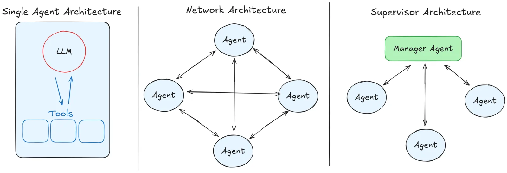
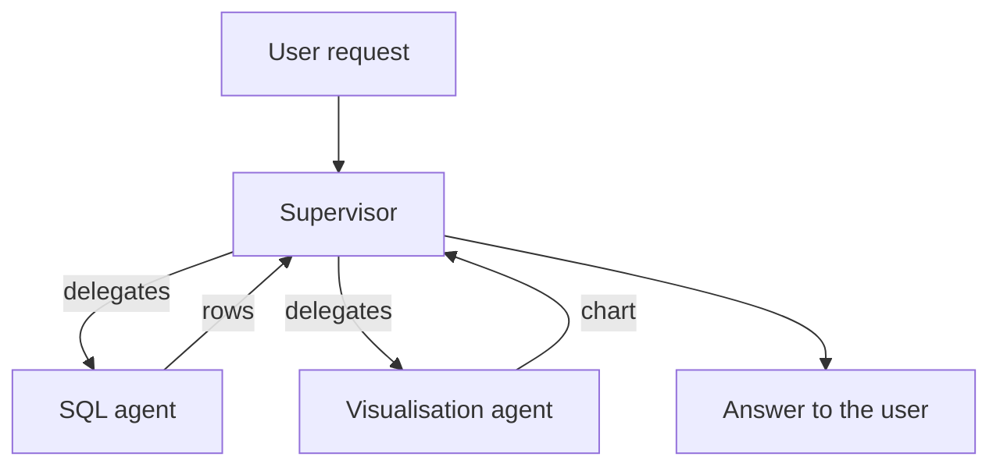
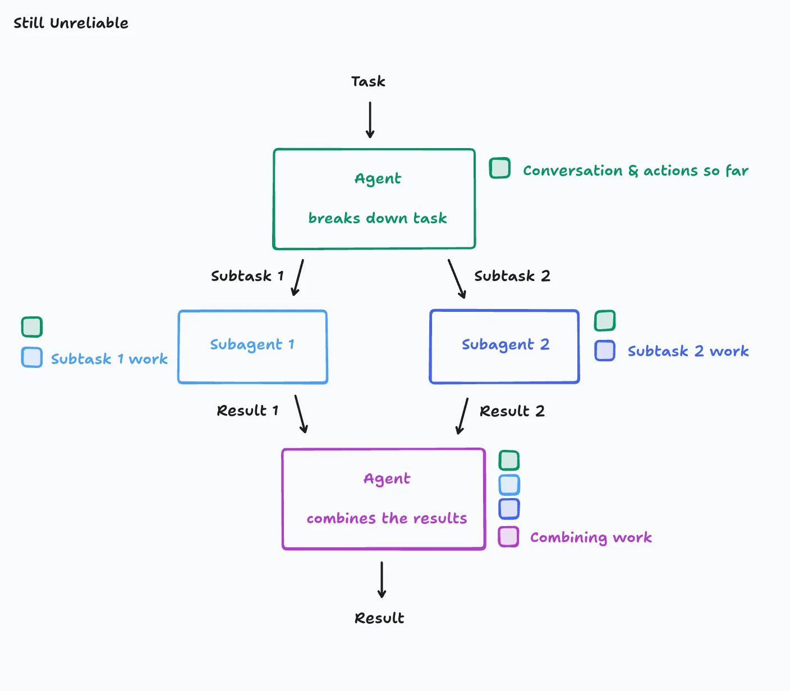
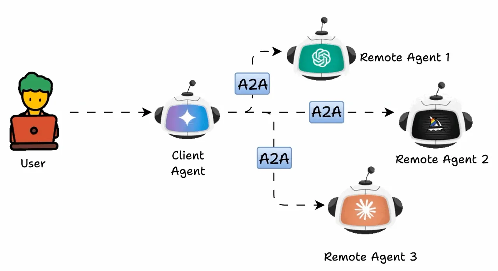
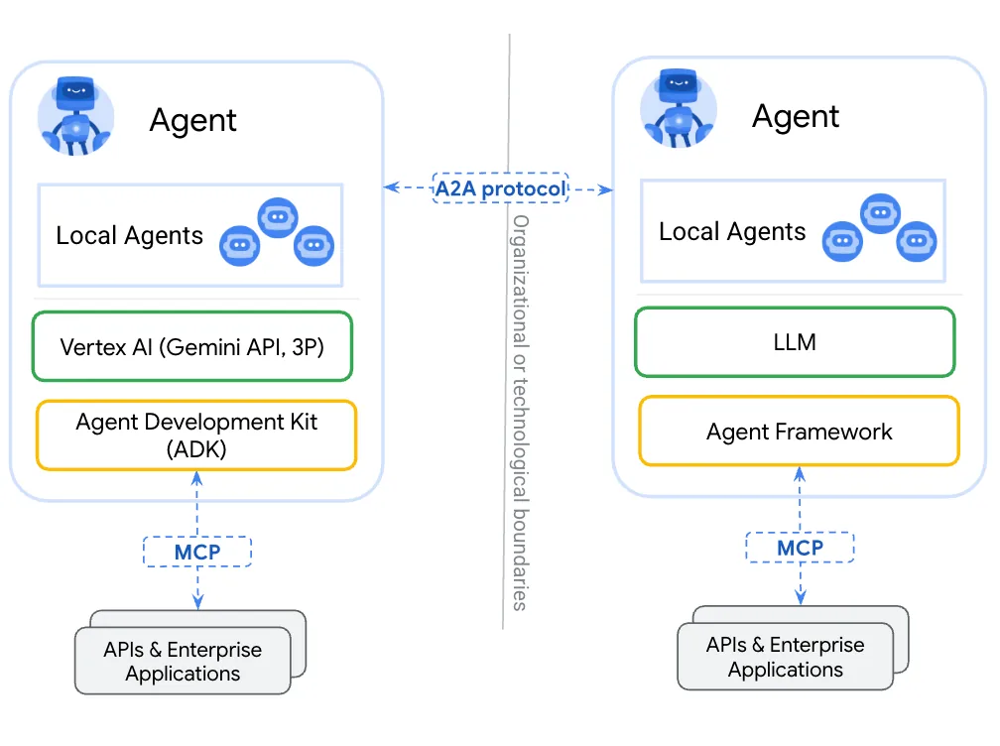
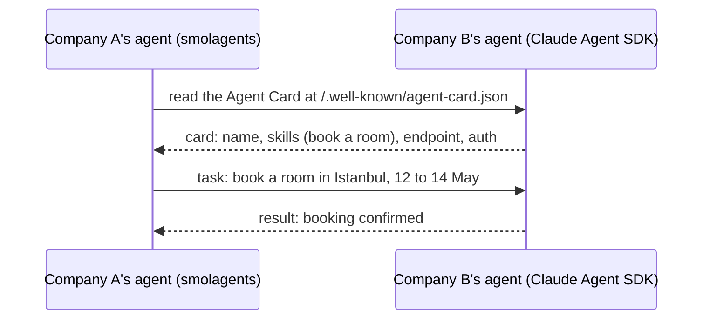
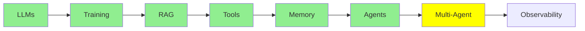

# Multi-Agent Systems

[AI Agents](agents.md) ended with one agent: one loop, one system prompt, one set of tools. This
module is about what happens when you use several agents, and what that costs you.

## Why We Might Need Multi-agents

Take a real request: *"How many rows are in my database tables? Show them in a bar chart."*

That is two different jobs. First you write and run SQL, then you draw a chart. One agent can do
both, but you pay a price for it. The system prompt now has to explain SQL *and* charting, and the
tool list gets longer. Every call also carries instructions that have nothing to do with the
current step. So the model has more ways to pick the wrong tool, and more room to confuse the two
jobs.

If you split the work, each agent gets a short prompt, a small tool list and one job:

- a **SQL agent** that writes and runs queries
- a **visualisation agent** that turns results into charts

Each one is just an agent from [AI Agents](agents.md). Nothing new has been invented. You have
only gone from one loop to several loops.

## Basic Multi-agent Architectures

  
*Left: one agent with its tools. This is where [AI Agents](agents.md) ended. Middle: a network, where every agent can talk to every other agent. Right: a supervisor. It receives the request and delegates the work to workers, and the workers only talk to the supervisor.*

**Supervisor.** One agent receives the request. Then, in this order, it:

- decides which worker should handle the request
- passes the work to that worker
- collects what comes back
- answers the user

Workers talk to the supervisor and to no one else. Our SQL and chart example fits this shape
exactly. The supervisor sends the question to the SQL agent and takes the rows. Then it hands the
rows to the visualisation agent and returns the chart.

You will also see this called manager-worker or orchestrator-worker. It is the same shape.

**Network, sometimes called a swarm.** There is no boss. Every agent can hand work to any other
agent. The agents decide among themselves who does what next. This is more flexible. It is also
much harder to predict, because there is no single place where you can see what the system
decided.



**Start with a supervisor.** It is easier to debug, because every decision passes through one
place. Also, most problems that look like they need a swarm do not need one.

## Multi-agent Drawbacks

This is the part to take seriously, because both problems come *from* splitting the work. A single
agent has neither.

**Coordination.** Who does what, and in what order? How does anyone know that a step is finished?
With one agent, the loop answered these questions. With several agents, something has to decide,
and that decision can be wrong. Two agents can do the same work. An agent can wait for something
that never arrives. A supervisor can keep delegating and never stop. More agents means more ways
to deadlock, which is when agents wait for each other forever. It also means more ways to loop
without end.

Coordination is an advanced topic, and [Advanced Multi-Agent](../3_expert/advanced_multiagent.md) covers
it properly. For now, one basic example shows the problem:

  
*The agent splits a task into two subtasks and runs one subagent for each. Each subagent gets the conversation so far plus its own subtask, and nothing of the other's work. So the two can do the same work twice, or make choices that conflict, and the agent that combines the results finds out only at the end.*

The two subagents are unaware of each other. That is one basic reason why multi-agent systems are
fragile, and sometimes unreliable.

**Context transfer.** Each agent has its own context: its own message stack. So when the SQL agent
finishes, what exactly does the visualisation agent get? Does it get only the rows? Does it also
get the original question? Does it get the SQL that produced the rows? If you hand over too little,
the second agent has to work without information that it needs. If you hand over everything, you pay for a huge context. You also
bring back the confusion that you split the agents to avoid.

Getting this wrong is the usual reason why a multi-agent system performs *worse* than the single
agent it replaced.

### Shared Context, or Isolated Context

That leads to a choice that sits under every multi-agent design. Do the agents **share** one
context, or does each agent work in its own **isolated** context?

- **Shared:** everyone sees everything. Nothing gets lost in the handover, but the context grows
  fast.
- **Isolated:** each agent sees only what it was handed. This is cheap and focused. But whatever
  you forgot to pass along is simply gone.

Production systems use both. This choice decides almost everything else about the design. The
topic is deep enough to deserve its own discussion, so we come back to it in
[Advanced Multi-Agent](../3_expert/advanced_multiagent.md).

## Advanced Multi-agent Architectures

We name these here so that the words are familiar. We cover all of them later:

- **Hierarchical:** a top supervisor manages other supervisors, and each of them manages its own
  workers. You use this when one layer is not enough.
- **Agent-as-a-tool:** one agent is given to another agent as if it were a plain tool. This fits
  directly into the mechanism from [Tool Calling](tools.md).
- **Subagents:** an agent starts short-lived helpers, and each helper has its own isolated context.
  The agent then keeps only their results.

## Building a Multi-agent

```python
from smolagents import CodeAgent, tool, InferenceClientModel

@tool
def sql_query(query: str) -> list:
    """Run a SQL query against the application database and return the rows."""
    return db.execute(query).fetchall()

@tool
def visualise(data: list) -> str:
    """Draw a bar chart from rows and return the path to the image."""
    return chart_from(data)

sql_agent = CodeAgent(tools=[sql_query], model=InferenceClientModel(), name="sql",
                      description="Answers questions by querying the database.")
viz_agent = CodeAgent(tools=[visualise], model=InferenceClientModel(), name="viz",
                      description="Draws a chart from rows of data.")

supervisor = CodeAgent(
    tools=[],
    model=InferenceClientModel(),
    managed_agents=[sql_agent, viz_agent],   # the workers it can delegate to
)

supervisor.run("How many rows are in my tables? Show them in a bar chart.")
```

Look at `managed_agents`. You hand the workers to the supervisor in the same way that you handed
tools to the agent in [AI Agents](agents.md). This is because, from the supervisor's point of view,
that is what the workers are: things it can call and get a result from.

## Agent2Agent Protocol (A2A)

This is a short introduction. The details of the protocol are in
[Protocols Reference](../4_ecosystem/protocols_reference.md).

Look again at the code above. The supervisor and both workers are smolagents agents. That is not an
accident. Agents built with one framework can talk to each other because they share that framework's
API, its message format and its idea of what an agent is. So in practice, every agent in one system
is built with the same framework: all smolagents, all LangChain, or all Claude Agent SDK.

That couples the agents to each other. You cannot build the supervisor with the Claude Agent SDK, two
workers with smolagents and the third worker with LangChain, and expect them to work together. Each
framework speaks its own language, and an agent from another framework does not understand it.

The **Agent2Agent Protocol (A2A)** solves this. It is an open standard that lets agents talk to each
other whatever vendor or framework built them. Google developed it and donated it to the Linux
Foundation, where a steering committee from several large companies now maintains it.

  
*A user talks to one client agent. That agent hands parts of the job to three remote agents, each built by a different vendor, and every handover goes over A2A.*

**How it works.** Every agent publishes an **Agent Card**. Think of it as the agent's CV. It says who
the agent is, what it can do (its **skills**), where to reach it, and how to authenticate. It says
nothing about the framework the agent was built with, because that no longer matters. The agent
serves its card at a standard address, `/.well-known/agent-card.json`, on its own A2A server. Another
agent reads the card, decides whether this agent can help, and then sends it a task, waits for the
result, or talks with it.

```json
{
  "name": "Hotel Booking Agent",
  "description": "Finds and books hotel rooms.",
  "url": "https://agents.hotels.example/a2a",
  "capabilities": { "streaming": true },
  "skills": [
    { "id": "book-room", "name": "Book a room", "description": "Books a room for given dates and city." }
  ]
}
```

That is a simplified card, so you can see the idea. The real one has a few more fields.

Notice how this sits next to MCP from [Tool Calling](tools.md). MCP connects an agent to its
**tools**. A2A connects an agent to **other agents**. The A2A site itself says the two are
complementary, not competitors.

**Do you need it?** Honestly, most of the time you do not, and in a small project almost never. There
is no reason to build each agent of one system with a different framework. If you build all of them
with one framework, they already understand each other.

A2A matters when the agents belong to **different organisations**. Say company A sells flights and
has a flight-booking agent, built with smolagents. Company B sells hotel rooms and has a hotel-booking
agent, built with the Claude Agent SDK. Company A now wants one assistant that books both a flight and
a hotel. The flight part is its own agent. For the hotel part, it depends on company B's agent, and
the two agents cannot talk to each other: different companies, different frameworks, different code.
That is an **inter-organisation barrier**. If company B publishes an Agent Card for its agent,
company A's agent can discover it and ask it to book the hotel.

  
*Two agents on either side of an organisational or technological boundary. Each has its own model, its own framework and its own local agents, and each reaches its own APIs and enterprise apps over MCP. Between the two agents, across the boundary, runs A2A.*



This use case is rare. It mostly shows up in large enterprises, or between teams inside one company
whose agents were built separately, for example an HR agent and a finance agent built with different
frameworks. But it is worth knowing that the barrier exists, and that A2A is the standard answer to it.

## When a Single Agent Might be Better

Multi-agent is not an upgrade. It is a trade. You buy shorter prompts and a clearer separation
between jobs. You pay for them in coordination and context transfer.

Stay with one agent while one prompt still fits comfortably and the tool list is still easy to
manage. Split when a single system prompt tries to teach two unrelated jobs. When you split, split
at the point where the least information has to cross from one agent to the other.

## Key Terms

- **Agent**: one loop, with one system prompt and one set of tools.
- **Multi-agent system**: a system that splits the work across several agents, each with one job.
- **Supervisor**: the agent that gets the request, delegates the work, collects the results and answers the user.
- **Worker**: an agent that a supervisor delegates to. It talks only to its supervisor.
- **Network**: a design with no boss, where any agent can hand work to any other agent. It is also called a swarm.
- **Coordination**: deciding who does what, in what order, and how anyone knows that a step is finished.
- **Deadlock**: a state in which agents wait for each other forever.
- **Subagent**: a short-lived helper that an agent starts. It has its own isolated context, and the agent keeps only its results.
- **Context transfer**: the information that one agent hands to the next.
- **Shared context**: every agent sees everything. Nothing is lost in a handover, but the context grows fast.
- **Isolated context**: each agent sees only what it receives. It is cheap and focused, but whatever the handover omits is gone.
- **Agent2Agent Protocol (A2A)**: an open standard that lets agents talk to each other, whatever framework built them.
- **Agent Card**: an agent's self-description, with its name, skills, address and authentication. The agent serves it at `/.well-known/agent-card.json`.
- **Inter-organisation barrier**: the gap between agents from different companies or frameworks, which cannot talk to each other.

## Where this fits in the series



## Summary

Several agents let each agent keep a short prompt and a single job. The supervisor architecture,
where one agent delegates and collects, is the one to start with.

You inherit two problems. The first is **coordination**: deciding who does what, and when
it is done. The second is **context transfer**: deciding what each agent is handed. Those two are
the whole difficulty. How you answer the second one (shared context or isolated context) shapes
everything else.

Agents from one framework understand each other, and agents from different frameworks do not. **A2A**
is the open standard that lets them talk, through the Agent Card each one publishes. Most projects never
need it; it matters when agents belong to different organisations.

That is the core of Fundamentals. You now have the full picture:

- a model that only predicts text
- a context window that is its desk
- retrieval to fill that desk
- tools to let it act
- memory across turns
- a loop that makes it an agent
- several agents when one is not enough

Everything in Intermediate is built on these seven ideas.

**Quick Check**: what are the two hard problems that a multi-agent system creates? And what is the
difference between shared and isolated context?

## References

### 📄 Articles

- [Announcing the Agent2Agent Protocol (A2A)](https://developers.googleblog.com/en/a2a-a-new-era-of-agent-interoperability/): Google's announcement, April 2025, and why agents from different vendors need a shared protocol
- [Multi-agent systems](https://docs.langchain.com/oss/python/langchain/multi-agent): the patterns, in more depth
- [LangGraph multi-agent concepts](https://langchain-ai.github.io/langgraph/concepts/multi_agent/): supervisor, network and the rest, with code
- [What is an agent?](https://www.langchain.com/blog/what-is-an-agent): worth reading again here, because a supervisor is a decision about autonomy

### 🛠️ Tools

- [A2A Protocol](https://a2a-protocol.org/latest/): the open standard for agents from any framework to talk to each other, and its [agent discovery](https://a2a-protocol.org/latest/topics/agent-discovery/) page on Agent Cards

### 🗃️ Repositories

- [a2aproject/A2A](https://github.com/a2aproject/a2a): the specification and its SDKs

### 🧭 Modules

- [AI Agents](agents.md): the single loop that all of this is built from
- [Advanced Multi-Agent](../3_expert/advanced_multiagent.md): shared and isolated context, and agent-to-agent protocols
- [Protocols Reference](../4_ecosystem/protocols_reference.md): A2A in detail, next to MCP and AG-UI
