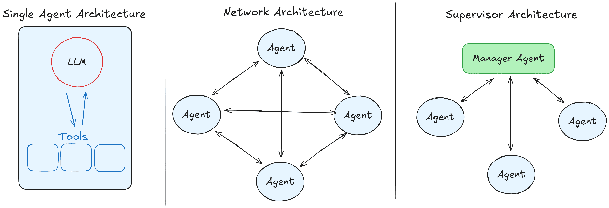
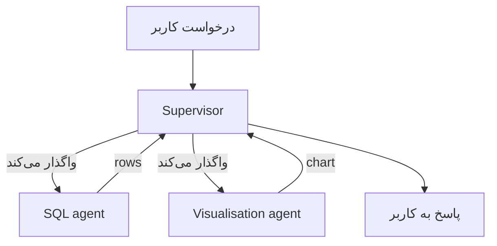
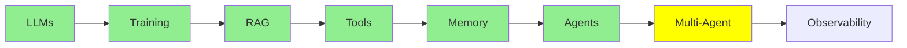

# Multi-Agent Systems

[AI Agents](agents_fa.md) با یک agent تمام شد: یک loop، یک system prompt و یک مجموعه tool. این ماژول درباره‌ی این است که وقتی چند agent را به کار می‌برید چه اتفاقی می‌افتد و این کار چه هزینه‌ای برای شما دارد.

## چرا ممکن است به Multi-agent‌ها نیاز داشته باشیم

یک درخواست واقعی را در نظر بگیرید: *"How many rows are in my database tables? Show them in a bar chart."*

این دو کار متفاوت است. اول SQL می‌نویسید و اجرا می‌کنید، بعد یک chart می‌کشید. یک agent می‌تواند هر دو را انجام دهد، اما برای این کار بهایی می‌پردازید. حالا system prompt باید SQL *و* charting را توضیح دهد، و لیست tool بلندتر می‌شود. هر call هم دستورهایی با خودش می‌آورد که ربطی به مرحله‌ی فعلی ندارند. پس مدل راه‌های بیشتری برای انتخاب tool اشتباه دارد، و فضای بیشتری برای قاطی کردن این دو کار.

اگر کار را تقسیم کنید، هر agent یک prompt کوتاه، یک لیست کوچک از tool‌ها و یک کار دارد:

- یک **SQL agent** که query‌ها را می‌نویسد و اجرا می‌کند
- یک **visualisation agent** که نتیجه‌ها را به chart‌ها تبدیل می‌کند

هر کدام فقط یک agent از [AI Agents](agents_fa.md) است. چیز تازه‌ای اختراع نشده است. شما فقط از یک loop به چند loop رفته‌اید.

## معماری‌های پایه‌ی Multi-agent

  
*چپ: یک agent با tool‌هایش. این‌جا بود که [AI Agents](agents_fa.md) تمام شد. وسط: یک network که در آن هر agent می‌تواند با هر agent دیگری حرف بزند. راست: یک supervisor. درخواست را دریافت می‌کند و کار را به worker‌ها واگذار می‌کند، و worker‌ها فقط با supervisor حرف می‌زنند.*

**Supervisor.** یک agent درخواست را دریافت می‌کند. بعد، به این ترتیب، این کارها را انجام می‌دهد:

- تصمیم می‌گیرد کدام worker باید به درخواست رسیدگی کند
- کار را به همان worker می‌دهد
- هر چه برمی‌گردد جمع می‌کند
- به کاربر پاسخ می‌دهد

worker‌ها فقط با supervisor حرف می‌زنند و با کس دیگری حرف نمی‌زنند. مثال SQL و chart ما دقیقاً با این شکل جور است. supervisor سؤال را به SQL agent می‌فرستد و rows را می‌گیرد. بعد rows را به visualisation agent می‌دهد و chart را برمی‌گرداند.

شما این الگو را با نام‌های manager-worker یا orchestrator-worker هم خواهید دید. شکل آن همان است.

**Network، که گاهی swarm نامیده می‌شود.** هیچ رئیسی وجود ندارد. هر agent می‌تواند کار را به هر agent دیگری بدهد. agent‌ها خودشان بین خودشان تصمیم می‌گیرند که بعد از این، چه کسی چه کاری انجام دهد. این روش انعطاف‌پذیرتر است. پیش‌بینی آن هم خیلی سخت‌تر است، چون جایی واحد وجود ندارد که بتوانید ببینید سیستم چه تصمیمی گرفته است.



**با یک supervisor شروع کنید.** debug کردن آن آسان‌تر است، چون هر تصمیم از یک جا می‌گذرد. همچنین، بیشتر مسئله‌هایی که به نظر می‌رسد به swarm نیاز دارند، اصلاً به آن نیازی ندارند.

## معایب Multi-agent

این بخشی است که باید جدی گرفته شود، چون هر دو مشکل *از* تقسیم کار ناشی می‌شوند. یک agent تنها هیچ‌کدام از این دو را ندارد.

**Coordination.** چه کسی چه کاری می‌کند و به چه ترتیبی؟ چطور کسی می‌فهمد که یک مرحله تمام شده است؟ با یک agent، loop به این پرسش‌ها پاسخ می‌داد. با چند agent، باید چیزی تصمیم بگیرد، و آن تصمیم ممکن است اشتباه باشد. دو agent می‌توانند یک کار را انجام دهند. یک agent می‌تواند منتظر چیزی بماند که هرگز نمی‌رسد. یک supervisor می‌تواند مدام کار واگذار کند و هرگز متوقف نشود. تعداد agent بیشتر یعنی راه‌های بیشتری برای گیر کردن در deadlock یا در یک loop بی‌پایان.

**Context transfer.** هر agent یک context مخصوص خودش دارد: یعنی یک message stack مخصوص خودش. پس وقتی SQL agent کارش تمام می‌شود، دقیقاً چه چیزی به visualisation agent می‌رسد؟ آیا فقط rows را می‌گیرد؟ آیا سؤال اصلی را هم می‌گیرد؟ آیا SQL‌ای را که rows را ساخته هم می‌گیرد؟ اگر خیلی کم تحویل دهید، agent دوم کورکورانه کار می‌کند. اگر همه‌چیز را تحویل دهید، هزینه‌ی یک context خیلی بزرگ را می‌پردازید. همچنین آشفتگی‌ای را که برای دوری از آن agent‌ها را تقسیم کرده بودید، دوباره به سیستم برمی‌گردانید.

اشتباه کردن در این بخش معمولاً دلیلی است که یک سیستم multi-agent *بدتر* از agent تکی‌ای کار می‌کند که جایش را گرفته است.

### Shared Context یا Isolated Context

این ما را به انتخابی می‌رساند که زیر هر طراحی multi-agent قرار دارد. آیا agent‌ها یک context واحد را **share** می‌کنند، یا هر agent در یک context **isolated** (جدا) کار می‌کند؟

- **Shared:** همه همه‌چیز را می‌بینند. در هنگام تحویل چیزی گم نمی‌شود، اما context به سرعت بزرگ می‌شود.
- **Isolated:** هر agent فقط چیزی را می‌بیند که به او داده شده است. این روش ارزان و متمرکز است. اما هر چیزی که یادتان برود منتقل کنید، همان‌جا گم می‌شود.

سیستم‌های production هر دو را به کار می‌برند. این انتخاب تقریباً همه‌ی بقیه‌ی طراحی را تعیین می‌کند. این موضوع آن‌قدر عمیق است که بحث جداگانه‌ای بخواهد، پس در [Advanced Multi-Agent](../3_expert/advanced_multiagent.md) به آن برمی‌گردیم.

## معماری‌های پیشرفته‌ی Multi-agent

این اسم‌ها را این‌جا می‌آوریم تا با آن‌ها آشنا شوید. همه‌ی آن‌ها را بعداً پوشش می‌دهیم:

- **Hierarchical:** supervisor‌های بالای supervisor‌ها. شما این را وقتی به کار می‌برید که یک لایه کافی نباشد.
- **Agent-as-a-tool:** یک agent به agent دیگری داده می‌شود، گویی یک tool ساده است. این دقیقاً با مکانیزمی جور است که در [Tool Calling](tools_fa.md) آمد.
- **Subagents:** یک agent دستیارهای کوتاه‌عمر راه می‌اندازد و هر دستیار context مخصوص خودش را دارد که isolated است. بعد agent فقط نتیجه‌ی آن‌ها را نگه می‌دارد.

## ساختن یک Multi-agent

```python
from smolagents import CodeAgent, tool, InferenceClientModel

@tool
def sql_query(query: str) -> list:
    """Run a SQL query against the application database and return the rows."""
    return db.execute(query).fetchall()

@tool
def visualise(data: list) -> str:
    """Draw a bar chart from rows and return the path to the image."""
    return chart_from(data)

sql_agent = CodeAgent(tools=[sql_query], model=InferenceClientModel(), name="sql",
                      description="Answers questions by querying the database.")
viz_agent = CodeAgent(tools=[visualise], model=InferenceClientModel(), name="viz",
                      description="Draws a chart from rows of data.")

supervisor = CodeAgent(
    tools=[],
    model=InferenceClientModel(),
    managed_agents=[sql_agent, viz_agent],   # the workers it can delegate to
)

supervisor.run("How many rows are in my tables? Show them in a bar chart.")
```

به `managed_agents` نگاه کنید. worker‌ها را به supervisor می‌دهید، همان‌طور که tool‌ها را در [AI Agents](agents_fa.md) به agent داده بودید. دلیلش این است که از دید supervisor، worker‌ها همین‌ها هستند: چیزهایی که supervisor می‌تواند آن‌ها را call کند و از آن‌ها نتیجه بگیرد.

## وقتی یک agent شاید بهتر باشد

Multi-agent یک ارتقا نیست. یک مبادله است. شما prompt‌های کوتاه‌تر و جداسازی روشن‌تری میان کارها به دست می‌آورید. بهایش را با coordination و context transfer می‌پردازید.

تا وقتی که یک prompt هنوز به خوبی جا می‌شود و لیست tool هنوز قابل مدیریت است، با یک agent بمانید. وقتی یک system prompt سعی می‌کند دو کار بی‌ربط را یاد بدهد، تقسیم کنید. وقتی تقسیم می‌کنید، جایی تقسیم کنید که کمترین اطلاعات باید از یک agent به agent دیگر منتقل شود.

## کجای این مجموعه هستیم



## خلاصه

چند agent باعث می‌شود هر agent یک prompt کوتاه و یک کار مشخص داشته باشد. معماری supervisor، که در آن یک agent کار را واگذار می‌کند و نتیجه‌ها را جمع می‌کند، همان است که باید با آن شروع کنید.

شما دو مشکل را به ارث می‌برید. اولی **coordination** است: تصمیم گرفتن درباره‌ی این‌که چه کسی چه کاری کند و این‌که کی کار تمام می‌شود. دومی **context transfer** است: تصمیم گرفتن درباره‌ی این‌که هر agent چه چیزی را تحویل بگیرد. همین دو، کل سختی کار هستند. پاسخی که به دومی می‌دهید (shared context یا isolated context) بقیه‌ی همه‌چیز را شکل می‌دهد.

این هسته‌ی Fundamentals است. حالا تصویر کامل را دارید:

- یک مدل که فقط متن را پیش‌بینی می‌کند
- یک context window که میز کار آن است
- retrieval برای پر کردن آن میز
- tool‌ها تا بتواند عمل کند
- memory در طول نوبت‌ها
- یک loop که آن را به agent تبدیل می‌کند
- چند agent وقتی یکی کافی نیست

هر چیزی در Intermediate روی این هفت ایده ساخته شده است.

**بررسی سریع**: دو مشکل سختی که یک سیستم multi-agent ایجاد می‌کند کدام‌اند؟ و تفاوت بین shared context و isolated context چیست؟

## منابع

- [Multi-agent systems](https://docs.langchain.com/oss/python/langchain/multi-agent): الگوها، با جزئیات بیشتر
- [LangGraph multi-agent concepts](https://langchain-ai.github.io/langgraph/concepts/multi_agent/): supervisor، network و بقیه‌ی الگوها، همراه با کد
- [What is an agent?](https://www.langchain.com/blog/what-is-an-agent): این‌جا ارزش دارد دوباره آن را بخوانید، چون یک supervisor تصمیمی درباره‌ی autonomy است.
- [AI Agents](agents_fa.md): همان loop تکی‌ای که همه‌ی این‌ها از آن ساخته شده‌اند
- [Advanced Multi-Agent](../3_expert/advanced_multiagent.md): shared و isolated context، و پروتکل‌های agent-to-agent
