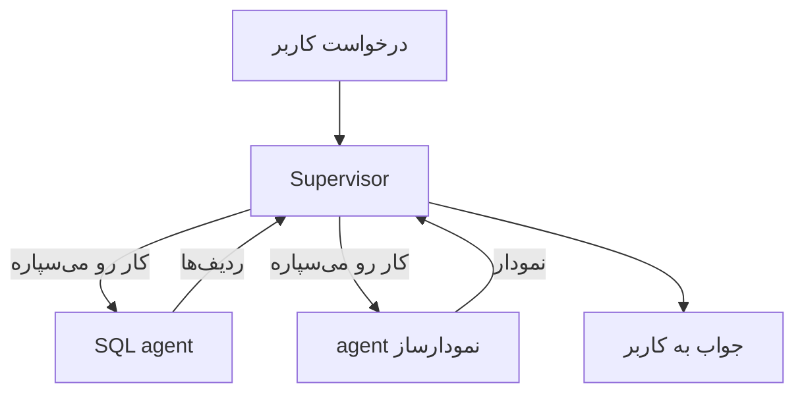
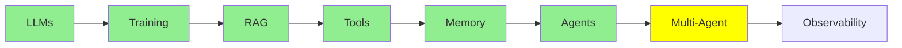

# Multi-Agent Systems

[AI Agents](agents_fa.md) با یه agent تموم شد: یه loop، یه system prompt و یه دسته tool. این درس درباره‌ی اینه که وقتی چند تا agent رو با هم به کار می‌گیری چی می‌شه، و این کار چه هزینه‌ای برات داره.

## چرا اصلاً به چند تا agent نیاز داریم

یه درخواست واقعی رو در نظر بگیر: *«جدول‌های database‌م هر کدوم چند تا ردیف دارن؟ توی یه نمودار میله‌ای نشونم بده.»*

این در واقع دو تا کار جداست: اول باید SQL بنویسی و اجرا کنی، بعد یه نمودار بکشی. یه agent می‌تونه هر دو رو انجام بده، ولی این کار هزینه داره. حالا system prompt باید هم SQL رو توضیح بده *و* هم نمودار کشیدن رو، و لیست tool‌ها هم بلندتر می‌شه. هر call هم یه سری دستور با خودش می‌بره که هیچ ربطی به مرحله‌ی فعلی ندارن. نتیجه این‌که مدل راه‌های بیشتری برای انتخاب tool اشتباه داره و راحت‌تر این دو تا کار رو با هم قاطی می‌کنه.

اگه کار رو تقسیم کنی، هر agent یه prompt کوتاه، یه لیست tool کوچیک و فقط یه کار داره:

- یه **SQL agent** که query‌ها رو می‌نویسه و اجرا می‌کنه
- یه **agent نمودارساز** (visualisation agent) که نتیجه‌ها رو به نمودار تبدیل می‌کنه

هر کدومشون همون agent معمولیه که توی [AI Agents](agents_fa.md) دیدیم. چیز تازه‌ای اختراع نشده؛ فقط به‌جای یه loop، چند تا loop داری.

## معماری‌های پایه‌ی Multi-agent

  
*چپ: یه agent با tool‌هاش، همون جایی که [AI Agents](agents_fa.md) تموم شد. وسط: یه network که توش هر agent می‌تونه با همه‌ی agent‌های دیگه حرف بزنه. راست: یه supervisor که درخواست رو می‌گیره و کار رو بین worker‌ها پخش می‌کنه، و worker‌ها فقط با خود supervisor حرف می‌زنن.*

**Supervisor.** یه agent درخواست رو می‌گیره و بعد به این ترتیب:

- تصمیم می‌گیره کدوم worker باید سراغ این کار بره
- کار رو می‌سپاره به همون worker
- چیزی رو که برمی‌گرده تحویل می‌گیره
- به کاربر جواب می‌ده

worker‌ها فقط با supervisor حرف می‌زنن و با هیچ‌کس دیگه کاری ندارن. مثال SQL و نمودار ما دقیقاً به همین قالب می‌خوره: supervisor سوال رو می‌فرسته برای SQL agent و ردیف‌ها رو ازش می‌گیره، بعد ردیف‌ها رو می‌ده دست agent نمودارساز و نمودار رو برمی‌گردونه.

این الگو رو با اسم manager-worker یا orchestrator-worker هم می‌بینی؛ اسمش فرق می‌کنه، ولی شکلش همینه.

**Network، که گاهی بهش swarm هم می‌گن.** این‌جا رئیسی در کار نیست: هر agent می‌تونه کار رو بده دست هر agent دیگه‌ای، و خود agent‌ها بین خودشون تصمیم می‌گیرن قدم بعدی رو کی برداره. انعطافش بیشتره، ولی پیش‌بینی کردنش خیلی سخت‌تره، چون هیچ نقطه‌ای نیست که بتونی از اون‌جا ببینی سیستم چه تصمیمی گرفته.



**با supervisor شروع کن.** debug کردنش راحت‌تره، چون همه‌ی تصمیم‌ها از یه جا رد می‌شن. تازه بیشتر مسئله‌هایی که به نظر میاد swarm لازم دارن، در واقع لازمش ندارن.

## دردسرهای Multi-agent

این بخش رو جدی بگیر، چون هر دو تا مشکلش *از خود* تقسیم کار میاد و یه agent تنها هیچ‌کدومشون رو نداره.

**Coordination (هماهنگی).** کی چی کار کنه و به چه ترتیبی؟ از کجا معلوم بشه یه مرحله تموم شده؟ وقتی یه agent داشتی، loop جواب این سوال‌ها رو می‌داد. ولی با چند تا agent یه چیزی باید تصمیم بگیره، و اون تصمیم ممکنه غلط باشه: دو تا agent ممکنه یه کار رو دو بار انجام بدن، یه agent ممکنه منتظر چیزی بمونه که هیچ‌وقت نمی‌رسه، یا یه supervisor ممکنه پشت سر هم کار واگذار کنه و هیچ‌وقت دست نکشه. هرچی agent‌ها بیشتر باشن، راه‌های بیشتری هست که کار به deadlock بکشه، یعنی agent‌ها تا ابد منتظر هم بمونن، یا بیفته توی یه loop بی‌پایان.

**Context transfer (انتقال context).** هر agent context خودش رو داره، یعنی message stack خودش. پس وقتی کار SQL agent تموم شد، دقیقاً چی به agent نمودارساز می‌رسه؟ فقط ردیف‌ها؟ سوال اصلی هم؟ اون SQL‌ای که ردیف‌ها رو درآورده چی؟ اگه کم بدی، agent دوم مجبوره بدون اطلاعاتی که لازم داره کار کنه؛ اگه همه‌چیز رو بدی، هم باید هزینه‌ی یه context خیلی بزرگ رو بدی و هم همون قاطی شدنی که به خاطرش agent‌ها رو جدا کرده بودی، دوباره برمی‌گرده.

معمولاً وقتی یه سیستم multi-agent از همون agent تنهایی که جاش اومده *بدتر* کار می‌کنه، دلیلش همینه که این قسمت درست انجام نشده.

### Shared Context یا Isolated Context

این ما رو می‌رسونه به انتخابی که پشت هر طراحی multi-agent هست: همه‌ی agent‌ها یه context **مشترک** دارن، یا هر کدوم توی یه context **جداگانه** کار می‌کنه؟

- **Shared:** همه همه‌چیز رو می‌بینن. موقع دست‌به‌دست شدن کار چیزی گم نمی‌شه، ولی context سریع بزرگ می‌شه.
- **Isolated:** هر agent فقط چیزی رو می‌بینه که بهش دادن. ارزونه و متمرکز، ولی هر چیزی که یادت رفته باشه بهش بدی، خیلی ساده از دست رفته.

سیستم‌های production از هر دو استفاده می‌کنن، و همین انتخاب تقریباً بقیه‌ی طراحی رو تعیین می‌کنه. این بحث اون‌قدر عمیقه که جای جدا می‌خواد، پس توی [Advanced Multi-Agent](../3_expert/advanced_multiagent.md) دوباره سراغش میایم.

## معماری‌های پیشرفته‌تر Multi-agent

این‌ها رو این‌جا فقط اسم می‌بریم که به گوشت آشنا باشن؛ بعداً همه‌شون رو کامل می‌بینیم:

- **Hierarchical:** یه supervisor بالای همه هست که چند تا supervisor دیگه رو مدیریت می‌کنه، و هر کدوم از اون‌ها هم worker‌های خودشون رو دارن. وقتی یه لایه کافی نیست، سراغ این می‌ری.
- **Agent-as-a-tool:** یه agent رو مثل یه tool معمولی می‌دی دست یه agent دیگه. این مستقیم با همون سازوکار [Tool Calling](tools_fa.md) جور درمیاد.
- **Subagent‌ها:** یه agent چند تا helper کوتاه‌عمر راه می‌ندازه که هر کدوم context جداگانه‌ی خودشون رو دارن، و آخرش فقط نتیجه‌ی کارشون رو نگه می‌داره.

## ساختن یه Multi-agent

```python
from smolagents import CodeAgent, tool, InferenceClientModel

@tool
def sql_query(query: str) -> list:
    """Run a SQL query against the application database and return the rows."""
    return db.execute(query).fetchall()

@tool
def visualise(data: list) -> str:
    """Draw a bar chart from rows and return the path to the image."""
    return chart_from(data)

sql_agent = CodeAgent(tools=[sql_query], model=InferenceClientModel(), name="sql",
                      description="Answers questions by querying the database.")
viz_agent = CodeAgent(tools=[visualise], model=InferenceClientModel(), name="viz",
                      description="Draws a chart from rows of data.")

supervisor = CodeAgent(
    tools=[],
    model=InferenceClientModel(),
    managed_agents=[sql_agent, viz_agent],   # the workers it can delegate to
)

supervisor.run("How many rows are in my tables? Show them in a bar chart.")
```

به `managed_agents` نگاه کن. worker‌ها رو دقیقاً همون‌جوری به supervisor می‌دی که توی [AI Agents](agents_fa.md) tool‌ها رو به agent می‌دادی، چون از نگاه supervisor، worker‌ها هم دقیقاً همینن: چیزهایی که می‌شه صداشون زد و ازشون نتیجه گرفت.

## کی یه agent تنها بهتره

multi-agent یه ارتقا نیست، یه معامله‌ست: prompt‌های کوتاه‌تر و مرز روشن‌تر بین کارها رو می‌خری و هزینه‌ش رو با coordination و context transfer می‌دی.

تا وقتی همه‌چیز راحت توی یه prompt جا می‌شه و لیست tool‌ها هنوز قابل مدیریته، با همون یه agent بمون. وقتی دیدی یه system prompt داره دو تا کار بی‌ربط رو یاد می‌ده، کار رو تقسیم کن؛ و موقع تقسیم، مرز رو جایی بذار که کمترین اطلاعات لازم باشه از یه agent به اون یکی منتقل بشه.

## کجای این مجموعه هستیم



## خلاصه

وقتی چند تا agent داری، هر کدوم می‌تونه یه prompt کوتاه و فقط یه کار داشته باشه. برای شروع هم معماری supervisor بهترین گزینه‌ست، که توش یه agent کار رو پخش می‌کنه و نتیجه‌ها رو جمع می‌کنه.

در عوض دو تا مشکل گردنت می‌افته. اولی **coordination**‌ه: این‌که کی چی کار کنه و کی کار تموم شده. دومی **context transfer**‌ه: این‌که به هر agent چی داده بشه. کل سختی کار همین دو تاست، و جوابی که به دومی می‌دی (context مشترک یا جداگانه) بقیه‌ی طراحی رو شکل می‌ده.

هسته‌ی بخش Fundamentals همین بود و حالا تصویر کامل دستته:

- یه مدل که فقط متن پیش‌بینی می‌کنه
- یه context window که میز کارشه
- retrieval برای پر کردن اون میز
- tool‌ها، تا بتونه دست به کار بشه
- memory بین نوبت‌ها
- یه loop که ازش agent می‌سازه
- چند تا agent، وقتی یکی کافی نیست

هر چیزی که توی Intermediate می‌بینی، روی همین هفت تا ایده بنا شده.

**بررسی سریع**: سیستم multi-agent چه دو تا مشکل سختی درست می‌کنه؟ و فرق shared context با isolated context چیه؟

## منابع

- [Multi-agent systems](https://docs.langchain.com/oss/python/langchain/multi-agent): همین الگوها، با جزئیات بیشتر
- [LangGraph multi-agent concepts](https://langchain-ai.github.io/langgraph/concepts/multi_agent/): supervisor، network و بقیه، همراه با کد
- [What is an agent?](https://www.langchain.com/blog/what-is-an-agent): این‌جا ارزش دوباره خوندن داره، چون انتخاب supervisor در واقع یه تصمیم درباره‌ی میزان خودمختاریه
- [AI Agents](agents_fa.md): همون loop تکی که همه‌ی این‌ها ازش ساخته شده
- [Advanced Multi-Agent](../3_expert/advanced_multiagent.md): shared و isolated context، و پروتکل‌های ارتباط agent با agent
