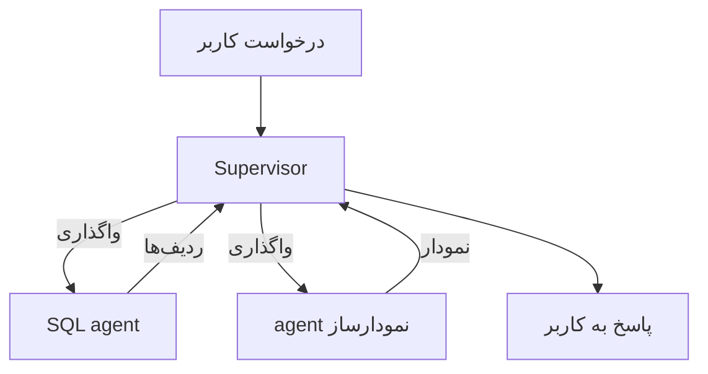
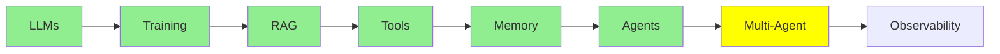

# Multi-Agent Systems

توی [AI Agents](agents_fa.md) کار با یه agent تموم شد: یه loop، یه system prompt و یه مجموعه tool. این module سراغ این می‌ره که وقتی چند تا agent رو با هم به کار می‌گیری، چه اتفاقی می‌افته و چه هزینه‌ای داره.

## چرا اصلاً به چند تا agent نیاز داریم

یه درخواست واقعی رو در نظر بگیر: «*How many rows are in my database tables? Show them in a bar chart.*» این درخواست دو تا کار جدا از هم داره. اول باید SQL بنویسی و اجراش کنی، و بعد یه نمودار بکشی. یه agent می‌تونه هر دو کار رو انجام بده، ولی این کار یه هزینه داره. حالا system prompt باید هم SQL رو توضیح بده و هم نمودار رو، و لیست tool‌ها هم بلندتر می‌شه. هر بار که مدل اجرا می‌شه، دستورهایی رو هم با خودش می‌بره که به مرحله‌ی فعلی ربطی ندارن. برای همین مدل راه‌های بیشتری داره که tool اشتباهی انتخاب کنه، و جای بیشتری برای قاطی شدن دو تا کار وجود داره.

اگه کار رو تقسیم کنی، هر agent یه prompt کوتاه داره، یه لیست کوچیک از tool‌ها و یه کار مشخص. مثلاً:

- یه **SQL agent** که query‌ها رو می‌نویسه و اجراشون می‌کنه
- یه **agent نمودارساز** که نتیجه‌ها رو به نمودار تبدیل می‌کنه

هر کدوم از این‌ها همون agent‌ای هستن که توی [AI Agents](agents_fa.md) دیدیم. چیز تازه‌ای اختراع نکردیم، فقط از یه loop رفتیم به چند تا loop.

## معماری‌های پایه‌ی Multi-agent

  
*سمت چپ: یه agent با tool‌هاش. همون جایی که [AI Agents](agents_fa.md) تموم شد. وسط: یه شبکه که هر agent می‌تونه با هر agent دیگه‌ای حرف بزنه. سمت راست: یه supervisor که درخواست رو می‌گیره و کار رو به worker‌ها واگذار می‌کنه، و worker‌ها فقط با supervisor حرف می‌زنن.*

**Supervisor.** یه agent درخواست رو می‌گیره و بعد به همین ترتیب این کارها رو انجام می‌ده:

- تصمیم می‌گیره کدوم worker باید این کار رو انجام بده
- کار رو به همون worker می‌ده
- نتیجه‌ای رو که برمی‌گرده جمع می‌کنه
- جواب رو به کاربر می‌ده

worker‌ها فقط با supervisor حرف می‌زنن و با کس دیگه‌ای کاری ندارن. مثال SQL و نمودار دقیقاً به همین شکل جواب می‌ده. supervisor سؤال رو می‌فرسته پیش SQL agent و ردیف‌ها رو ازش تحویل می‌گیره. بعد اون ردیف‌ها رو می‌ده دست agent نمودارساز، و در آخر نمودار رو به کاربر برمی‌گردونه.

به این الگو manager-worker یا orchestrator-worker هم می‌گن. شکلش همونه، فقط اسمش فرق می‌کنه.

**Network**، که گاهی بهش swarm هم می‌گن، رئیس نداره. هر agent می‌تونه کار رو به هر agent دیگه‌ای بده، و خود agent‌ها بین خودشون تصمیم می‌گیرن که کار بعدی با کیه. این روش انعطاف بیشتری داره، ولی پیش‌بینی‌اش خیلی سخت‌تره، چون هیچ نقطه‌ی مشخصی وجود نداره که بشه تصمیم‌های سیستم رو اون‌جا دید.



**با supervisor شروع کن.** دیباگ کردنش راحت‌تره، چون هر تصمیم از یه جا رد می‌شه. ضمن این‌که بیشتر مشکل‌هایی که به نظر swarm لازم دارن، در واقع اصلاً بهش نیازی ندارن.

## دردسرهای Multi-agent

این بخش رو جدی بگیر، چون هر دو مشکلش دقیقاً از خودِ تقسیم کار میاد. یه agent تنها هیچ‌کدوم از این دو مشکل رو نداره.

**Coordination.** کی چی رو انجام بده و به چه ترتیبی؟ از کجا معلوم بشه که یه مرحله تموم شده؟ با یه agent تنها، loop به همه‌ی این سؤال‌ها جواب می‌داد. با چند تا agent، یه جایی باید تصمیم بگیره، و اون تصمیم هم ممکنه اشتباه باشه. دو تا agent ممکنه یه کار رو دوبار انجام بدن، یه agent ممکنه منتظر چیزی بمونه که هیچ‌وقت نمی‌رسه، و یه supervisor هم ممکنه بی‌وقفه کار واگذار کنه و هیچ‌وقت تموم نشه. هرچی agent بیشتر باشه، راه‌های بیشتری برای deadlock و برای loop بی‌پایان هم وجود داره.

**Context transfer.** هر agent یه context مخصوص خودش داره، یعنی message stack خودش. پس وقتی SQL agent کارش تموم شد، دقیقاً چی باید به agent نمودارساز برسه؟ فقط ردیف‌ها کافیه، یا باید سؤال اصلی و حتی خود SQL‌ای که اون ردیف‌ها رو ساخته هم بهش داده بشه؟ اگه خیلی کم بدی، agent دوم کورکورانه کار می‌کنه. اگه همه‌چی رو بدی، context خیلی بزرگ می‌شه و هزینه‌ش بالا می‌ره، و آشفتگی‌ای رو که با تقسیم کردن agent‌ها می‌خواستی ازش فرار کنی، دوباره برمی‌گردونی.

اگه این بخش درست از آب درنیاد، معمولاً همین دلیل اصلیه که یه سیستم multi-agent از همون agent تنهایی که جایگزینش شده، *بدتر* کار کنه.

### Shared Context یا Isolated Context

یه انتخاب هست که زیر هر طراحی multi-agent قرار داره. آیا agent‌ها یه context مشترک دارن، یا هر کدوم توی یه context جدا کار می‌کنن؟

- **Shared:** همه‌ی agent‌ها همه‌چیز رو می‌بینن. توی تحویل کار چیزی گم نمی‌شه، ولی context خیلی سریع بزرگ می‌شه.
- **Isolated:** هر agent فقط چیزی رو می‌بینه که بهش داده شده. این روش ارزون و متمرکزه، ولی هر چیزی که یادت بره پاس بدی، کلاً از بین می‌ره.

سیستم‌های production از هر دو استفاده می‌کنن، و همین انتخاب تقریباً هر چیز دیگه‌ی طراحی رو تعیین می‌کنه. این موضوع اون‌قدر عمیقه که یه بحث جدا می‌خواد، پس ادامه‌ش رو توی [Advanced Multi-Agent](../3_expert/advanced_multiagent.md) می‌بینیم.

## معماری‌های پیشرفته‌تر Multi-agent

این اسم‌ها رو همین‌جا می‌آریم تا با اون‌ها آشنا بشی. همه‌شون رو بعداً کامل بررسی می‌کنیم:

- **Hierarchical:** supervisor‌هایی که روی supervisor‌های دیگه نظارت دارن. وقتی یه لایه کافی نیست، از این الگو استفاده می‌کنی.
- **Agent-as-a-tool:** یه agent به یه agent دیگه داده می‌شه، انگار که یه tool ساده‌ست. این دقیقاً با مکانیزمی جور درمیاد که توی [Tool Calling](tools_fa.md) دیدیم.
- **Subagent‌ها:** یه agent چند تا helper کوتاه‌عمر راه می‌ندازه. هر helper یه context جدا داره، و agent اصلی فقط نتیجه‌ی کار اون‌ها رو نگه می‌داره.

## ساختن یه Multi-agent

```python
from smolagents import CodeAgent, tool, InferenceClientModel

@tool
def sql_query(query: str) -> list:
    """Run a SQL query against the application database and return the rows."""
    return db.execute(query).fetchall()

@tool
def visualise(data: list) -> str:
    """Draw a bar chart from rows and return the path to the image."""
    return chart_from(data)

sql_agent = CodeAgent(tools=[sql_query], model=InferenceClientModel(), name="sql",
                      description="Answers questions by querying the database.")
viz_agent = CodeAgent(tools=[visualise], model=InferenceClientModel(), name="viz",
                      description="Draws a chart from rows of data.")

supervisor = CodeAgent(
    tools=[],
    model=InferenceClientModel(),
    managed_agents=[sql_agent, viz_agent],   # the workers it can delegate to
)

supervisor.run("How many rows are in my tables? Show them in a bar chart.")
```

به `managed_agents` دقت کن. همون‌طور که توی [AI Agents](agents_fa.md) tool‌ها رو به agent می‌دادی، این‌جا هم worker‌ها رو به supervisor می‌دی. دلیلش اینه که از دید supervisor، worker‌ها همین چیزها هستن: چیزهایی که می‌تونه صدا بزنه و نتیجه‌شون رو بگیره.

## کی یه agent تنها بهتره

Multi-agent یه ارتقا نیست، یه مبادله‌ست. prompt‌های کوتاه‌تر و جدایی روشن‌تر بین کارها رو می‌خری، و هزینه‌شون رو با coordination و context transfer پس می‌دی.

تا وقتی یه prompt هنوز راحت جا می‌شه و لیست tool‌ها هم هنوز راحت قابل مدیریته، با یه agent بمون. وقتی یه system prompt داره سعی می‌کنه دو تا کار بی‌ربط رو یاد بده، کار رو تقسیم کن. موقع تقسیم هم، جایی رو انتخاب کن که کمترین اطلاعات باید از یه agent به agent دیگه برسه.

## کجای این مجموعه هستیم



## خلاصه

با چند تا agent، هر کدوم می‌تونه یه prompt کوتاه و یه کار مشخص داشته باشه. الگوی supervisor، یعنی یه agent که کار رو واگذار می‌کنه و نتیجه‌ها رو جمع می‌کنه، همونیه که باید اول سراغش بری.

با این حساب دو تا مشکل هم به ارث می‌بری. اولیش **coordination**‌ه، یعنی تصمیم گرفتن این‌که کی چی رو انجام بده و کی کار تموم شده. دومیش **context transfer** هست، یعنی تصمیم گرفتن این‌که هر agent چی دریافت کنه. این دو تا کل سختی ماجرا هستن، و جوابی که به مورد دوم می‌دی، یعنی context مشترک یا context جدا، همه‌ی بقیه‌ی طراحی رو شکل می‌ده.

این هسته‌ی بخش Fundamentals بود و حالا تصویر کامل رو داری:

- یه مدل که فقط متن پیش‌بینی می‌کنه
- یه context window که میزکار مدله
- retrieval که اون میزکار رو پر می‌کنه
- tool‌ها که بهش اجازه‌ی عمل می‌دن
- memory بین نوبت‌ها
- یه loop که اون مدل رو تبدیل به agent می‌کنه
- چند تا agent، وقتی یکی کافی نیست

هر چیزی که توی Intermediate می‌بینی، روی همین هفت تا ایده ساخته شده.

**بررسی سریع**: دو تا مشکل سختی که یه سیستم multi-agent ایجاد می‌کنه چیه؟ و فرق بین shared context و isolated context چیه؟

## منابع

- [Multi-agent systems](https://docs.langchain.com/oss/python/langchain/multi-agent): الگوها، با جزئیات بیشتر
- [LangGraph multi-agent concepts](https://langchain-ai.github.io/langgraph/concepts/multi_agent/): supervisor، network و بقیه‌ی الگوها، همراه با کد
- [What is an agent?](https://www.langchain.com/blog/what-is-an-agent): ارزش داره دوباره بخونیش، چون انتخاب supervisor یعنی تصمیم گرفتن درباره‌ی میزان خودمختاری
- [AI Agents](agents_fa.md): همون loop تنهایی که همه‌ی این مطالب ازش ساخته شدن
- [Advanced Multi-Agent](../3_expert/advanced_multiagent.md): shared و isolated context، و پروتکل‌های ارتباط بین agent‌ها
