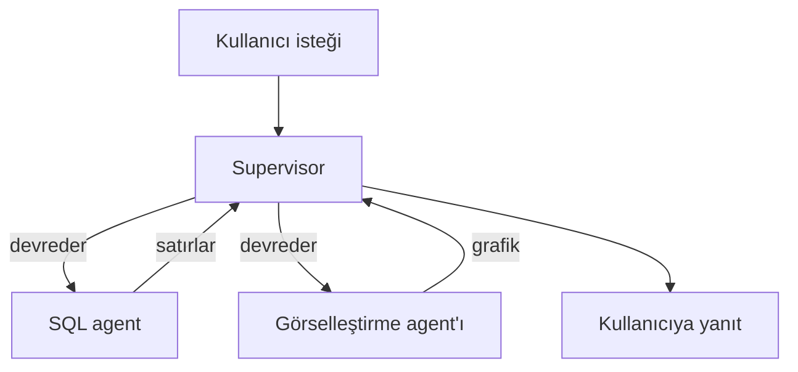
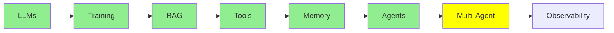

# Multi-Agent Systems

[AI Agents](agents_tr.md) modülü tek bir agent ile bitmişti: tek bir döngü (loop), tek bir system prompt ve tek bir tool seti. Bu modülde birden fazla agent kullandığında neler olduğunu ve bunun sana neye mal olduğunu anlatacağız.

## Neden Birden Fazla Agent'a İhtiyaç Duyabiliriz

Gerçek bir isteği düşünelim: *"How many rows are in my database tables? Show them in a bar chart."*

Bu aslında iki ayrı iş. Önce SQL yazıp çalıştırman, sonra da bir grafik çizmen gerekiyor. Tek bir agent ikisini de yapabilir, ama bunun bir bedeli var. System prompt artık hem SQL'i hem de grafik çizmeyi anlatmak zorunda kalır ve tool listesi uzar. Her model çağrısı ayrıca o anki adımla ilgisi olmayan talimatları da taşır. Bu yüzden model yanlış tool'u seçmenin daha fazla yolunu bulur, iki işi birbirine karıştırmak için de daha fazla alan doğar.

İşi bölersen her agent kısa bir prompt, küçük bir tool listesi ve tek bir iş alır:

- sorguları yazan ve çalıştıran bir **SQL agent'ı**
- sonuçları grafiğe dönüştüren bir **görselleştirme agent'ı**

İkisi de [AI Agents](agents_tr.md) modülündeki bir agent'tan başka bir şey değil. Ortada yeni bir mekanizma yok, sadece tek bir döngü yerine birkaç döngü çalıştırıyorsun.

## Temel Multi-agent Mimarileri

  
*Solda: tool'larıyla birlikte tek bir agent. [AI Agents](agents_tr.md) modülü tam olarak burada bitmişti. Ortada: her agent'ın diğer her agent'la konuşabildiği bir network. Sağda: bir supervisor. İsteği o alır, işi worker'lara devreder ve worker'lar yalnızca supervisor ile konuşur.*

**Supervisor.** Bir agent isteği alır ve ardından sırasıyla şunları yapar:

- isteği hangi worker'ın işleyeceğine karar verir
- işi o worker'a iletir
- geri dönen sonucu toplar
- kullanıcıya yanıt verir

Worker'lar yalnızca supervisor ile konuşur, başka kimseyle değil. Yukarıdaki SQL ve grafik örneği bu yapıya tam olarak uyuyor. Supervisor soruyu SQL agent'ına gönderir ve satırları geri alır. Ardından o satırları görselleştirme agent'ına verir ve grafiği döndürür.

Bu yapıyı manager-worker ya da orchestrator-worker olarak da görebilirsin, ama ikisi de aynı şekli anlatır.

**Network, bazen swarm diye de anılır.** Burada patron yoktur. Her agent işi diğer herhangi bir agent'a devredebilir ve agent'lar bir sonraki adımda kimin ne yapacağına kendi aralarında karar verir. Bu yapı daha esnektir, ancak tahmin edilmesi çok daha zordur, çünkü sistemin ne karar verdiğini görebileceğin tek bir yer yoktur.



**Supervisor ile başla.** Her karar tek bir yerden geçtiği için hata ayıklaması daha kolaydır. Ayrıca swarm gerektiriyormuş gibi görünen problemlerin çoğu aslında buna ihtiyaç duymaz.

## Multi-agent'ın Dezavantajları

Bu bölümü ciddiye almakta fayda var, çünkü iki problemin de kaynağı işi bölmek. Tek bir agent'ta bu iki problemden hiçbiri yoktur.

**Koordinasyon (coordination).** Kim ne yapar, hangi sırayla yapar ve bir adımın bittiğini kim nasıl anlar? Tek bir agent'ta döngü bu soruların yanıtını zaten veriyordu. Birden fazla agent'ta ise bir şeyin karar vermesi gerekir ve bu karar yanlış çıkabilir. Örneğin iki agent aynı işi yapabilir. Üstelik bir agent, hiç gelmeyecek bir yanıtı sonsuza kadar bekleyebilir, bir supervisor da işi sürekli devredip hiç bitirmeyebilir. Agent sayısı arttıkça kilitlenme (deadlock), yani agent'ların birbirini sonsuza kadar beklemesi, daha olası hale gelir. Sonsuza kadar dönen bir döngüye girmenin yolları da çoğalır.

**Bağlam aktarımı (context transfer).** Her agent kendi bağlamına (context) sahiptir, yani kendi mesaj yığınına (message stack). Bu yüzden SQL agent işini bitirdiğinde görselleştirme agent'ı tam olarak ne alır? Yalnızca satırları mı alır, yoksa orijinal soruyu ve satırları üreten SQL'i de mi alır? Çok az bilgi verirsen ikinci agent, ihtiyaç duyduğu bilgiye sahip olmadan çalışmak zorunda kalır. Her şeyi verirsen ise devasa bir bağlamın bedelini ödersin. Üstelik agent'ları ayırmanın önüne geçmek istediğin karmaşayı geri getirmiş olursun.

Bu konuda yanlış karar vermek, multi-agent bir sistemin yerini aldığı tek agent'tan *daha kötü* çalışmasının en sık görülen nedenidir.

### Ortak Bağlam mı, İzole Bağlam mı

Bu, her multi-agent tasarımın altında yatan bir seçime götürüyor. Agent'lar **ortak** bir bağlamı mı paylaşır, yoksa her agent kendi **izole** bağlamında mı çalışır?

- **Ortak (shared):** herkes her şeyi görür. Devir sırasında hiçbir şey kaybolmaz, ama bağlam hızla büyür.
- **İzole (isolated):** her agent yalnızca kendisine verileni görür. Bu yöntem ucuz ve odaklıdır. Ama aktarmayı unuttuğun her şey tamamen kaybolur.

Üretimdeki sistemler ikisini de kullanır. Üstelik bu seçim, tasarımın geri kalanının neredeyse tamamını belirler. Konu kendi başına ayrı bir tartışmayı hak edecek kadar derin olduğu için ona [İleri Seviye Multi-Agent](../3_expert/advanced_multiagent_tr.md) bölümünde geri döneceğiz.

## İleri Seviye Multi-agent Mimarileri

Bu terimleri şimdiden tanıyasın diye adlarını burada koyuyoruz. Hepsini daha sonra ayrıntılı olarak işleyeceğiz:

- **Hiyerarşik:** en üstteki bir supervisor başka supervisor'ları yönetir, onların her biri de kendi worker'larını yönetir. Tek bir katman yetmediğinde bunu kullanırsın.
- **Agent-as-a-tool:** bir agent, diğer bir agent'a sıradan bir tool gibi verilir. Bu, doğrudan [LLM Tool Calling](tools_tr.md) bölümündeki mekanizmaya oturur.
- **Subagent'lar:** bir agent kısa ömürlü yardımcılar başlatır ve her yardımcının kendi izole bağlamı olur. Ana agent ise sonunda yalnızca onların sonuçlarını tutar.

## Bir Multi-agent Nasıl Kurulur

```python
from smolagents import CodeAgent, tool, InferenceClientModel

@tool
def sql_query(query: str) -> list:
    """Run a SQL query against the application database and return the rows."""
    return db.execute(query).fetchall()

@tool
def visualise(data: list) -> str:
    """Draw a bar chart from rows and return the path to the image."""
    return chart_from(data)

sql_agent = CodeAgent(tools=[sql_query], model=InferenceClientModel(), name="sql",
                      description="Answers questions by querying the database.")
viz_agent = CodeAgent(tools=[visualise], model=InferenceClientModel(), name="viz",
                      description="Draws a chart from rows of data.")

supervisor = CodeAgent(
    tools=[],
    model=InferenceClientModel(),
    managed_agents=[sql_agent, viz_agent],   # the workers it can delegate to
)

supervisor.run("How many rows are in my tables? Show them in a bar chart.")
```

Şimdi `managed_agents` parametresine bak. Worker'ları supervisor'a, [AI Agents](agents_tr.md) modülünde tool'ları agent'a verdiğin şekilde veriyorsun. Bunun nedeni, supervisor'ın gözünden worker'ların tam olarak bu olması: çağırıp sonuç alabileceği şeyler.

## Tek Bir Agent Ne Zaman Daha İyi Olabilir

Multi-agent bir yükseltme değildir, bir takastır (trade-off). Karşılığında daha kısa prompt'lar ve işler arasında daha net bir ayrım elde edersin. Bunun bedelini ise koordinasyon ve bağlam aktarımıyla ödersin.

Tek bir prompt hâlâ rahatça sığıyorsa ve tool listesi kolay yönetilebiliyorsa, tek bir agent'ta kal. Tek bir system prompt birbiriyle ilgisi olmayan iki işi öğretmeye çalışıyorsa böl. Bölerken, bir agent'tan diğerine en az bilginin geçmesi gereken noktayı seç.

## Bu serinin neresindeyiz



## Özet

Birden fazla agent, her agent'ın kısa bir prompt'u ve tek bir işi olmasını sağlar. Başlangıç için en iyi seçenek, bir agent'ın işi devredip sonuçları topladığı supervisor mimarisidir.

Ayrıca iki problemi de devralırsın. Birincisi **koordinasyon**: kimin ne yaptığına ve bir işin ne zaman bittiğine karar vermek. İkincisi **bağlam aktarımı**: her agent'a neyin verileceğine karar vermek. Zorluğun tamamı bu iki problemde toplanır. İkinci soruya nasıl yanıt verdiğin (ortak bağlam mı, izole bağlam mı) gerisini şekillendirir.

Bu, Fundamentals'ın özüdür. Artık resmin tamamı önünde:

- yalnızca metin tahmin eden bir model
- modelin masası gibi çalışan bir bağlam penceresi (context window)
- bu masayı dolduran bilgi getirme (retrieval)
- modelin eylem yapmasını sağlayan tool'lar
- turlar boyunca tutulan memory
- onu bir agent'a dönüştüren döngü
- tek bir agent yetmediğinde birden fazla agent

Intermediate'teki her şey bu yedi fikrin üzerine kurulu.

**Hızlı Kontrol**: Multi-agent bir sistemin yarattığı iki zor problem nedir? Peki ortak bağlam ile izole bağlam arasındaki fark nedir?

## Kaynaklar

- [Multi-agent systems](https://docs.langchain.com/oss/python/langchain/multi-agent): bu kalıpları daha derinlemesine anlatıyor
- [LangGraph multi-agent concepts](https://langchain-ai.github.io/langgraph/concepts/multi_agent/): supervisor, network ve diğerleri, kod örnekleriyle birlikte
- [What is an agent?](https://www.langchain.com/blog/what-is-an-agent): supervisor'ın aslında bir özerklik kararı olduğunu hatırlamak için burada yeniden okumaya değer
- [AI Agents](agents_tr.md): bütün bunların üzerine kurulduğu tek döngü
- [İleri Seviye Multi-Agent](../3_expert/advanced_multiagent_tr.md): ortak ve izole bağlam ile agent'lar arası protokoller
