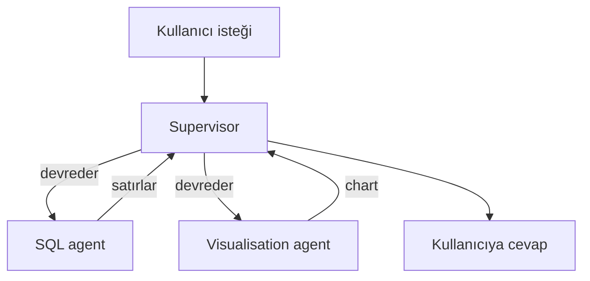
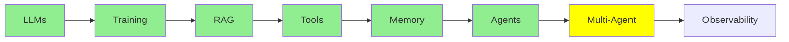

# Multi-Agent Systems

[AI Agent'lar](agents_tr.md) tek bir agent ile bitti: bir loop, bir system prompt, bir tool seti. Bu
modül, birkaç agent kullandığında ne olduğunu ve bunun sana neye mal olduğunu anlatıyor.

## Neden Multi-agent'a İhtiyaç Duyabiliriz?

Gerçek bir istek düşün: *"Veritabanı tablolarımda kaç satır var? Bunları bir bar chart'ta göster."*

Bu iki farklı iş. Önce SQL yazıp çalıştırıyorsun, sonra chart çiziyorsun. Tek bir agent ikisini de
yapabilir, ama bunun bir bedeli var. System prompt artık hem SQL'i hem chart çizmeyi anlatmak
zorunda, tool listesi de uzuyor. Ayrıca her çağrı, o anki adımla ilgisi olmayan talimatlar taşıyor.
Bu yüzden modelin yanlış tool'u seçmesi için daha çok yol var. İki işi karıştırması için de daha
çok alan var.

İşi bölersen, her agent kısa bir prompt, küçük bir tool listesi ve tek bir iş alıyor:

- query yazıp çalıştıran bir **SQL agent**
- sonuçları chart'a çeviren bir **visualisation agent**

Her biri [AI Agent'lar](agents_tr.md) modülündeki agent'ın kendisi. Yeni bir şey icat edilmedi.
Sadece bir loop'tan birkaç loop'a geçtin.

## Temel Multi-agent Mimarileri

  
*Solda: tool'larıyla tek bir agent. [AI Agent'lar](agents_tr.md) modülü burada bitmişti. Ortada: her agent'ın diğer her agent'la konuşabildiği bir network. Sağda: bir supervisor. İsteği alıyor ve işi worker'lara dağıtıyor. Worker'lar da sadece supervisor'la konuşuyor.*

**Supervisor.** Bir agent isteği alıyor. Sonra sırasıyla:

- hangi worker'ın bu isteğe bakması gerektiğine karar veriyor
- işi o worker'a geçiriyor
- geri geleni topluyor
- kullanıcıya cevap veriyor

Worker'lar sadece supervisor'la konuşuyor, başka kimseyle değil. SQL ve chart örneğimiz tam olarak
bu şekle oturuyor. Supervisor soruyu SQL agent'a gönderiyor ve satırları alıyor. Sonra satırları
visualisation agent'a veriyor ve chart'ı döndürüyor.

Buna manager-worker ya da orchestrator-worker da deniyor. Şekil aynı.

**Network, bazen swarm.** Patron yok. Her agent işi herhangi bir başka agent'a devredebiliyor.
Sırada kimin ne yapacağına agent'lar kendi aralarında karar veriyor. Bu daha esnek. Ama tahmin
etmesi de çok daha zor, çünkü sistemin neye karar verdiğini görebileceğin tek bir yer yok.



**Supervisor ile başla.** Debug etmesi daha kolay, çünkü her karar tek bir yerden geçiyor. Ayrıca
swarm gerektiriyor gibi görünen problemlerin çoğu swarm gerektirmiyor.

## Multi-agent'ın Dezavantajları

Bu kısmı ciddiye almaya değer, çünkü iki problem de işi bölmenin *kendisinden* doğuyor. Tek bir
agent'ta ikisi de yok.

**Coordination.** Kim ne yapıyor, hangi sırayla? Bir adımın bittiğini kim, nasıl biliyor? Tek
agent'ta bu soruları loop cevaplıyordu. Birkaç agent'ta bir şeyin karar vermesi gerekiyor ve o karar
yanlış olabiliyor. İki agent aynı işi yapabilir. Bir agent hiç gelmeyecek bir şeyi bekleyebilir. Bir
supervisor devretmeye devam edip hiç durmayabilir. Daha çok agent, deadlock'a düşmek ya da sonu
gelmeyen bir loop'a girmek için daha çok yol demek.

**Context transfer.** Her agent'ın kendi context'i, yani kendi mesaj yığını (message stack) var.
Peki SQL agent işini bitirdiğinde, visualisation agent tam olarak neyi alıyor? Sadece satırları mı
alıyor? Orijinal soruyu da alıyor mu? Satırları üreten SQL'i de alıyor mu? Çok az şey devredersen
ikinci agent kör çalışıyor. Her şeyi devredersen kocaman bir context'in bedelini ödüyorsun. Üstelik
agent'ları bölerek kaçmaya çalıştığın karışıklığı da geri getiriyorsun.

Bir multi-agent sistem, yerini aldığı tek agent'tan *daha kötü* çalışıyorsa, sebep genellikle bunun
yanlış yapılmasıdır.

### Shared Context mı, Isolated Context mı

Bu da her multi-agent tasarımının altında yatan bir seçime götürüyor. Agent'lar tek bir context'i
**paylaşıyor** mu, yoksa her biri kendi **izole** context'inde mi çalışıyor?

- **Shared:** herkes her şeyi görüyor. Devirde hiçbir şey kaybolmuyor, ama context hızla büyüyor.
- **Isolated:** her agent sadece kendisine verileni görüyor. Bu ucuz ve odaklı. Ama geçirmeyi
  unuttuğun şey de öylece kayboluyor.

İkisi de production'da kullanılıyor. Bu seçim, tasarımın geri kalanında neredeyse her şeyi
belirliyor. Konu, ayrıca ele alınmayı hak edecek kadar derin. O yüzden
[İleri Seviye Multi-Agent](../3_expert/advanced_multiagent_tr.md) modülünde ona geri
döneceğiz.

## İleri Seviye Multi-agent Mimarileri

Bu kelimeler tanıdık gelsin diye onları burada anıyoruz. Hepsini daha sonra ele alacağız:

- **Hierarchical:** supervisor'ların supervisor'ları. Tek katman yetmediğinde kullanılıyor.
- **Agent-as-a-tool:** bir agent, başka bir agent'a sanki düz bir tool'muş gibi veriliyor. Bu,
  [Tool Calling](tools_tr.md) modülündeki mekanizmaya tam oturuyor.
- **Subagent'lar:** bir agent kısa ömürlü yardımcılar başlatıyor ve her yardımcının kendi izole
  context'i var. Agent sonra sadece onların sonuçlarını tutuyor.

## Bir Multi-agent Kurmak

```python
from smolagents import CodeAgent, tool, InferenceClientModel

@tool
def sql_query(query: str) -> list:
    """Run a SQL query against the application database and return the rows."""
    return db.execute(query).fetchall()

@tool
def visualise(data: list) -> str:
    """Draw a bar chart from rows and return the path to the image."""
    return chart_from(data)

sql_agent = CodeAgent(tools=[sql_query], model=InferenceClientModel(), name="sql",
                      description="Answers questions by querying the database.")
viz_agent = CodeAgent(tools=[visualise], model=InferenceClientModel(), name="viz",
                      description="Draws a chart from rows of data.")

supervisor = CodeAgent(
    tools=[],
    model=InferenceClientModel(),
    managed_agents=[sql_agent, viz_agent],   # devredebileceği worker'lar
)

supervisor.run("How many rows are in my tables? Show them in a bar chart.")
```

`managed_agents`'a bak. Worker'ları supervisor'a, [AI Agent'lar](agents_tr.md) modülünde agent'a
tool verdiğin şekilde veriyorsun. Çünkü supervisor'ın bakış açısından worker'lar tam olarak bu:
çağırıp sonuç alabileceği şeyler.

## Tek Agent'ın Daha İyi Olabileceği Durumlar

Multi-agent bir yükseltme değil. Bir alışveriş. Kısa prompt'lar ve işler arasında daha net bir
ayrım satın alıyorsun. Bedelini de coordination ve context transfer ile ödüyorsun.

Tek bir prompt hâlâ rahatça sığıyorsa ve tool listesini hâlâ kolayca yönetebiliyorsan tek agent'ta
kal. Tek bir system prompt iki alakasız işi öğretmeye çalışıyorsa böl. Bölerken de, bir agent'tan
diğerine en az bilginin geçmesi gereken noktadan böl.

## Bu serinin neresindeyiz



## Özet

Birkaç agent, her birinin kısa bir prompt'u ve tek bir işi olmasını sağlıyor. Bir agent'ın işi
devredip sonuçları topladığı supervisor mimarisi, başlamak için doğru olan mimari.

İki problem devralıyorsun. Birincisi **coordination**: kimin ne yapacağına ve işin ne zaman
bittiğine karar vermek. İkincisi **context transfer**: her agent'a neyin verileceğine karar vermek.
Bütün zorluk bu ikisi. İkincisine verdiğin cevap (shared context mı, isolated context mı) geri kalan
her şeyi şekillendiriyor.

Fundamentals'ın özü bu. Artık bütün resim elinde:

- sadece metin tahmin eden bir model
- onun masası olan bir context window
- o masayı doldurmak için retrieval
- iş yapabilmesi için tool'lar
- turlar boyunca memory
- onu bir agent yapan bir loop
- biri yetmediğinde birkaç agent

Intermediate'teki her şey bu yedi fikrin üstüne kuruluyor.

**Hızlı Kontrol**: bir multi-agent sistemin yarattığı iki zor problem nedir? Shared ile isolated
context arasındaki fark ne?

## Kaynaklar

- [Multi-agent systems](https://docs.langchain.com/oss/python/langchain/multi-agent): pattern'ler, daha derinlemesine
- [LangGraph multi-agent concepts](https://langchain-ai.github.io/langgraph/concepts/multi_agent/): supervisor, network ve diğerleri, kodla birlikte
- [What is an agent?](https://www.langchain.com/blog/what-is-an-agent): burada yeniden okumaya değer, çünkü bir supervisor da autonomy hakkında bir karar
- [AI Agents](agents_tr.md): bütün bunların kurulduğu tek loop
- [İleri Seviye Multi-Agent](../3_expert/advanced_multiagent_tr.md): shared ve isolated context, ve agent-to-agent protokolleri
