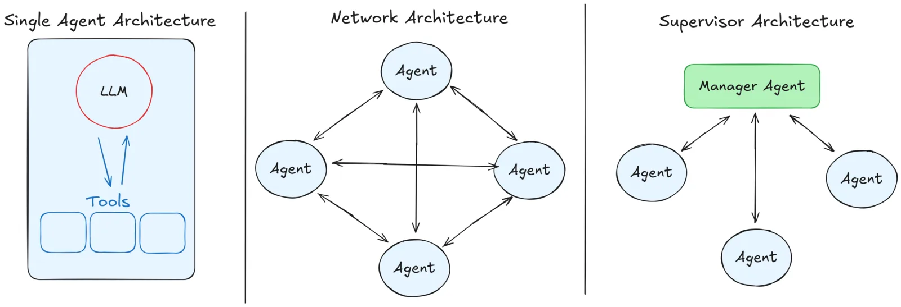
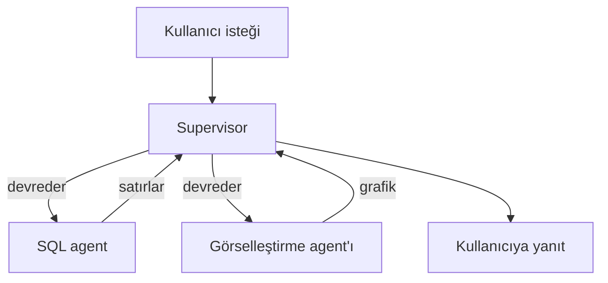
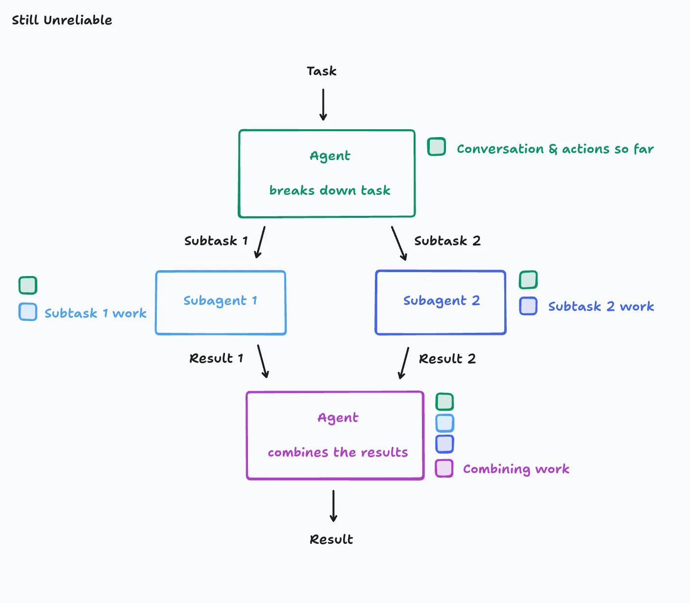
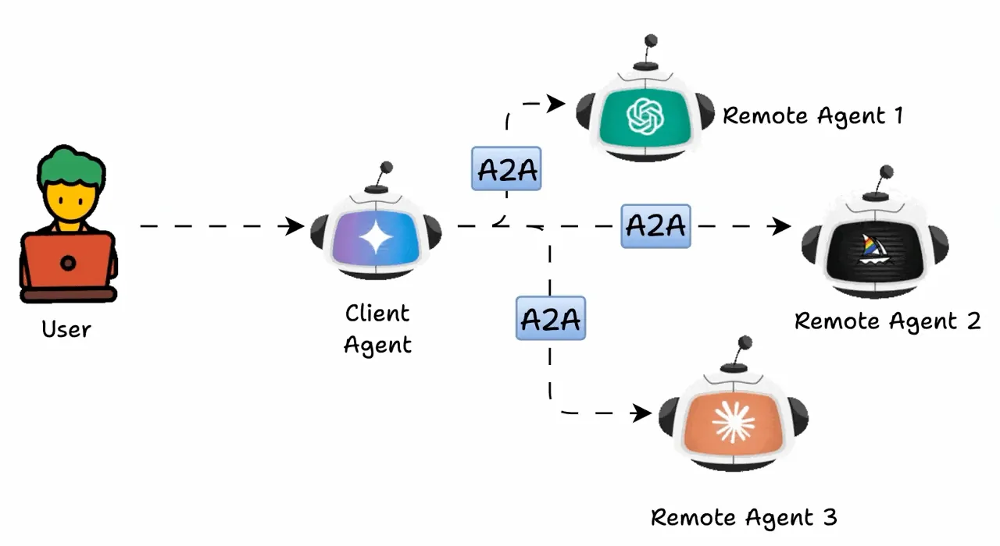
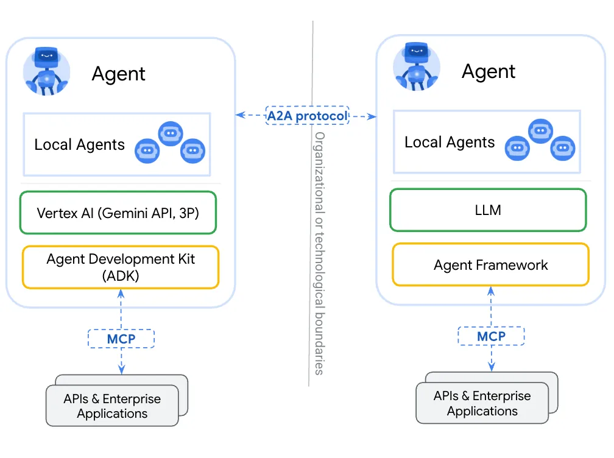
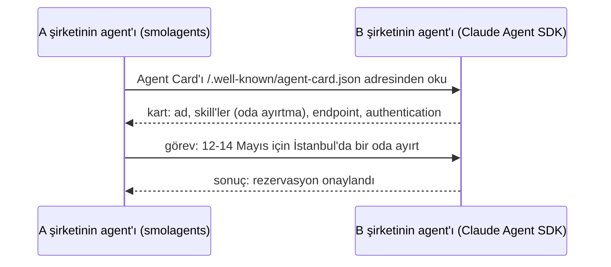
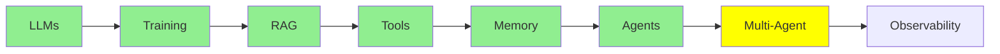

---
objectives:
  - "Hangi tür karmaşıklığın seni birden fazla agent kullanmaya ittiğini açıkla"
  - "Supervisor ve network mimarilerini karşılaştır"
  - "Multi-agent sistemlerin iki zor sorununu say: koordinasyon ve bağlam aktarımı (context transfer)"
  - "Shared context ile isolated context arasındaki farkı açıkla"
  - "Tek bir agent'ın ne zaman hâlâ doğru cevap olduğunu ayırt et"
---

# Multi-Agent Systems

[AI Agents](agents_tr.md) modülü tek bir agent ile bitmişti: tek bir döngü (loop), tek bir system prompt ve tek bir tool seti. Bu modülde birden fazla agent kullandığında neler olduğunu ve bunun sana neye mal olduğunu anlatacağız.

## Neden Birden Fazla Agent'a İhtiyaç Duyabiliriz

Gerçek bir isteği düşünelim: *"How many rows are in my database tables? Show them in a bar chart."*

Bu aslında iki ayrı iş. Önce SQL yazıp çalıştırman, sonra da bir grafik çizmen gerekiyor. Tek bir agent ikisini de yapabilir, ama bunun bir bedeli var. System prompt artık hem SQL'i hem de grafik çizmeyi anlatmak zorunda kalır ve tool listesi uzar. Her model çağrısı ayrıca o anki adımla ilgisi olmayan talimatları da taşır. Bu yüzden model yanlış tool'u seçmenin daha fazla yolunu bulur, iki işi birbirine karıştırmak için de daha fazla alan doğar.

İşi bölersen her agent kısa bir prompt, küçük bir tool listesi ve tek bir iş alır:

- sorguları yazan ve çalıştıran bir **SQL agent'ı**
- sonuçları grafiğe dönüştüren bir **görselleştirme agent'ı**

İkisi de [AI Agents](agents_tr.md) modülündeki bir agent'tan başka bir şey değil. Ortada yeni bir mekanizma yok, sadece tek bir döngü yerine birkaç döngü çalıştırıyorsun.

## Temel Multi-agent Mimarileri

  
*Solda: tool'larıyla birlikte tek bir agent. [AI Agents](agents_tr.md) modülü tam olarak burada bitmişti. Ortada: her agent'ın diğer her agent'la konuşabildiği bir network. Sağda: bir supervisor. İsteği o alır, işi worker'lara devreder ve worker'lar yalnızca supervisor ile konuşur.*

**Supervisor.** Bir agent isteği alır ve ardından sırasıyla şunları yapar:

- isteği hangi worker'ın işleyeceğine karar verir
- işi o worker'a iletir
- geri dönen sonucu toplar
- kullanıcıya yanıt verir

Worker'lar yalnızca supervisor ile konuşur, başka kimseyle değil. Yukarıdaki SQL ve grafik örneği bu yapıya tam olarak uyuyor. Supervisor soruyu SQL agent'ına gönderir ve satırları geri alır. Ardından o satırları görselleştirme agent'ına verir ve grafiği döndürür.

Bu yapıyı manager-worker ya da orchestrator-worker olarak da görebilirsin, ama ikisi de aynı şekli anlatır.

**Network, bazen swarm diye de anılır.** Burada patron yoktur. Her agent işi diğer herhangi bir agent'a devredebilir ve agent'lar bir sonraki adımda kimin ne yapacağına kendi aralarında karar verir. Bu yapı daha esnektir, ancak tahmin edilmesi çok daha zordur, çünkü sistemin ne karar verdiğini görebileceğin tek bir yer yoktur.



**Supervisor ile başla.** Her karar tek bir yerden geçtiği için hata ayıklaması daha kolaydır. Ayrıca swarm gerektiriyormuş gibi görünen problemlerin çoğu aslında buna ihtiyaç duymaz.

## Multi-agent'ın Dezavantajları

Bu bölümü ciddiye almakta fayda var, çünkü iki problemin de kaynağı işi bölmek. Tek bir agent'ta bu iki problemden hiçbiri yoktur.

**Koordinasyon (coordination).** Kim ne yapar, hangi sırayla yapar ve bir adımın bittiğini kim nasıl anlar? Tek bir agent'ta döngü bu soruların yanıtını zaten veriyordu. Birden fazla agent'ta ise bir şeyin karar vermesi gerekir ve bu karar yanlış çıkabilir. Örneğin iki agent aynı işi yapabilir. Üstelik bir agent, hiç gelmeyecek bir yanıtı sonsuza kadar bekleyebilir, bir supervisor da işi sürekli devredip hiç bitirmeyebilir. Agent sayısı arttıkça kilitlenme (deadlock), yani agent'ların birbirini sonsuza kadar beklemesi, daha olası hale gelir. Sonsuza kadar dönen bir döngüye girmenin yolları da çoğalır.

Koordinasyon ileri seviye bir konudur ve [İleri Seviye Multi-Agent](../3_expert/advanced_multiagent_tr.md) bölümü onu ayrıntısıyla anlatır. Şimdilik sorunu gösteren basit bir örneğe bakalım:

  
*Agent, bir task'ı iki subtask'a böler ve her biri için bir subagent çalıştırır. Her subagent o ana kadarki konuşmayı ve kendi subtask'ını alır, diğerinin yaptığı işi ise görmez. Bu yüzden ikisi aynı işi iki kez yapabilir ya da çelişen kararlar verebilir. Sonuçları birleştiren agent bunu ancak en sonda fark eder.*

İki subagent birbirinden habersizdir. Multi-agent sistemlerin kırılgan, bazen de güvenilmez olmasının temel nedenlerinden biri budur.

**Bağlam aktarımı (context transfer).** Her agent kendi bağlamına (context) sahiptir, yani kendi mesaj yığınına (message stack). Bu yüzden SQL agent işini bitirdiğinde görselleştirme agent'ı tam olarak ne alır? Yalnızca satırları mı alır, yoksa orijinal soruyu ve satırları üreten SQL'i de mi alır? Çok az bilgi verirsen ikinci agent, ihtiyaç duyduğu bilgiye sahip olmadan çalışmak zorunda kalır. Her şeyi verirsen ise devasa bir bağlamın bedelini ödersin. Üstelik agent'ları ayırmanın önüne geçmek istediğin karmaşayı geri getirmiş olursun.

Bu konuda yanlış karar vermek, multi-agent bir sistemin yerini aldığı tek agent'tan *daha kötü* çalışmasının en sık görülen nedenidir.

### Shared Context mi, Isolated Context mi

Bu, her multi-agent tasarımın altında yatan bir seçime götürüyor. Agent'lar **ortak** bir bağlamı mı paylaşır, yoksa her agent kendi **izole** bağlamında mı çalışır?

- **Ortak (shared):** herkes her şeyi görür. Devir sırasında hiçbir şey kaybolmaz, ama bağlam hızla büyür.
- **İzole (isolated):** her agent yalnızca kendisine verileni görür. Bu yöntem ucuz ve odaklıdır. Ama aktarmayı unuttuğun her şey tamamen kaybolur.

Üretimdeki sistemler ikisini de kullanır. Üstelik bu seçim, tasarımın geri kalanının neredeyse tamamını belirler. Konu kendi başına ayrı bir tartışmayı hak edecek kadar derin olduğu için ona [İleri Seviye Multi-Agent](../3_expert/advanced_multiagent_tr.md) bölümünde geri döneceğiz.

## İleri Seviye Multi-agent Mimarileri

Bu terimleri şimdiden tanıyasın diye adlarını burada koyuyoruz. Hepsini daha sonra ayrıntılı olarak işleyeceğiz:

- **Hiyerarşik:** en üstteki bir supervisor başka supervisor'ları yönetir, onların her biri de kendi worker'larını yönetir. Tek bir katman yetmediğinde bunu kullanırsın.
- **Agent-as-a-tool:** bir agent, diğer bir agent'a sıradan bir tool gibi verilir. Bu, doğrudan [LLM Tool Calling](tools_tr.md) bölümündeki mekanizmaya oturur.
- **Subagent'lar:** bir agent kısa ömürlü yardımcılar başlatır ve her yardımcının kendi izole bağlamı olur. Ana agent ise sonunda yalnızca onların sonuçlarını tutar.

## Bir Multi-agent Nasıl Kurulur

```python
from smolagents import CodeAgent, tool, InferenceClientModel

@tool
def sql_query(query: str) -> list:
    """Run a SQL query against the application database and return the rows."""
    return db.execute(query).fetchall()

@tool
def visualise(data: list) -> str:
    """Draw a bar chart from rows and return the path to the image."""
    return chart_from(data)

sql_agent = CodeAgent(tools=[sql_query], model=InferenceClientModel(), name="sql",
                      description="Answers questions by querying the database.")
viz_agent = CodeAgent(tools=[visualise], model=InferenceClientModel(), name="viz",
                      description="Draws a chart from rows of data.")

supervisor = CodeAgent(
    tools=[],
    model=InferenceClientModel(),
    managed_agents=[sql_agent, viz_agent],   # the workers it can delegate to
)

supervisor.run("How many rows are in my tables? Show them in a bar chart.")
```

Şimdi `managed_agents` parametresine bak. Worker'ları supervisor'a, [AI Agents](agents_tr.md) modülünde tool'ları agent'a verdiğin şekilde veriyorsun. Bunun nedeni, supervisor'ın gözünden worker'ların tam olarak bu olması: çağırıp sonuç alabileceği şeyler.

## Agent2Agent Protocol (A2A)

Bu kısa bir giriş. Protokolün ayrıntıları [Protokol Referansı](../4_ecosystem/protocols_reference_tr.md) modülünde.

Yukarıdaki koda bir kez daha bak. Supervisor da iki worker da smolagents agent'ı. Bu tesadüf değil. Aynı framework ile yazılmış agent'lar birbirleriyle konuşabilir, çünkü aynı API'yi, aynı mesaj formatını ve "agent nedir" sorusuna aynı cevabı paylaşırlar. Bu yüzden pratikte bir sistemdeki bütün agent'lar aynı framework ile yazılır: hepsi smolagents, hepsi LangChain ya da hepsi Claude Agent SDK.

Bu, agent'ları birbirine bağlar. Supervisor'ı Claude Agent SDK ile, iki worker'ı smolagents ile, üçüncü worker'ı da LangChain ile yazıp hepsinin birlikte çalışmasını bekleyemezsin. Her framework kendi dilini konuşur ve başka bir framework'ten gelen agent bu dili anlamaz.

**Agent2Agent Protocol (A2A)** bu sorunu çözer. Agent'ı hangi şirket ya da hangi framework yazmış olursa olsun, agent'ların birbirleriyle konuşmasını sağlayan açık bir standarttır (open standard). Google geliştirdi ve Linux Foundation'a bağışladı. Şimdi birkaç büyük şirketten oluşan bir yönetim kurulu (steering committee) onu sürdürüyor.

  
*Kullanıcı tek bir client agent ile konuşur. Bu agent işin parçalarını, her biri farklı bir şirketin yazdığı üç remote agent'a devreder ve her devir A2A üzerinden gider.*

**Nasıl çalışır.** Her agent bir **Agent Card** yayınlar. Bunu agent'ın CV'si gibi düşünebilirsin. Agent'ın kim olduğunu, neler yapabildiğini (**skill**'lerini), ona nereden ulaşılacağını ve nasıl authentication yapılacağını söyler. Agent'ın hangi framework ile yazıldığı hakkında ise hiçbir şey söylemez, çünkü artık bunun önemi kalmadı. Agent, kartını kendi A2A server'ında standart bir adresten sunar: `/.well-known/agent-card.json`. Başka bir agent kartı okur, bu agent'ın işine yarayıp yaramayacağına karar verir, sonra ona bir görev (task) gönderir, sonucu bekler ya da onunla karşılıklı konuşur.

```json
{
  "name": "Hotel Booking Agent",
  "description": "Finds and books hotel rooms.",
  "url": "https://agents.hotels.example/a2a",
  "capabilities": { "streaming": true },
  "skills": [
    { "id": "book-room", "name": "Book a room", "description": "Books a room for given dates and city." }
  ]
}
```

Bu, fikri görebilmen için sadeleştirilmiş bir kart. Gerçeğinde birkaç alan daha var.

Bunun [LLM Tool Calling](tools_tr.md) modülündeki MCP ile nasıl yan yana durduğuna dikkat et. MCP, bir agent'ı **tool**'larına bağlar. A2A ise bir agent'ı **başka agent'lara** bağlar. A2A'nın kendi sitesi de ikisinin rakip değil, birbirini tamamlayan protokoller olduğunu söylüyor.

**Buna ihtiyacın var mı?** Dürüst olmak gerekirse çoğu zaman yok, küçük bir projede de neredeyse hiç yok. Tek bir sistemin her agent'ını farklı bir framework ile yazmanın bir nedeni yok. Hepsini aynı framework ile yazarsan zaten birbirlerini anlarlar.

A2A, agent'lar **farklı kurumlara** ait olduğunda önem kazanır. Diyelim ki A şirketi uçak bileti satıyor ve smolagents ile yazılmış bir uçak bileti agent'ı var. B şirketi otel odası satıyor ve Claude Agent SDK ile yazılmış bir otel rezervasyonu agent'ı var. A şirketi şimdi hem uçak hem otel ayırtan tek bir asistan istiyor. Uçak kısmı kendi agent'ı. Otel kısmı ise B şirketinin agent'ına bağlı ve iki agent birbiriyle konuşamıyor: farklı şirketler, farklı framework'ler, farklı kod. Bu, **kurumlar arası bir engel**. B şirketi agent'ı için bir Agent Card yayınlarsa, A şirketinin agent'ı onu keşfedip oteli ayırtmasını isteyebilir.

  
*Kurumsal ya da teknolojik bir sınırın iki yanında duran iki agent. Her birinin kendi modeli, kendi framework'ü ve kendi yerel agent'ları var; her biri kendi API'lerine ve kurumsal uygulamalarına MCP ile ulaşır. Sınırın öte yanına, iki agent arasında ise A2A uzanır.*



Bu kullanım nadir görülür. Çoğunlukla büyük şirketlerde ya da aynı şirket içinde ayrı ayrı yazılmış agent'lara sahip ekipler arasında karşına çıkar, örneğin farklı framework'lerle yazılmış bir İK agent'ı ile bir finans agent'ı. Yine de bu engelin var olduğunu ve A2A'nın bunun standart cevabı olduğunu bilmeye değer.

## Tek Bir Agent Ne Zaman Daha İyi Olabilir

Multi-agent bir yükseltme değildir, bir takastır (trade-off). Karşılığında daha kısa prompt'lar ve işler arasında daha net bir ayrım elde edersin. Bunun bedelini ise koordinasyon ve bağlam aktarımıyla ödersin.

Tek bir prompt hâlâ rahatça sığıyorsa ve tool listesi kolay yönetilebiliyorsa, tek bir agent'ta kal. Tek bir system prompt birbiriyle ilgisi olmayan iki işi öğretmeye çalışıyorsa böl. Bölerken, bir agent'tan diğerine en az bilginin geçmesi gereken noktayı seç.

## Temel Terimler

- **Agent**: tek bir döngü, tek bir system prompt ve tek bir tool seti.
- **Multi-agent system**: işi birden fazla agent arasında bölen, her agent'ın kısa bir prompt'u ve tek bir işi olan bir sistem.
- **Supervisor**: isteği alan, işi devreden, sonuçları toplayan ve kullanıcıya yanıt veren agent.
- **Worker**: supervisor'ın iş devrettiği bir agent'tır ve yalnızca kendi supervisor'ı ile konuşur.
- **Network**: patronun olmadığı, her agent'ın işi diğer herhangi bir agent'a devredebildiği bir tasarım ve swarm olarak da anılır.
- **Coordination**: kimin ne yapacağına, işlerin hangi sırayla yapılacağına ve bir adımın bittiğinin nasıl anlaşılacağına karar vermek.
- **Deadlock**: agent'ların birbirini sonsuza kadar beklediği bir durum.
- **Subagent**: bir agent'ın başlattığı, kendi izole context'i olan kısa ömürlü bir yardımcıdır ve ana agent yalnızca sonuçlarını tutar.
- **Context transfer**: bir agent'ın bir sonrakine aktardığı bilgi.
- **Shared context**: bütün agent'lar her şeyi gördüğü için devirde hiçbir şey kaybolmaz, ama context hızla büyür.
- **Isolated context**: her agent yalnızca kendisine gelen bilgiyi gördüğü için bu yapı ucuz ve odaklıdır, ama devirde atlanan her şey kaybolur.
- **Agent2Agent Protocol (A2A)**: hangi framework ile yazılmış olursa olsun agent'ların birbiriyle konuşmasını sağlayan açık bir standart.
- **Agent Card**: bir agent'ın adı, skill'leri, adresi ve authentication bilgisini içeren ve `/.well-known/agent-card.json` adresinde sunulan tanıtım kartı.
- **Inter-organisation barrier**: farklı şirketlere ya da framework'lere ait agent'ların birbiriyle konuşamamasından doğan engel.

## Bu serinin neresindeyiz



## Özet

Birden fazla agent, her agent'ın kısa bir prompt'u ve tek bir işi olmasını sağlar. Başlangıç için en iyi seçenek, bir agent'ın işi devredip sonuçları topladığı supervisor mimarisidir.

Ayrıca iki problemi de devralırsın. Birincisi **koordinasyon**: kimin ne yaptığına ve bir işin ne zaman bittiğine karar vermek. İkincisi **bağlam aktarımı**: her agent'a neyin verileceğine karar vermek. Zorluğun tamamı bu iki problemde toplanır. İkinci soruya nasıl yanıt verdiğin (ortak bağlam mı, izole bağlam mı) gerisini şekillendirir.

Aynı framework'ün agent'ları birbirini anlar, farklı framework'lerin agent'ları anlamaz. **A2A**, her agent'ın yayınladığı Agent Card üzerinden onların konuşmasını sağlayan açık standarttır. Çoğu proje ona hiç ihtiyaç duymaz; agent'lar farklı kurumlara ait olduğunda önem kazanır.

Bu, Fundamentals'ın özüdür. Artık resmin tamamı önünde:

- yalnızca metin tahmin eden bir model
- modelin masası gibi çalışan bir bağlam penceresi (context window)
- bu masayı dolduran bilgi getirme (retrieval)
- modelin eylem yapmasını sağlayan tool'lar
- turlar boyunca tutulan memory
- onu bir agent'a dönüştüren döngü
- tek bir agent yetmediğinde birden fazla agent

Intermediate'teki her şey bu yedi fikrin üzerine kurulu.

**Hızlı Kontrol**: Multi-agent bir sistemin yarattığı iki zor problem nedir? Peki ortak bağlam ile izole bağlam arasındaki fark nedir?

## Kaynaklar

### 📄 Makaleler

- [Announcing the Agent2Agent Protocol (A2A)](https://developers.googleblog.com/en/a2a-a-new-era-of-agent-interoperability/): Google'ın Nisan 2025 tarihli duyurusu ve farklı şirketlerin agent'larının neden ortak bir protocol'e ihtiyaç duyduğu
- [Multi-agent systems](https://docs.langchain.com/oss/python/langchain/multi-agent): bu kalıpları daha derinlemesine anlatıyor
- [LangGraph multi-agent concepts](https://langchain-ai.github.io/langgraph/concepts/multi_agent/): supervisor, network ve diğerleri, kod örnekleriyle birlikte
- [What is an agent?](https://www.langchain.com/blog/what-is-an-agent): supervisor'ın aslında bir özerklik kararı olduğunu hatırlamak için burada yeniden okumaya değer

### 🛠️ Araçlar

- [A2A Protocol](https://a2a-protocol.org/latest/): her framework'ten agent'ın birbiriyle konuşması için açık standart ve Agent Card'lar hakkındaki [agent discovery](https://a2a-protocol.org/latest/topics/agent-discovery/) sayfası

### 🗃️ Repolar

- [a2aproject/A2A](https://github.com/a2aproject/a2a): spesifikasyon ve SDK'ları

### 🧭 Modüller

- [AI Agents](agents_tr.md): bütün bunların üzerine kurulduğu tek döngü
- [İleri Seviye Multi-Agent](../3_expert/advanced_multiagent_tr.md): ortak ve izole bağlam ile agent'lar arası protokoller
- [Protokol Referansı](../4_ecosystem/protocols_reference_tr.md): A2A'nın ayrıntıları, MCP ve AG-UI ile birlikte
